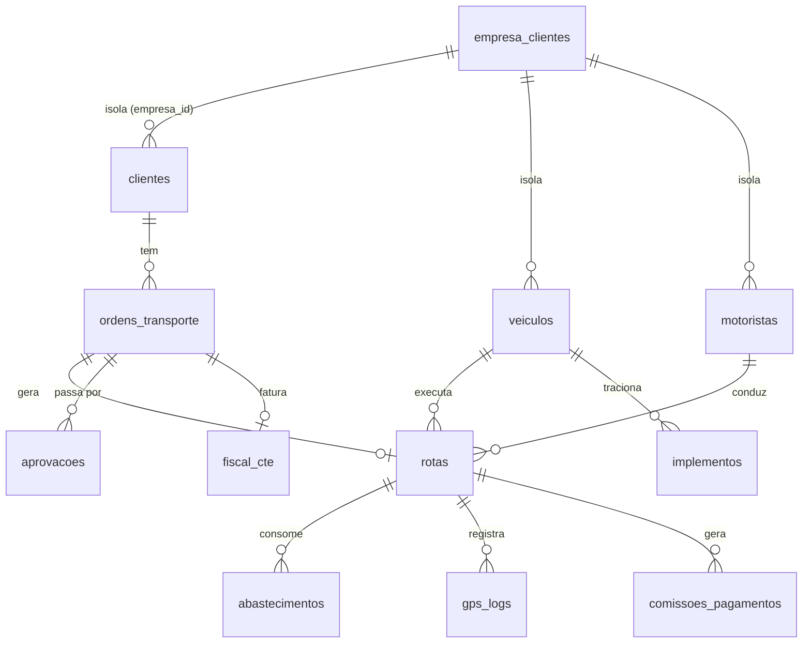

[← Índice](README.md)

# 05 · Banco de Dados

- **SGBD:** MySQL/MariaDB · charset `utf8mb4` · porta local **3307**.
- **Total:** **230 tabelas**, **5 views**, **9 triggers**, **3 procedures**, 0 events.
- **Migrações:** `sql/*.sql` (109 arquivos), aplicadas manualmente. Não há schema único
  consolidado — ver pendência em [99-validacao-final.md](99-validacao-final.md).
- **Isolamento:** quase toda tabela de dados tem `empresa_id` — é o limite entre clientes.

```bash
# Inventário rápido
mysql -h 127.0.0.1 -P 3307 -u root sistema_frotas -e "SHOW TABLES;"
# DDL de uma tabela
mysql -h 127.0.0.1 -P 3307 -u root sistema_frotas -e "SHOW CREATE TABLE rotas\G"
```

## Grupos de tabelas (por prefixo/domínio)

| Domínio | Tabelas (exemplos) |
|---------|--------------------|
| **TMS / operação** | `clientes`, `ordens_transporte`*, `aprovacoes`, `rotas`(ver ROTAS.md), `implementos`, `disponibilidades`, `disponibilidades_motoristas` |
| **Frota** | `veiculos`/`cavalos_carretas`, `carrocerias`, `eixos`, `eixos_veiculos`, `categorias` |
| **Motoristas** | `motoristas`, `motoristas_log`, `documentos_motoristas`, `motorista_periodos`, `motorista_dependentes`, `motorista_treinamentos`, `jornada_motorista` |
| **Abastecimento** | `abastecimentos`, `despesas_viagem`, `despesas_fixas`, `pedagios`*(app) |
| **Manutenção** | `manutencoes`, `manutencao_anexos`, `componentes_manutencao`, `planos_manutencao`* |
| **Pneus** | `estoque_pneus`, `instalacoes_pneus`, `eixo_pneus`, `alocacoes_pneus_flexiveis`, `gastos_pneus`, `gestao_montagem` (ver GESTAO_PNEUS_TABELAS.md) |
| **Financeiro** | `contas_pagar`, `financiamentos`, `multas`, `comissoes_pagamentos`, `formas_pagamento`, `bancos` |
| **Fiscal** | `fiscal_cte*`, `fiscal_mdfe*` (20+ tabelas), `fiscal_nfe*`, `fiscal_certificados_digitais`, `fiscal_config_*`, `fiscal_logs`, `certificados_denatran` |
| **GPS** | `gps_logs`, `gps_logs_resumido`, `gps_ultima_posicao`, `gps_cercas`, `gps_cerca_*`, `gps_alertas_operacionais`, `gps_geocode_cache` |
| **IA / BI** | `insights_ia`, `configuracoes_ia`, `bi_cache`, `bi_metas`, `historico_analises`, `alertas_inteligentes` |
| **Gamificação** | `gamificacao_motoristas`, `conquistas_motoristas`, `desafios_motoristas`, `competicoes`, `config_ranking`, `v_gamificacao_atual`, `v_ranking_atual` |
| **Notificações** | `notificacoes`, `notificacoes_preferencias`, `notificacoes_ia_config`, `alertas_sistema` |
| **Segurança** | `usuarios`, `configuracoes_seguranca`, `login_attempts`, `acessos_conhecidos`, `admin_ip_whitelist`, `auth_remember_tokens`, `api_tokens_motorista`, `log_acessos`/`logs_acesso` |
| **Calendário** | `calendario_eventos`, `calendario_templates`, `categorias_calendario` |
| **Plataforma (adm)** | `adm_*` (~28 tabelas: `adm_planos`, `adm_pagamentos`, `adm_boletos`, `adm_health_checks`, `adm_cron_jobs`, `adm_auditoria_suporte`, `empresa_clientes`, `adm_empresa_modulos`…) |
| **Cadastros base** | `estados`, `cidades`, `fornecedores`, `configuracoes` |

\* tabelas criadas/alteradas nas migrações recentes do TMS (`sql/ordens_transporte.sql`,
`sql/clientes.sql`, `sql/implementos.sql`, `sql/aprovacoes.sql`).

## Diagrama ER — núcleo TMS (Mermaid)



> `empresa_clientes` é a tabela de **empresas-cliente** (tenants). `empresa_id` em cada
> tabela de dados aponta para ela — é a chave do isolamento multi-empresa.

## Views (5)

| View | Finalidade (inferida) |
|------|-----------------------|
| `v_ranking_atual` / `v_gamificacao_atual` | Ranking/estado atual de gamificação dos motoristas |
| `view_seguro_clientes_ativos` | Clientes de seguro ativos |
| `view_seguro_atendimentos_abertos` | Atendimentos de seguro em aberto |
| `view_seguro_financeiro_resumo` | Resumo financeiro de seguros |

## Triggers (9)

| Trigger | Tabela | Finalidade |
|---------|--------|-----------|
| `trigger_motorista_cnh_calendario` (+ _update/_delete) | `motoristas` | Sincroniza vencimento de CNH no calendário |
| `trigger_multa_insert/_update/_delete_calendario` | `multas` | Sincroniza multas no calendário |
| `tr_atualizar_gamificacao_checklist` | `checklist_viagem` | Pontua gamificação ao concluir checklist |
| `tr_atualizar_ranking_rota` | `rotas` | Atualiza ranking ao concluir rota |
| `after_pneu_insert` | pneus | Efeito colateral ao inserir pneu |

## Procedures (3)

| Procedure | Finalidade |
|-----------|-----------|
| `sincronizar_cnh_calendario` | Recarrega vencimentos de CNH no calendário |
| `sincronizar_multas_calendario` | Recarrega multas no calendário |
| `sp_calcular_ranking_motoristas` | Recalcula o ranking dos motoristas |

> **Backlog:** documentar **campo a campo** as 230 tabelas é um trabalho incremental. As
> tabelas de pneus e fiscal já têm docs dedicados (GESTAO_PNEUS_TABELAS.md, manuais fiscais).
> Ver o que falta em [99-validacao-final.md](99-validacao-final.md).
