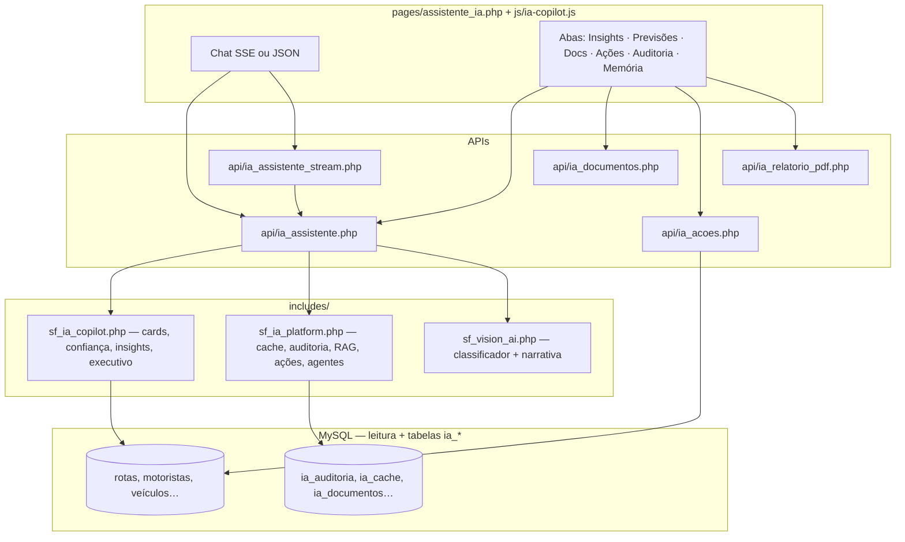
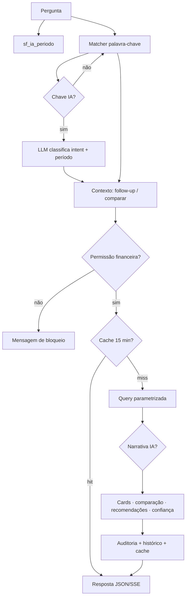

[← Telas](README.md) · [← Índice](../README.md)

# Centro de Inteligência (Copiloto de Operações)

> Antes: **Assistente IA** (chat simples).  
> Agora: hub enterprise com agentes especializados, streaming, documentos, ações com confirmação, auditoria e memória por empresa.

## Descrição

Chat interno ("ChatGPT da operação") evoluído para **copiloto da gestão de frotas**. O gestor pergunta em **linguagem natural** e recebe resposta com **dados reais da empresa** — texto, cards KPI, tabela, gráfico, confiança, fontes e sugestões de próxima pergunta. Não inventa dados.

Além do chat, o hub oferece: insights proativos, previsões, upload de documentos (RAG), automações pendentes (com confirmação humana), auditoria de consultas, memória persistente da empresa e export PDF para diretoria.

## Objetivo

Responder dúvidas operacionais/financeiras sem navegar por telas nem montar relatório — e ir além: resumo executivo, análise ampla da operação, previsão de revisões, busca em NF/contratos enviados e proposta de ações (ex.: agendar manutenção) **sempre com aprovação do gestor**.

## Quem utiliza / Permissões

- **Gestor** (sessão + `empresa_id`). Toda consulta é **escopada pela empresa** e **somente leitura** no banco.
- **Dados financeiros detalhados** (faturamento, contas a pagar, executivo, PDF diretoria, etc.): exige `can_view_financial_data()` — permissão «Ver dados financeiros» ou admin.
- **Ações** (agendar manutenção): qualquer gestor autenticado pode **confirmar ou cancelar**; nada é executado automaticamente.

## Onde está no sistema

Menu **Operação → Centro de Inteligência** (`pages/assistente_ia.php`).  
Ação rápida **"Perguntar à IA"** no Centro de Operações.

---

## Interface (hub)

| Aba | Função |
|-----|--------|
| **Chat** | Conversa com modos (Conversar, Analisar, Automatizar, Explicar, Recomendar), chips, microfone, streaming SSE |
| **Insights** | Alertas proativos ao abrir (CNH, contas, rotas longas, etc.) |
| **Previsões** | Combustível 30d, gasto manutenção, veículos próximos da revisão (km) |
| **Documentos** | Upload TXT/PDF/imagem → indexação → busca RAG no chat |
| **Automações** | Fila de ações pendentes (confirmar / cancelar) |
| **Auditoria** | Log de todas as consultas (intent, agente, pergunta, confiança, tempo ms) |
| **Aprendizado** *(admin)* | Perguntas não entendidas (`ia_perguntas_pendentes`) → mapear para intenção (`ia_intencoes_custom`). Só com `can_manage_system_settings`. Fecha o loop de aprendizado. `api/ia_aprendizado.php` |
| **Saúde** *(admin)* | Métricas da IA (tempo médio, cache, tokens, falhas) + Playground/benchmark |
| **Skills** | Habilidades por domínio (Financeiro, Frota, Oficina…) com intenções/tools |
| **Memória** | Preferências da empresa: foco, período padrão, notas para o copiloto |

**Toolbar:** Resumo Executivo · PDF Diretoria (se permissão financeira) · toggle Streaming · Sugerir revisões.

---

## Segurança (essencial)

O modelo de linguagem **NUNCA executa SQL**. Ele apenas:

1. **Classifica** a pergunta numa **intenção** pré-definida (palavra-chave + LLM quando há chave).
2. **Extrai o período** (`sf_ia_periodo()` + refinamento LLM opcional).

O backend roda a **query parametrizada** da intenção, filtrada por `empresa_id`. Zero SQL injection / vazamento entre empresas.

**Ações de escrita** (ex.: `agendar_manutencao`) passam por `ia_acoes_pendentes` e só executam após **POST com CSRF** e clique em Confirmar.

---

## Arquitetura



---

## Fluxo de uma pergunta (chat)



---

## Agentes especializados

Cada intenção é roteada para um agente (rótulo na resposta):

| Agente | Intenções típicas |
|--------|-------------------|
| **Financeiro** | `faturamento`, `contas_pagar`, `pedagio`, `despesas`, `multas`, `glossario` |
| **Frota** | `frota`, `veiculo_*`, `consumo`, `km`, `pneus`, `implementos`, `abastecimentos` |
| **Oficina** | `manutencao` |
| **Logística** | `rotas_*`, `rota_top`, `no_prazo`, `atrasos` |
| **RH** | `cnh`, `motorista_top` |
| **Comercial** | `cliente_top` |
| **Copiloto Geral** | `analise_empresa`, `executivo`, `previsoes`, `documentos`, `ajuda` |

---

## Intenções suportadas

Catálogo em `$INTENCOES` em `api/ia_assistente.php` (alimenta matcher + LLM).

| Intenção | Exemplo de pergunta |
|----------|---------------------|
| `faturamento` | Quanto faturei no mês passado? |
| `motorista_top` | Qual motorista mais faturou? |
| `cliente_top` | Melhor cliente em frete |
| `rota_top` | Rota mais rentável / última rota |
| `veiculo_top` / `veiculo_parado` | Veículo que mais/menos rodou |
| `rotas_ativas` | Quantas rotas em andamento agora? |
| `rotas_mes` | Total de rotas no período |
| `no_prazo` / `atrasos` | Pontualidade / quem atrasou |
| `cnh` | CNH vencendo |
| `consumo` / `km` | km/L, quilometragem |
| `abastecimentos` | Últimos abastecimentos |
| `pedagio` / `despesas` | Gastos de viagem |
| `multas` | Multas no período |
| `frota` / `pneus` / `implementos` | Tamanho da frota, estoque |
| `manutencao` | Gasto, abertas, causas por tipo |
| `contas_pagar` | Contas em aberto / vencendo |
| `analise_empresa` | Analise minha empresa |
| `executivo` | Resumo executivo de hoje |
| `glossario` | O que significa custo/km? |
| `previsoes` | Previsões próximos 30 dias |
| `documentos` | Pergunta sobre NF/contrato enviado (RAG) |

**Período** (`sf_ia_periodo`): mês atual/passado, trimestre, últimos N dias/meses, ano, semana; padrão = **últimos 12 meses**.

**Memória de contexto:** follow-ups como *"e no mês passado?"* reaproveitam a última intenção (`contexto` no front).

**Comparação:** frases como *"Comparar com mês passado"* reaproveitam intenção comparável (`faturamento`, `manutencao`, `despesas`, `multas`, `km`, `pedagio`) ou caem em `faturamento` como base. Bloco `comparacao` mostra variação % vs período anterior equivalente (`sf_ia_copilot_comparacao`).

---

## Resposta enriquecida (JSON)

Além de `answer`, `rows` e `chart`:

| Campo | Descrição |
|-------|-----------|
| `cards` | KPIs em cards (até 4) |
| `confianca` | score 0–100, estrelas, label, motivos |
| `fontes` | Módulos consultados (Rotas, Financeiro, GPS…) |
| `sugestoes` | Follow-ups **por intenção** (só o que a IA sabe responder) |
| `comparacao` | Variação vs período anterior (quando aplicável) |
| `analise` / `recomendacoes` | Textos derivados dos dados |
| `agente` / `agente_label` | Agente que respondeu |
| `from_cache` | true se veio do cache de 15 min |

Feedback 👍/👎 → `logs/ia_assistente_feedback.log`.

---

## APIs

### `api/ia_assistente.php`

| `action` / uso | Método | Params | Retorno |
|----------------|--------|--------|---------|
| `pergunta` (default) | GET/POST | `pergunta`, `contexto`, `modo` | Payload completo acima |
| `insights` | GET | — | `{success, data: {saudacao, itens[], total}}` |
| `executivo` | GET | — | `{success, answer, cards[], alertas}` |
| `previsoes` | GET | — | `{success, data: {resumo, itens[]}}` |
| `auditoria` | GET | `limit` | `{success, data: []}` |
| `historico` | GET | — | Mensagens user/assistant |
| `memoria` | GET | — | Preferências JSON |
| `memoria` | POST | `foco`, `periodo_padrao`, `notas`, `csrf_token` | `{success}` |
| `sugerir_acoes` | POST | `csrf_token` | Cria ações de revisão a partir de previsões |
| `feedback` | POST | `util`, `intent`, `comentario` | `{success}` |

`via`: `palavra-chave` · `ia` · `contexto`.

### `api/ia_assistente_stream.php` (SSE)

Mesmos params de pergunta. Eventos:

| Evento | Conteúdo |
|--------|----------|
| `phase` | `{step, msg?, intent?, agente?}` |
| `token` | `{t}` — trechos da resposta (efeito streaming) |
| `done` | Payload JSON completo |
| `error` | `{error}` |

Headers: `Content-Type: text/event-stream`. Toggle **Streaming** no front (`EventSource`).

### `api/ia_documentos.php`

| `action` | Método | Descrição |
|----------|--------|-----------|
| `listar` | GET | Documentos da empresa |
| `buscar` | GET | `q` — busca RAG (LIKE em chunks) |
| `upload` | POST | `arquivo`, `texto` opcional, `csrf_token` |

Formatos: TXT, PDF, PNG/JPG/WEBP. Imagens: OCR via `sf_vision_ocr.php` se configurado. PDF: armazena arquivo; indexar texto manual ou enviar TXT/imagem.

### `api/ia_acoes.php`

| `action` | Método | Descrição |
|----------|--------|-----------|
| `listar` | GET | `status` (pendente, todos…) |
| `propor` | POST | Nova ação pendente |
| `confirmar` | POST | Executa (ex.: INSERT em `manutencoes`) |
| `cancelar` | POST | Marca cancelada |

Tipos implementados: **`agendar_manutencao`**, **`exportar_relatorio`**, **`abrir_whatsapp`**, **`enviar_email`** (SMTP se configurado), **`criar_ot`**, **`notificar_motorista`**.

### `api/ia_relatorio_pdf.php`

GET — gera PDF executivo (mPDF). Requer `can_view_financial_data()` e `composer install` (vendor).

---

## Banco de dados (plataforma)

Migração: `sql/ia_copilot.sql`

```bash
mysql -h 127.0.0.1 -P 3307 -u root sistema_frotas < sql/ia_copilot.sql
```

Tabelas criadas automaticamente na primeira consulta via `sf_ia_ensure_schema()` se a migração não foi aplicada manualmente.

| Tabela | Uso |
|--------|-----|
| `ia_empresa_memoria` | Preferências JSON por empresa |
| `ia_auditoria` | Log de consultas |
| `ia_conversa_mensagens` | Histórico user/assistant |
| `ia_cache_consulta` | Cache de respostas (TTL 15 min) |
| `ia_documentos` | Arquivos enviados |
| `ia_documento_chunks` | Chunks para RAG (FULLTEXT) |
| `ia_acoes_pendentes` | Fila de automações |

Uploads em `uploads/ia_docs/{empresa_id}/` (pasta em `.gitignore` via `/uploads/`).

**Tabelas operacionais lidas** (somente SELECT): `rotas`, `motoristas`, `veiculos`, `abastecimentos`, `ordens_transporte`, `multas`, `manutencoes`, `contas_pagar`, `pneus`, `implementos`, `despesas_viagem`.

---

## Arquivos envolvidos

| Arquivo | Papel |
|---------|--------|
| `pages/assistente_ia.php` | Hub UI, abas, CSRF, permissão financeira |
| `js/ia-copilot.js` | Chat, SSE, abas, upload, ações, voz |
| `css/ia-copilot.css` | Design copiloto (`.ci-*`, `.ai-*`) |
| `api/ia_assistente.php` | Pipeline principal + actions |
| `api/ia_assistente_stream.php` | Wrapper SSE (`SF_IA_SSE`) |
| `includes/sf_ia_copilot.php` | Cards, confiança, insights, executivo, análise, sugestões, comparação |
| `includes/sf_ia_platform.php` | Schema, cache, auditoria, memória, RAG, ações, previsões, PDF, agentes |
| `includes/sf_vision_ai.php` | Classificador LLM + narrativa |
| `includes/permissions.php` | `can_view_financial_data()` |

Logs: `logs/ia_assistente_naoentendidas.log`, `logs/ia_assistente_feedback.log`.

---

## Economia da IA

- **Classificação:** 1 chamada curta (`max_tokens 60`, temp 0) — só com chave.
- **Narrativa:** 1 chamada curta (`max_tokens 90`) **só com dados reais** (pula vazios).
- **Sem chave:** matcher + parser apenas (custo zero).
- **Cache:** consultas repetidas (mesmo intent + período) servidas do banco por 15 min.

---

## Gráficos inline

`chart{type,label,labels,values}` com **Chart.js** quando ≥2 pontos: faturamento, km, multas, manutenção (`sf_ia_serie()`).

---

## Previsões (regra, não ML)

`sf_ia_previsoes()` em `sf_ia_platform.php`:

- **Manutenção:** km desde última revisão vs intervalo 10.000 km (padrão).
- **Combustível 30d:** média diária dos últimos 30 dias × 30.
- **Gasto manutenção 30d:** média diária dos últimos 90 dias × 30.

Integração com `api/manutencao_preditiva.php` conceitualmente alinhada; botão **Sugerir revisões** cria até 3 ações `agendar_manutencao` para veículos em prioridade alta.

---

## "Aprender sempre"

Perguntas não entendidas (`intent === ajuda`) → `logs/ia_assistente_naoentendidas.log`.

---

## Testes locais

| Script | O que valida |
|--------|----------------|
| `tmp/test_ia_copilot_smoke.php` | Tabelas, memória, ações, RAG, auditoria, previsões |
| `tmp/test_ia_copilot_playwright.py` | Fluxo navegador (requer `SF_TEST_EMAIL` / `SF_TEST_PASSWORD`) |

```bash
C:\xampp\php\php.exe tmp\test_ia_copilot_smoke.php
```

---

## Correções recentes (jul/2026)

| Problema | Causa | Correção |
|----------|-------|----------|
| Streaming abortava (`MIME text/html`) | Header `text/event-stream` não enviado em modo SSE | `sf_ia_sse_headers()` quando `SF_IA_SSE` |
| Resumo executivo falhava | Query "veículos parados" com `:e` duplicado (PDO `EMULATE_PREPARES=false`) | Placeholders `:e` e `:e2` |
| Tabelas `ia_*` "não existiam" | `SHOW TABLES LIKE :t` com placeholder inválido | `quote()` no nome da tabela |
| "Comparar com mês passado" → ajuda | Contexto não tratava comparação | Detecção `comparar` + fallback `faturamento` |
| Sugestões inúteis após `rotas_ativas` | Fallback genérico com "Comparar…" | `sf_ia_copilot_sugestoes()` por intenção |
| Comparação sem dados | Silêncio quando ambos períodos = 0 | Nota em `analise` explicando ausência de movimento |

---

## Possíveis erros

- Sem chave de IA → matcher + palavras-chave (frases muito livres podem virar `ajuda`).
- Período sem dados → responde 0; sugere outro período ou mostra nota de comparação vazia.
- PDF → `composer install` na raiz (mPDF).
- OCR de documento → provedor de visão configurado por empresa.
- Streaming → se falhar, desmarque **Streaming** no toolbar (modo JSON normal).
- `content.js: Feature is disabled` → extensão do navegador, não do sistema.

Ver também [16-troubleshooting.md](../16-troubleshooting.md).

---

## Roadmap 10/10 — de chat inteligente a copiloto operacional

> Avaliação atual: arquitetura e segurança sólidas; o salto de qualidade não é “mais intenções”, e sim **fechar buracos** e dar à IA **ferramentas + navegação + explicabilidade + observabilidade**.

### O que já existe (base)

| Recurso | Estado |
|---------|--------|
| Intenções + SQL parametrizado | ✅ Produção |
| Agentes por domínio (rótulo) | ✅ Skills por intenção (`skill_label` no payload) |
| Tools registry + auditoria | ✅ `includes/sf_ia_tools.php` — `tools[]`, timeline, raciocínio no JSON e auditoria |
| Auditoria (`ia_auditoria`) | ✅ intent, agente, tempo, tokens, meta tools/raciocínio |
| Cache 15 min | ✅ Métrica cache hit na aba Saúde |
| RAG documentos (LIKE + vetorial) | ✅ Embeddings com fallback LIKE |
| Ações com confirmação | ✅ Todas com botão inline + contexto ok/confirmar |
| Confirmar por contexto | ✅ «ok», «sim», «confirmar» executam última ação pendente |
| agendar_manutencao no chat | ✅ Intent + sugestões com Confirmar inline |
| Purpose narrate | ✅ Configurações → Provedores de IA |
| Aviso motorista no app | ✅ `motorista_avisos_ia` + polling `avisos.php` |
| Reindex vetorial | ✅ Botão Documentos + `cron/reindex_ia_embeddings.php` |
| Métricas erro/intent/usuário/modelo | ✅ Aba Saúde (7–30 dias) |
| Custos admin global | ✅ `pages_adm/ia_copilot_ops.php` |
| Quota SaaS (`sf_ia_enforce_quota`) | ✅ Em `ia_assistente.php` + aba Saúde (uso/tokens/custo) |
| Log não entendidas | ✅ Arquivo `logs/ia_assistente_naoentendidas.log` + fila `ia_perguntas_pendentes` (`sf_ia_tools_queue_unanswered`) |
| Aprendizado (mapear → intenção) | ✅ **Dois locais**: aba **Aprendizado** do copiloto (empresa, `api/ia_aprendizado.php`) e painel da plataforma `pages_adm/ia_copilot_ops.php` (cross-empresa). Ambos gravam em `ia_intencoes_custom`, que o classificador consulta (`sf_ia_tools_match_custom`) |
| OCR (app + upload docs) | ✅ Upload no chat (📎) → pergunta sobre documento |
| PDF executivo | ✅ |
| Fontes clicáveis | ✅ `fontes_clicaveis[]` com URL para telas |
| Mapa no chat | ✅ Intent `mapa_frota` + Leaflet embed |
| Ajuda sistema | ✅ Intent `ajuda_sistema` + RAG em `docs/` |
| Análise completa | ✅ Intent `analise_completa` — scorecard multi-domínio |
| Playground / benchmark | ✅ Aba Saúde + `api/ia_playground.php` |
| Intenções custom | ✅ Tabela `ia_intencoes_custom` + matcher admin |
| Provedor IA por empresa | ✅ Roteador por tarefa (`classify` barato / `narrate` completo) |
| IA híbrida | ✅ Docs empresa → manual sistema → fallback |
| Skills modulares | ✅ Aba Skills + `sf_ia_skills.php` |
| Multimodal (foto chat) | ✅ OCR via `imagem` POST |
| Exportar / WhatsApp | ✅ Ações `exportar_relatorio`, `abrir_whatsapp` com confirmação |
| Modo dev / suporte L2 | ✅ `dev=1` + traces em admin |
| Benchmark suite fixa | ✅ 8 perguntas no playground |
| RAG vetorial | ✅ Embeddings + similaridade coseno (`sf_ia_embeddings.php`) com fallback LIKE |
| Streaming token LLM | ✅ `sf_ia_router_chat_stream()` na narrativa SSE |
| Automações extras | ✅ `criar_ot`, `notificar_motorista`, e-mail SMTP |
| Purpose classify | ✅ Configurações → Provedores de IA |
| Painel custos IA | ✅ Card em Configurações (aba IA) |

### Priorização recomendada (4 fases) — **concluídas**

Todas as fases A–D foram implementadas no stack PHP atual. Itens opcionais futuros: skills em pastas PHP separadas (`skills/financeiro/`) e E2E Playwright com credenciais de teste.

#### Fase A — Fundação Tools + Explicabilidade ✅

**Objetivo:** cada resposta deixa rastro auditável e o gestor entende *como* chegou no número.

| # | Item | Entrega concreta |
|---|------|------------------|
| 1 | **Ferramentas (Tools)** | `includes/sf_ia_tools.php` — registry: `consultar_rotas`, `consultar_financeiro`, `consultar_veiculos`, `consultar_gps`, `consultar_documentos`, `executar_acao`, `gerar_pdf`, `abrir_tela`. Cada intenção chama 1+ tools. Auditoria grava `ferramenta`, `tempo_ms`, `linhas_lidas`. |
| 2 | **Raciocínio visível** | Bloco `raciocinio[]` no JSON: passos humanos (“Analisei N rotas”, “Cruzei abastecimentos”, “Comparei período anterior”). Dados vêm das queries reais (`rowCount` / `COUNT` já executados). |
| 11 | **Linha do tempo** | Mesmo payload, ordem: `pergunta → intent → tools[] → cache? → SQL → narrativa → resposta`. Modo dev no playground. |
| 10 | **Fontes clicáveis** | `fontes[]` vira `{nome, count, url}` — ex. Rotas (43) → `pages/routes.php?periodo=...`. |
| 18 | **Indicadores explicáveis** | Card com `formula` + `inputs` (ex. margem = (frete−comissão)/frete). Clique “Como calculou?”. |

**Status:** entregue em produção (`sf_ia_tools.php`, timeline, `formula` + `inputs` nos cards).

#### Fase B — Observabilidade + SaaS ✅

| # | Item | Entrega concreta |
|---|------|------------------|
| 3 | **Saúde da IA** | Aba ou `pages/ia_saude.php` (gestor/admin): tempo médio, consultas hoje, cache hit %, split LLM vs banco, falhas, tokens estimados. Agregar `ia_auditoria` + `ia_cache_consulta`. |
| 4 | **Custos por empresa** | Tabela `ia_uso_empresa` (empresa_id, dia, consultas, tokens_in, tokens_out, custo_estimado_usd). Hook em cada chamada LLM. Painel em `pages_adm` ou Configurações. |
| 12 | **Métricas** | Intent top, erro por intent, por modelo, por usuário — materialized daily ou query agregada. |
| 5 | **Aprendizado admin** ✅ | **Entregue** na aba **Aprendizado** do copiloto (`api/ia_aprendizado.php`, empresa) e no painel `pages_adm/ia_copilot_ops.php` (plataforma). Fila `ia_perguntas_pendentes` → mapear `padrao → intent` em `ia_intencoes_custom`; o classificador consulta via `sf_ia_tools_match_custom`. |

**Status:** quota em todos os endpoints do hub; painel gestor + admin; intent top, erros, modelos e usuários na aba Saúde.

#### Fase C — Agente operacional ✅

| # | Item | Entrega concreta |
|---|------|------------------|
| 22 | **Skills** | Refatorar agentes em módulos carregáveis: `skills/financeiro`, `skills/gps`, `skills/fiscal`… Cada skill declara tools + intenções + permissões. |
| 14–15 | **Abrir tela / deep link** | Tool `abrir_tela(slug, filtros)`. Chat devolve botão `[Abrir Rotas]` com query string. JS `window.location` ou modal. |
| 17 | **Mapa** | Intent `mapa_frota` + tool `consultar_gps` → embed Leaflet (reuso `mapa_frota.php` / API posições). Resposta com `map: {markers[]}` além de tabela. |
| 9 | **IA híbrida** | Orquestrador: banco → se miss, RAG docs → se miss, API externa (opcional). Um único `answer` com `fontes` de cada camada. |
| 22b | **Análise completa** | Intent `analise_completa` unifica executivo + análise empresa + previsões + alertas em **scorecard** (saúde 92%, oficina atenção, 12 recomendações). É evolução do `analise_empresa`, não chat genérico. |

**Status:** deep links, mapa, híbrido, scorecard e catálogo de skills na UI. Refactor físico em `skills/*` permanece opcional.

#### Fase D — Plataforma avançada ✅

| # | Item | Estado |
|---|------|--------|
| 6 | Playground admin | ✅ `pages_adm/ia_copilot_ops.php` + benchmark suite |
| 7 | Múltiplos modelos | ✅ `sf_ia_router.php` — classify/narrate/vision |
| 8 | Benchmark | ✅ Suite fixa 8 perguntas |
| 13 | Multimodal chat | ✅ Foto → OCR + pergunta |
| 16 | IA conhece o sistema | ✅ (Fase C) + híbrido |
| 19–20 | Dev + suporte | ✅ Modo dev + `ia_suporte_traces` |
| — | Export Excel / WhatsApp | ✅ Via `ia_acoes_pendentes` |
| — | RAG vetorial | ✅ `ia_documento_chunks.embedding` |
| — | Streaming LLM | ✅ Narrativa token-a-token no SSE |
| — | Criar OT / notificar motorista | ✅ Automações com confirmação |

### Modelo mental: Tools (Fase A)

```
Pergunta → Router (intent) → Skill/Agente → Tools[] → Resultado agregado → Narrativa opcional
                                    │
                    ┌───────────────┼───────────────┐
                    ▼               ▼               ▼
              consultar_rotas  consultar_financeiro  abrir_tela
                    │               │               │
                    └─────── ia_auditoria (ferramenta, ms, rows) ─────┘
```

Exemplo de registro:

```php
// sf_ia_tools.php — registry em produção
[
  'id' => 'consultar_financeiro',
  'label' => 'Consultar Financeiro',
  'handler' => 'sf_ia_tool_financeiro',
  'tela' => 'pages/financial.php',
]
```

### O que **não** fazer agora

- Adicionar dezenas de intenções novas sem tool registry (vira manutenção infinita).
- Trocar stack para agent framework externo (LangChain etc.) — o padrão intent+tool já escala no PHP.
- Benchmark de 6 LLMs antes de ter playground e métricas de tokens.
- Vetorial / Ollama / OpenClaw antes de RAG textual e auditoria de tools estarem redondos.

### Meta de produto (sua frase, operacionalizada)

| De | Para |
|----|------|
| Chat que responde | Agente que **consulta, explica, navega e propõe** |
| Fontes estáticas | Fontes **clicáveis** com contagem |
| Auditoria opaca | **Ferramenta + timeline + saúde** |
| Log de não entendidas | **Fila admin** → nova intenção |
| Um modelo | **Roteador** por tarefa e custo |
| Análise por pergunta | **Scorecard completo** em um clique |

### Estimativa de esforço (ordem de grandeza)

| Fase | Esforço | Impacto UX | Impacto comercial |
|------|---------|------------|-------------------|
| A Tools + explicar | Médio | Alto | Médio |
| B Saúde + custos | Baixo | Médio | **Alto** (SaaS) |
| C Navegação + mapa + scorecard | Alto | **Alto** | Alto |
| D Playground / multimodal / benchmark | Alto | Baixo–médio | Médio |

---

## Melhorias técnicas (rodada final)

- Confirmação contextual (`ok` / `sim` / `cancelar`) para última ação pendente.
- `criar_ot` com cliente por nome, frete, km heurístico e piso ANTT.
- `agendar_manutencao` como intent no chat + sugestões com Confirmar inline.
- Purpose `narrate` em Configurações; quota em insights/executivo/previsões.
- Reindex embeddings (`reindex_embeddings`, cron, botão na aba Documentos).
- Avisos motorista no app (`sql/motorista_avisos_ia.sql`).
- Métricas de falha por intent na aba Saúde; custos globais no admin.
- Cards KPI com «Como calculou?» (fórmula + inputs usados no cálculo).
- Sessão `sf_ia_ultima_acao_id` para confirmar com «ok» após proposta no chat.
- Avisos motorista marcados como lidos ao abrir `avisos.php` no app.
- Smoke test: `php tmp/test_ia_copilot_smoke.php`.
- E2E opcional: `python tmp/test_ia_copilot_playwright.py` (requer `SF_TEST_EMAIL` / `SF_TEST_PASSWORD`).

