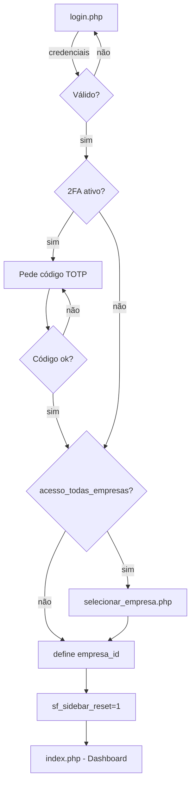
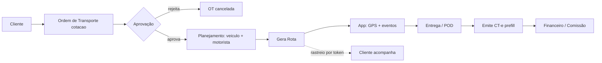
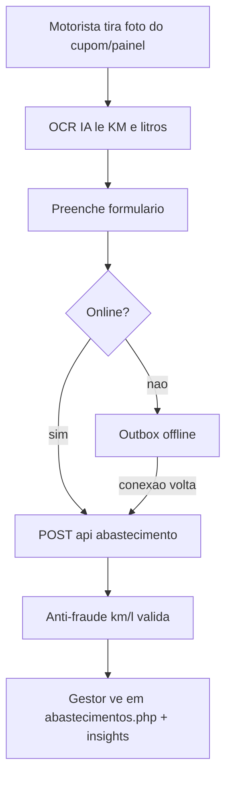
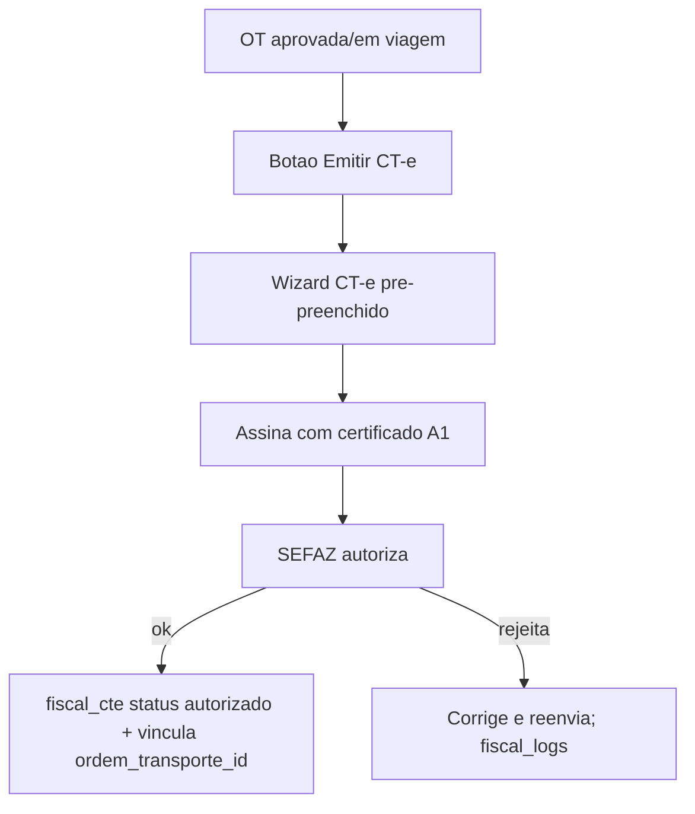
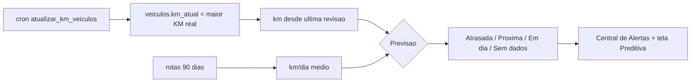

[← Índice](../README.md)

# 15 · Fluxos (Fluxogramas Mermaid)

## Login e acesso

## Ciclo TMS do frete

## Abastecimento (app, com OCR)

## Emissão fiscal (CT-e a partir da OT)

## Manutenção preditiva

> Fluxos fiscais detalhados (NF-e/MDF-e/CIOT) nos manuais em `docs/` (fiscais).
