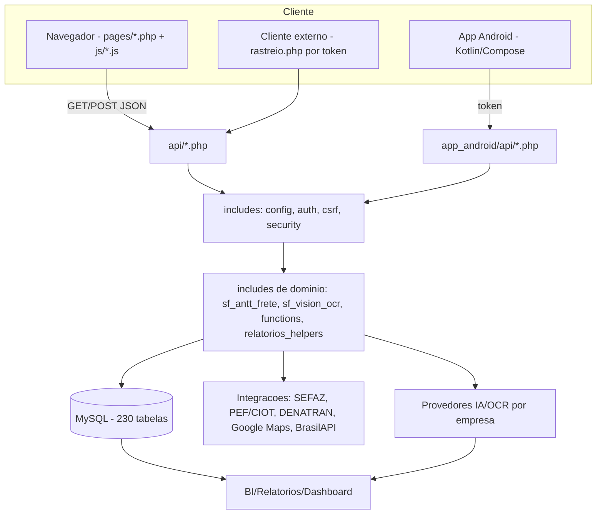
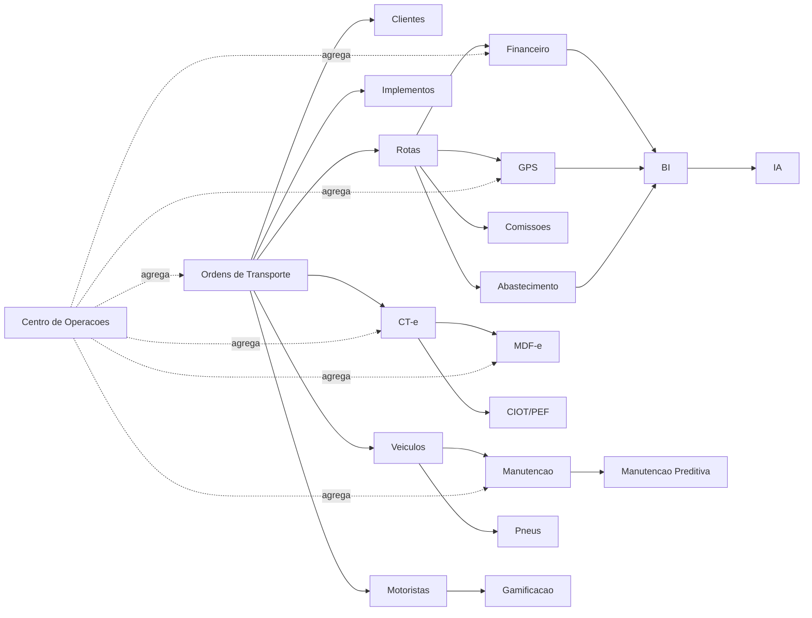
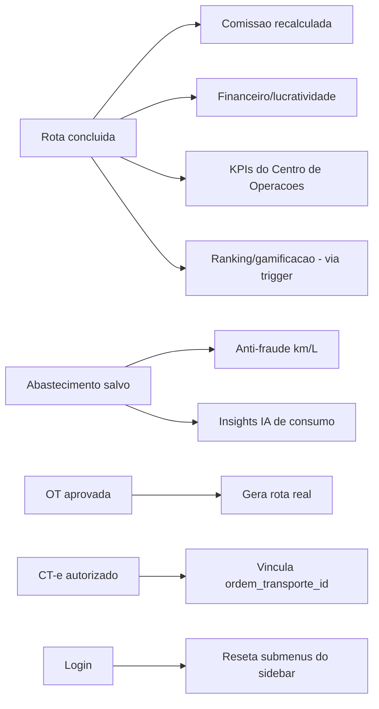

[← Índice](README.md)

# A1 · Arquitetura, Dependências e Eventos Automáticos

## 1. Arquitetura em camadas

O Frotec **não usa framework MVC**; a "camada" é lógica (scripts PHP + includes
compartilhados), não pastas rígidas. O fluxo real de uma requisição:

> Camadas equivalentes: **Front** (`pages/`,`js/`,`css/`) → **API** (`api/`) →
> **"Services/Helpers"** (`includes/`) → **Banco** (MySQL) + **Integrações** + **IA** →
> **BI/Relatórios/Dashboard**. Não há Controllers/Services formais — a lógica vive nos
> endpoints e nos helpers de `includes/`.

## 2. Dependência entre módulos

**Regra transversal:** *todos* dependem de **Segurança/Auth** e do isolamento
**`empresa_id`** (tabela `empresa_clientes`).

## 3. Eventos automáticos (o que acontece sozinho)

### Em tempo de banco (triggers/procedures reais)
| Gatilho | Efeito |
|---------|--------|
| Concluir rota (`tr_atualizar_ranking_rota`) | Atualiza ranking do motorista |
| Concluir checklist (`tr_atualizar_gamificacao_checklist`) | Pontua gamificação |
| Inserir/editar CNH de motorista (`trigger_motorista_cnh_*`) | Sincroniza vencimento no calendário |
| Inserir/editar multa (`trigger_multa_*_calendario`) | Sincroniza multa no calendário |
| Inserir pneu (`after_pneu_insert`) | Efeito colateral de pneu |
| Procedures | `sp_calcular_ranking_motoristas`, `sincronizar_cnh_calendario`, `sincronizar_multas_calendario` |

### Em tempo de aplicação (fluxo)

### Em tempo agendado (cron)
| Horário sugerido | Job | Efeito |
|------------------|-----|--------|
| a cada 15 min | `adm_cc_maintenance.php` | Storage/cache/logs/cron vencidos |
| diário (madrugada) | `gps_agregar_diario.php` | Agrega GPS do dia anterior |
| diário | `atualizar_km_veiculos.php` | Atualiza KM da frota (preditiva) |
| diário | `arquivar_notificacoes.php` | Arquiva notificações antigas |
| de hora em hora | `enviar_relatorios_agendados.php` | Envia relatórios agendados |
| contínuo | `gps_redis_worker.php` | Consome fila Redis de GPS |

Detalhes em [10-cronjobs.md](10-cronjobs.md).

## 4. Linha do tempo diária (cron)

```mermaid
gantt
    dateFormat HH:mm
    axisFormat %H:%M
    title Rotinas automáticas no dia
    section Contínuo
    Control Center (15/15min) :00:00, 24h
    Worker Redis GPS          :00:00, 24h
    Relatórios agendados (1/1h):00:00, 24h
    section Madrugada
    Agregar GPS diário   :02:00, 20m
    Atualizar KM frota   :02:30, 15m
    Arquivar notificações:03:00, 15m
```

