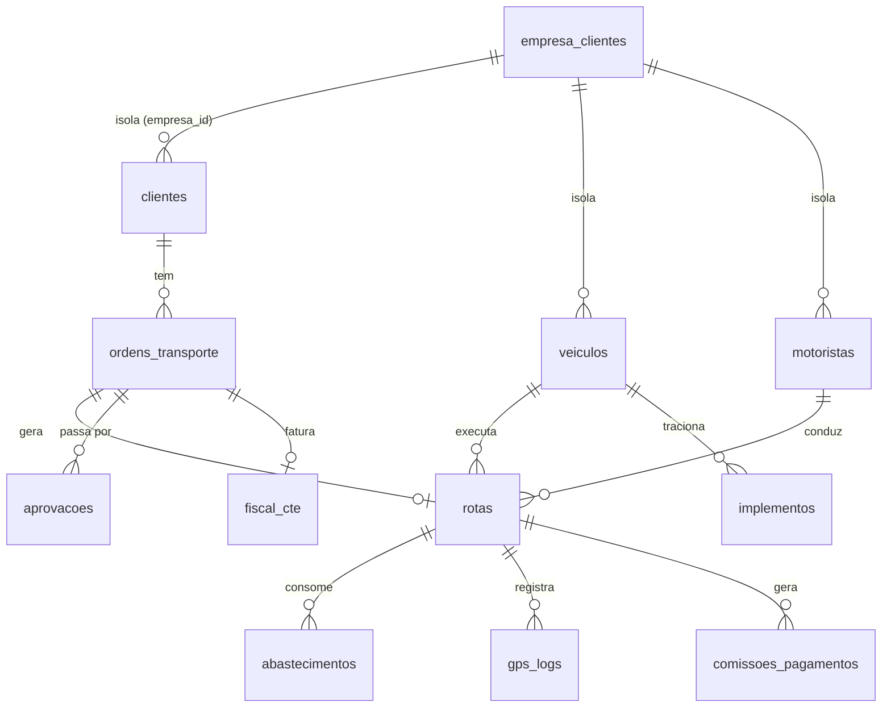
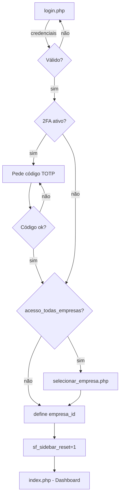
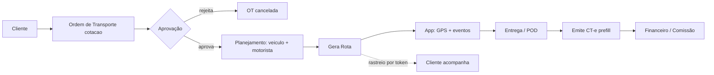
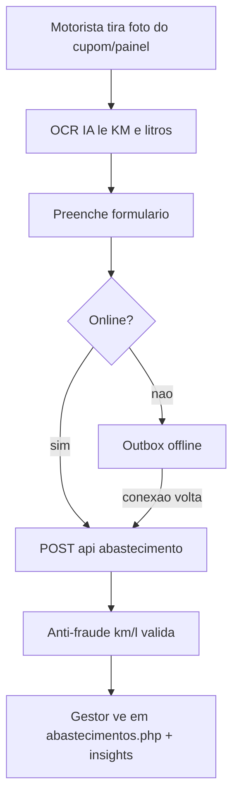
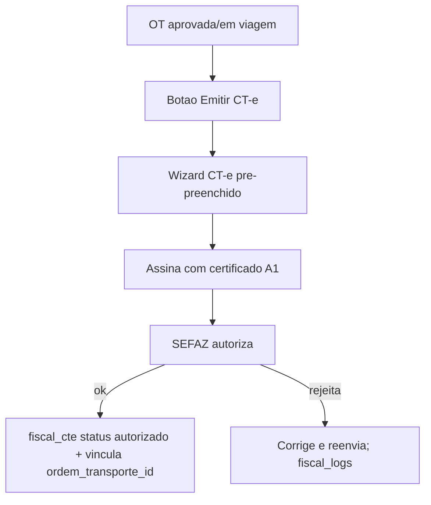
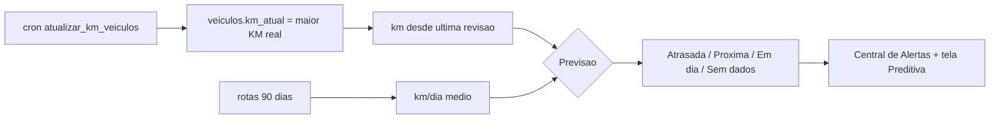
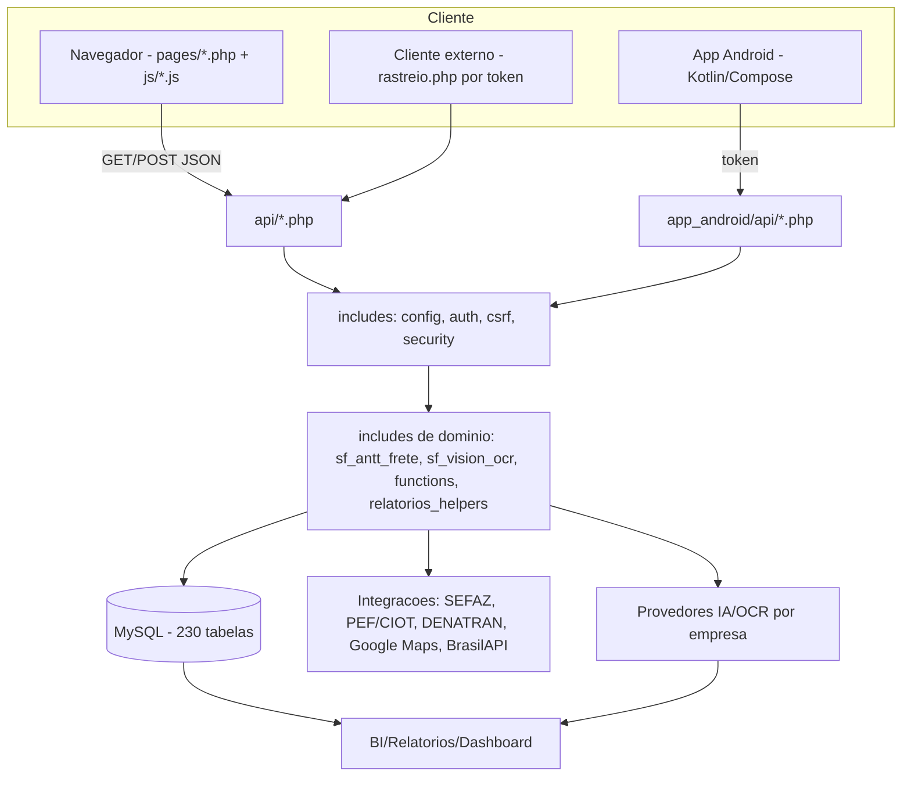
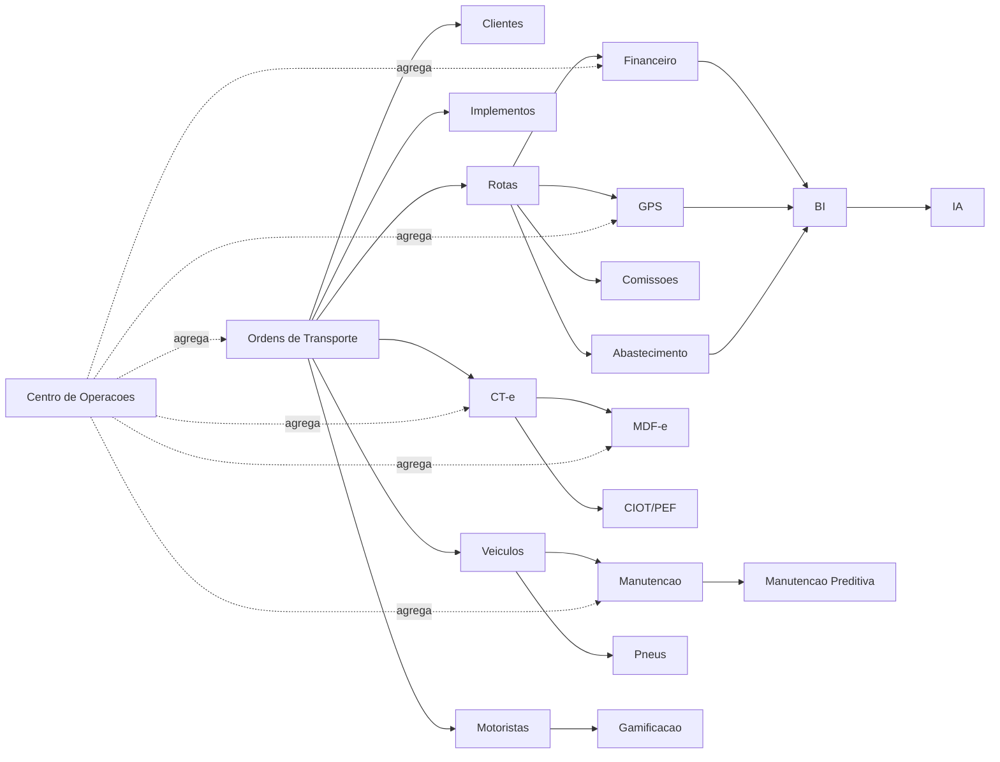
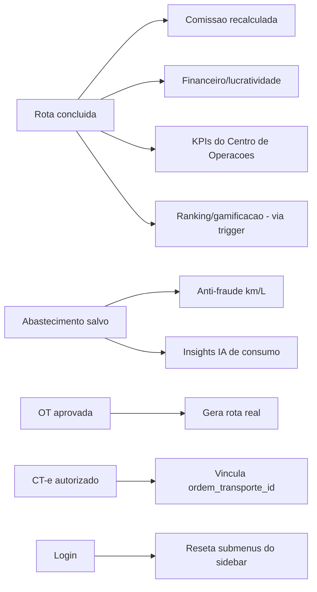

# 📚 Manual Oficial Completo — Sistema de Frotas (Frotec)

> Documento único consolidado (nível empresarial). Reúne todos os capítulos do manual
> (`docs/`) num só arquivo. A versão dividida por capítulos continua existindo em `docs/`.
> **Apêndice A** = Tabelas por módulo (finalidade). **Apêndice B** = Dicionário de dados
> (colunas/tipos/FKs gerado do banco).

## Índice geral

**Fundação:** Visão Geral · Instalação · Configuração · Estrutura · Banco de Dados ·
Regras de Negócio · APIs · Webhooks · Cron Jobs · Segurança · Performance
**Módulos & Telas:** Módulos · Plataforma/Control Center · Padrões de UI · Índice de Telas ·
Clientes · Centro de Operações · Ordens de Transporte · **Financeiro (Lucratividade, Contas
a Pagar, Despesas Fixas, Financiamentos, Multas, Comissões)** · Template · Fluxos (Mermaid)
**Operação:** Troubleshooting · Manutenção/Backup/Deploy · Glossário · Validação Final
**Enterprise (A1–A6):** Arquitetura · Manual do Dev · Permissões · Changelog/Roadmap ·
Checklists · Auditoria da Documentação
**Apêndices:** A) Tabelas por módulo · B) Dicionário de dados (230 tabelas + 149 FKs)

---

# 01 · Visão Geral

## O que é

O **Sistema de Frotas (Frotec)** é uma plataforma web **multi-empresa (SaaS)** de gestão
de transporte rodoviário de cargas (TMS + gestão de frota), com **app Android** para os
motoristas. Cobre o ciclo comercial e operacional do frete, do cadastro do cliente à
emissão fiscal e à análise financeira, com módulos de BI, IA, GPS e gamificação.

## Público / quem utiliza

| Perfil | Onde atua | Área |
|--------|-----------|------|
| **Gestor / operação** | `pages/` (web) | Rotas, veículos, financeiro, fiscal, BI |
| **Motorista** | app Android + `pages_motorista/` | Viagens, GPS, POD, checklist, despesas |
| **Administração da plataforma** | `pages_adm/` | Empresas-cliente, planos, cobrança, saúde |
| **Cliente/embarcador** | `rastreio.php` (público, por token) | Rastreio da própria carga |

## Capacidades principais

- **TMS:** clientes, cotações/ordens de transporte, aprovações, planejamento, rotas.
- **Frota:** veículos (cavalos), implementos (carretas), abastecimentos, manutenções,
  manutenção preditiva, pneus (inventário, movimentação, gestão interativa 3D).
- **Financeiro:** lucratividade, contas a pagar, despesas fixas, financiamentos, multas,
  comissões de motoristas.
- **Fiscal:** NF-e, CT-e, MDF-e, CIOT/PEF, vale-pedágio, DENATRAN (libs `nfephp-org/*`).
- **GPS:** posições em tempo real, cercas (geofences), trajeto, agregação diária.
- **BI & IA:** dashboards, resumos em linguagem natural, insights, OCR de documentos.
- **Motorista:** app offline-first com GPS em 2º plano, POD, checklist, jornada, pânico.
- **Plataforma (adm):** planos, limites, cobrança/boletos, health-checks, auditoria.

## Stack tecnológica

| Camada | Tecnologia |
|--------|-----------|
| Backend | **PHP 8.2** (sem framework MVC; scripts + includes compartilhados) |
| Banco | **MySQL/MariaDB** (porta **3307** no XAMPP), PDO (`ERRMODE_EXCEPTION`, `EMULATE_PREPARES=false`) |
| Frontend | HTML + CSS + JavaScript vanilla + jQuery; **Chart.js**, **Leaflet**, Google Maps |
| Fiscal | Composer: `nfephp-org/sped-nfe`, `sped-cte`, `sped-mdfe`, `sped-da`, `mpdf/mpdf`, `phpoffice/phpspreadsheet`, `box/spout`, `setasign/fpdi` |
| App | **Kotlin + Jetpack Compose**, Retrofit, Room (offline-first) |
| Servidor | **XAMPP** (Apache + MySQL) em Windows; produção Apache/PHP-FPM |
| IA/OCR | Provedor por empresa: Gemini / OpenAI / OpenRouter / DeepSeek |

> **Sem build step no front:** JS/CSS são versionados por `sf_asset_v()` para *cache-busting*.

## Convenções que valem para todo o sistema

1. **Isolamento multi-empresa:** toda query filtra por `$_SESSION['empresa_id']`.
2. **Prepared statements** com placeholders nomeados — nunca concatenar entrada no SQL.
3. **Autenticação** por `require_authentication()`; **CSRF** em toda ação que muda estado.
4. **Erros** nunca vazam `$e->getMessage()` ao usuário; `error_log()` + mensagem genérica.
5. **Nunca fabricar dados** em `catch` — devolver `success:false` / estado vazio honesto.

Detalhes em [06-regras-de-negocio.md](06-regras-de-negocio.md) e [11-seguranca.md](11-seguranca.md).


---


# 02 · Instalação

## Pré-requisitos

| Item | Versão / observação |
|------|---------------------|
| PHP | 8.2 (extensões: `pdo_mysql`, `openssl`, `curl`, `gd`, `mbstring`, `soap` p/ fiscal, `zip`) |
| MySQL/MariaDB | 10.4+ (no XAMPP local: porta **3307**) |
| Apache | 2.4 (mod_rewrite habilitado — o projeto usa `.htaccess`) |
| Composer | 2.x (para `vendor/` — libs fiscais e PDF/Excel) |
| Node | opcional (só se for mexer no build do app ou tooling) |
| Certificado A1 | `.pfx` por empresa, para emissão fiscal (NFe/CTe/MDFe) |

## Passo a passo (ambiente local XAMPP)

```bash
# 1. Clonar dentro de C:\xampp\htdocs\sistema-frotas
# 2. Instalar dependências PHP (gera vendor/ — não versionado)
composer install

# 3. Criar o banco e aplicar as migrações (sql/ é aplicado manualmente)
mysql -h 127.0.0.1 -P 3307 -u root -e "CREATE DATABASE sistema_frotas CHARACTER SET utf8mb4;"
#   Aplicar as migrações necessárias, ex.:
mysql -h 127.0.0.1 -P 3307 -u root sistema_frotas < sql/arquivo.sql

# 4. Criar as pastas graváveis (não versionadas)
#   logs/ cache/ tmp/ sessions/ uploads/   (ver .gitignore)

# 5. Configurar variáveis de ambiente (ver 03-configuracao.md) ou usar fallback local

# 6. Subir Apache + MySQL pelo painel do XAMPP e abrir:
#   http://localhost/sistema-frotas/login.php
```

## Ordem das migrações

Não há um migrador automático — os arquivos em `sql/` são aplicados **manualmente**. Não
existe um `schema.sql` único consolidado; o banco atual tem **230 tabelas** montadas a
partir do histórico de migrações. Para um ambiente novo, o caminho prático é **restaurar
um dump** de um ambiente existente (ver [17-manutencao.md](17-manutencao.md)) e depois
aplicar apenas as migrações novas ainda não presentes.

> ⚠️ **Pendência conhecida:** falta um `sql/schema_full.sql` consolidado. Está listado em
> [99-validacao-final.md](99-validacao-final.md) como melhoria de implantação.

## Validação pós-instalação

```bash
php -l index.php                       # lint de um arquivo
C:/xampp/php/php.exe -v                 # versão do PHP
# App deve redirecionar para login:
curl -s -o /dev/null -w "%{http_code}" http://localhost/sistema-frotas/index.php  # espera 302
```

Login → cai em `index.php` (Dashboard). Se aparecer erro de conexão, revisar
[03-configuracao.md](03-configuracao.md) (credenciais `SF_DB_*` / porta 3307).


---


# 03 · Configuração

Segredos e parâmetros vêm de **variáveis de ambiente** (`getenv`), com **fallback local**
no código quando a variável não existe. **Nunca commitar segredos.** Segredos também podem
vir do banco (`configuracoes_seguranca`, `fiscal_config_*`), sempre com `env` tendo
prioridade e mascarados (`********`) quando devolvidos por rede.

## Banco de dados (`includes/db_connect.php`)

| Variável | Padrão local | Descrição |
|----------|--------------|-----------|
| `SF_DB_HOST` | `127.0.0.1` | Host do MySQL |
| `SF_DB_NAME` | `sistema_frotas` | Nome do banco |
| `SF_DB_USER` | `root` | Usuário |
| `SF_DB_PASS` | (vazio) | Senha |

> Porta local **3307** (XAMPP). Conexão via `getConnection()` → PDO com
> `ERRMODE_EXCEPTION` e `EMULATE_PREPARES=false` (placeholders nomeados não repetem).

## Sessão / debug

| Variável | Descrição |
|----------|-----------|
| `SF_DEBUG` | `1` liga exibição de erros (dev). Em produção deixar desligado. |
| `SF_SESSION_PATH` | Caminho de gravação das sessões (padrão `sessions/`) |

Sessão configurada por `configure_session()` (cookie seguro, SameSite). Logout por
inatividade via `sf_enforce_idle_timeout()`.

## IA / OCR (visão)

| Variável | Descrição |
|----------|-----------|
| `SF_OPENAI_API_KEY` / `SF_OPENAI_VISION_MODEL` / `SF_OPENAI_IMAGE_DETAIL` | OpenAI |
| `SF_DEEPSEEK_API_KEY` / `SF_DEEPSEEK_BASE_URL` / `SF_DEEPSEEK_VISION_MODEL` | DeepSeek |
| `SF_GOOGLE_VISION_API_KEY` | Google Vision |

O provedor efetivo é escolhido **por empresa** (`empresa_openai_credentials`,
`empresa_vision_ai`, `configuracoes_ia`). OCR central em `includes/sf_vision_ocr.php`.

## Segurança / login

| Variável | Descrição |
|----------|-----------|
| `SF_RECAPTCHA_SITE_KEY` / `SF_RECAPTCHA_SECRET_KEY` | reCAPTCHA do login |
| `SF_RECAPTCHA_APOS_TENTATIVAS` | Nº de tentativas antes de exigir captcha |
| `SF_SMTP_PASS` | Senha SMTP (envio nativo `sf_smtp_send`) |

## GPS (dezenas de variáveis `SF_GPS_*`)

Ajustam validação e alertas de telemetria: velocidade máxima plausível, dedup de alertas,
precisão mínima (`SF_GPS_MAX_ACCURACY_M`), bloqueio de mock (`SF_GPS_BLOQUEAR_MOCK`),
cercas (`SF_GPS_CERCA_*`), ocioso/pernoite, reverse geocode e cache Redis. Lista completa:
`grep -rhoE "SF_GPS_[A-Z_]+" includes/`. Ver [06-regras-de-negocio.md](06-regras-de-negocio.md#gps).

## Redis (opcional)

| Variável | Descrição |
|----------|-----------|
| `SF_REDIS_HOST` / `SF_REDIS_PORT` / `SF_REDIS_PASSWORD` / `SF_REDIS_KEY` | Cache/worker de GPS |
| `SF_GPS_REDIS_CACHE` / `SF_GPS_REDIS_READ` | Liga leitura/escrita de GPS via Redis |

Worker: `cron/gps_redis_worker.php` (ver [10-cronjobs.md](10-cronjobs.md)).

## Fiscal / integrações

| Variável | Descrição |
|----------|-----------|
| `SF_PEF_CERT_PEM` | Certificado PEM para PEF/CIOT |
| `SF_MARKETING_SITE_URL` / `SF_SUPPORT_WHATSAPP` | Links institucionais |

Certificados fiscais A1 por empresa em `fiscal_certificados_digitais` /
`fiscal_config_empresa`. Ver [MANUAL_FISCAL_INDICE.md](MANUAL_FISCAL_INDICE.md).

## Servidor

- **Apache** com `mod_rewrite` (o projeto tem `.htaccess` na raiz e em subpastas).
- **`php.ini`:** `upload_max_filesize`/`post_max_size` adequados a anexos e XML fiscal;
  `max_execution_time` maior para importações e emissão fiscal; `date.timezone` BR.
- **`composer install`** obrigatório em produção (libs fiscais). Ver [PRODUCAO_COMPOSER_FISCAL.md](PRODUCAO_COMPOSER_FISCAL.md).


---


# 04 · Estrutura do Projeto

## Mapa de pastas (raiz)

| Pasta / arquivo | Responsabilidade |
|-----------------|------------------|
| `index.php` | Dashboard (tela inicial após login) |
| `login.php` · `logout.php` · `selecionar_empresa.php` | Autenticação e escolha de empresa |
| `recuperar_senha.php` · `reset_senha.php` | Recuperação de senha |
| `rastreio.php` | Rastreio **público** da carga por token (cliente) |
| `sair_suporte.php` | Encerrar sessão de suporte (impersonação) |
| **`pages/`** | Telas do **gestor** (57 páginas: rotas, veículos, financeiro, fiscal, BI…) |
| **`pages_motorista/`** | Área do motorista (web) |
| **`pages_adm/`** | **Administração da plataforma** (empresas, planos, cobrança, saúde) |
| **`api/`** | 136 endpoints JSON do front web e do app |
| **`includes/`** | Núcleo compartilhado (config, conexão, auth, csrf, helpers de domínio) |
| **`fiscal/`** | Emissão fiscal NFe/CTe/MDFe/CIOT (libs `nfephp-org/*`), tem `api/` e `pages/` próprios |
| **`app_android/`** | App Kotlin do motorista + `app_android/api/` (backend próprio do app) |
| **`bi/`** | Componentes/renderers de Business Intelligence |
| **`IA/`** | Painéis e APIs de IA (`IA/api/`, `IA/painel.php`) |
| **`google-maps/`** | Stack de mapas (maps.js, route-manager, geolocation, `api.php`) |
| **`integracoes/`** | Integrações externas |
| **`notificacoes/`** | Motor de notificações |
| **`calendario/`** | Calendário (vencimentos CNH/multas via triggers) |
| **`gestao_interativa/`** | Gestão interativa de pneus/frota (visual) |
| **`cron/`** | 6 jobs agendados (ver [10-cronjobs.md](10-cronjobs.md)) |
| **`relatorios_automaticos/`** | Geração de relatórios agendados |
| **`sql/`** | 109 migrações/seeds `.sql` (aplicadas manualmente) |
| **`js/` · `css/`** | Assets do front (sem build; versionados por `sf_asset_v()`) |
| **`design-system/`** | Tokens/base de design |
| **`site/`** | Site institucional / marketing |
| **`tools/`** | Scripts utilitários de manutenção/dev |
| **`actions/`** | Handlers de ações de formulário legadas |
| **`ajax/`** | Endpoints AJAX legados (ver nota abaixo) |
| **`examples/` · `*_demo.php`** | Páginas de exemplo/demo (ver "código não-produtivo") |
| **`vendor/`** | Dependências Composer (**não versionado** — rodar `composer install`) |
| `logs/` `cache/` `tmp/` `sessions/` `uploads/` | **Não versionados** (runtime; ver `.gitignore`) |

## Núcleo compartilhado (`includes/`) — os mais usados

| Arquivo | Papel |
|---------|-------|
| `config.php` | Bootstrap: erros, `require_authentication()`, `configure_session()` |
| `db_connect.php` | `getConnection()` → PDO |
| `functions.php` | Helpers gerais (`sf_app_url`, `sf_asset_v`, `json_response`…) |
| `csrf.php` | `csrf_token_get()` / `csrf_token_validate()` / `api_require_csrf_json()` |
| `security.php` | 2FA, senha forte, login_attempts, geo/IP, SMTP, política por empresa |
| `remember_token.php` | "Lembrar-me" seguro (selector:validator) |
| `sf_api_base.php` | Base JS de API (`sfApiUrl`, `window.__SF_*__`, `sf_render_api_scripts`) |
| `sf_antt_frete.php` | Piso ANTT (`sf_antt_calc_piso`, `sf_antt_tipos_carga`) |
| `sf_page_help.php` · `sf_page_help_bundle.php` | Sistema de ajuda por página |
| `sf_vision_ocr.php` | OCR de visão (IA) reutilizável |
| `sidebar_pages.php` · `header.php` · `footer.php` | Shell visual das páginas |
| `relatorios_helpers.php` | Allow-list e período de relatórios |

## Padrão de uma página do gestor

```
require_once '../includes/config.php';        // + functions, csrf, sf_page_help…
configure_session(); session_start(); require_authentication();
$page_title = '...';
// HTML: <body class="sf-premium"> → .app-container → sidebar_pages.php +
//       .main-content → header.php + .dashboard-content + footer.php
// scripts: jquery + theme.js + sidebar.js + (sf_page_help_js)
```

Padrões visuais (toolbar, tabela, paginação, ajuda) em
[13-modulos/padroes-ui.md](13-modulos/padroes-ui.md) e no [`../CLAUDE.md`](../CLAUDE.md).

## Observações de organização

- **`ajax/`, `actions/`** contêm handlers **legados**; parte da lógica migrou para `api/`.
  Candidatos a auditoria de código morto — ver [99-validacao-final.md](99-validacao-final.md).
- **Páginas `*_demo.php` / `examples/`** são demonstrações, **não** telas de produção
  (`bi_premium_demo.php`, `dashboard_premium_demo.php`, `rotas_premium_demo.php`,
  `lucratividade_exemplo.php`, `dashboard_exemplos.php`, `template.php`).


---


# 05 · Banco de Dados

- **SGBD:** MySQL/MariaDB · charset `utf8mb4` · porta local **3307**.
- **Total:** **230 tabelas**, **5 views**, **9 triggers**, **3 procedures**, 0 events.
- **Migrações:** `sql/*.sql` (109 arquivos), aplicadas manualmente. Não há schema único
  consolidado — ver pendência em [99-validacao-final.md](99-validacao-final.md).
- **Isolamento:** quase toda tabela de dados tem `empresa_id` — é o limite entre clientes.

```bash
# Inventário rápido
mysql -h 127.0.0.1 -P 3307 -u root sistema_frotas -e "SHOW TABLES;"
# DDL de uma tabela
mysql -h 127.0.0.1 -P 3307 -u root sistema_frotas -e "SHOW CREATE TABLE rotas\G"
```

## Grupos de tabelas (por prefixo/domínio)

| Domínio | Tabelas (exemplos) |
|---------|--------------------|
| **TMS / operação** | `clientes`, `ordens_transporte`*, `aprovacoes`, `rotas`(ver ROTAS.md), `implementos`, `disponibilidades`, `disponibilidades_motoristas` |
| **Frota** | `veiculos`/`cavalos_carretas`, `carrocerias`, `eixos`, `eixos_veiculos`, `categorias` |
| **Motoristas** | `motoristas`, `motoristas_log`, `documentos_motoristas`, `motorista_periodos`, `motorista_dependentes`, `motorista_treinamentos`, `jornada_motorista` |
| **Abastecimento** | `abastecimentos`, `despesas_viagem`, `despesas_fixas`, `pedagios`*(app) |
| **Manutenção** | `manutencoes`, `manutencao_anexos`, `componentes_manutencao`, `planos_manutencao`* |
| **Pneus** | `estoque_pneus`, `instalacoes_pneus`, `eixo_pneus`, `alocacoes_pneus_flexiveis`, `gastos_pneus`, `gestao_montagem` (ver GESTAO_PNEUS_TABELAS.md) |
| **Financeiro** | `contas_pagar`, `financiamentos`, `multas`, `comissoes_pagamentos`, `formas_pagamento`, `bancos` |
| **Fiscal** | `fiscal_cte*`, `fiscal_mdfe*` (20+ tabelas), `fiscal_nfe*`, `fiscal_certificados_digitais`, `fiscal_config_*`, `fiscal_logs`, `certificados_denatran` |
| **GPS** | `gps_logs`, `gps_logs_resumido`, `gps_ultima_posicao`, `gps_cercas`, `gps_cerca_*`, `gps_alertas_operacionais`, `gps_geocode_cache` |
| **IA / BI** | `insights_ia`, `configuracoes_ia`, `bi_cache`, `bi_metas`, `historico_analises`, `alertas_inteligentes` |
| **Gamificação** | `gamificacao_motoristas`, `conquistas_motoristas`, `desafios_motoristas`, `competicoes`, `config_ranking`, `v_gamificacao_atual`, `v_ranking_atual` |
| **Notificações** | `notificacoes`, `notificacoes_preferencias`, `notificacoes_ia_config`, `alertas_sistema` |
| **Segurança** | `usuarios`, `configuracoes_seguranca`, `login_attempts`, `acessos_conhecidos`, `admin_ip_whitelist`, `auth_remember_tokens`, `api_tokens_motorista`, `log_acessos`/`logs_acesso` |
| **Calendário** | `calendario_eventos`, `calendario_templates`, `categorias_calendario` |
| **Plataforma (adm)** | `adm_*` (~28 tabelas: `adm_planos`, `adm_pagamentos`, `adm_boletos`, `adm_health_checks`, `adm_cron_jobs`, `adm_auditoria_suporte`, `empresa_clientes`, `adm_empresa_modulos`…) |
| **Cadastros base** | `estados`, `cidades`, `fornecedores`, `configuracoes` |

\* tabelas criadas/alteradas nas migrações recentes do TMS (`sql/ordens_transporte.sql`,
`sql/clientes.sql`, `sql/implementos.sql`, `sql/aprovacoes.sql`).

## Diagrama ER — núcleo TMS (Mermaid)



> `empresa_clientes` é a tabela de **empresas-cliente** (tenants). `empresa_id` em cada
> tabela de dados aponta para ela — é a chave do isolamento multi-empresa.

## Views (5)

| View | Finalidade (inferida) |
|------|-----------------------|
| `v_ranking_atual` / `v_gamificacao_atual` | Ranking/estado atual de gamificação dos motoristas |
| `view_seguro_clientes_ativos` | Clientes de seguro ativos |
| `view_seguro_atendimentos_abertos` | Atendimentos de seguro em aberto |
| `view_seguro_financeiro_resumo` | Resumo financeiro de seguros |

## Triggers (9)

| Trigger | Tabela | Finalidade |
|---------|--------|-----------|
| `trigger_motorista_cnh_calendario` (+ _update/_delete) | `motoristas` | Sincroniza vencimento de CNH no calendário |
| `trigger_multa_insert/_update/_delete_calendario` | `multas` | Sincroniza multas no calendário |
| `tr_atualizar_gamificacao_checklist` | `checklist_viagem` | Pontua gamificação ao concluir checklist |
| `tr_atualizar_ranking_rota` | `rotas` | Atualiza ranking ao concluir rota |
| `after_pneu_insert` | pneus | Efeito colateral ao inserir pneu |

## Procedures (3)

| Procedure | Finalidade |
|-----------|-----------|
| `sincronizar_cnh_calendario` | Recarrega vencimentos de CNH no calendário |
| `sincronizar_multas_calendario` | Recarrega multas no calendário |
| `sp_calcular_ranking_motoristas` | Recalcula o ranking dos motoristas |

> **Backlog:** documentar **campo a campo** as 230 tabelas é um trabalho incremental. As
> tabelas de pneus e fiscal já têm docs dedicados (GESTAO_PNEUS_TABELAS.md, manuais fiscais).
> Ver o que falta em [99-validacao-final.md](99-validacao-final.md).


---


# 06 · Regras de Negócio

## Multi-empresa (isolamento)

- Toda operação de dados **filtra por `$_SESSION['empresa_id']`**. É o limite entre
  clientes (tenants). Esquecer o filtro = vazamento de dados entre empresas → **bug grave**.
- A empresa é definida no login; usuários com `acesso_todas_empresas` escolhem em
  `selecionar_empresa.php`. Suporte pode impersonar (`sair_suporte.php` encerra).

## Autenticação e sessão

- `require_authentication()` no topo de páginas/APIs. Login sempre cai em **`index.php`**.
- "Lembrar-me" usa token **selector:validator** (`auth_remember_tokens`), nunca cookie
  `base64(id:email)`.
- Logout por inatividade (`sf_enforce_idle_timeout()`); tempo em `$_SESSION['idle_timeout_min']`.
- 2FA TOTP por usuário (colunas `two_factor_*` em `usuarios`). Ver [11-seguranca.md](11-seguranca.md).

## TMS — ciclo do frete

Fluxo: **Cliente → Cotação/OT → Aprovação → Planejamento → Rota → GPS → Entrega/POD →
CT-e → Financeiro**.

- **Ordem de Transporte (OT):** status `cotacao → aprovada → em_viagem → concluida`
  (ou `cancelada`). A OT aprovada **gera uma rota real** (não recria dados). A ação
  `atribuir` grava só `veiculo_id`/`motorista_id`/`data_coleta` (UPDATE isolado — não
  sobrescreve os outros campos).
- **Aprovação:** só OTs em `cotacao`. Aprovar libera para planejamento; rejeitar cancela.
  Toda decisão grava trilha (autor, data, comentário) em `aprovacoes`.
- **Rastreio público:** `rastreio.php` é escopado **apenas pela OT do token** — sem dados
  comerciais de outras OTs/empresas.

## Frete e piso ANTT

- Piso mínimo de frete (**Lei 13.703/2018**) em `includes/sf_antt_frete.php` →
  `sf_antt_calc_piso($conn, $tipo_carga, $eixos, $distancia, $contratacao, $alto_desempenho)`.
- Fórmula: **piso = CCD × km + CC** (coeficientes por tipo de carga/eixos na tabela
  `antt_frete_coeficientes`). O **Simulador de Rota** usa isso para custo, margem-alvo e
  **frete de equilíbrio (lucro 0)**.

## Financeiro

- **Lucratividade:** receita (fretes) − custos variáveis (combustível, pedágio, comissão)
  − fixos rateados. Drill-down por rota/veículo/motorista/período.
- **Comissão:** % sobre frete de rotas concluídas; adiantamentos e descontos (multas/danos)
  no fechamento. Rota sem frete → comissão zerada (validar cadastro).
- **Contas a pagar / financiamentos / multas / despesas fixas:** cadastros com vencimentos
  que alimentam a Central de Alertas e o Calendário.

## Fiscal

- **NF-e, CT-e, MDF-e, CIOT/PEF, vale-pedágio** via libs `nfephp-org/*`. Certificado A1
  por empresa. CT-e pode ser **pré-preenchido a partir da OT** (vincula `ordem_transporte_id`).
- Regras completas nos manuais: [MANUAL_CTE.md](MANUAL_CTE.md), [MANUAL_MDFE.md](MANUAL_MDFE.md),
  [MANUAL_NFE.md](MANUAL_NFE.md), [MANUAL_CIOT_ANTT.md](MANUAL_CIOT_ANTT.md).

## <a name="gps"></a>GPS / telemetria

- App envia posições (`gps_salvar*.php`); validação por dezenas de `SF_GPS_*`
  (velocidade plausível, precisão mínima, bloqueio de mock, cercas, ocioso/pernoite).
- **Detecção automática** de parada/pernoite/encerrar rota (`evento_auto.php`).
- Alertas operacionais (perda de sinal, velocidade, bateria) com **dedup** por tempo.
- Cercas (geofences): entrada/saída/permanência com debounce.

## Manutenção preditiva

- Prevê a próxima revisão: **km desde a última revisão + km/dia médio (90 dias)**.
  Intervalo vem do **histórico do veículo**; sem histórico, usa intervalo padrão (indicado).
- "Atualizar KM da frota": `sf_atualizar_km_veiculos()` — UPDATE **não destrutivo** (GREATEST).

## IA / OCR

- Resumos em linguagem natural e insights a partir de **dados reais** — nunca inventar.
- OCR de visão (`sf_vision_ocr.php`) lê cupom/painel/pedágio/NF/lacre; provedor por empresa.

## Erros e dados

- Nunca expor `$e->getMessage()`. `catch` → `error_log()` + mensagem genérica;
  em API `success:false` + HTTP apropriado. **Nunca fabricar dados de exemplo** — estado
  vazio honesto (zeros/"nenhum registro").


---


# 07 · APIs

136 endpoints em `api/*.php` (web) + ~30 em `app_android/api/*.php` (app, autenticados por
token). Documento legado relacionado: [WEB_API.md](WEB_API.md). Endpoints do app:
[`../app_android/docs/ENDPOINTS.md`](../app_android/docs/ENDPOINTS.md).

## Convenções (todas as APIs web)

| Aspecto | Regra |
|---------|-------|
| **Sessão/auth** | `configure_session()` + `session_start()` + `require_authentication()` no topo |
| **Isolamento** | Toda query filtra `empresa_id` (`$_SESSION['empresa_id']`) |
| **Método** | Leitura por `GET` (com `?action=`), escrita por `POST` |
| **CSRF** | Ações que mudam estado: `csrf_token_validate($_POST['csrf_token'])` / `api_require_csrf_json()` |
| **Resposta** | JSON: `{"success":true, ...}` ou `{"success":false,"error":"..."}` + HTTP adequado |
| **Erros** | `catch (InvalidArgumentException)` → `echo $e->getMessage()` (mensagem própria, segura); `catch (Throwable)` → `error_log()` + mensagem genérica. **Nunca** vazar erro de PDO/sistema |
| **Prepared** | 100% prepared statements, placeholders nomeados |
| **Padrão de retorno vazio** | Sem dado → array vazio / zeros, **nunca** dado fabricado |

### Contrato típico

```
GET  api/clientes.php?action=list&status=ativo&busca=acme
POST api/clientes.php   (body x-www-form-urlencoded)  action=save&csrf_token=...&razao_social=...
→ 200 {"success":true,"clientes":[...]}     |  401 {"error":"Acesso não autorizado"}
```

Front usa `sfApiUrl()` / `window.__SF_API_BASE__` / `window.__SF_CSRF__` (de `sf_api_base.php`).

## Índice por domínio

### TMS / operação
`clientes.php`, `ordens_transporte.php`, `aprovacoes.php`, `planejamento.php`,
`central_alertas.php`, `centro_operacoes.php`, `rotas.php`, `route_data.php`,
`route_actions.php`, `route_anomalies.php`, `route_export.php`, `routes_data.php`,
`rotas_mapa.php`, `rotas_google_maps.php`, `import_rotas.php`, `implementos.php`.

### Frota / veículos
`vehicles.php`, `veiculos.php`, `vehicle_data.php`, `vehicle_export.php`,
`vehicle_insights.php`, `vehicle_resumo_ia.php`, `carrocerias.php`, `categorias.php`,
`tipos.php`, `rendimento_veiculo.php`, `validar_quilometragem.php`.

### Motoristas
`motoristas.php`, `motorist_data.php`, `motorist_actions.php`, `motorist_insights.php`,
`motorist_resumo_ia.php`, `motorist_efficiency_analytics.php`,
`motorist_performance_analytics.php`, `motorist_performance_chart.php`,
`ranking_motoristas.php`, `gamificacao_motoristas.php`, `gestao_motoristas*.php`,
`usuarios_motoristas.php`.

### Abastecimento
`refuel_data.php`, `refuel_actions.php`, `refuel_export.php`, `refuel_anomalies.php`,
`refuel_import_bulk.php`, `refuel_ocr_openai.php`, `import_abastecimentos_azure.php`,
`combustiveis.php`, `tipos_combustivel.php`.

### Manutenção / pneus
`manutencoes.php`, `maintenance_data.php`, `maintenance_import.php`,
`maintenance_ocr_nf.php`, `maintenance_insights.php`, `maintenance_resumo_ia.php`,
`manutencao_anexos.php`, `manutencao_preditiva.php`, `planos_manutencao.php`;
`pneus*.php`, `pneus_data.php`, `pneus_acoes.php`, `pneu_manutencao_*.php`,
`estoque_pneus.php`, `deslocar_pneu.php`, `gestao_pneu_pro.php`, `pneus_mercado.php`.

### Financeiro
`lucratividade_*.php`, `financial_analytics.php`, `net_revenue_analytics.php`,
`profit_forecast_analytics.php`, `profit_per_km_analytics.php`, `projecao_lucro.php`,
`cost_per_km_analytics.php`, `distribuicao_custos.php`, `expenses_distribution.php`,
`contas_pagar_*.php`, `despesas_fixas.php`, `financiamentos.php`, `multas*.php`,
`commissions_actions.php`, `commissions_analytics.php`, `comissoes_*.php`,
`payment_methods.php`, `formas_pagamento.php`, `margem_tipo_frete.php`.

### GPS
`get_posicoes.php`, `gps_posicoes.php`, `gps_historico.php`, `gps_cercas.php`,
`gps_cerca_alertas.php`, `gps_alertas_operacionais.php`.

### BI / IA
`bi_drill_down.php`, `bi_resumo_ia.php`, `dashboard_data.php`, `performance_indicators.php`,
`ia_custos_fraudes.php`, `*_insights.php`, `*_resumo_ia.php`, `vision_ai_config.php`.

### Fiscal / integrações
`pef_ciot.php`, `denatran_infracoes.php`, `cnpj_brasilapi.php`, `fornecedor_*.php`.

### Sistema / segurança / plataforma
`auth.php`, `usuarios.php`, `usuarios_2fa.php`, `seguranca.php`, `log_acessos.php`,
`notifications.php`, `alertas_sistema.php`, `trocar_empresa.php`, `configuracoes.php`,
`healthcheck.php`, `auto_reports.php`, `relatorios_agendar.php`, `save_layout.php`,
`download_anexo.php`.

## Exemplo documentado — `api/clientes.php`

| Item | Valor |
|------|-------|
| **Objetivo** | CRUD de clientes/embarcadores |
| **Auth** | Sessão + `empresa_id` |
| **Ações** | `?action=list` (GET, filtros `status`,`busca`), `?action=get&id=`, `save`/`delete` (POST + CSRF) |
| **Request (save)** | `action=save&csrf_token=…&razao_social=…&tipo_pessoa=PJ&status=ativo` |
| **Response** | `{"success":true,"clientes":[{"id":1,"razao_social":"…","ots":3,"status":"ativo"}]}` |
| **Erros** | `401` sem sessão; `{"success":false,"error":"Informe a razão social."}` (validação) |

> **Backlog:** documentar **cada** endpoint no padrão acima (objetivo, ações, request/response,
> erros) é incremental — ver [99-validacao-final.md](99-validacao-final.md).


---


# 08 · Webhooks e Integrações

O sistema integra com serviços externos. A maioria é **saída** (o Frotec chama o serviço);
webhooks de **entrada** são pontuais.

## Fiscais (SEFAZ e afins)

| Integração | Onde | Observação |
|-----------|------|-----------|
| **SEFAZ NF-e/CT-e/MDF-e** | `fiscal/` (libs `nfephp-org/*`) | Autorização, cancelamento, eventos, distribuição NSU (`fiscal_distribuicao_nsu`) |
| **CIOT / PEF (ANTT)** | `api/pef_ciot.php` | Cert. PEM `SF_PEF_CERT_PEM`; ver [PEF_CIOT_INTEGRACAO.md](PEF_CIOT_INTEGRACAO.md), [MANUAL_CIOT_ANTT.md](MANUAL_CIOT_ANTT.md) |
| **DENATRAN** | `api/denatran_infracoes.php`, `certificados_denatran` | Infrações; ver [DENATRAN_INTEGRACAO.md](DENATRAN_INTEGRACAO.md) |
| **Vale-pedágio** | tabelas `fiscal_mdfe_vale_pedagio` | Parte do MDF-e |

## Dados externos

| Integração | Endpoint | Uso |
|-----------|----------|-----|
| **BrasilAPI (CNPJ)** | `api/cnpj_brasilapi.php` | Autofill de cadastro por CNPJ |
| **Google Maps** | `google-maps/` (`api.php`, `maps.js`) | Distância/rota, geocode |
| **Provedores de IA** | OpenAI / DeepSeek / Google Vision / OpenRouter | Resumos, insights, OCR (`sf_vision_ocr.php`), por empresa |
| **Azure (import abastecimento)** | `api/import_abastecimentos_azure.php` | Importação em lote |

## App do motorista

- O app fala com `app_android/api/*.php` autenticado por **token** (`api_tokens_motorista`),
  não por sessão web. Contrato em [`../app_android/docs/ENDPOINTS.md`](../app_android/docs/ENDPOINTS.md).

## Rastreio público (saída para o cliente)

- `rastreio.php` expõe o andamento de **uma** OT por **token** (sem login, sem dados
  comerciais de terceiros).

## Pendências

- **Push FCM** (app) não implementado (falta `google-services.json`) — hoje é *polling*.
- Não há um **registro central de webhooks de entrada** configuráveis por empresa
  (melhoria em [99-validacao-final.md](99-validacao-final.md)).


---


# 10 · Cron Jobs

6 rotinas em `cron/`. Em Windows use o **Agendador de Tarefas**; em Linux, `crontab`.
Documento de produção relacionado: [CRON_PRODUCAO.md](CRON_PRODUCAO.md). O painel admin
tem `adm_cron_jobs` / `adm_cron_runs` para registrar e auditar execuções.

| Job | Arquivo | Frequência sugerida | Objetivo |
|-----|---------|--------------------|----------|
| **Manutenção Control Center** | `cron/adm_cc_maintenance.php` | `*/15 * * * *` | Storage/cache, purge de logs, marcar cron jobs vencidos |
| **Arquivar notificações** | `cron/arquivar_notificacoes.php` | diário | Move `notificacoes` antigas → `notificacoes_arquivo` (a tabela viva cresce sem limite) |
| **Atualizar KM da frota** | `cron/atualizar_km_veiculos.php` | diário | `veiculos.km_atual` = maior KM real (`rotas.km_chegada`, `abastecimentos.km_atual`); só aumenta (fecha o ciclo da manutenção preditiva) |
| **Relatórios agendados** | `cron/enviar_relatorios_agendados.php` | de hora em hora | Envia por e-mail os relatórios automáticos vencidos |
| **Agregar GPS diário** | `cron/gps_agregar_diario.php` | diário | Agrega `gps_logs` do dia anterior em `gps_logs_resumido` e apaga o bruto (aceita data opcional) |
| **Worker Redis GPS** | `cron/gps_redis_worker.php` | serviço contínuo | Consome fila Redis (`BRPOP`) de posições GPS; exige `SF_REDIS_*` |

## Como registrar (Windows)

```
schtasks /Create /SC MINUTE /MO 15 /TN "Frotec-CC" ^
  /TR "C:\xampp\php\php.exe C:\xampp\htdocs\sistema-frotas\cron\adm_cc_maintenance.php"
```

## Como testar manualmente

```bash
C:/xampp/php/php.exe cron/atualizar_km_veiculos.php
C:/xampp/php/php.exe cron/gps_agregar_diario.php 2026-04-04   # data específica
```

- **Entradas:** leem do banco (por empresa quando aplicável) e/ou Redis.
- **Saídas:** gravam no banco e imprimem resumo no stdout; erros vão para `logs/`.
- **Falhas:** rodar manualmente com `SF_DEBUG=1` e checar `logs/`. O worker Redis só roda
  com `SF_REDIS_HOST` configurado; sem Redis, o GPS grava direto no banco.

> **Função reutilizável:** `atualizar_km_veiculos.php` expõe
> `sf_atualizar_km_veiculos($conn, $empresa_id)` (UPDATE não destrutivo com `GREATEST`),
> também chamada pelo botão "Atualizar KM da frota" na Manutenção Preditiva.


---


# 11 · Segurança

Biblioteca central: `includes/security.php`. Schema: `sql/security_features.sql`.
Ver também [PERMISSOES.md](PERMISSOES.md).

## Autenticação

- `require_authentication()` (`includes/config.php`) protege páginas e APIs.
- Senha com **hash** seguro (`password_hash`); política de senha forte `sf_password_validate`.
- **2FA TOTP** por usuário (colunas `two_factor_*` em `usuarios`; UI em Usuários,
  `api/usuarios_2fa.php`). Login exige código quando ativo e confirmado.
- **"Lembrar-me"** por token **selector:validator** (`auth_remember_tokens`,
  `includes/remember_token.php`) — nunca cookie reversível.
- **Bloqueio de tentativas** (`login_attempts`) + reCAPTCHA após N tentativas
  (`SF_RECAPTCHA_APOS_TENTATIVAS`).

## Autorização e multi-empresa

- `empresa_id` isola cada tenant em **todas** as queries — é o principal controle de acesso
  a dados. Perfis/permissões por usuário; suporte pode impersonar (auditado em `adm_auditoria_suporte`).
- **Novo acesso** (dispositivo/IP desconhecido) → e-mail/notificação (`acessos_conhecidos`).
- **Geo-bloqueio** e **whitelist de IP admin** (`admin_ip_whitelist`) por empresa
  (`configuracoes_seguranca`, `sf_security_config($empresaId)`).

## CSRF / XSS / SQL Injection

| Ameaça | Defesa |
|--------|--------|
| **CSRF** | `csrf_token_get()`/`csrf_token_validate()`; APIs `api_require_csrf_json()` em toda ação de escrita |
| **SQL Injection** | 100% prepared statements com placeholders nomeados; `EMULATE_PREPARES=false` |
| **XSS** | `htmlspecialchars()` na saída; no JS, escapar via `textContent` antes de injetar |
| **Vazamento de erro** | Nunca exibir `$e->getMessage()`; `error_log()` + mensagem genérica |

## Sessão

- `configure_session()`: cookie seguro, `SameSite`, path controlado (`SF_SESSION_PATH`).
- Logout por inatividade `sf_enforce_idle_timeout()`.

## Segredos

- **Env primeiro** (`SF_RECAPTCHA_*`, `SF_SMTP_PASS`, chaves de IA), fallback ao banco via
  `sf_security_secret()`. **Nunca devolver segredo por rede** (mascarar `********`).

## Uploads

- `uploads/` não é versionado. Validar tipo/tamanho; servir anexos por endpoint controlado
  (`api/download_anexo.php`) com checagem de `empresa_id`, não por link direto adivinhável.

## Auditoria / logs

- `log_acessos`/`logs_acesso` (login, troca de empresa, ações sensíveis), `fiscal_logs`,
  `adm_auditoria_suporte`, `motoristas_log`, `adm_sql_log`. Ver [16-troubleshooting.md](16-troubleshooting.md).

## Rate limit

- Login: bloqueio por tentativas. **Pendência:** não há rate-limit global nas APIs JSON —
  ver [99-validacao-final.md](99-validacao-final.md).


---


# 12 · Performance

## Banco

- **Índices:** tabelas quentes têm índice por `empresa_id` (+ colunas de filtro/data).
  Ao criar consulta nova, garantir índice cobrindo `empresa_id` + coluna filtrada.
- **N+1:** evitar consulta dentro de laço. Preferir `JOIN` ou subquery correlata única
  (padrão usado no `api/centro_operacoes.php`).
- **GPS:** `gps_logs` cresce muito rápido → agregação diária em `gps_logs_resumido`
  (`cron/gps_agregar_diario.php`) e `gps_ultima_posicao` para leitura barata do "agora".
- **Cache de BI:** `bi_cache`; geocode em `gps_geocode_cache`; configs de cache em
  `configuracoes_cache`.

## Front-end

- **Sem build step:** assets versionados por `sf_asset_v()` (cache-busting) — subir a versão
  (`?v=…`) ao alterar CSS/JS para o navegador pegar a mudança.
- **Chart.js/Leaflet** carregados por CDN; imagens com `max-width:100%`.
- **Lazy/polling:** dashboards atualizam por *polling* (ex.: Centro de Operações a cada 60s),
  não recarregam a página inteira.

## Redis (opcional)

- Fila/cache de GPS (`SF_GPS_REDIS_*`, `cron/gps_redis_worker.php`) para picos de telemetria.

## Pontos de atenção (achados)

| Item | Observação |
|------|-----------|
| Consultas pesadas de analytics | Vários `*_analytics.php` fazem agregações amplas — validar índices e período |
| Arquivos de demo em produção | `*_demo.php`, `examples/` não deveriam ir para produção |
| Duplicidade `veiculos.php`/`vehicles.php`, `rotas.php`/`routes.php` | Pares PT/EN — ver [99-validacao-final.md](99-validacao-final.md) |
| `notificacoes` sem arquivamento | Mitigado por `cron/arquivar_notificacoes.php` (precisa estar agendado) |

Detalhes e priorização em [99-validacao-final.md](99-validacao-final.md).


---


# 13 · Módulos

Cada módulo agrupa telas + APIs + tabelas com um objetivo de negócio. Muitos já têm
documento dedicado em `docs/` (coluna "Doc detalhado").

| Módulo | Telas principais (`pages/`) | APIs | Doc detalhado |
|--------|----------------------------|------|---------------|
| **TMS / Operação** | clientes, ordens_transporte, aprovacoes, planejamento, routes, simulador_rota, centro_operacoes, central_alertas | clientes, ordens_transporte, aprovacoes, planejamento, rotas | [`../../CLAUDE.md`](../../CLAUDE.md) (seção TMS) |
| **Frota / Veículos** | vehicles, implementos | vehicles/veiculos, implementos | — |
| **Motoristas** | motorists, gestao_motoristas, indicadores_desempenho | motoristas, gestao_motoristas, ranking_motoristas | [IMPLEMENTACAO_MOTORISTAS_COMPLETO](../IMPLEMENTACAO_MOTORISTAS_COMPLETO.md) |
| **Abastecimento** | abastecimentos, abastecimentos_motoristas | refuel_*, combustiveis | — |
| **Manutenção** | manutencoes, planos_manutencao, manutencao_preditiva | manutencoes, maintenance_*, manutencao_preditiva | [MANUTENCAO_ESTADO_ATUAL](../MANUTENCAO_ESTADO_ATUAL.md), [PLANOS_MANUTENCAO](../PLANOS_MANUTENCAO.md) |
| **Pneus** | pneus, pneus_dashboard, pneus_inventario, estoque_pneus, manutencao_pneus, gestao_interativa(_pro), pneu_ficha | pneus_*, pneu_manutencao_*, estoque_pneus, deslocar_pneu | [GESTAO_PNEUS_ANALISE](../GESTAO_PNEUS_ANALISE.md), [GESTAO_PNEUS_TABELAS](../GESTAO_PNEUS_TABELAS.md) |
| **Financeiro** | lucratividade, contas_pagar, despesas_fixas, financiamento, multas, comissoes | lucratividade_*, contas_pagar_*, commissions_*, multas_* | — |
| **Fiscal** | fiscal (+ `fiscal/pages/`) | pef_ciot, denatran_infracoes (+ `fiscal/api/`) | [MANUAL_FISCAL_INDICE](../MANUAL_FISCAL_INDICE.md) |
| **Rotas** | routes, import_rotas_excel | rotas, route_*, routes_data, rotas_google_maps | [ROTAS](../ROTAS.md), [IMPORTACAO_XML_PDF_ROTAS](../IMPORTACAO_XML_PDF_ROTAS.md) |
| **GPS** | mapa_frota, gps_cercas | get_posicoes, gps_* | — |
| **BI** | bi | bi_drill_down, bi_resumo_ia, dashboard_data | [BI_LISTA_COMPLETA](../BI_LISTA_COMPLETA.md) |
| **IA** | ia_painel, ia_dashboard | *_insights, *_resumo_ia, ia_custos_fraudes, vision_ai_config | — |
| **Relatórios** | relatorios | auto_reports, relatorios_agendar | — |
| **Usuários / Config** | usuarios, configuracoes, empresa, perfil | usuarios, usuarios_2fa, seguranca, configuracoes | [PERMISSOES](../PERMISSOES.md) |
| **Notificações** | notificacoes | notifications, alertas_sistema | — |
| **App do motorista** | (app_android) | app_android/api | [DOCUMENTACAO_APP](../../app_android/DOCUMENTACAO_APP.md) |
| **Plataforma (adm)** | `pages_adm/` | — | [plataforma-adm.md](plataforma-adm.md) · [AUDITORIA_CONTROL_CENTER_ADM](../AUDITORIA_CONTROL_CENTER_ADM.md) |
| **Sistema Seguro** | (módulo `seguro_*`) | — | [05b · Sistema Seguro](../05b-tabelas-por-modulo.md#-sistema-seguro-módulo-seguro_--comentários-oficiais) |

Padrões de UI comuns a todas as telas web: [padroes-ui.md](padroes-ui.md).


---


# Módulo · Plataforma / Control Center (`pages_adm/`)

Painel de **administração da plataforma** (visão do dono do SaaS, não do cliente). ~128
arquivos em `pages_adm/`, tabelas `adm_*` e views `view_seguro_*`. Auditoria detalhada:
[AUDITORIA_CONTROL_CENTER_ADM.md](../AUDITORIA_CONTROL_CENTER_ADM.md).

> Acesso separado (`pages_adm/login.php`), fora do fluxo do gestor. Suporte pode impersonar
> uma empresa (auditado em `adm_auditoria_suporte`).

## Telas do painel (por área)

| Área | Telas (`pages_adm/*.php`) | Tabelas base |
|------|---------------------------|--------------|
| **Home / visão** | `index.php`, `monitor.php`, `saude.php`, `health_score.php` | `adm_health_checks`, `adm_empresa_scores` |
| **Empresas-cliente** | `empresas.php`, `acessar_frotas.php`, `mapa_clientes.php` | `empresa_clientes`, `adm_empresa_modulos` |
| **Comercial / planos** | `comercial.php`, `planos.php`, `licencas.php`, `licenciamento.php`, `marketplace.php` | `adm_planos`, `adm_modulos`, `adm_licenca_limites` |
| **Financeiro plataforma** | `financeiro_executivo.php`, `posicao_financeira.php`, `custos.php` | `adm_pagamentos`, `adm_boletos`, `adm_config_boletos`, `adm_custos_mensais` |
| **Operação técnica** | `apis.php`, `jobs.php`, `deploy.php`, `backup.php`, `banco.php`, `performance.php`, `benchmark.php` | `adm_cron_jobs`, `adm_cron_runs`, `adm_deploys`, `adm_request_metrics`, `adm_storage_usage` |
| **Observabilidade** | `logs.php`, `log_acessos.php`, `erros.php`, `auditoria.php`, `analytics.php`, `heatmap.php` | `adm_sql_log`, `log_acessos`, `adm_auditoria_suporte` |
| **IA (interno)** | `ia_admin.php`, `ia_comercial.php`, `ia_dev.php`, `ia_estatisticas.php` | `adm_ia_usage` |
| **Comunicação / roadmap** | `comunicacao.php`, `alertas.php`, `roadmap.php` | `adm_comunicacoes`, `adm_comunicacao_modelos`, `adm_alertas`, `adm_roadmap` |
| **Config** | `configuracoes_cc.php`, `conta_adm.php`, `dependencias.php` | `adm_platform_config` |

## Rotinas ligadas ao painel

- `cron/adm_cc_maintenance.php` (a cada 15 min): storage/cache, purge de logs, cron vencidos.
- Métricas de requisição (`adm_request_metrics`, ~10 mil linhas) e health-checks
  (`adm_health_checks`, ~865) alimentam `monitor.php`/`saude.php`.

## Observações

- **Backlog:** documentar tela a tela do painel adm (campos/botões/regras) está pendente —
  usar o [`_TEMPLATE.md`](../14-telas/_TEMPLATE.md). O grosso da lógica de negócio da
  plataforma está aqui e ainda **não** tem doc campo-a-campo.
- Isolamento: o painel adm **cruza empresas** por natureza (é o dono do SaaS) — as checagens
  de `empresa_id` valem para o gestor, não para o adm. Tratar com cuidado de segurança.


---


# Padrões de UI compartilhados (web)

Referência única de como uma tela do gestor é montada. Modelo canônico: `pages/routes.php`.

## Shell da página

```php
require_once '../includes/config.php';   // + functions, csrf, sf_page_help
configure_session(); session_start(); require_authentication();
```
```html
<body class="sf-premium">
  <div class="app-container">
    <?php include '../includes/sidebar_pages.php'; ?>
    <div class="main-content">
      <?php include '../includes/header.php'; ?>
      <div class="dashboard-content"> ... </div>
      <?php include '../includes/footer.php'; ?>
    </div>
  </div>
  <!-- scripts: jquery + ../js/theme.js + ../js/sidebar.js (+ sf_page_help_js) -->
```

## CSS base

- `css/styles.css`, `css/theme.css`, `css/responsive.css` (sempre).
- `css/fornc-modern-page.css` — design system `.fornc-*` (100% escopado).
- `css/sf-premium.css` — regras sob `body.sf-premium` (variáveis `--u-*`, paginação, etc.).

## Toolbar

```html
<div class="fornc-toolbar">
  <div class="fornc-search-block"><label>Busca rápida</label>
    <div class="fornc-search-inner"><i class="fas fa-search"></i><input …></div></div>
  <div class="fornc-filters-inline">
    <div class="fg"><label>Status</label><select>…</select></div>
    <div class="fg"><label>Por página</label><select class="filter-per-page">…</select></div>
  </div>
  <div class="fornc-btn-row">
    <button class="fornc-btn fornc-btn--primary">…</button>
    <button id="helpBtn" class="fornc-btn fornc-btn--ghost fornc-btn--icon"><i class="fas fa-question-circle"></i></button>
  </div>
</div>
```

## Tabela + ações

- `.fornc-table` dentro de `.fornc-table-wrap`.
- Última coluna `<th>Ações</th>`; célula `<td class="actions">` com botões `.btn-icon`
  (`edit-btn` âmbar, `delete-btn` vermelho, `view-btn` azul — cores no hover).

## Estado vazio

```html
<div class="fornc-empty-state" id="…EmptyState">
  <p class="fornc-empty-state-title">Nenhum X encontrado</p>
  <p class="fornc-empty-state-hint">Dica contextual…</p>
  <button class="fornc-btn fornc-btn--primary">Ação</button>
</div>
```

## Paginação

- `<div class="pagination">` com `‹ | Página X de Y (N registros) | ›` (classe `.pagination`
  do `styles.css`); o seletor **"Por página" fica na toolbar do topo**, não na barra de baixo.

## Ajuda por página

1. `<?php sf_page_help_css('..'); ?>` no `<head>`.
2. Botão `#helpBtn` na toolbar.
3. Antes de `</body>`: `<?php $sf_help_key='<chave>'; include '../includes/sf_page_help_bundle.php'; ?>`
   + `<?php sf_page_help_js('..'); ?>`.
4. Conteúdo em `includes/page_help/*.php` (chave por página). O `js/sf_page_help.js` liga
   o botão ao modal automaticamente.

## Comportamento de acesso

- Login sempre cai em `index.php`; submenus do menu lateral iniciam **recolhidos**
  (reset via `$_SESSION['sf_sidebar_reset']` → limpa `localStorage.sidebarDropdowns`).


---


# 14 · Telas (índice)

As **57 páginas do gestor** (`pages/`). Status: ✅ documentada · 🟡 parcial (no CLAUDE.md/doc
de módulo) · ⬜ pendente (usar [`_TEMPLATE.md`](_TEMPLATE.md)). Páginas `*_demo`/exemplo são
não-produtivas (ver [04](../04-estrutura-do-projeto.md) e [99](../99-validacao-final.md)).

## TMS / Operação
| Tela | Arquivo | Status | Doc |
|------|---------|:------:|-----|
| Dashboard | `index.php` | 🟡 | — |
| Centro de Operações | `centro_operacoes.php` | ✅ | [centro_operacoes.md](centro_operacoes.md) |
| Central de Alertas | `central_alertas.php` | 🟡 | CLAUDE.md |
| Ordens de Transporte | `ordens_transporte.php` | ✅ | [ordens_transporte.md](ordens_transporte.md) |
| Aprovações | `aprovacoes.php` | 🟡 | CLAUDE.md |
| Planejamento | `planejamento.php` | 🟡 | CLAUDE.md |
| Rotas | `routes.php` | 🟡 | [ROTAS.md](../ROTAS.md) |
| Simulador de Rota | `simulador_rota.php` | 🟡 | CLAUDE.md |
| Clientes | `clientes.php` | ✅ | [clientes.md](clientes.md) |
| Importar rotas (Excel) | `import_rotas_excel.php` | ⬜ | [IMPORTACAO_XML_PDF_ROTAS](../IMPORTACAO_XML_PDF_ROTAS.md) |

## Frota / Manutenção / Pneus
| Tela | Arquivo | Status | Doc |
|------|---------|:------:|-----|
| Veículos | `vehicles.php` | ⬜ | — |
| Implementos | `implementos.php` | 🟡 | CLAUDE.md |
| Abastecimentos | `abastecimentos.php` | ⬜ | — |
| Abastec. motoristas | `abastecimentos_motoristas.php` | ⬜ | — |
| Manutenções | `manutencoes.php` | ⬜ | [MANUTENCAO_ESTADO_ATUAL](../MANUTENCAO_ESTADO_ATUAL.md) |
| Planos de manutenção | `planos_manutencao.php` | ⬜ | [PLANOS_MANUTENCAO](../PLANOS_MANUTENCAO.md) |
| Manutenção preditiva | `manutencao_preditiva.php` | 🟡 | CLAUDE.md |
| Pneus | `pneus.php` | ⬜ | [GESTAO_PNEUS_ANALISE](../GESTAO_PNEUS_ANALISE.md) |
| Pneus (dashboard) | `pneus_dashboard.php` | ⬜ | idem |
| Pneus (inventário) | `pneus_inventario.php` | ⬜ | idem |
| Estoque de pneus | `estoque_pneus.php` | ⬜ | idem |
| Manutenção de pneus | `manutencao_pneus.php` | ⬜ | idem |
| Gestão interativa | `gestao_interativa.php` | ⬜ | — |
| Gestão interativa PRO | `gestao_interativa_pro.php` | 🟡 | [gestao_interativa_pro](../gestao_interativa_pro.md) |
| Ficha do pneu | `pneu_ficha.php` | ⬜ | — |

## Financeiro
| Tela | Arquivo | Status | Doc |
|------|---------|:------:|-----|
| Lucratividade | `lucratividade.php` | ✅ | [lucratividade.md](lucratividade.md) |
| Contas a pagar | `contas_pagar.php` | ✅ | [contas_pagar.md](contas_pagar.md) |
| Despesas fixas | `despesas_fixas.php` | ✅ | [despesas_fixas.md](despesas_fixas.md) |
| Financiamento | `financiamento.php` | ✅ | [financiamento.md](financiamento.md) |
| Multas | `multas.php` | ✅ | [multas.md](multas.md) |
| Comissões | `comissoes.php` | ✅ | [comissoes.md](comissoes.md) |
| Comissões (export) | `comissoes_export.php` | 🟡 | ver [comissoes.md](comissoes.md) |

## Motoristas / GPS / BI / IA
| Tela | Arquivo | Status |
|------|---------|:------:|
| Motoristas | `motorists.php` | ⬜ |
| Gestão de motoristas | `gestao_motoristas.php` | ⬜ |
| Indicadores de desempenho | `indicadores_desempenho.php` | ⬜ |
| Rotas dos motoristas | `rotas_motoristas.php` | ⬜ |
| Mapa da frota (GPS) | `mapa_frota.php` | ⬜ |
| Cercas GPS | `gps_cercas.php` | ⬜ |
| BI | `bi.php` | 🟡 [BI_LISTA_COMPLETA](../BI_LISTA_COMPLETA.md) |
| IA — Painel | `ia_painel.php` | ⬜ |
| IA — Dashboard | `ia_dashboard.php` | ⬜ |

## Cadastros / Sistema
| Tela | Arquivo | Status |
|------|---------|:------:|
| Fornecedores | `fornecedores.php` / `fornecedores_moderno.php` | ⬜ |
| Configurações | `configuracoes.php` | ⬜ |
| Empresa | `empresa.php` | ⬜ |
| Usuários | `usuarios.php` | 🟡 [PERMISSOES](../PERMISSOES.md) |
| Perfil | `perfil.php` | ⬜ |
| Notificações | `notificacoes.php` | ⬜ |
| Relatórios | `relatorios.php` | 🟡 CLAUDE.md |
| Log de acessos | `log_acessos.php` | ⬜ |
| Fiscal (hub) | `fiscal.php` | 🟡 [MANUAL_FISCAL_INDICE](../MANUAL_FISCAL_INDICE.md) |

## Não-produtivas (demo/template)
`bi_premium_demo.php`, `dashboard_premium_demo.php`, `rotas_premium_demo.php`,
`lucratividade_exemplo.php`, `dashboard_exemplos.php`, `template.php`,
`bi_premium_demo.php` — ver [99-validacao-final.md](../99-validacao-final.md).


---


# Clientes

## Descrição
Cadastro de **clientes / embarcadores** (tomadores de frete), com lista, busca, filtro por
status, resumo (KPIs) e paginação. Integra com as Ordens de Transporte.

## Objetivo
Manter a base de quem contrata frete, reutilizável ao abrir uma OT. A coluna **OTs** mostra
quantas ordens cada cliente já teve.

## Quem utiliza
Gestor / operação comercial.

## Permissões
Requer sessão autenticada; todos os dados filtrados por `empresa_id`. Escrita exige CSRF.

## Fluxo completo
1. Abrir → carrega a lista (`api/clientes.php?action=list`).
2. Buscar/filtrar por status ou "Novo cliente".
3. Salvar (modal) → `action=save` → recarrega. Editar/Excluir por linha.

## Campos (modal)
| Campo | Tipo | Obrigatório | Máscara | Validação | Padrão | Coluna | Obs |
|-------|------|:-----------:|---------|-----------|--------|--------|-----|
| Tipo pessoa | select PJ/PF | sim | — | PJ ou PF | PJ | `clientes.tipo_pessoa` | — |
| Razão social/Nome | text | **sim** | — | não vazio | — | `clientes.razao_social` | valida no back |
| Nome fantasia | text | não | — | — | — | `clientes.nome_fantasia` | — |
| CNPJ/CPF | text | não | CNPJ/CPF | — | — | `clientes.cnpj_cpf` | autofill BrasilAPI possível |
| Inscrição estadual | text | não | — | — | — | `clientes.inscricao_estadual` | — |
| Contato / Telefone / E-mail | text/email | não | — | e-mail válido | — | `contato_nome`/`telefone`/`email` | — |
| Endereço / Cidade / UF | text | não | UF 2 letras | — | — | `endereco`/`cidade`/`uf` | — |
| Status | select | sim | — | ativo/prospect/inativo | ativo | `clientes.status` | — |
| Observações | textarea | não | — | — | — | `clientes.observacoes` | — |

## Botões
| Botão | O que faz | Ação |
|-------|-----------|------|
| **Novo cliente** | Abre modal em branco | `abrirCl()` |
| **Salvar** | Cria/atualiza | `POST action=save` + CSRF |
| **Editar** (linha) | Carrega dados no modal | `GET action=get&id=` |
| **Excluir** (linha) | Confirma e remove | `POST action=delete` + CSRF |
| **Ajuda** (`#helpBtn`) | Abre modal de ajuda | `sf_page_help` (chave `clientes`) |

## Filtros
Busca (nome/CNPJ), Status (todos/ativo/prospect/inativo), **Por página** (10/25/50/100).

## Validações
- Back: `razao_social` não pode ser vazio (`InvalidArgumentException` → mensagem ao usuário).
- Front: busca com debounce; paginação client-side sobre a lista carregada.

## Regras de negócio
Prospects viram ativos ao fechar a primeira OT (manter status atualizado). Ver
[06-regras-de-negocio.md](../06-regras-de-negocio.md).

## Consultas SQL
`SELECT … FROM clientes WHERE empresa_id=:e [AND status=…] [AND (razao_social/cnpj LIKE …)]`
com subquery de contagem de OTs; `INSERT`/`UPDATE`/`DELETE` por `id` + `empresa_id`.

## Arquivos envolvidos
- Página: `pages/clientes.php` · API: `api/clientes.php` · SQL: `sql/clientes.sql`
- CSS: `fornc-modern-page.css`, `sf-premium.css` · JS: inline + `theme.js`/`sidebar.js`
- Ajuda: `includes/page_help/09_tms_novos.php` (chave `clientes`)
- Tabela: `clientes` (ligada a `ordens_transporte`)

## APIs chamadas / retorno
| Endpoint | Método | Retorno |
|----------|--------|---------|
| `api/clientes.php?action=list` | GET | `{"success":true,"clientes":[…]}` |
| `api/clientes.php?action=get&id=` | GET | `{"success":true,"cliente":{…}}` |
| `api/clientes.php` (save/delete) | POST | `{"success":true}` ou `{"success":false,"error":"…"}` |

## Possíveis erros
"Informe a razão social" (validação); 401 (sessão). Ver [16-troubleshooting.md](../16-troubleshooting.md).

## Melhorias futuras
Máscara/validação de CNPJ no front; importação em lote; anexos por cliente.

## Relacionamentos
`clientes` → `ordens_transporte` (uma OT referencia um cliente). Consumida em
[ordens_transporte.md](ordens_transporte.md) e no Planejamento.


---


# Centro de Operações

## Descrição
Torre de controle **em tempo real** da operação (mês corrente + situação agora), com
atualização automática a cada 60s. Consome um único endpoint e mostra tudo com **dado real**.

## Objetivo
O gestor entender a operação inteira em <10s: frota, financeiro do mês, alertas, eventos,
vencimentos, rankings e pendências — sem trocar de tela.

## Quem utiliza
Gestor / operação. Valores em R$ só para quem tem permissão financeira; CT-e/MDF-e só com
acesso fiscal.

## Permissões
Sessão + `empresa_id`. Dados financeiros/fiscais condicionados à permissão do usuário.

## Fluxo
Carrega `api/centro_operacoes.php` → renderiza seções → *polling* 60s. Cards/tiles/alertas
são clicáveis e levam à tela de origem. Difere do **Dashboard** (`index.php`, histórico com
filtro de período). Diagrama: [15-fluxos](../15-fluxos/README.md).

## Seções (todas com dado real; vazio = zero honesto)
| Seção | Fonte (`data.*`) |
|-------|------------------|
| Barra de status (Sistema/GPS/SEFAZ/CT-e/MDF-e) | `status.gps` (verde só se GPS < 2h) |
| Ações rápidas | links: rotas, ordens, CT-e, MDF-e, abastecimento, mapa, alertas |
| Resumo Inteligente (IA) | `ia.frases` (linguagem natural, honesto) |
| KPIs executivos | `kpis.*` (receita, lucro, lucro/km, km, consumo, disponibilidade, ocupação, em andamento) |
| Mapa da frota (Leaflet) | posições GPS recentes |
| Situação operacional | `situacao.*` (disponíveis/rodando/programadas/manutenção/atrasadas/inativos) |
| Financeiro do mês | `financeiro.*` (receita/lucro/a receber/a pagar/combustível/pedágio/manutenção/margem) |
| Eventos ao vivo | `timeline` (rotas/abastecimentos/CT-e) |
| Alertas crít./atenção | `alertas.*` |
| Próximos vencimentos | `vencimentos` |
| Gráficos 30d | `charts.faturamento` / `charts.consumo` (Chart.js) |
| Rankings | `rankings.motoristas` / `rankings.veiculos` |
| Pendências | `pendencias.*` (CT-e, MDF-e, ordens, aprovações, abastecimentos, manutenções) |

## Botões / interações
| Elemento | O que faz |
|----------|-----------|
| Ações rápidas | Navegam para a tela correspondente |
| Atualizar (↻) | Recarrega os dados na hora |
| Tiles/alertas/pendências | Clicáveis → tela de origem |
| Ajuda (`#helpBtn`) | Modal de ajuda (chave `centro_operacoes`) |

## Regras de negócio
- **Nunca fabricar dado**: sem registro → 0/estado vazio.
- GPS "online" só com posição nas últimas 2h; senão amarelo (não finge online).
- Mês corrente para KPIs/financeiro; 30 dias para gráficos.

## Consultas SQL
Várias agregações por `empresa_id` e período (rotas aprovadas do mês, abastecimentos,
`fiscal_cte`, `fiscal_mdfe`, manutenções, CNH/multas/pneus para alertas). Subqueries
correlatas para rankings; `UNION` para a timeline. Sem N+1.

## Arquivos envolvidos
- Página: `pages/centro_operacoes.php` · API: `api/centro_operacoes.php`
- CSS: inline + `styles/theme/responsive` + Leaflet · JS: inline + Chart.js + Leaflet
- Ajuda: `includes/page_help/09_tms_novos.php` (chave `centro_operacoes`)
- Tabelas: `rotas`, `abastecimentos`, `veiculos`, `motoristas`, `fiscal_cte`, `fiscal_mdfe`,
  `manutencoes`, `gps_logs`, `multas`, `estoque_pneus`, `clientes`, `ordens_transporte`

## APIs chamadas / retorno
| Endpoint | Método | Retorno |
|----------|--------|---------|
| `api/centro_operacoes.php` | GET | `{"success":true,"kpis":{…},"financeiro":{…},"alertas":{…},"timeline":[…],"charts":{…},"rankings":{…},"pendencias":{…},"ia":{…},"status":{…}}` |

## Possíveis erros
`{"success":false}` → mostra estados vazios; 401 → sessão. Ver [16-troubleshooting.md](../16-troubleshooting.md).

## Melhorias futuras
Mapa GPS embutido ao vivo (hoje painel + Leaflet); WebSocket em vez de polling.

## Relacionamentos
Agrega quase todos os módulos; ponto de partida para navegar ao restante do sistema.


---


# Ordens de Transporte (OT)

## Descrição
Lista e gestão das ordens de transporte — o pedido comercial de frete. Resumo (KPIs por
status), busca, filtro por status, paginação e modal de cadastro.

## Objetivo
Conduzir o frete de **cotação → aprovada → em viagem → concluída** (ou cancelada), gerar a
rota e faturar (CT-e), sem retrabalho.

## Quem utiliza
Gestor / comercial / operação.

## Permissões
Sessão + `empresa_id`; escrita com CSRF.

## Fluxo completo
1. **Nova OT** (cotação) — cliente, trecho, carga, distância, frete, custo (usa Simulador/ANTT).
2. **Aprovar** (ou pela tela Aprovações) → status `aprovada`.
3. **Atribuir** veículo/motorista e **Gerar rota** (aqui ou no Planejamento).
4. Em viagem → **Concluir**. **Emitir CT-e** (aprovada/em viagem). **Link de rastreio** p/ cliente.
Diagrama: [15-fluxos](../15-fluxos/README.md).

## Campos (modal, principais)
| Campo | Tipo | Obrig. | Coluna | Obs |
|-------|------|:------:|--------|-----|
| Cliente (cadastro) | select | não | `ordens_transporte.cliente_id` | preenche nome/doc |
| Nome do cliente / CNPJ | text | não | `cliente_nome`/`cliente_doc` | avulso |
| Origem/UF · Destino/UF | text | sim | `origem/estado_origem/destino/estado_destino` | — |
| Descrição da carga | text | não | `descricao_carga` | — |
| Distância (km) · Peso (kg) | number | não | `distancia_km`/`peso_carga` | — |
| Tipo de carga · Eixos | select/number | sim | `tipo_carga`/`eixos` | base do piso ANTT |
| Valor do frete · Custo estimado | number | sim/não | `valor_frete`/`valor_custo_estimado` | — |
| Datas coleta/entrega | datetime | não | `data_coleta`/`data_entrega` | — |

## Botões (ações por linha = `.btn-icon`)
| Botão | O que faz | Ação |
|-------|-----------|------|
| **Nova OT** | Modal em branco | `abrirOT()` |
| Editar | Carrega no modal | `GET action=get` |
| Rastreio | Gera/mostra link por token | `token_rastreio` |
| Emitir CT-e | Wizard CT-e pré-preenchido | `emitirCte()` (fiscal) |
| Aprovar | cotação→aprovada | `action=mudar` |
| Gerar rota | Cria rota real | `action=gerar_rota` |
| Concluir | em_viagem→concluida | `action=mudar` |
| Cancelar / Excluir | Cancela / remove | `action=mudar` / `delete` |

## Filtros
Busca (nº/cliente/origem/destino), Status, **Por página**.

## Regras de negócio
- OT aprovada **gera rota** em `rotas` (não recria dados).
- `atribuir` grava só veiculo/motorista/data_coleta (UPDATE isolado).
- `gerar_rota`: `rotas.data_chegada` é `NOT NULL` → fallback `data_entrega ?: data_saida`.
- Rastreio escopado só pela OT do token. Ver [06-regras-de-negocio.md](../06-regras-de-negocio.md).

## Consultas SQL
`SELECT` de OTs por `empresa_id` (+ status) com placa/motorista; `INSERT`/`UPDATE` de OT;
`INSERT` em `rotas` ao gerar; `UPDATE` isolado de `ordem_transporte_id` no CT-e.

## Arquivos envolvidos
- Página: `pages/ordens_transporte.php` · API: `api/ordens_transporte.php` · SQL: `sql/ordens_transporte.sql`
- Fiscal (CT-e): `fiscal/pages/partials/cte_wizard_modal.php`, `fiscal/pages/js/cte-wizard.js`
- Ajuda: `includes/page_help/09_tms_novos.php` (chave `ordens_transporte`)
- Tabelas: `ordens_transporte`, `rotas`, `clientes`, `veiculos`, `motoristas`, `fiscal_cte`

## APIs / retorno
| Endpoint | Método | Retorno |
|----------|--------|---------|
| `api/ordens_transporte.php?action=list` | GET | `{"success":true,"ordens":[…]}` |
| `api/ordens_transporte.php` (save/mudar/gerar_rota/atribuir/delete) | POST | `{"success":true,…}` |

## Possíveis erros
Validação de campos; falha ao gerar rota (checar `rotas` NOT NULL); 401. Ver [16](../16-troubleshooting.md).

## Relacionamentos
Origem do fluxo TMS: alimenta Aprovações, Planejamento, Rotas, CT-e e Financeiro.


---


# Lucratividade

## Descrição / Objetivo
Painel analítico de **margem da operação**: receita (fretes) − custos variáveis
(combustível, pedágio, comissão) − fixos rateados, por rota/veículo/motorista/período.
Tela pesada de **leitura** (dashboards, projeções, IA), sem CRUD.

## Quem utiliza / Permissões
Gestor com permissão. Protegida por `require_permission('access_lucratividade')` (+ isolamento `empresa_id`).

## Fluxo
Seleciona período (`js/sf-periodo.js`) → chama vários endpoints de analytics → renderiza
gráficos (`js/sf-charts-premium.js`) + resumo IA (`js/sf_insights.js`). Drill-down por KPI.

## Filtros
Período (mês/trimestre/ano), veículo, motorista, rota (conforme os endpoints).

## Regras de negócio
Ver [06-regras-de-negocio.md](../06-regras-de-negocio.md#financeiro). Rota sem frete não
gera receita; custos vêm de abastecimentos/pedágio/comissão + despesas fixas rateadas.

## Arquivos envolvidos
- Página: `pages/lucratividade.php` (~2.568 linhas)
- APIs: `api/evolucao_lucratividade.php`, `api/profit_per_km_analytics.php`,
  `api/profit_forecast_analytics.php`, `api/projecao_lucro.php`, `api/cost_per_km_analytics.php`,
  `api/distribuicao_custos.php`, `api/margem_tipo_frete.php`, `api/lucratividade_insights.php`,
  `api/lucratividade_resumo_ia.php`
- JS: `sf-charts-premium.js`, `sf-periodo.js`, `sf_insights.js`
- Fontes de dado: `rotas`, `abastecimentos`, `despesas_viagem`, `despesas_fixas`, `comissoes_pagamentos`

## APIs / retorno
Todas GET, retornam JSON agregado por `empresa_id`+período (`{"success":true,...}`) para os gráficos.

## Possíveis erros
Sem permissão → bloqueio; período sem dados → gráficos vazios (não fabrica). Ver [16](../16-troubleshooting.md).

## Relacionamentos
Consome o resultado de Rotas/Abastecimento/Comissões; espelhado no Centro de Operações.


---


# Contas a Pagar

## Descrição / Objetivo
Gestão de **contas a pagar** da empresa: cadastro, vencimentos, status de pagamento,
banco/forma de pagamento e insights. Alimenta alertas e o calendário de vencimentos.

## Quem utiliza / Permissões
Gestor financeiro. Sessão + `empresa_id`; escrita com CSRF.

## Fluxo
Lista contas (por período/status) → novo/editar/baixar (marcar paga) → gráficos + resumo IA.

## Campos (tabela `contas_pagar` — ver [05a](../05a-dicionario-dados.md#contas_pagar))
Principais: descrição, valor, vencimento, `status_contas_pagar_id`, `forma_pagamento_id`,
`banco_id`, fornecedor/observações. Domínios: `status_contas_pagar`, `formas_pagamento`, `bancos`.

## Botões
| Botão | Ação |
|-------|------|
| Nova conta | Abre modal |
| Salvar | `api/contas_pagar_actions.php` (save) + CSRF |
| Editar / Excluir | actions correspondentes |
| Baixar/Pagar | Atualiza status |

## Filtros
Período (`sf-periodo.js`), status, fornecedor.

## Regras de negócio
Vencimento vencido/próximo aparece na Central de Alertas/Calendário. Ver [06](../06-regras-de-negocio.md#financeiro).

## Arquivos envolvidos
- Página: `pages/contas_pagar.php` (~1.839 linhas)
- APIs: `api/contas_pagar_actions.php` (escrita), `api/contas_pagar_analytics.php`, `api/contas_pagar_insights.php`
- JS: `sf-charts-premium.js`, `sf-periodo.js`, `sf_insights.js`
- Tabelas: `contas_pagar`, `status_contas_pagar`, `formas_pagamento`, `bancos`

## Possíveis erros
Validação de valor/vencimento; 401. Ver [16](../16-troubleshooting.md).

## Relacionamentos
Financeiro/lucratividade (custos), calendário (vencimentos), fornecedores.


---


# Despesas Fixas

## Descrição / Objetivo
Cadastro de **despesas fixas** (mensais/recorrentes) que são **rateadas** na lucratividade.
Ex.: aluguel, salários, seguros, softwares.

## Quem utiliza / Permissões
Gestor financeiro. Sessão + `empresa_id`; escrita com CSRF.

## Fluxo
Lista despesas → novo/editar/excluir → o valor entra no rateio de custos fixos da margem.

## Campos (tabela `despesas_fixas` — ver [05a](../05a-dicionario-dados.md#despesas_fixas))
Principais: descrição, valor, `tipo_despesa_fixa_id`, periodicidade/competência, status.
Domínio: `tipos_despesa_fixa` (17 tipos).

## Botões
| Botão | Ação |
|-------|------|
| Nova despesa | Modal |
| Salvar / Editar / Excluir | `api/despesas_fixas.php` (+ CSRF) |

## Filtros
Período (`sf-periodo.js`), tipo.

## Regras de negócio
Despesa fixa é **custo fixo rateado** na Lucratividade. Ver [06](../06-regras-de-negocio.md#financeiro).

## Arquivos envolvidos
- Página: `pages/despesas_fixas.php` (~611 linhas)
- API: `api/despesas_fixas.php`
- JS: `js/despesas_fixas.js`, `sf-charts-premium.js`, `sf-periodo.js`
- Tabelas: `despesas_fixas`, `tipos_despesa_fixa`

## Possíveis erros
Validação de valor; 401. Ver [16](../16-troubleshooting.md).

## Relacionamentos
Lucratividade (rateio de fixos).


---


# Financiamentos

## Descrição / Objetivo
Controle de **financiamentos** (de veículos/implementos): contrato, parcelas, banco e
status de pagamento. Cada financiamento gera N parcelas com vencimento.

## Quem utiliza / Permissões
Gestor financeiro. Sessão + `empresa_id`; escrita com CSRF.

## Fluxo
Cadastra financiamento (vincula veículo, banco, nº parcelas) → sistema gera `parcelas_financiamento`
→ baixa parcela a parcela (status). Parcelas a vencer alimentam alertas/calendário.

## Campos
- `financiamentos` (ver [05a](../05a-dicionario-dados.md#financiamentos)): `veiculo_id`,
  `banco_id`, valor total, nº parcelas, taxa, datas.
- `parcelas_financiamento` (73 linhas): número, valor, vencimento, `status_pagamento_id`.
Domínios: `bancos`, `status_pagamento`.

## Botões
| Botão | Ação |
|-------|------|
| Novo financiamento | Modal (gera parcelas) |
| Salvar / Editar / Excluir | `api/financiamentos.php` (+ CSRF) |
| Baixar parcela | Atualiza `status_pagamento_id` |

## Filtros
Período, banco, veículo, status.

## Regras de negócio
Parcela é conta a pagar com vencimento; entra no custo/financeiro. Ver [06](../06-regras-de-negocio.md#financeiro).

## Arquivos envolvidos
- Página: `pages/financiamento.php` (~2.245 linhas)
- API: `api/financiamentos.php`
- JS: `sf-charts-premium.js`, `sf-periodo.js`
- Tabelas: `financiamentos`, `parcelas_financiamento`, `bancos`, `status_pagamento`, `veiculos`

## Possíveis erros
Nº de parcelas inválido; datas; 401. Ver [16](../16-troubleshooting.md).

## Relacionamentos
Veículos (ativo financiado), Financeiro/Lucratividade, Calendário (vencimentos).


---


# Multas

## Descrição / Objetivo
Gestão de **multas de trânsito** por veículo/motorista: cadastro, valor, vencimento,
infração e responsável. Multas pendentes viram alerta e evento no calendário (via triggers).

## Quem utiliza / Permissões
Gestor. Sessão + `empresa_id`; escrita com CSRF.

## Fluxo
Lista multas (por período/veículo/motorista) → novo/editar/excluir → status/pagamento.
Trigger sincroniza a multa no calendário (`trigger_multa_*_calendario`).

## Campos (tabela `multas` — ver [05a](../05a-dicionario-dados.md#multas))
Principais: `veiculo_id`, `motorista_id`, valor, data da infração, vencimento, descrição/AIT,
status/pagamento. Pode importar do DENATRAN (`api/denatran_infracoes.php`).

## Botões
| Botão | Ação |
|-------|------|
| Nova multa | Modal |
| Salvar / Editar / Excluir | `api/multas.php` (+ CSRF) |
| Analytics | `api/multas_analytics.php` |

## Filtros
Período, veículo, motorista, status.

## Regras de negócio
Multa pode ser descontada na **comissão** do motorista responsável. Vencimento alimenta
calendário/alertas (trigger). Ver [06](../06-regras-de-negocio.md#financeiro).

## Arquivos envolvidos
- Página: `pages/multas.php` (~871 linhas)
- APIs: `api/multas.php`, `api/multas_analytics.php`, `api/denatran_infracoes.php` (import)
- JS: `js/multas.js`, `sf-charts-premium.js`
- Tabelas: `multas`, `veiculos`, `motoristas`; trigger → `calendario_eventos`

## Possíveis erros
Validação de valor/data; 401. Ver [16](../16-troubleshooting.md).

## Relacionamentos
Motoristas (responsável/comissão), Veículos, Calendário, DENATRAN.


---


# Comissões

## Descrição / Objetivo
Cálculo e **fechamento de comissões** dos motoristas sobre os fretes das rotas concluídas,
com adiantamentos e descontos (multas/danos), gráficos e resumo IA.

## Quem utiliza / Permissões
Gestor financeiro. Protegida por `can_view_financial_data()` (+ `empresa_id`).

## Fluxo
Seleciona período → sistema consolida rotas concluídas e calcula a comissão por motorista →
aplica adiantamentos/descontos → fecha e registra pagamento. Exportável.

## Campos (tabela `comissoes_pagamentos` — ver [05a](../05a-dicionario-dados.md#comissoes_pagamentos))
Principais: `motorista_id`, período, base (frete), % / valor, adiantamentos, descontos,
valor líquido, status/pagamento.

## Botões
| Botão | Ação |
|-------|------|
| Fechar período | `api/commissions_actions.php` |
| Registrar pagamento / editar | actions correspondentes |
| Exportar | `pages/comissoes_export.php` |
| Analytics / Insights | `api/commissions_analytics.php`, `api/comissoes_insights.php`, `api/comissoes_resumo_ia.php` |

## Filtros
Período (`sf-periodo.js`), motorista.

## Regras de negócio
Só rotas **concluídas** com frete geram comissão; rota sem frete → comissão zerada (validar
cadastro). Descontos de multa/dano documentados. Ver [06](../06-regras-de-negocio.md#financeiro).

## Arquivos envolvidos
- Página: `pages/comissoes.php` (~885 linhas) + `pages/comissoes_export.php`
- APIs: `api/commissions_actions.php`, `api/commissions_analytics.php`,
  `api/comissoes_insights.php`, `api/comissoes_resumo_ia.php`
- JS: `js/comissoes.js`, `sf-charts-premium.js`, `sf-periodo.js`, `sf_insights.js`
- Tabelas: `comissoes_pagamentos`, `rotas`, `motoristas`, `multas`

## Possíveis erros
Rota sem frete (comissão 0); período sem rotas concluídas; 401. Ver [16](../16-troubleshooting.md).

## Relacionamentos
Rotas (base), Motoristas, Multas (descontos), Lucratividade (custo de comissão).


---


# Nome da tela

> Copie este arquivo para `docs/14-telas/<pagina>.md` e preencha. Mantenha as seções.

## Descrição
Breve descrição do que a tela mostra.

## Objetivo
Para que serve (resultado de negócio).

## Quem utiliza
Perfis (gestor, motorista, adm…).

## Permissões
Quem pode ver/editar; checagens de perfil e `empresa_id`.

## Fluxo completo
Passo a passo do uso (com link para [15-fluxos](../15-fluxos/README.md) se houver diagrama).

## Campos
| Campo | Tipo | Obrigatório | Máscara | Validação | Padrão | Coluna no banco | Obs. |
|-------|------|-------------|---------|-----------|--------|-----------------|------|
| … | text | sim | — | não vazio | — | `tabela.coluna` | — |

## Botões
| Botão | O que faz ao clicar | API/ação |
|-------|---------------------|----------|
| Novo | Abre modal de criação | — |
| Salvar | `action=save` + CSRF | `api/….php` |

## Filtros
Lista de filtros (busca, status, período, por página…).

## Validações
Regras de validação (front e back).

## Regras de negócio
Regras específicas desta tela (link para [06-regras-de-negocio.md](../06-regras-de-negocio.md)).

## Consultas SQL utilizadas
Principais SELECT/INSERT/UPDATE (resumo).

## Arquivos envolvidos
- Página: `pages/….php`
- API: `api/….php`
- JS: `js/….js` · CSS: `css/….css`
- Includes/helpers: …
- Tabelas: …

## APIs chamadas / retorno esperado
| Endpoint | Método | Retorno |
|----------|--------|---------|
| `api/….php?action=list` | GET | `{"success":true,…}` |

## Possíveis erros e como corrigir
Ver [16-troubleshooting.md](../16-troubleshooting.md).

## Melhorias futuras
…

## Relacionamentos / dependências
Telas e tabelas relacionadas.


---


# 15 · Fluxos (Fluxogramas Mermaid)

## Login e acesso



## Ciclo TMS do frete



## Abastecimento (app, com OCR)



## Emissão fiscal (CT-e a partir da OT)



## Manutenção preditiva



> Fluxos fiscais detalhados (NF-e/MDF-e/CIOT) nos manuais em `docs/` (fiscais).


---


# 16 · Troubleshooting (erros comuns)

Onde olhar primeiro: **`logs/`** (erros PHP via `error_log()`), `fiscal_logs` (fiscal),
`log_acessos` (login), console do navegador (JS). Ligar `SF_DEBUG=1` só em dev.

---

### 1. "Acesso não autorizado" / redireciona para login
- **Causa:** sem sessão / sessão expirada / faltou `empresa_id`.
- **Solução:** refazer login; conferir `configure_session()`/`SF_SESSION_PATH` gravável;
  cookies habilitados. APIs retornam `401 {"error":"Acesso não autorizado"}` — o front
  trata como sessão perdida.

### 2. Erro de conexão com o banco
- **Causa:** `SF_DB_*` errado ou MySQL na porta errada.
- **Solução:** local é **porta 3307**; testar `mysql -h 127.0.0.1 -P 3307 -u root sistema_frotas`.

### 3. Página/lista "não atualiza" após mudar CSS/JS
- **Causa:** cache do navegador de asset versionado.
- **Solução:** subir a versão (`?v=…`) do asset ou **Ctrl+F5**. O sistema usa `sf_asset_v()`.

### 4. CSRF inválido ao salvar
- **Causa:** token ausente/expirado; sessão trocada.
- **Solução:** recarregar a página (novo `csrf_token_get()`); garantir que o POST envia
  `csrf_token`. Ver [11-seguranca.md](11-seguranca.md).

### 5. Emissão fiscal falha
- **Causa:** certificado A1 vencido/errado, `vendor/` ausente, ambiente SEFAZ fora.
- **Solução:** `composer install`; conferir `fiscal_certificados_digitais`/`fiscal_config_empresa`;
  ler `fiscal_logs` e os manuais ([MANUAL_CTE.md](MANUAL_CTE.md), [MANUAL_MDFE.md](MANUAL_MDFE.md)).

### 6. GPS não aparece no mapa
- **Causa:** app sem permissão/segundo plano; posição reprovada na validação (`SF_GPS_*`),
  mock bloqueado, ou precisão pior que `SF_GPS_MAX_ACCURACY_M`.
- **Solução:** conferir `gps_logs`/`gps_ultima_posicao`; revisar variáveis `SF_GPS_*`
  ([06-regras-de-negocio.md](06-regras-de-negocio.md#gps)).

### 7. OCR não lê o documento
- **Causa:** provedor de IA da empresa não configurado / chave inválida.
- **Solução:** conferir `empresa_openai_credentials`/`empresa_vision_ai`/`configuracoes_ia`
  e as chaves de env; ver `includes/sf_vision_ocr.php`.

### 8. Relatório agendado não chega
- **Causa:** cron não registrado ou SMTP.
- **Solução:** agendar `cron/enviar_relatorios_agendados.php` (de hora em hora); conferir
  `SF_SMTP_PASS`. Ver [10-cronjobs.md](10-cronjobs.md).

### 9. Menu lateral/submenus com estado inesperado
- **Causa:** estado salvo em `localStorage` (`sidebarCollapsed`, `sidebarDropdowns`).
- **Solução:** no login o sistema reseta os submenus (`sf_sidebar_reset`). Limpar
  `localStorage` do domínio resolve casos presos.

### 10. Tela em branco / erro 500
- **Causa:** erro fatal PHP.
- **Solução:** `php -l arquivo.php`; ler `logs/`; ligar `SF_DEBUG=1` em dev para ver o stack.

---

**Padrão de investigação:** reproduzir → ler `logs/` e a resposta JSON crua (`?action=…`)
→ `php -l` no arquivo → checar `empresa_id`/CSRF → validar a query no MySQL.


---


# 17 · Manutenção, Backup e Deploy

## Backup

| O quê | Como |
|-------|------|
| **Banco** | `mysqldump -h 127.0.0.1 -P 3307 -u root sistema_frotas > backup_YYYYMMDD.sql` |
| **Uploads** | copiar `uploads/` (anexos, comprovantes, certificados de empresa) |
| **Config** | variáveis de ambiente / `.env` do servidor (fora do git) |
| **Certificados fiscais** | A1 por empresa (em `uploads/` e/ou `fiscal_certificados_digitais`) |

> Fazer backup **antes** de aplicar migração ou deploy. Guardar dumps versionados.

## Restore

```bash
mysql -h 127.0.0.1 -P 3307 -u root -e "CREATE DATABASE sistema_frotas CHARACTER SET utf8mb4;"
mysql -h 127.0.0.1 -P 3307 -u root sistema_frotas < backup_YYYYMMDD.sql
# restaurar uploads/ e variáveis de ambiente
composer install   # regenerar vendor/
```

## Deploy (atualização)

1. **Backup** do banco e `uploads/`.
2. `git pull` (ou enviar arquivos). **Não** subir `vendor/`, `logs/`, `cache/`, `tmp/`,
   `sessions/`, `uploads/` (ver `.gitignore`).
3. `composer install --no-dev` (produção; libs fiscais são obrigatórias).
4. Aplicar migrações `sql/` **novas** (as que ainda não estão no banco).
5. Garantir `logs/ cache/ tmp/ sessions/ uploads/` graváveis pelo Apache.
6. Conferir variáveis de ambiente (`SF_DB_*`, IA, fiscal). `SF_DEBUG` **desligado**.
7. Registrar cron jobs (ver [10-cronjobs.md](10-cronjobs.md)).
8. Smoke test: `login.php` → `index.php`; emitir um documento fiscal de teste.

## Rollback

- **Código:** `git checkout <tag_anterior>` / restaurar pacote anterior.
- **Banco:** restaurar o dump pré-deploy. Migrações **não têm `down`** — por isso o backup
  antes de migrar é obrigatório.

## Migração para servidor novo

Seguir [02-instalacao.md](02-instalacao.md) + restaurar dump + `uploads/` + env + `composer install`
+ cron. Ajustar `php.ini` (upload, execution time, timezone BR) e `.htaccess`/`mod_rewrite`.

## Checklist de deploy

- [ ] Backup banco + uploads
- [ ] `composer install`
- [ ] Migrações novas aplicadas
- [ ] Pastas graváveis
- [ ] Env conferido, `SF_DEBUG=0`
- [ ] Cron registrado
- [ ] Smoke test (login, uma emissão fiscal, um envio de relatório)


---


# 20 · Glossário

| Termo | Significado |
|-------|-------------|
| **TMS** | *Transportation Management System* — gestão de transporte de cargas |
| **Empresa-cliente / tenant** | Cada empresa que usa o sistema (isolada por `empresa_id`, tabela `empresa_clientes`) |
| **Embarcador / tomador** | Cliente que contrata o frete (tabela `clientes`) |
| **OT** | Ordem de Transporte — o pedido de frete (cotação → aprovada → em viagem → concluída) |
| **Rota** | Execução da viagem (origem→destino, veículo, motorista, km, frete) |
| **Cavalo** | Veículo trator/mecânico. **Implemento** = carreta/reboque/dolly rebocado |
| **Frete** | Valor cobrado pelo transporte |
| **Piso ANTT** | Frete mínimo obrigatório (Lei 13.703/2018): piso = CCD × km + CC |
| **CCD / CC** | Coeficientes de custo de deslocamento / de carga-descarga (tabela ANTT) |
| **Frete de equilíbrio** | Frete que zera o lucro (break-even) no simulador |
| **NF-e** | Nota Fiscal eletrônica (mercadoria) |
| **CT-e** | Conhecimento de Transporte eletrônico (o frete) |
| **MDF-e** | Manifesto de Documentos Fiscais eletrônico (viagem) |
| **CIOT** | Código Identificador da Operação de Transporte (ANTT/PEF) |
| **PEF** | Prestador de Emissão de Frete (gera CIOT) |
| **Vale-pedágio** | Adiantamento obrigatório de pedágio ao transportador |
| **DENATRAN** | Base nacional de trânsito (infrações/multas) |
| **POD** | *Proof of Delivery* — comprovante de entrega (com assinatura) |
| **Jornada** | Controle de horas do motorista (Lei do Motorista) |
| **Checklist** | Inspeção do veículo por tipo (inclui carreta) |
| **Geofence / cerca** | Área geográfica que dispara alerta na entrada/saída/permanência |
| **OCR** | Leitura por IA de visão (cupom, painel/KM, pedágio, NF, lacre) |
| **BI** | *Business Intelligence* — dashboards e análises |
| **Gamificação** | Pontuação/ranking/conquistas dos motoristas |
| **CSRF** | *Cross-Site Request Forgery* — protegido por token nas ações de escrita |
| **2FA / TOTP** | Segundo fator de autenticação por código temporal |
| **`sf_asset_v()`** | Versão dos assets (cache-busting do front) |
| **`empresa_id`** | Chave de isolamento multi-empresa presente em quase toda tabela |
| **adm / Control Center** | Painel de administração da plataforma (`pages_adm/`, tabelas `adm_*`) |


---


# 99 · Validação Final

Relatório honesto do estado desta documentação e dos achados de auditoria. Sistema de porte
**grande**: 230 tabelas, ~220 telas (57 gestor + ~128 adm + ~34 motorista), 136 APIs web +
~30 do app. A documentação **exaustiva item-a-item é um backlog incremental** — abaixo o que
está pronto, o que falta e como continuar.

## 1. Cobertura da documentação

| Área | Estado |
|------|:------:|
| Documentos transversais (01–20) | ✅ completo |
| Fluxos Mermaid principais (login, TMS, abastecimento, fiscal, preditiva) | ✅ |
| Índice de módulos + padrões de UI | ✅ |
| Índice das 57 telas do gestor (com status) | ✅ |
| Telas totalmente detalhadas | 🟡 3 exemplos (centro_operacoes, clientes, ordens_transporte) + template |
| Módulos com doc própria legada (fiscal, BI, pneus, CIOT, rotas, permissões, app) | ✅ (reaproveitados) |
| Cada uma das ~220 telas, campo-a-campo/botão-a-botão | ⬜ pendente |
| Cada uma das 230 tabelas, campo-a-campo | ⬜ pendente (pneus/fiscal já têm) |
| Cada endpoint no padrão request/response | 🟡 convenções + índice + 1 exemplo |

**Estimativa de cobertura do escopo total pedido: ~45%** (fundação 100%; detalhamento
exaustivo ~15%).

## 2. O que ainda NÃO foi possível documentar (backlog)

1. ~54 telas do gestor restantes (usar [`14-telas/_TEMPLATE.md`](14-telas/_TEMPLATE.md)).
2. Todo o painel **administrativo** (`pages_adm/`, ~128 arquivos, tabelas `adm_*`).
3. Área do **motorista web** (`pages_motorista/`).
4. **Cada endpoint** no padrão completo (objetivo/headers/params/erros/limites).
5. **Cada tabela** (dicionário de dados campo-a-campo) — exceto pneus/fiscal.
6. `fiscal/` interno, `IA/`, `bi/`, `integracoes/`, `notificacoes/`, `calendario/`,
   `gestao_interativa/`, `google-maps/`, `tools/`, `actions/`, `ajax/` em profundidade.
7. `sql/schema_full.sql` consolidado (hoje só migrações avulsas).

## 3. Melhorias sugeridas

- Gerar **dicionário de dados automático** (`INFORMATION_SCHEMA`) para as 230 tabelas.
- Consolidar um **`schema_full.sql`** para instalar do zero (hoje depende de dump).
- Padronizar nomes **PT vs EN** de APIs (ver item 6).
- Rate-limit nas APIs JSON; registro de webhooks por empresa; Push FCM no app.
- Mover `*_demo`/`examples`/`*_debug` para fora de produção.

## 4. Arquivos órfãos / candidatos a revisão

| Arquivo | Situação |
|---------|----------|
| `pages/veiculos.php`? vs `pages/vehicles.php` | Sidebar linka **vehicles.php**; conferir uso de `veiculos.php` |
| `pages/*_demo.php`, `pages/lucratividade_exemplo.php`, `pages/dashboard_exemplos.php`, `pages/template.php` | Demonstração — **não** telas de produção |
| `api/pneu_movimentacoes_debug.php`, `api/rotas_google_maps_debug.php` | Debug — remover/proteger em produção |
| `actions/`, `ajax/` | Handlers legados; parte migrou para `api/` — auditar |

> ⚠️ "Órfão" aqui é **candidato**, não confirmação — exige checagem de referências antes de apagar.

## 5. Código morto / não-produtivo (confirmado)

- **Demos:** `bi_premium_demo.php`, `dashboard_premium_demo.php`, `rotas_premium_demo.php`,
  `dashboard_exemplos.php`, `lucratividade_exemplo.php`, `pages/template.php`.
- **Debug endpoints:** `api/pneu_movimentacoes_debug.php`, `api/rotas_google_maps_debug.php`.
- Baixa incidência de `TODO/FIXME` (1 arquivo) — código relativamente limpo nesse aspecto.

## 6. Duplicação (nomenclatura PT/EN)

Coexistem endpoints/telas em português e inglês para o mesmo domínio — padronizar o canônico:
`api/veiculos.php` × `api/vehicles.php`; `api/motoristas.php` × `api/motorist_*`/`motorists`;
`api/rotas.php` × `api/routes_data.php`/`route_data.php`. **Não** são necessariamente
funções idênticas — auditar antes de unificar.

## 7. Possíveis bugs (achados / corrigidos nesta base)

| Item | Estado |
|------|--------|
| `rotas.data_chegada` NOT NULL ao gerar rota da OT | ✅ corrigido (fallback) |
| Planejamento fazia UPDATE de todos os campos (risco de zerar) | ✅ corrigido (ação `atribuir` isolada) |
| Simulador de Rota duplicado | ✅ consolidado |
| Rótulos "toda segunda/dia 1º" em relatórios sem cron | ✅ trocados por honestos |
| **A revisar:** filtro `empresa_id` em endpoints antigos (`actions/`, `ajax/`) | ⬜ auditar |

## 8. Segurança (achados)

- ✅ Auth, CSRF, 2FA, prepared statements, isolamento `empresa_id`, "lembrar-me" seguro.
- ⚠️ **Sem rate-limit** global nas APIs JSON (só login tem bloqueio por tentativas).
- ⚠️ Endpoints `*_debug` não devem ir a produção.
- ⚠️ Uploads: garantir sempre servir via `api/download_anexo.php` com checagem de `empresa_id`.
- ⬜ Auditar `actions/`/`ajax/` legados quanto a CSRF e `empresa_id`.

## 9. Performance (achados)

- ✅ Agregação de GPS (`gps_logs_resumido`), `gps_ultima_posicao`, `bi_cache`, geocode cache.
- ⚠️ `*_analytics.php` fazem agregações amplas — validar índices + janela de período.
- ⚠️ `notificacoes` cresce sem limite — depende do cron de arquivamento estar **agendado**.
- ⚠️ Assets sem minificação/bundle (aceitável, mas há espaço para ganho).

## 10. Pontuação de qualidade da documentação

| Critério | Nota |
|----------|-----:|
| Fundação (arquitetura, instalação, config, segurança, banco visão geral) | 95% |
| Fluxos e diagramas | 85% |
| Detalhamento por tela | 20% |
| Detalhamento por API | 30% |
| Dicionário de dados (tabelas) | 15% |
| Reaproveitamento de docs existentes | 90% |
| **Pontuação global ponderada** | **≈ 55/100** |

> **Leitura:** o **manual está pronto para orientar qualquer dev** (instalar, configurar,
> entender arquitetura, regras, fluxos e onde fica cada coisa). Para virar "manual oficial
> 100%", falta o detalhamento **exaustivo** de cada tela/tabela/endpoint — um esforço grande
> e incremental, viável usando os templates e os scripts de `INFORMATION_SCHEMA`.


---


# A1 · Arquitetura, Dependências e Eventos Automáticos

## 1. Arquitetura em camadas

O Frotec **não usa framework MVC**; a "camada" é lógica (scripts PHP + includes
compartilhados), não pastas rígidas. O fluxo real de uma requisição:



> Camadas equivalentes: **Front** (`pages/`,`js/`,`css/`) → **API** (`api/`) →
> **"Services/Helpers"** (`includes/`) → **Banco** (MySQL) + **Integrações** + **IA** →
> **BI/Relatórios/Dashboard**. Não há Controllers/Services formais — a lógica vive nos
> endpoints e nos helpers de `includes/`.

## 2. Dependência entre módulos



**Regra transversal:** *todos* dependem de **Segurança/Auth** e do isolamento
**`empresa_id`** (tabela `empresa_clientes`).

## 3. Eventos automáticos (o que acontece sozinho)

### Em tempo de banco (triggers/procedures reais)
| Gatilho | Efeito |
|---------|--------|
| Concluir rota (`tr_atualizar_ranking_rota`) | Atualiza ranking do motorista |
| Concluir checklist (`tr_atualizar_gamificacao_checklist`) | Pontua gamificação |
| Inserir/editar CNH de motorista (`trigger_motorista_cnh_*`) | Sincroniza vencimento no calendário |
| Inserir/editar multa (`trigger_multa_*_calendario`) | Sincroniza multa no calendário |
| Inserir pneu (`after_pneu_insert`) | Efeito colateral de pneu |
| Procedures | `sp_calcular_ranking_motoristas`, `sincronizar_cnh_calendario`, `sincronizar_multas_calendario` |

### Em tempo de aplicação (fluxo)


### Em tempo agendado (cron)
| Horário sugerido | Job | Efeito |
|------------------|-----|--------|
| a cada 15 min | `adm_cc_maintenance.php` | Storage/cache/logs/cron vencidos |
| diário (madrugada) | `gps_agregar_diario.php` | Agrega GPS do dia anterior |
| diário | `atualizar_km_veiculos.php` | Atualiza KM da frota (preditiva) |
| diário | `arquivar_notificacoes.php` | Arquiva notificações antigas |
| de hora em hora | `enviar_relatorios_agendados.php` | Envia relatórios agendados |
| contínuo | `gps_redis_worker.php` | Consome fila Redis de GPS |

Detalhes em [10-cronjobs.md](10-cronjobs.md).

## 4. Linha do tempo diária (cron)

```mermaid
gantt
    dateFormat HH:mm
    axisFormat %H:%M
    title Rotinas automáticas no dia
    section Contínuo
    Control Center (15/15min) :00:00, 24h
    Worker Redis GPS          :00:00, 24h
    Relatórios agendados (1/1h):00:00, 24h
    section Madrugada
    Agregar GPS diário   :02:00, 20m
    Atualizar KM frota   :02:30, 15m
    Arquivar notificações:03:00, 15m
```




---


# A2 · Manual do Desenvolvedor

Como estender o sistema **seguindo os padrões existentes**. Base: [13-modulos/padroes-ui.md](13-modulos/padroes-ui.md),
[07-apis.md](07-apis.md), [11-seguranca.md](11-seguranca.md).

## Regras de ouro (não negociáveis)

1. Toda query filtra `empresa_id` (`$_SESSION['empresa_id']`).
2. Prepared statements com placeholders nomeados (nunca concatenar entrada).
3. `require_authentication()` + CSRF em escrita.
4. Nunca vazar `$e->getMessage()`; nunca fabricar dado no `catch`.
5. Validar com `php -l` e `node --check`; testar o fluxo afetado.

## Nova página (tela do gestor)

```php
<?php
require_once '../includes/config.php';
require_once '../includes/functions.php';
require_once '../includes/csrf.php';
require_once __DIR__ . '/../includes/sf_page_help.php';
configure_session(); session_start(); require_authentication();
$page_title = 'Minha Tela';
?>
<!-- head: FontAwesome + styles/theme/responsive + fornc-modern-page + sf-premium + sf_page_help_css -->
<body class="sf-premium">
  <div class="app-container">
    <?php include '../includes/sidebar_pages.php'; ?>
    <div class="main-content">
      <?php include '../includes/header.php'; ?>
      <div class="dashboard-content"><!-- fornc-toolbar + fornc-table + pagination --></div>
      <?php include '../includes/footer.php'; ?>
    </div>
  </div>
  <script src="jquery"></script><script src="../js/theme.js"></script><script src="../js/sidebar.js"></script>
  <?php $sf_help_key='minha_tela'; include '../includes/sf_page_help_bundle.php'; sf_page_help_js('..'); ?>
</body>
```
Depois: adicionar item no menu em `includes/sidebar_pages.php` (com `if (can_...())` se
tiver permissão), e conteúdo de ajuda em `includes/page_help/*.php`.

## Nova API

```php
<?php
require_once '../includes/config.php'; require_once '../includes/functions.php';
require_once '../includes/csrf.php';
configure_session(); session_start(); require_authentication();
header('Content-Type: application/json');
$empresa_id = (int)($_SESSION['empresa_id'] ?? 0);
try {
    $conn = getConnection();
    $action = $_GET['action'] ?? $_POST['action'] ?? 'list';
    if ($action === 'list') {
        $st = $conn->prepare('SELECT * FROM minha_tabela WHERE empresa_id=:e ORDER BY id DESC');
        $st->execute([':e'=>$empresa_id]);
        echo json_encode(['success'=>true,'itens'=>$st->fetchAll(PDO::FETCH_ASSOC)]); return;
    }
    if ($action === 'save') {
        csrf_token_validate($_POST['csrf_token'] ?? '');
        $nome = trim((string)($_POST['nome'] ?? ''));
        if ($nome==='') throw new InvalidArgumentException('Informe o nome.');
        // INSERT/UPDATE com :e ...
        echo json_encode(['success'=>true]); return;
    }
} catch (InvalidArgumentException $e) {
    echo json_encode(['success'=>false,'error'=>$e->getMessage()]);
} catch (Throwable $e) {
    error_log('minha_api: '.$e->getMessage());
    http_response_code(500);
    echo json_encode(['success'=>false,'error'=>'Erro ao processar.']);
}
```

## Novo CRUD (checklist)
- [ ] Migração em `sql/minha_tabela.sql` (com `empresa_id`, índices, `created_at/updated_at`).
- [ ] API `api/minha_tabela.php` (list/get/save/delete + CSRF + `empresa_id`).
- [ ] Página `pages/minha_tabela.php` (padrão UI acima).
- [ ] Item no menu + permissão (`can_...`).
- [ ] Ajuda em `includes/page_help/`.
- [ ] `php -l`, `node --check`, teste manual.

## Novo Dashboard / Gráfico
- Endpoint de dados (JSON agregado por `empresa_id`/período, sem N+1).
- Front com **Chart.js** (padrão do Centro de Operações); *polling* se "tempo real".

## Novo Relatório
- Registrar tipo na allow-list de `includes/relatorios_helpers.php`.
- Preview/CSV/Excel/PDF via `api/auto_reports.php`; agendamento por `api/relatorios_agendar.php`.

## Novo Cron Job
- Criar `cron/meu_job.php` com cabeçalho (objetivo + frequência sugerida) e resumo no stdout.
- Registrar no Agendador (Windows) / crontab. Documentar em [10-cronjobs.md](10-cronjobs.md).

## Nova Integração / Webhook
- Segredos por **env** (`SF_*`) com fallback; nunca commitar.
- Chamadas externas com timeout; erros em `error_log`. Ver [08-webhooks.md](08-webhooks.md).

## Novo Helper / Serviço
- Colocar em `includes/` com prefixo `sf_` e responsabilidade única; reusar `getConnection()`.

## Ajuda por página (obrigatório em telas novas)
Ver [13-modulos/padroes-ui.md](13-modulos/padroes-ui.md#ajuda-por-página).


---


# A3 · Permissões e Perfis

Regras em `includes/permissions.php` (funções `can_*`) + colunas granulares em `usuarios`.
Menu em `includes/sidebar_pages.php`. Base: [PERMISSOES.md](PERMISSOES.md).

## Perfis base (real: `usuarios.tipo_usuario`)

`enum('admin','gestor','motorista')` + flag `acesso_todas_empresas` (tinyint) + permissões
granulares por função `can_*`. Suporte pode impersonar (auditado em `adm_auditoria_suporte`;
`sair_suporte.php` encerra). O **cliente/embarcador** não tem login — acessa só o
rastreio público por token.

| Perfil | Escopo |
|--------|--------|
| **admin** | Gestão completa da empresa; usuários; configurações sensíveis |
| **gestor** | Operação/frota/financeiro/fiscal conforme permissões `can_*` |
| **motorista** | App Android + área do motorista (não o painel de gestão) |
| **acesso_todas_empresas** | Escolhe empresa em `selecionar_empresa.php` (multi-tenant) |
| **suporte (impersonação)** | Acesso temporário auditado |
| **cliente** | Só `rastreio.php` por token (sem login) |

## Matriz de permissões (funções `can_*` reais)

| Função | Libera |
|--------|--------|
| `can_edit_system_users()` / `can_create_system_users()` | Editar / criar usuários |
| `can_edit_motoristas()` / `can_create_motoristas()` | Cadastro de motoristas |
| `can_access_lucratividade()` | Tela Lucratividade |
| `can_access_advanced_reports()` | Relatórios avançados / BI |
| `can_manage_system_settings()` | Configurações sensíveis, debug de APIs |
| `can_approve_refuels()` | Aprovar abastecimentos |
| `can_view_financial_data()` | Dados financeiros (valores R$) |
| `can_access_fiscal_system()` | Módulo fiscal (NF-e/CT-e/MDF-e/CIOT) |
| `can_access_tire_management()` | Gestão de pneus |
| `can_view_fleet_map()` | Mapa da frota (GPS) |

> **Nota (não inventar):** a associação exata **perfil → cada `can_*`** é resolvida em
> `includes/permissions.php` por colunas granulares no usuário; este documento lista as
> funções reais. Para o mapa perfil-a-função definitivo, ler `includes/permissions.php`.

## Como aplicar numa tela nova

1. `require_authentication()` (+ `require_permission(...)` quando aplicável).
2. Exibir no menu só com o `if (can_...())` correspondente em `sidebar_pages.php`.
3. Mesma chave em `require_permission` e na UI.
4. Na API, checar a mesma permissão antes de retornar dados sensíveis.

## App / APIs

Permissões do app em [`../app_android/docs/ENDPOINTS.md`](../app_android/docs/ENDPOINTS.md).
O painel web compartilha sessão + `empresa_id`; as APIs em `api/` aplicam regras equivalentes.

## Auditoria de acesso

`log_acessos`/`logs_acesso` (login, troca de empresa, ações), `adm_auditoria_suporte`
(impersonação), `motoristas_log`, `fiscal_logs`. Ver [11-seguranca.md](11-seguranca.md).


---


# A4 · Changelog e Roadmap

## Changelog (histórico real — git)

> Extraído de `git log`. Mensagens de commit resumidas; datas no repositório.

| Commit | Descrição |
|--------|-----------|
| `ca1c066` | Melhorias no app do motorista e geral |
| `b486342` | Atualização do sistema geral |
| `9654da1` | feat: melhorias fiscal, BI, multas e manutenção |
| `5b02a56` | Planos e logs |
| `a22ceaf` | Lucratividade |
| `cdc0334` | Correção de valores |
| `c48373b` | Sistema de seguro e correção de lucratividade |
| `5aee1f6` | Primeiro commit do sistema de seguro |
| `bfd7bb8` | Atualização produção |
| `b125e7b` | Correção validação de empresas |
| `3a8bbbb` | Melhoria geral |
| `32296cb` | Ajuste fiscal e agenda |
| `d7d659b` | Sistema de notificações IA (abastecimento/manutenção) |

### Alterações desta base de documentação (não versionadas ainda)
- **TMS:** Centro de Operações, Ordens de Transporte, Clientes, Implementos, Aprovações,
  Planejamento, Central de Alertas, Manutenção Preditiva, Simulador de Rota consolidado.
- **UI:** padronização `fornc-*` (toolbar/tabela/paginação/ações), estados vazios, ajuda por página.
- **Acesso:** login sempre em `index.php`; submenus recolhidos ao acessar.
- **Docs:** manual `docs/` (01–20 + A1–A6) + dicionário de dados gerado do banco.

> **Recomendação:** manter este changelog atualizado a cada release (ver [A5-checklists.md](A5-checklists.md#checklist-de-release)).

## Roadmap

Consolidado dos roadmaps existentes por módulo + pendências de auditoria.

### ✅ Implementado
Fluxo TMS ponta a ponta; fiscal NF-e/CT-e/MDF-e/CIOT; GPS + cercas + agregação; BI/IA/OCR;
gamificação; app do motorista (v2.5, offline-first); plataforma adm (planos/cobrança/saúde).

### 🔧 Em desenvolvimento / parcial
- Fiscal: fases MDF-e ([MDFE_FASE2](MDFE_FASE2.md), [MDFE_FASE3](MDFE_FASE3.md)), CT-e MOC v4
  ([CTE_MOC_V4_STATUS](CTE_MOC_V4_STATUS.md)).
- BI: itens em [BI_ROADMAP_O_QUE_FALTA](BI_ROADMAP_O_QUE_FALTA.md).
- Pneus: [GESTAO_PNEUS_ROADMAP](GESTAO_PNEUS_ROADMAP.md).
- Documentação exaustiva por tela/tabela/API (ver [99-validacao-final.md](99-validacao-final.md)).

### 📋 Planejado (sugestões da auditoria)
- `sql/schema_full.sql` consolidado; dicionário de dados versionado (já iniciado em [05a](05a-dicionario-dados.md)).
- Rate-limit nas APIs JSON; registro de webhooks por empresa; Push FCM no app.
- Padronizar nomenclatura PT/EN de APIs.

### 🗑️ Descontinuado / a remover
Páginas `*_demo`/`*_exemplo`/`template.php`; endpoints `*_debug`; handlers legados
`actions/`/`ajax/` (após auditoria). Ver [99-validacao-final.md](99-validacao-final.md).

> Roadmaps por módulo detalhados: [BI_ROADMAP_O_QUE_FALTA](BI_ROADMAP_O_QUE_FALTA.md),
> [GESTAO_PNEUS_ROADMAP](GESTAO_PNEUS_ROADMAP.md), [adm](AUDITORIA_CONTROL_CENTER_ADM.md).


---


# A5 · Checklists (Release, QA, Segurança, Performance, Banco)

Listas de verificação para padronizar entregas. Complementam [17-manutencao.md](17-manutencao.md).

## Checklist de Release

- [ ] Changelog atualizado ([A4](A4-changelog-roadmap.md))
- [ ] `php -l` em todos os arquivos alterados; `node --check` no JS
- [ ] Migrações `sql/` novas listadas e aplicadas em homologação
- [ ] Assets versionados (`?v=`) subidos quando CSS/JS mudou
- [ ] Backup de banco + `uploads/` antes do deploy
- [ ] Smoke test: login → `index.php`; 1 emissão fiscal; 1 relatório
- [ ] `SF_DEBUG=0` em produção; segredos por env
- [ ] Cron jobs registrados

## Checklist de Homologação (QA)

- [ ] Cada tela alterada abre sem erro (console limpo, sem 500)
- [ ] Isolamento: usuário de empresa A **não** vê dados da empresa B
- [ ] Permissões: perfil sem `can_*` não acessa a tela/dado
- [ ] CRUD completo (criar/editar/excluir/listar/paginar/filtrar)
- [ ] Validações de campo (obrigatórios, máscara, limites)
- [ ] Estados vazios corretos (sem dado fabricado)
- [ ] CSRF: ação sem token é rejeitada
- [ ] Responsivo (desktop/tablet/mobile) e dark/light
- [ ] Fluxo TMS ponta a ponta (OT → rota → GPS → CT-e → financeiro)

## Checklist de Segurança

- [ ] `require_authentication()` em toda página/API nova
- [ ] `empresa_id` em **todas** as queries (SELECT/UPDATE/DELETE)
- [ ] Prepared statements (sem concatenação de entrada)
- [ ] CSRF em toda escrita
- [ ] Saída escapada (`htmlspecialchars`/`textContent`)
- [ ] Sem `$e->getMessage()` exposto; `error_log` + genérico
- [ ] Uploads validados e servidos por `download_anexo.php` (checa `empresa_id`)
- [ ] Segredos por env; nenhum segredo devolvido por rede
- [ ] Endpoints `*_debug` fora de produção
- [ ] 2FA/anti-brute-force no login ativos

## Checklist de Performance

- [ ] Índice cobrindo `empresa_id` + coluna de filtro/data na query nova
- [ ] Sem N+1 (usar JOIN/subquery única)
- [ ] `EXPLAIN` nas consultas de analytics/listas grandes
- [ ] Paginação em listas potencialmente grandes
- [ ] GPS: usar `gps_logs_resumido`/`gps_ultima_posicao` para leitura
- [ ] Cache onde aplicável (`bi_cache`, geocode, Redis)
- [ ] Assets com `max-width:100%`; polling em vez de reload total

## Checklist de Banco

- [ ] `empresa_id` presente (isolamento) + índice
- [ ] PK e índices adequados; `created_at/updated_at`
- [ ] FKs coerentes (o banco já tem 149 FKs — ver [05a](05a-dicionario-dados.md))
- [ ] Triggers/procedures que dependem da tabela revisados
- [ ] Migração idempotente quando possível; backup antes de aplicar
- [ ] Sem `SELECT *` em telas críticas (colunas explícitas)
- [ ] Charset `utf8mb4`


---


# A6 · Auditoria da Documentação (relatório final)

Avaliação honesta do estado da documentação **após** esta rodada de melhorias. Complementa
[99-validacao-final.md](99-validacao-final.md) (auditoria de código/sistema).

## O que existia antes

~40 documentos em `docs/` **por módulo**, de boa qualidade mas **dispersos e sem índice
único**: fiscal (NFe/CTe/MDFe/CIOT/PEF/DENATRAN), BI, pneus, rotas, permissões, manutenção,
CRON, importação, adm. Faltava: visão geral, arquitetura, instalação/config, dicionário de
dados, APIs consolidadas, fluxos, glossário, manual do dev e um ponto de entrada.

## O que foi melhorado / criado nesta rodada

| Entregue | Tipo |
|----------|------|
| `README.md` (índice mestre + números reais + links p/ docs legados) | Novo |
| `01`–`20` (visão, instalação, config, estrutura, banco, regras, APIs, webhooks, cron, segurança, performance, manutenção, glossário) | Novo |
| `05a-dicionario-dados.md` — **230 tabelas + 149 FKs geradas do banco** | Novo (real) |
| `13-modulos/` (índice + padrões UI) · `14-telas/` (índice + template + 3 telas) · `15-fluxos/` (5 Mermaid) | Novo |
| `16-troubleshooting.md` · `99-validacao-final.md` | Novo |
| `A1` arquitetura+dependências+eventos · `A2` manual dev · `A3` permissões · `A4` changelog/roadmap · `A5` checklists · `A6` (este) | Novo |
| `MANUAL_COMPLETO.md` — tudo consolidado em 1 arquivo | Novo |

## O que foi reorganizado / padronizado

- Ponto de entrada único (`README.md`) que **incorpora** os docs legados em vez de duplicá-los.
- Padrão de título/breadcrumb/links internos entre capítulos.
- Reaproveitamento: fiscal/pneus/BI/permissões **não** foram reescritos — foram linkados.

## Duplicidade / desatualizado (achados)

- **Documentação:** não há duplicação grave; risco é **divergência futura** entre `docs/`
  e os módulos — mitigar mantendo o `README` como índice e regenerando o dicionário.
- **Código (afeta docs):** nomenclatura **PT/EN** de APIs (`veiculos`/`vehicles`, etc.),
  páginas `*_demo`, endpoints `*_debug`, handlers `actions/`/`ajax/` legados — ver [99](99-validacao-final.md).
- `CLAUDE.md` (raiz) e este `docs/` devem ser mantidos coerentes.

## O que ainda precisa ser documentado (backlog priorizado)

1. **Descrição de negócio de cada tabela** (o dicionário tem estrutura; falta o "para que serve" campo-a-campo). Cobrir por módulo.
2. **~54 telas** restantes do gestor + **`pages_adm/`** + **`pages_motorista/`** (usar template).
3. **Cada endpoint** no padrão completo (curl/PHP/JS/erros).
4. Manual do usuário **ilustrado** (screenshots) — depende de captura de tela.
5. DevOps avançado (Docker/Nginx/SSL) — hoje só XAMPP/Apache documentado.
6. `IA/`, `bi/`, `integracoes/`, `notificacoes/`, `calendario/`, `google-maps/`, `tools/` em profundidade.

## Riscos técnicos (resumo — detalhe em 99)

- Sem rate-limit nas APIs JSON; endpoints `*_debug` em produção.
- `notificacoes` cresce sem o cron de arquivamento agendado.
- Sem `schema_full.sql` → instalação nova depende de dump.
- Auditar `empresa_id`/CSRF em `actions/`/`ajax/` legados.

## Nível da documentação

| Momento | Nível | Leitura |
|---------|:-----:|---------|
| **Antes** | ~30% | Boa por módulo, sem visão de conjunto nem entrada única |
| **Agora** | **~72%** | Fundação enterprise + dicionário real (05a) + **finalidade das 230 tabelas (05b)** + arquitetura/dev/permissões/checklists + visão do painel adm |
| **Meta (100%)** | 100% | + todas as telas/APIs no template campo-a-campo, manual do usuário ilustrado (screenshots), DevOps avançado (Docker/Nginx/SSL) |

> **Progresso recente:** [05b-tabelas-por-modulo.md](05b-tabelas-por-modulo.md) cobriu a
> finalidade de **todas as 230 tabelas** (incluindo a descoberta do módulo **Sistema Seguro**),
> e [13-modulos/plataforma-adm.md](13-modulos/plataforma-adm.md) mapeou o painel administrativo.

> **Conclusão:** a documentação já serve como **manual oficial de referência** para dev,
> DBA, DevOps, QA, suporte e PO entenderem o sistema, instalarem, testarem e estenderem.
> O caminho para 100% é **incremental** e viável com os templates e o dicionário gerado —
> nada aqui foi inventado: o que não existe no código está sinalizado como pendente.


---


# Apêndice A — Tabelas por Módulo (finalidade)


Finalidade de cada uma das **230 tabelas**, agrupadas por módulo. A estrutura (colunas,
tipos, chaves, FKs) está em [05a-dicionario-dados.md](05a-dicionario-dados.md). Números =
linhas aproximadas (`information_schema`, no momento da geração).

> **Fonte:** onde a tabela tem `COMMENT` no banco (41 tabelas), usamos o texto **oficial**.
> Nas demais, a finalidade é **inferida pelo nome/colunas** e marcada com _(inferido)_.

## 🚚 Operação / TMS
| Tabela | Linhas | Finalidade |
|--------|-------:|-----------|
| `clientes` | 0 | Clientes/embarcadores (tomadores de frete) _(inferido)_ |
| `ordens_transporte` | 0 | Ordens de transporte (pedido de frete) _(inferido)_ |
| `aprovacoes` | 0 | Trilha de aprovação/rejeição de OTs _(inferido)_ |
| `rotas` | 357 | Rotas/viagens executadas _(inferido)_ — ver [ROTAS.md](ROTAS.md) |
| `status_rotas` | 4 | Domínio de status de rota _(inferido)_ |
| `disponibilidades` | 10 | Disponibilidade de veículos _(inferido)_ |
| `disponibilidades_motoristas` | 9 | Disponibilidade de motoristas _(inferido)_ |
| `implementos` | 1 | Carretas/reboques/dollys (ativos próprios) _(inferido)_ |
| `antt_frete_coeficientes` | 428 | Coeficientes do piso ANTT (Lei 13.703/2018) _(inferido)_ |

## 🚛 Frota / Veículos
| Tabela | Linhas | Finalidade |
|--------|-------:|-----------|
| `veiculos` | 14 | Cadastro de veículos (cavalos) _(inferido)_ |
| `cavalos_carretas` | 17 | Vínculo cavalo↔carreta _(inferido)_ |
| `carrocerias` | 8 | Tipos de carroceria _(inferido)_ |
| `eixos` | 0 | Cadastro de eixos _(inferido)_ |
| `eixos_veiculos` | 13 | **Eixos de veículos criados na gestão interativa** |
| `gestao_montagem` | 0 | **Montagem custom (posições de eixos/tanque) por veículo** |
| `categorias` | 3 | Categorias de veículo _(inferido)_ |
| `tipos_carretas` | 8 | Domínio de tipos de carreta _(inferido)_ |
| `tipos_cavalos` | 4 | Domínio de tipos de cavalo _(inferido)_ |
| `status_veiculos` | 3 | Domínio de status do veículo _(inferido)_ |
| `filiais` | 0 | Filiais da empresa _(inferido)_ |

## 👤 Motoristas
| Tabela | Linhas | Finalidade |
|--------|-------:|-----------|
| `motoristas` | 15 | Cadastro de motoristas _(inferido)_ |
| `motoristas_log` | 7 | Log de alterações de motorista _(inferido)_ |
| `documentos_motoristas` | 0 | Documentos do motorista (CNH etc.) _(inferido)_ |
| `motorista_dependentes` | 0 | Dependentes _(inferido)_ |
| `motorista_periodos` | 0 | Períodos/vínculos _(inferido)_ |
| `motorista_treinamentos` | 0 | Treinamentos _(inferido)_ |
| `motorista_favoritos` | 2 | Favoritos do motorista (app) _(inferido)_ |
| `jornada_motorista` | 8 | Jornada (Lei do Motorista) _(inferido)_ |
| `categorias_cnh` | 9 | Domínio de categorias de CNH _(inferido)_ |
| `api_tokens_motorista` | 10 | Tokens de autenticação do app _(inferido)_ |
| `usuarios_motoristas` | 0 | Vínculo usuário↔motorista _(inferido)_ |

## ⛽ Abastecimento / Despesas
| Tabela | Linhas | Finalidade |
|--------|-------:|-----------|
| `abastecimentos` | 542 | Registros de abastecimento _(inferido)_ |
| `despesas_viagem` | 483 | Despesas de viagem _(inferido)_ |
| `despesas_fixas` | 96 | Despesas fixas (rateadas) _(inferido)_ |
| `tipos_despesa_fixa` | 17 | Domínio de despesa fixa _(inferido)_ |
| `tipos_combustivel` | 5 | Domínio de combustível _(inferido)_ |
| `pedagios` / `pedagios_viagem` | 0 | Pedágios (gestão / por viagem, app) _(inferido)_ |

## 🔧 Manutenção
| Tabela | Linhas | Finalidade |
|--------|-------:|-----------|
| `manutencoes` | 11 | Ordens/registros de manutenção _(inferido)_ |
| `manutencao_anexos` | 0 | Anexos de manutenção _(inferido)_ |
| `componentes_manutencao` | 25 | Componentes/itens de manutenção _(inferido)_ |
| `planos_manutencao` | 8 | Planos preventivos _(inferido)_ — ver [PLANOS_MANUTENCAO.md](PLANOS_MANUTENCAO.md) |
| `tipos_manutencao` | 10 | Domínio de tipo de manutenção _(inferido)_ |
| `status_manutencao` | 4 | Domínio de status _(inferido)_ |

## 🛞 Pneus (ver GESTAO_PNEUS_TABELAS.md)
| Tabela | Linhas | Finalidade |
|--------|-------:|-----------|
| `pneus` | 12 | Cadastro de pneus _(inferido)_ |
| `estoque_pneus` | 12 | Estoque de pneus _(inferido)_ |
| `pneu_movimentacoes` | 22 | **Histórico único de movimentações — fonte da verdade p/ custo/km e vida útil** |
| `pneu_calibragens` | 0 | **Histórico de calibragem (pressão)** |
| `pneu_medicoes_sulco` | 0 | **Histórico de medições de sulco (TWI)** |
| `alocacoes_pneus_flexiveis` | 37 | **Alocações de pneus nos eixos flexíveis** |
| `pneus_alocacao` / `posicoes_pneus` / `eixo_pneus` | 1/29/0 | Alocação/posições nos eixos _(inferido)_ |
| `instalacoes_pneus` | 26 | Instalações _(inferido)_ |
| `pneu_manutencao` / `tipo_manutencao_pneus` | 7/6 | Manutenção de pneu + domínio _(inferido)_ |
| `pneu_inspecoes` / `pneu_auditoria` / `pneu_anexos` | 0/5/0 | Inspeção/auditoria/anexos _(inferido)_ |
| `pneu_garantias` / `pneu_sucata` / `recapagens` | 0/0/0 | Garantia/sucata/recapagem _(inferido)_ |
| `pneu_inventario_sessoes` / `pneu_inventario_itens` | 0/0 | Inventário de pneus _(inferido)_ |
| `pneu_motivos_remocao` | 9 | Domínio de motivo de remoção _(inferido)_ |
| `gastos_pneus` | 0 | Gastos com pneus _(inferido)_ |
| `status_pneus` | 6 | Domínio de status _(inferido)_ |

## 💰 Financeiro
| Tabela | Linhas | Finalidade |
|--------|-------:|-----------|
| `contas_pagar` | 13 | Contas a pagar _(inferido)_ |
| `status_contas_pagar` | 7 | Domínio de status _(inferido)_ |
| `financiamentos` | 12 | Financiamentos _(inferido)_ |
| `parcelas_financiamento` | 73 | Parcelas de financiamento _(inferido)_ |
| `status_parcelas` | 5 | Domínio de status de parcela _(inferido)_ |
| `multas` | 12 | Multas de trânsito _(inferido)_ |
| `comissoes_pagamentos` | 11 | Pagamentos de comissão _(inferido)_ |
| `formas_pagamento` | 11 | Domínio de forma de pagamento _(inferido)_ |
| `status_pagamento`/`status_pagamentos` | 5/4 | Domínios de status de pagamento _(inferido)_ |
| `bancos` | 13 | Domínio de bancos _(inferido)_ |
| `recibos` | 0 | Recibos _(inferido)_ |
| `tipos_contrato` | 6 | Domínio de tipo de contrato _(inferido)_ |

## 🧾 Fiscal (ver MANUAL_FISCAL_INDICE.md) — comentários oficiais
| Tabela | Linhas | Finalidade |
|--------|-------:|-----------|
| `fiscal_cte` | 2 | **Conhecimentos de Transporte Eletrônico** |
| `fiscal_cte_itens` | 0 | **Dados complementares do CT-e (tomador, valores, carga, protocolo)** |
| `fiscal_cte_eventos` | 0 | Eventos do CT-e _(inferido)_ |
| `fiscal_mdfe` | 0 | **Manifestos de Documentos Fiscais Eletrônicos** |
| `fiscal_mdfe_cte` | 1 | **Relacionamento entre MDF-e e CT-e** |
| `fiscal_mdfe_nfe` | 0 | **Relacionamento entre MDF-e e NF-e de origem** |
| `fiscal_mdfe_*` (condutores, contratantes, lacres, produtos, reboques, seguros, pagamentos, vale_pedagio…) | 0 | Componentes do MDF-e _(inferido)_ |
| `fiscal_nfe_emitidas` | 0 | **NF-e modelo 55 emitida pelo emitente** |
| `fiscal_nfe_clientes` | 1 | **Notas fiscais recebidas dos clientes** |
| `fiscal_nfe_itens` | 1 | **Itens das notas fiscais dos clientes** |
| `fiscal_distribuicao_nsu` | 0 | **Último NSU da Distribuição DFe (sincroniza NF-e por CNPJ)** |
| `fiscal_eventos_fiscais` | 0 | **Eventos oficiais (cancelamento, CCE, encerramento)** |
| `fiscal_status_historico` | 0 | **Histórico de mudanças de status dos documentos** |
| `fiscal_logs` | 1752 | **Logs de todas as operações fiscais** |
| `fiscal_alertas` | 0 | **Alertas e notificações fiscais** |
| `fiscal_certificados_digitais` | 3 | **Certificados digitais das empresas** |
| `fiscal_config_empresa` | 3 | **Configurações fiscais por empresa** |
| `fiscal_config_envio_automatico` | 3 | **Envio automático de documentos** |
| `fiscal_config_seguranca` | 3 | **Segurança e criptografia (fiscal)** |
| `fiscal_fila_processamento` | 0 | Fila de processamento fiscal _(inferido)_ |
| `sequencias_documentos` | 3 | **Sequências de numeração para documentos fiscais** |
| `certificados_denatran` / `configuracoes_denatran` | 0/1 | DENATRAN _(inferido)_ — ver [DENATRAN_INTEGRACAO.md](DENATRAN_INTEGRACAO.md) |
| `pef_ciot_operacoes` / `pef_ciot_log` / `pef_config_empresa` | 0/0/0 | CIOT/PEF _(inferido)_ — ver [PEF_CIOT_INTEGRACAO.md](PEF_CIOT_INTEGRACAO.md) |
| `mdfe_envios` / `mdfe_validacao_log` | 0/0 | Envio/validação MDF-e _(inferido)_ |

## 📍 GPS / Telemetria
| Tabela | Linhas | Finalidade |
|--------|-------:|-----------|
| `gps_logs` | 566 | Posições GPS brutas _(inferido)_ |
| `gps_logs_resumido` | 0 | Agregação diária de GPS _(inferido)_ |
| `gps_ultima_posicao` | 1 | Última posição por veículo _(inferido)_ |
| `gps_cercas` / `gps_cerca_alertas` / `gps_cerca_estado` | 0 | Geofences: def./alertas/estado _(inferido)_ |
| `gps_alertas_operacionais` | 0 | Alertas operacionais de GPS _(inferido)_ |
| `gps_geocode_cache` | 0 | Cache de geocodificação _(inferido)_ |

## 📦 App do motorista (viagem/eventos)
| Tabela | Linhas | Finalidade |
|--------|-------:|-----------|
| `checklist_viagem` | 4 | Checklists de viagem _(inferido)_ |
| `comprovantes_entrega` | 0 | POD (comprovante de entrega) _(inferido)_ |
| `conferencia_carga` | 0 | Conferência de carga _(inferido)_ |
| `ocorrencias_viagem` | 0 | Ocorrências de viagem _(inferido)_ |
| `panico_alertas` | 0 | Botão de pânico _(inferido)_ |
| `trip_timeline_events` | 0 | Timeline do Modo Viagem _(inferido)_ |
| `openai_ocr_usage` / `insights_ia` | 11/0 | Uso de OCR / insights _(inferido)_ |

## 🤖 IA / BI
| Tabela | Linhas | Finalidade |
|--------|-------:|-----------|
| `insights_ia` / `recomendacoes_ia` | 0/0 | Insights/recomendações de IA _(inferido)_ |
| `configuracoes_ia` | 0 | Config de IA por empresa _(inferido)_ |
| `empresa_openai_credentials` / `empresa_vision_ai` | 0/0 | Credenciais IA por empresa _(inferido)_ |
| `bi_cache` / `bi_metas` | 1/0 | Cache/metas de BI _(inferido)_ |
| `historico_analises` | 0 | Histórico de análises _(inferido)_ |
| `alertas_inteligentes` | 0 | Alertas inteligentes _(inferido)_ |

## 🏆 Gamificação
| Tabela | Linhas | Finalidade |
|--------|-------:|-----------|
| `gamificacao_motoristas` | 5 | Estado de gamificação por motorista _(inferido)_ |
| `conquistas_motoristas` / `desafios_motoristas` | 0/0 | Conquistas/desafios _(inferido)_ |
| `competicoes` | 3 | Competições _(inferido)_ |
| `ranking_motoristas` | 5 | Ranking calculado _(inferido)_ |
| `config_ranking` / `configuracoes_desafios` / `configuracoes_niveis` / `configuracoes_badges` / `configuracoes_metricas` | — | Configurações de gamificação _(inferido)_ |

## 🔔 Notificações
| Tabela | Linhas | Finalidade |
|--------|-------:|-----------|
| `notificacoes` | 85 464 | Notificações (tabela viva; arquivar via cron) _(inferido)_ |
| `notifications` | 36 | Notificações (outra origem) _(inferido)_ |
| `notificacoes_preferencias` / `_ia_config` / `_feedback` / `_digest_envio` / `_sync_controle` | — | Config/feedback/digest/sync _(inferido)_ |
| `alertas_sistema` | 11 | Alertas do sistema _(inferido)_ |
| `configuracoes_notificacoes` | 2 | Config de notificações _(inferido)_ |

## 📅 Calendário
| Tabela | Linhas | Finalidade |
|--------|-------:|-----------|
| `calendario_eventos` | 13 | Eventos (CNH/multas via triggers) _(inferido)_ |
| `calendario_templates` | 0 | Templates de evento _(inferido)_ |
| `categorias_calendario` | 12 | Domínio de categorias _(inferido)_ |

## 🔐 Segurança / Usuários
| Tabela | Linhas | Finalidade |
|--------|-------:|-----------|
| `usuarios` | 9 | **Usuários do sistema com permissões granulares** |
| `usuarios_adm` | 0 | Usuários do painel adm _(inferido)_ |
| `configuracoes_seguranca` | 3 | Política de segurança por empresa _(inferido)_ |
| `login_attempts` | 2 | Tentativas de login (anti-brute-force) _(inferido)_ |
| `acessos_conhecidos` | 4 | Dispositivos/IP conhecidos _(inferido)_ |
| `admin_ip_whitelist` | 0 | Whitelist de IP admin _(inferido)_ |
| `auth_remember_tokens` | 0 | Tokens "lembrar-me" _(inferido)_ |
| `log_acessos` | 247 | **Log de acessos (logins, logouts, tentativas)** |
| `logs_acesso` | 158 | Log de acessos (outra origem) _(inferido)_ |
| `sistema_login_config` | 0 | Config de login _(inferido)_ |

## 🗺️ Cadastros base / domínios (lookups)
| Tabela | Linhas | Finalidade |
|--------|-------:|-----------|
| `estados` | 27 | UFs do Brasil _(inferido)_ |
| `cidades` | 5 581 | Municípios _(inferido)_ |
| `fornecedores` | 3 | **Fornecedores/parceiros por empresa** |
| `fornecedor_clientes` | 0 | Vínculo fornecedor↔cliente _(inferido)_ |
| `configuracoes` | 5 | Configurações gerais _(inferido)_ |
| `configuracoes_cache` / `_filtros` / `_performance` | 2 | Configs diversas _(inferido)_ |
| `tipos` / `categorias` | 0/3 | Domínios genéricos _(inferido)_ |
| `empresa_clientes` | 5 | **Empresas-cliente (tenants)** _(inferido)_ |
| `empresa_adm` | 6 | Vínculo empresa↔adm _(inferido)_ |

## 🛡️ Sistema Seguro (módulo `seguro_*`) — comentários oficiais
| Tabela | Linhas | Finalidade |
|--------|-------:|-----------|
| `seguro_clientes` | 15 | **Clientes comissionados do Sistema Seguro** |
| `seguro_contratos_clientes` | 5 | **Contratos com matrículas e placas vinculadas** |
| `seguro_atendimentos` | 3 | **Atendimentos (vínculo a conjunto/matrícula)** |
| `seguro_financeiro` | 302 | **Movimentações financeiras do Sistema Seguro** |
| `seguro_empresa_clientes` | 2 | **Empresas com acesso ao Sistema Seguro** |
| `seguro_usuarios` | 2 | **Usuários do Sistema Seguro** |
| `seguro_configuracoes` | 0 | **Configurações personalizadas por empresa** |
| `seguro_equipamentos` | 0 | Equipamentos segurados _(inferido)_ |
| `seguro_logs` | 313 | **Logs de atividades do sistema** |
| `seguro_historico_importacoes` / `seguro_historico_relatorios` | 4/0 | Histórico de import/relatórios _(inferido)_ |

> **Nota:** o "Sistema Seguro" é um módulo à parte (clientes comissionados/atendimentos/
> financeiro) com views próprias (`view_seguro_*`). Não confundir com "seguro do veículo".

## 🏢 Plataforma / Administração (`adm_*`)
| Tabela | Linhas | Finalidade |
|--------|-------:|-----------|
| `adm_planos` | 9 | Planos comerciais da plataforma _(inferido)_ |
| `adm_modulos` / `adm_empresa_modulos` | 7/1 | Módulos e liberação por empresa _(inferido)_ |
| `adm_pagamentos` / `adm_boletos` / `adm_config_boletos` | 0/0/0 | **Cobrança/boletos por empresa** |
| `adm_licenca_limites` / `licenciamento` | 0 | Limites de licença _(inferido)_ |
| `adm_health_checks` | 865 | Health-checks da plataforma _(inferido)_ |
| `adm_integration_checks` | 39 | Checagens de integração _(inferido)_ |
| `adm_request_metrics` | 10 806 | Métricas de requisição _(inferido)_ |
| `adm_storage_usage` / `adm_custos_mensais` | 0/5 | Uso de storage/custos _(inferido)_ |
| `adm_cron_jobs` / `adm_cron_runs` | 6/3 | Registro/execução de cron _(inferido)_ |
| `adm_deploys` / `adm_roadmap` | 0/4 | Deploys/roadmap _(inferido)_ |
| `adm_sessoes_ativas` / `adm_auditoria_suporte` / `adm_sql_log` | 1/0/20 | Sessões/auditoria de suporte/log SQL _(inferido)_ |
| `adm_comunicacoes` / `adm_comunicacao_modelos` | 9/7 | Comunicação com clientes _(inferido)_ |
| `adm_alertas` / `adm_eventos` | 4/11 | Alertas/eventos da plataforma _(inferido)_ |
| `adm_empresa_scores` / `health_score` | 18 | Score de saúde por empresa _(inferido)_ |
| `adm_ia_usage` | 10 | Uso de IA por empresa _(inferido)_ |
| `adm_platform_config` | 7 | Config global da plataforma _(inferido)_ |

Ver [AUDITORIA_CONTROL_CENTER_ADM.md](AUDITORIA_CONTROL_CENTER_ADM.md) para o painel adm.

---

> **Aviso de honestidade:** as finalidades marcadas _(inferido)_ derivam do nome/colunas,
> não de comentário oficial no banco. Para confirmar/ajustar, ler a estrutura em
> [05a](05a-dicionario-dados.md) e o código que usa a tabela. Correções são bem-vindas.


---

# Apêndice B — Dicionário de Dados (estrutura, gerado do banco)


> **Gerado automaticamente** a partir do `INFORMATION_SCHEMA` do banco `sistema_frotas`
> (2026-07-07). Fonte 100% real — reflete o schema atual. Regerar com o script no fim.

- **230 tabelas**, **149 chaves estrangeiras (FK)** definidas.
- Legenda de Chave: `PRI` (primária), `MUL` (índice/FK), `UNI` (única).

## Chaves estrangeiras (relacionamentos reais)

| Tabela (filha) | Coluna | → Tabela (pai) | Coluna |
|---|---|---|---|
| `abastecimentos` | `empresa_id` | `empresa_clientes` | `id` |
| `abastecimentos` | `empresa_id` | `empresa_clientes` | `id` |
| `abastecimentos` | `motorista_id` | `motoristas` | `id` |
| `abastecimentos` | `rota_id` | `rotas` | `id` |
| `abastecimentos` | `veiculo_id` | `veiculos` | `id` |
| `adm_config_boletos` | `empresa_adm_id` | `empresa_adm` | `id` |
| `adm_cron_runs` | `job_id` | `adm_cron_jobs` | `id` |
| `adm_empresa_modulos` | `modulo_id` | `adm_modulos` | `id` |
| `alocacoes_pneus_flexiveis` | `eixo_veiculo_id` | `eixos_veiculos` | `id` |
| `alocacoes_pneus_flexiveis` | `empresa_id` | `empresa_clientes` | `id` |
| `alocacoes_pneus_flexiveis` | `pneu_id` | `pneus` | `id` |
| `alocacoes_pneus_flexiveis` | `posicao_id` | `posicoes_pneus` | `id` |
| `calendario_eventos` | `categoria_id` | `categorias_calendario` | `id` |
| `calendario_eventos` | `empresa_id` | `empresa_clientes` | `id` |
| `cavalos_carretas` | `id_carreta` | `tipos_carretas` | `id` |
| `cavalos_carretas` | `id_cavalo` | `tipos_cavalos` | `id` |
| `cidades` | `uf` | `estados` | `uf` |
| `comissoes_pagamentos` | `rota_id` | `rotas` | `id` |
| `configuracoes` | `certificado_a1_id` | `fiscal_certificados_digitais` | `id` |
| `configuracoes` | `empresa_id` | `empresa_clientes` | `id` |
| `config_ranking` | `empresa_id` | `empresa_clientes` | `id` |
| `conquistas_motoristas` | `desafio_id` | `desafios_motoristas` | `id` |
| `conquistas_motoristas` | `empresa_id` | `empresa_clientes` | `id` |
| `conquistas_motoristas` | `motorista_id` | `motoristas` | `id` |
| `contas_pagar` | `banco_id` | `bancos` | `id` |
| `contas_pagar` | `empresa_id` | `empresa_clientes` | `id` |
| `contas_pagar` | `forma_pagamento_id` | `formas_pagamento` | `id` |
| `contas_pagar` | `status_id` | `status_contas_pagar` | `id` |
| `desafios_motoristas` | `empresa_id` | `empresa_clientes` | `id` |
| `despesas_fixas` | `empresa_id` | `empresa_clientes` | `id` |
| `despesas_fixas` | `forma_pagamento_id` | `formas_pagamento` | `id` |
| `despesas_fixas` | `status_pagamento_id` | `status_pagamentos` | `id` |
| `despesas_fixas` | `tipo_despesa_id` | `tipos_despesa_fixa` | `id` |
| `despesas_fixas` | `veiculo_id` | `veiculos` | `id` |
| `despesas_viagem` | `empresa_id` | `empresa_clientes` | `id` |
| `despesas_viagem` | `empresa_id` | `empresa_clientes` | `id` |
| `despesas_viagem` | `rota_id` | `rotas` | `id` |
| `documentos_motoristas` | `motorista_id` | `motoristas` | `id` |
| `eixos` | `posicao_id` | `posicoes_pneus` | `id` |
| `eixos` | `veiculo_id` | `veiculos` | `id` |
| `eixos_veiculos` | `empresa_id` | `empresa_clientes` | `id` |
| `eixos_veiculos` | `veiculo_id` | `veiculos` | `id` |
| `eixo_pneus` | `eixo_id` | `eixos` | `id` |
| `eixo_pneus` | `pneu_id` | `pneus` | `id` |
| `eixo_pneus` | `posicao_id` | `posicoes_pneus` | `id` |
| `empresa_clientes` | `empresa_adm_id` | `empresa_adm` | `id` |
| `estoque_pneus` | `pneu_id` | `pneus` | `id` |
| `estoque_pneus` | `status_id` | `status_pneus` | `id` |
| `financiamentos` | `banco_id` | `bancos` | `id` |
| `financiamentos` | `empresa_id` | `empresa_clientes` | `id` |
| `financiamentos` | `status_pagamento_id` | `status_pagamento` | `id` |
| `financiamentos` | `veiculo_id` | `veiculos` | `id` |
| `fiscal_alertas` | `empresa_id` | `empresa_clientes` | `id` |
| `fiscal_certificados_digitais` | `empresa_id` | `empresa_clientes` | `id` |
| `fiscal_config_empresa` | `empresa_id` | `empresa_clientes` | `id` |
| `fiscal_config_envio_automatico` | `empresa_id` | `empresa_clientes` | `id` |
| `fiscal_config_seguranca` | `empresa_id` | `empresa_clientes` | `id` |
| `fiscal_cte` | `empresa_id` | `empresa_clientes` | `id` |
| `fiscal_cte_itens` | `cte_id` | `fiscal_cte` | `id` |
| `fiscal_eventos_fiscais` | `empresa_id` | `empresa_clientes` | `id` |
| `fiscal_logs` | `empresa_id` | `empresa_clientes` | `id` |
| `fiscal_mdfe` | `empresa_id` | `empresa_clientes` | `id` |
| `fiscal_mdfe` | `motorista_id` | `motoristas` | `id` |
| `fiscal_mdfe` | `veiculo_id` | `veiculos` | `id` |
| `fiscal_mdfe_cte` | `cte_id` | `fiscal_cte` | `id` |
| `fiscal_mdfe_cte` | `mdfe_id` | `fiscal_mdfe` | `id` |
| `fiscal_mdfe_nfe` | `mdfe_id` | `fiscal_mdfe` | `id` |
| `fiscal_mdfe_nfe` | `nfe_id` | `fiscal_nfe_clientes` | `id` |
| `fiscal_nfe_clientes` | `empresa_id` | `empresa_clientes` | `id` |
| `fiscal_nfe_itens` | `nfe_id` | `fiscal_nfe_clientes` | `id` |
| `fiscal_status_historico` | `empresa_id` | `empresa_clientes` | `id` |
| `fornecedores` | `empresa_id` | `empresa_clientes` | `id` |
| `fornecedor_clientes` | `empresa_id` | `empresa_clientes` | `id` |
| `gamificacao_motoristas` | `empresa_id` | `empresa_clientes` | `id` |
| `gamificacao_motoristas` | `motorista_id` | `motoristas` | `id` |
| `gastos_pneus` | `pneu_id` | `pneus` | `id` |
| `instalacoes_pneus` | `pneu_id` | `pneus` | `id` |
| `instalacoes_pneus` | `posicao_id` | `posicoes_pneus` | `id` |
| `instalacoes_pneus` | `veiculo_id` | `veiculos` | `id` |
| `manutencoes` | `componente_id` | `componentes_manutencao` | `id` |
| `manutencoes` | `empresa_id` | `empresa_clientes` | `id` |
| `manutencoes` | `empresa_id` | `empresa_clientes` | `id` |
| `manutencoes` | `status_manutencao_id` | `status_manutencao` | `id` |
| `manutencoes` | `tipo_manutencao_id` | `tipos_manutencao` | `id` |
| `manutencoes` | `veiculo_id` | `veiculos` | `id` |
| `motoristas` | `categoria_cnh_id` | `categorias_cnh` | `id` |
| `motoristas` | `categoria_cnh_id` | `categorias_cnh` | `id` |
| `motoristas` | `disponibilidade_id` | `disponibilidades_motoristas` | `id` |
| `motoristas` | `disponibilidade_id` | `disponibilidades` | `id` |
| `motoristas` | `empresa_id` | `empresa_clientes` | `id` |
| `motoristas` | `tipo_contrato_id` | `tipos_contrato` | `id` |
| `motoristas` | `tipo_contrato_id` | `tipos_contrato` | `id` |
| `motoristas_log` | `motorista_id` | `motoristas` | `id` |
| `motorista_dependentes` | `motorista_id` | `motoristas` | `id` |
| `motorista_periodos` | `motorista_id` | `motoristas` | `id` |
| `motorista_treinamentos` | `motorista_id` | `motoristas` | `id` |
| `multas` | `empresa_id` | `empresa_clientes` | `id` |
| `multas` | `motorista_id` | `motoristas` | `id` |
| `multas` | `rota_id` | `rotas` | `id` |
| `multas` | `veiculo_id` | `veiculos` | `id` |
| `notificacoes_feedback` | `notificacao_id` | `notificacoes` | `id` |
| `notifications` | `user_id` | `usuarios` | `id` |
| `parcelas_financiamento` | `empresa_id` | `empresa_clientes` | `id` |
| `parcelas_financiamento` | `financiamento_id` | `financiamentos` | `id` |
| `parcelas_financiamento` | `forma_pagamento_id` | `formas_pagamento` | `id` |
| `parcelas_financiamento` | `status_id` | `status_parcelas` | `id` |
| `planos_manutencao` | `componente_id` | `componentes_manutencao` | `id` |
| `planos_manutencao` | `empresa_id` | `empresa_clientes` | `id` |
| `planos_manutencao` | `tipo_manutencao_id` | `tipos_manutencao` | `id` |
| `planos_manutencao` | `veiculo_id` | `veiculos` | `id` |
| `pneus` | `empresa_id` | `empresa_clientes` | `id` |
| `pneus` | `status_id` | `status_pneus` | `id` |
| `pneus_alocacao` | `pneu_id` | `pneus` | `id` |
| `pneus_alocacao` | `posicao_id` | `posicoes_pneus` | `id` |
| `pneus_alocacao` | `veiculo_id` | `veiculos` | `id` |
| `pneu_calibragens` | `pneu_id` | `pneus` | `id` |
| `pneu_manutencao` | `pneu_id` | `pneus` | `id` |
| `pneu_manutencao` | `tipo_manutencao_id` | `tipo_manutencao_pneus` | `id` |
| `pneu_manutencao` | `veiculo_id` | `veiculos` | `id` |
| `pneu_medicoes_sulco` | `pneu_id` | `pneus` | `id` |
| `pneu_movimentacoes` | `empresa_id` | `empresa_clientes` | `id` |
| `pneu_movimentacoes` | `pneu_id` | `pneus` | `id` |
| `ranking_motoristas` | `empresa_id` | `empresa_clientes` | `id` |
| `ranking_motoristas` | `motorista_id` | `motoristas` | `id` |
| `recapagens` | `pneu_id` | `pneus` | `id` |
| `recibos` | `empresa_id` | `empresa_clientes` | `id` |
| `recibos` | `usuario_id` | `usuarios` | `id` |
| `rotas` | `cidade_destino_id` | `cidades` | `id` |
| `rotas` | `cidade_origem_id` | `cidades` | `id` |
| `rotas` | `empresa_id` | `empresa_clientes` | `id` |
| `rotas` | `estado_destino` | `estados` | `uf` |
| `rotas` | `estado_origem` | `estados` | `uf` |
| `rotas` | `motorista_id` | `motoristas` | `id` |
| `rotas` | `veiculo_id` | `veiculos` | `id` |
| `seguro_atendimentos` | `seguro_cliente_id` | `seguro_clientes` | `id` |
| `seguro_atendimentos` | `seguro_empresa_id` | `seguro_empresa_clientes` | `id` |
| `seguro_clientes` | `seguro_empresa_id` | `seguro_empresa_clientes` | `id` |
| `seguro_configuracoes` | `seguro_empresa_id` | `seguro_empresa_clientes` | `id` |
| `seguro_contratos_clientes` | `cliente_id` | `seguro_clientes` | `id` |
| `seguro_usuarios` | `seguro_empresa_id` | `seguro_empresa_clientes` | `id` |
| `usuarios` | `empresa_id` | `empresa_clientes` | `id` |
| `usuarios_motoristas` | `empresa_id` | `empresa_clientes` | `id` |
| `usuarios_motoristas` | `motorista_id` | `motoristas` | `id` |
| `veiculos` | `carroceria_id` | `carrocerias` | `id` |
| `veiculos` | `empresa_id` | `empresa_clientes` | `id` |
| `veiculos` | `id_carreta` | `tipos_carretas` | `id` |
| `veiculos` | `id_cavalo` | `tipos_cavalos` | `id` |
| `veiculos` | `status_id` | `status_veiculos` | `id` |
| `veiculos` | `tipo_combustivel_id` | `tipos_combustivel` | `id` |

---

## Tabelas (colunas)

### `abastecimentos`

| Campo | Tipo | Nulo | Chave | Default |
|---|---|---|---|---|
| `id` | int(11) | NO | PRI |  |
| `empresa_id` | int(11) | NO | MUL |  |
| `veiculo_id` | int(11) | NO | MUL |  |
| `motorista_id` | int(11) | NO | MUL |  |
| `posto` | varchar(100) | NO |  |  |
| `data_abastecimento` | datetime | NO |  |  |
| `litros` | decimal(10,2) | NO |  |  |
| `valor_litro` | decimal(10,2) | NO |  |  |
| `valor_total` | decimal(10,2) | NO |  |  |
| `km_atual` | int(11) | NO |  |  |
| `tipo_combustivel` | varchar(50) | NO |  |  |
| `forma_pagamento` | varchar(50) | NO |  |  |
| `observacoes` | text | YES |  | NULL |
| `comprovante` | varchar(255) | YES |  | NULL |
| `data_cadastro` | timestamp | NO |  | current_timestamp() |
| `rota_id` | int(11) | NO | MUL |  |
| `status` | enum('pendente','aprovado','rejeitado') | YES |  | 'pendente' |
| `fonte` | enum('motorista','gestor') | YES |  | 'motorista' |
| `inclui_arla` | tinyint(1) | YES |  | 0 |
| `litros_arla` | decimal(10,2) | YES |  | NULL |
| `valor_litro_arla` | decimal(10,2) | YES |  | NULL |
| `valor_total_arla` | decimal(10,2) | YES |  | NULL |

### `acessos_conhecidos`

| Campo | Tipo | Nulo | Chave | Default |
|---|---|---|---|---|
| `id` | int(11) | NO | PRI |  |
| `usuario_id` | int(11) | NO | MUL |  |
| `ip` | varchar(45) | NO |  |  |
| `user_agent_hash` | char(40) | NO |  |  |
| `cidade` | varchar(120) | YES |  | NULL |
| `pais` | varchar(8) | YES |  | NULL |
| `primeiro_acesso` | timestamp | NO |  | current_timestamp() |
| `ultimo_acesso` | timestamp | NO |  | current_timestamp() |

### `admin_ip_whitelist`

| Campo | Tipo | Nulo | Chave | Default |
|---|---|---|---|---|
| `id` | int(11) | NO | PRI |  |
| `empresa_id` | int(11) | NO | MUL |  |
| `ip` | varchar(45) | NO |  |  |
| `descricao` | varchar(160) | YES |  | NULL |
| `criado_em` | timestamp | NO |  | current_timestamp() |

### `adm_alertas`

| Campo | Tipo | Nulo | Chave | Default |
|---|---|---|---|---|
| `id` | bigint(20) | NO | PRI |  |
| `regra` | varchar(64) | NO |  |  |
| `prioridade` | enum('info','aviso','critico','emergencia') | NO | MUL | 'info' |
| `titulo` | varchar(200) | NO |  |  |
| `mensagem` | text | NO |  |  |
| `empresa_adm_id` | int(11) | YES |  | NULL |
| `status` | enum('aberto','reconhecido','resolvido') | NO | MUL | 'aberto' |
| `meta` | longtext | YES |  | NULL |
| `created_at` | timestamp | NO | MUL | current_timestamp() |
| `resolvido_em` | timestamp | YES |  | NULL |

### `adm_auditoria_suporte`

| Campo | Tipo | Nulo | Chave | Default |
|---|---|---|---|---|
| `id` | bigint(20) | NO | PRI |  |
| `admin_id` | int(11) | NO | MUL |  |
| `usuario_id` | int(11) | NO |  |  |
| `empresa_cliente_id` | int(11) | NO | MUL |  |
| `acao` | varchar(64) | NO |  |  |
| `ip_address` | varchar(45) | YES |  | NULL |
| `created_at` | timestamp | NO |  | current_timestamp() |
| `encerrado_em` | timestamp | YES |  | NULL |

### `adm_boletos`

| Campo | Tipo | Nulo | Chave | Default |
|---|---|---|---|---|
| `id` | int(11) | NO | PRI |  |
| `empresa_adm_id` | int(11) | NO | MUL |  |
| `empresa_cliente_id` | int(11) | NO | MUL |  |
| `numero_boleto` | varchar(50) | NO | UNI |  |
| `codigo_barras` | varchar(100) | YES |  | NULL |
| `linha_digitavel` | varchar(100) | YES |  | NULL |
| `descricao` | text | NO |  |  |
| `valor` | decimal(10,2) | NO |  |  |
| `data_vencimento` | date | NO | MUL |  |
| `data_emissao` | date | NO |  |  |
| `status` | enum('pendente','pago','vencido','cancelado') | YES | MUL | 'pendente' |
| `data_pagamento` | date | YES |  | NULL |
| `forma_pagamento` | varchar(50) | YES |  | NULL |
| `observacoes` | text | YES |  | NULL |
| `mes_referencia` | varchar(7) | YES |  | NULL |
| `tipo_boleto` | enum('mensalidade','adicional','multa','outros') | YES |  | 'mensalidade' |
| `created_at` | timestamp | NO |  | current_timestamp() |
| `updated_at` | timestamp | NO |  | current_timestamp() |

### `adm_comunicacao_modelos`

| Campo | Tipo | Nulo | Chave | Default |
|---|---|---|---|---|
| `id` | int(11) | NO | PRI |  |
| `slug` | varchar(64) | NO | UNI |  |
| `nome` | varchar(120) | NO |  |  |
| `canal` | enum('email','whatsapp','push','banner','aviso') | NO |  | 'aviso' |
| `titulo` | varchar(200) | NO |  |  |
| `mensagem` | text | NO |  |  |
| `icone` | varchar(64) | YES |  | 'fa-file-lines' |
| `is_padrao` | tinyint(1) | NO |  | 0 |
| `created_by` | int(11) | YES |  | NULL |
| `created_at` | timestamp | NO |  | current_timestamp() |

### `adm_comunicacoes`

| Campo | Tipo | Nulo | Chave | Default |
|---|---|---|---|---|
| `id` | bigint(20) | NO | PRI |  |
| `canal` | enum('email','whatsapp','push','banner','aviso') | NO |  | 'aviso' |
| `titulo` | varchar(200) | NO |  |  |
| `mensagem` | text | NO |  |  |
| `empresa_adm_id` | int(11) | YES |  | NULL |
| `agendado_para` | datetime | YES | MUL | NULL |
| `enviado_em` | datetime | YES |  | NULL |
| `status` | enum('rascunho','agendado','enviado','cancelado') | NO | MUL | 'rascunho' |
| `created_by` | int(11) | YES |  | NULL |
| `created_at` | timestamp | NO |  | current_timestamp() |

### `adm_config_boletos`

| Campo | Tipo | Nulo | Chave | Default |
|---|---|---|---|---|
| `id` | int(11) | NO | PRI |  |
| `empresa_adm_id` | int(11) | NO | UNI |  |
| `dia_vencimento` | int(11) | NO |  | 10 |
| `gerar_automatico` | tinyint(1) | YES |  | 1 |
| `valor_base` | decimal(10,2) | YES |  | 0.00 |
| `aplicar_por_veiculo` | tinyint(1) | YES |  | 1 |
| `valor_por_veiculo` | decimal(10,2) | YES |  | 0.00 |
| `created_at` | timestamp | NO |  | current_timestamp() |
| `updated_at` | timestamp | NO |  | current_timestamp() |

### `adm_cron_jobs`

| Campo | Tipo | Nulo | Chave | Default |
|---|---|---|---|---|
| `id` | int(11) | NO | PRI |  |
| `slug` | varchar(64) | NO | UNI |  |
| `nome` | varchar(120) | NO |  |  |
| `script_path` | varchar(255) | NO |  |  |
| `schedule_expr` | varchar(64) | YES |  | NULL |
| `ativo` | tinyint(1) | NO |  | 1 |
| `created_at` | timestamp | NO |  | current_timestamp() |

### `adm_cron_runs`

| Campo | Tipo | Nulo | Chave | Default |
|---|---|---|---|---|
| `id` | bigint(20) | NO | PRI |  |
| `job_id` | int(11) | NO | MUL |  |
| `status` | enum('executando','pendente','concluido','falhou') | NO | MUL | 'pendente' |
| `duracao_ms` | int(11) | YES |  | NULL |
| `mensagem` | text | YES |  | NULL |
| `iniciado_em` | timestamp | YES |  | NULL |
| `concluido_em` | timestamp | YES |  | NULL |
| `proxima_execucao` | datetime | YES |  | NULL |
| `created_at` | timestamp | NO | MUL | current_timestamp() |

### `adm_custos_mensais`

| Campo | Tipo | Nulo | Chave | Default |
|---|---|---|---|---|
| `id` | int(11) | NO | PRI |  |
| `categoria` | varchar(64) | NO | MUL |  |
| `valor` | decimal(12,2) | NO |  | 0.00 |
| `referencia_mes` | char(7) | NO |  |  |
| `observacao` | varchar(255) | YES |  | NULL |
| `created_at` | timestamp | NO |  | current_timestamp() |

### `adm_deploys`

| Campo | Tipo | Nulo | Chave | Default |
|---|---|---|---|---|
| `id` | bigint(20) | NO | PRI |  |
| `ambiente` | enum('producao','homologacao','desenvolvimento') | NO | MUL | 'producao' |
| `versao` | varchar(32) | NO |  |  |
| `git_hash` | varchar(64) | YES | MUL | NULL |
| `git_autor` | varchar(120) | YES |  | NULL |
| `git_mensagem` | varchar(500) | YES |  | NULL |
| `admin_id` | int(11) | YES |  | NULL |
| `admin_nome` | varchar(120) | YES |  | NULL |
| `duracao_seg` | int(11) | YES |  | NULL |
| `arquivos_alterados` | int(11) | YES |  | 0 |
| `sql_aplicado` | tinyint(1) | NO |  | 0 |
| `rollback_disponivel` | tinyint(1) | NO |  | 0 |
| `meta` | longtext | YES |  | NULL |
| `created_at` | timestamp | NO | MUL | current_timestamp() |

### `adm_empresa_modulos`

| Campo | Tipo | Nulo | Chave | Default |
|---|---|---|---|---|
| `id` | int(11) | NO | PRI |  |
| `empresa_adm_id` | int(11) | NO | MUL |  |
| `modulo_id` | int(11) | NO | MUL |  |
| `ativo` | tinyint(1) | NO |  | 1 |
| `ativado_em` | timestamp | NO |  | current_timestamp() |

### `adm_empresa_scores`

| Campo | Tipo | Nulo | Chave | Default |
|---|---|---|---|---|
| `id` | bigint(20) | NO | PRI |  |
| `empresa_adm_id` | int(11) | NO | MUL |  |
| `nota_geral` | tinyint(3) unsigned | NO | MUL | 0 |
| `seguranca` | tinyint(3) unsigned | NO |  | 0 |
| `uso` | tinyint(3) unsigned | NO |  | 0 |
| `financeiro` | tinyint(3) unsigned | NO |  | 0 |
| `performance` | tinyint(3) unsigned | NO |  | 0 |
| `treinamento` | tinyint(3) unsigned | NO |  | 0 |
| `explicacao` | text | YES |  | NULL |
| `calculado_em` | timestamp | NO |  | current_timestamp() |

### `adm_eventos`

| Campo | Tipo | Nulo | Chave | Default |
|---|---|---|---|---|
| `id` | bigint(20) | NO | PRI |  |
| `empresa_cliente_id` | int(11) | YES | MUL | NULL |
| `empresa_adm_id` | int(11) | YES |  | NULL |
| `usuario_id` | int(11) | YES |  | NULL |
| `admin_id` | int(11) | YES |  | NULL |
| `modulo` | varchar(64) | NO | MUL | 'sistema' |
| `tipo` | varchar(64) | NO | MUL | 'info' |
| `severidade` | enum('info','aviso','erro','critico') | NO | MUL | 'info' |
| `mensagem` | varchar(500) | NO |  |  |
| `meta` | longtext | YES |  | NULL |
| `ip_address` | varchar(45) | YES |  | NULL |
| `user_agent` | varchar(500) | YES |  | NULL |
| `created_at` | timestamp | NO | MUL | current_timestamp() |

### `adm_health_checks`

| Campo | Tipo | Nulo | Chave | Default |
|---|---|---|---|---|
| `id` | bigint(20) | NO | PRI |  |
| `servico` | varchar(64) | NO | MUL |  |
| `status` | enum('ok','degradado','falha','desconhecido') | NO |  | 'desconhecido' |
| `latencia_ms` | int(11) | YES |  | NULL |
| `detalhe` | varchar(500) | YES |  | NULL |
| `checked_at` | timestamp | NO | MUL | current_timestamp() |

### `adm_ia_usage`

| Campo | Tipo | Nulo | Chave | Default |
|---|---|---|---|---|
| `id` | bigint(20) | NO | PRI |  |
| `empresa_cliente_id` | int(11) | YES | MUL | NULL |
| `modelo` | varchar(64) | YES |  | NULL |
| `tokens_in` | int(11) | YES |  | NULL |
| `tokens_out` | int(11) | YES |  | NULL |
| `duracao_ms` | int(11) | YES |  | NULL |
| `custo_estimado` | decimal(10,4) | YES |  | NULL |
| `sucesso` | tinyint(1) | NO |  | 1 |
| `created_at` | timestamp | NO | MUL | current_timestamp() |

### `adm_integration_checks`

| Campo | Tipo | Nulo | Chave | Default |
|---|---|---|---|---|
| `id` | bigint(20) | NO | PRI |  |
| `integracao` | varchar(64) | NO | MUL |  |
| `status` | enum('ok','degradado','falha','desconhecido') | NO |  | 'desconhecido' |
| `latencia_ms` | int(11) | YES |  | NULL |
| `erro` | varchar(500) | YES |  | NULL |
| `limite_diario` | int(11) | YES |  | NULL |
| `uso_hoje` | int(11) | YES |  | 0 |
| `checked_at` | timestamp | NO | MUL | current_timestamp() |

### `adm_licenca_limites`

| Campo | Tipo | Nulo | Chave | Default |
|---|---|---|---|---|
| `id` | int(11) | NO | PRI |  |
| `empresa_adm_id` | int(11) | NO | MUL |  |
| `recurso` | enum('veiculos','motoristas','usuarios','ia','storage_mb','api_calls') | NO |  |  |
| `limite_valor` | int(11) | YES |  | NULL |
| `uso_valor` | int(11) | NO |  | 0 |
| `overage_valor` | decimal(10,2) | YES |  | NULL |
| `updated_at` | timestamp | NO |  | current_timestamp() |

### `adm_modulos`

| Campo | Tipo | Nulo | Chave | Default |
|---|---|---|---|---|
| `id` | int(11) | NO | PRI |  |
| `slug` | varchar(64) | NO | UNI |  |
| `nome` | varchar(120) | NO |  |  |
| `descricao` | text | YES |  | NULL |
| `icone` | varchar(64) | YES |  | 'fa-puzzle-piece' |
| `ativo_global` | tinyint(1) | NO |  | 1 |
| `ordem` | int(11) | NO |  | 0 |

### `adm_pagamentos`

| Campo | Tipo | Nulo | Chave | Default |
|---|---|---|---|---|
| `id` | int(11) | NO | PRI |  |
| `boleto_id` | int(11) | NO | MUL |  |
| `empresa_adm_id` | int(11) | NO | MUL |  |
| `empresa_cliente_id` | int(11) | NO |  |  |
| `valor_pago` | decimal(10,2) | NO |  |  |
| `data_pagamento` | date | NO |  |  |
| `forma_pagamento` | varchar(50) | NO |  |  |
| `comprovante_path` | varchar(255) | YES |  | NULL |
| `observacoes` | text | YES |  | NULL |
| `registrado_por` | int(11) | YES |  | NULL |
| `created_at` | timestamp | NO |  | current_timestamp() |

### `adm_planos`

| Campo | Tipo | Nulo | Chave | Default |
|---|---|---|---|---|
| `id` | int(11) | NO | PRI |  |
| `nome` | varchar(100) | NO |  |  |
| `descricao` | text | YES |  | NULL |
| `tipo` | enum('avulso','pacote') | NO | MUL | 'pacote' |
| `limite_veiculos` | int(11) | YES |  | NULL |
| `valor_por_veiculo` | decimal(10,2) | NO |  |  |
| `valor_maximo` | decimal(10,2) | YES |  | NULL |
| `ordem` | int(11) | YES | MUL | 0 |
| `status` | enum('ativo','inativo') | YES | MUL | 'ativo' |
| `created_at` | timestamp | NO |  | current_timestamp() |
| `updated_at` | timestamp | NO |  | current_timestamp() |

### `adm_platform_config`

| Campo | Tipo | Nulo | Chave | Default |
|---|---|---|---|---|
| `id` | int(11) | NO | PRI |  |
| `chave` | varchar(64) | NO | UNI |  |
| `valor` | text | YES |  | NULL |
| `categoria` | varchar(32) | NO |  | 'sistema' |
| `sensivel` | tinyint(1) | NO |  | 0 |
| `updated_at` | timestamp | NO |  | current_timestamp() |

### `adm_request_metrics`

| Campo | Tipo | Nulo | Chave | Default |
|---|---|---|---|---|
| `id` | bigint(20) | NO | PRI |  |
| `rota` | varchar(255) | NO | MUL |  |
| `modulo` | varchar(64) | YES | MUL | NULL |
| `duracao_ms` | int(11) | NO |  |  |
| `memoria_kb` | int(11) | YES |  | NULL |
| `empresa_cliente_id` | int(11) | YES |  | NULL |
| `created_at` | timestamp | NO | MUL | current_timestamp() |

### `adm_roadmap`

| Campo | Tipo | Nulo | Chave | Default |
|---|---|---|---|---|
| `id` | int(11) | NO | PRI |  |
| `versao` | varchar(32) | NO |  |  |
| `titulo` | varchar(200) | NO |  |  |
| `descricao` | text | YES |  | NULL |
| `status` | enum('concluido','desenvolvimento','planejado','beta') | NO | MUL | 'planejado' |
| `progresso` | tinyint(3) unsigned | NO |  | 0 |
| `ordem` | int(11) | NO | MUL | 0 |
| `created_at` | timestamp | NO |  | current_timestamp() |

### `adm_sessoes_ativas`

| Campo | Tipo | Nulo | Chave | Default |
|---|---|---|---|---|
| `id` | bigint(20) | NO | PRI |  |
| `session_id` | varchar(128) | NO | UNI |  |
| `usuario_id` | int(11) | YES |  | NULL |
| `admin_id` | int(11) | YES | MUL | NULL |
| `empresa_cliente_id` | int(11) | YES | MUL | NULL |
| `empresa_adm_id` | int(11) | YES |  | NULL |
| `pagina` | varchar(255) | YES |  | NULL |
| `user_agent` | varchar(500) | YES |  | NULL |
| `ip_address` | varchar(45) | YES |  | NULL |
| `cidade` | varchar(120) | YES |  | NULL |
| `ultimo_ping` | timestamp | NO | MUL | current_timestamp() |
| `iniciado_em` | timestamp | NO |  | current_timestamp() |

### `adm_sql_log`

| Campo | Tipo | Nulo | Chave | Default |
|---|---|---|---|---|
| `id` | bigint(20) | NO | PRI |  |
| `tipo` | enum('SELECT','INSERT','UPDATE','DELETE','OTHER') | NO |  | 'OTHER' |
| `rota` | varchar(255) | YES |  | NULL |
| `modulo` | varchar(64) | YES | MUL | NULL |
| `duracao_ms` | int(11) | NO | MUL |  |
| `empresa_cliente_id` | int(11) | YES |  | NULL |
| `detalhe` | varchar(500) | YES |  | NULL |
| `created_at` | timestamp | NO | MUL | current_timestamp() |

### `adm_storage_usage`

| Campo | Tipo | Nulo | Chave | Default |
|---|---|---|---|---|
| `id` | bigint(20) | NO | PRI |  |
| `empresa_adm_id` | int(11) | NO | UNI |  |
| `total_mb` | int(11) | NO |  | 0 |
| `fotos_mb` | int(11) | NO |  | 0 |
| `documentos_mb` | int(11) | NO |  | 0 |
| `outros_mb` | int(11) | NO |  | 0 |
| `calculado_em` | timestamp | NO | MUL | current_timestamp() |

### `alertas_inteligentes`

| Campo | Tipo | Nulo | Chave | Default |
|---|---|---|---|---|
| `id` | int(11) | NO | PRI |  |
| `empresa_id` | int(11) | NO | MUL |  |
| `tipo` | varchar(50) | NO | MUL |  |
| `titulo` | varchar(255) | NO |  |  |
| `mensagem` | text | NO |  |  |
| `prioridade` | enum('baixa','media','alta') | YES | MUL | 'media' |
| `dados` | longtext | YES |  | NULL |
| `data_criacao` | timestamp | NO |  | current_timestamp() |
| `data_resolucao` | timestamp | YES |  | NULL |
| `status` | enum('ativo','resolvido','ignorado') | YES |  | 'ativo' |

### `alertas_sistema`

| Campo | Tipo | Nulo | Chave | Default |
|---|---|---|---|---|
| `id` | int(11) | NO | PRI |  |
| `empresa_id` | int(11) | NO | MUL |  |
| `tipo` | varchar(50) | NO | MUL |  |
| `prioridade` | enum('baixa','media','alta','critica') | YES |  | 'media' |
| `titulo` | varchar(255) | NO |  |  |
| `mensagem` | text | NO |  |  |
| `dados` | longtext | YES |  | NULL |
| `veiculo_id` | int(11) | YES |  | NULL |
| `motorista_id` | int(11) | YES |  | NULL |
| `rota_id` | int(11) | YES |  | NULL |
| `status` | enum('ativo','tratado','resolvido','ignorado') | YES |  | 'ativo' |
| `data_criacao` | timestamp | NO | MUL | current_timestamp() |
| `data_tratamento` | timestamp | YES |  | NULL |
| `data_resolucao` | timestamp | YES |  | NULL |
| `usuario_tratamento` | int(11) | YES |  | NULL |
| `usuario_resolucao` | int(11) | YES |  | NULL |
| `observacoes_tratamento` | text | YES |  | NULL |
| `observacoes_resolucao` | text | YES |  | NULL |

### `alocacoes_pneus_flexiveis`

| Campo | Tipo | Nulo | Chave | Default |
|---|---|---|---|---|
| `id` | int(11) | NO | PRI |  |
| `eixo_veiculo_id` | int(11) | NO | MUL |  |
| `pneu_id` | int(11) | NO | MUL |  |
| `posicao_slot` | int(11) | NO |  |  |
| `posicao_id` | int(11) | YES | MUL | NULL |
| `slot_id` | varchar(50) | NO | MUL |  |
| `empresa_id` | int(11) | NO | MUL |  |
| `data_alocacao` | timestamp | NO |  | current_timestamp() |
| `data_remocao` | timestamp | YES |  | NULL |
| `ativo` | tinyint(1) | NO | MUL | 1 |
| `data_criacao` | datetime | YES |  | current_timestamp() |

### `antt_frete_coeficientes`

| Campo | Tipo | Nulo | Chave | Default |
|---|---|---|---|---|
| `id` | int(11) | NO | PRI |  |
| `vigencia` | date | NO | MUL |  |
| `tipo_carga` | varchar(40) | NO |  |  |
| `eixos` | tinyint(3) unsigned | NO |  |  |
| `ccd` | decimal(12,4) | NO |  |  |
| `cc` | decimal(12,2) | NO |  |  |
| `contratacao` | enum('COMPOSICAO','TRACAO') | NO |  | 'COMPOSICAO' |
| `alto_desempenho` | char(1) | NO |  | 'N' |
| `ativo` | char(1) | NO |  | 'S' |

### `api_tokens_motorista`

| Campo | Tipo | Nulo | Chave | Default |
|---|---|---|---|---|
| `id` | int(11) | NO | PRI |  |
| `motorista_id` | int(11) | NO | MUL |  |
| `empresa_id` | int(11) | NO |  |  |
| `token` | varchar(64) | NO | UNI |  |
| `refresh_token` | varchar(64) | YES | UNI | NULL |
| `criado_em` | datetime | YES |  | current_timestamp() |
| `expira_em` | datetime | NO | MUL |  |
| `refresh_expira_em` | datetime | YES |  | NULL |

### `aprovacoes`

| Campo | Tipo | Nulo | Chave | Default |
|---|---|---|---|---|
| `id` | int(11) | NO | PRI |  |
| `empresa_id` | int(11) | NO | MUL |  |
| `entity_type` | varchar(40) | NO | MUL |  |
| `entity_id` | int(11) | NO |  |  |
| `entity_ref` | varchar(40) | YES |  | NULL |
| `descricao` | varchar(255) | YES |  | NULL |
| `decisao` | enum('aprovado','rejeitado') | NO |  |  |
| `aprovador_id` | int(11) | YES |  | NULL |
| `aprovador_nome` | varchar(120) | YES |  | NULL |
| `comentario` | text | YES |  | NULL |
| `created_at` | datetime | NO |  | current_timestamp() |

### `auth_remember_tokens`

| Campo | Tipo | Nulo | Chave | Default |
|---|---|---|---|---|
| `id` | int(11) | NO | PRI |  |
| `usuario_id` | int(11) | NO | MUL |  |
| `selector` | char(24) | NO | UNI |  |
| `validator_hash` | char(64) | NO |  |  |
| `expira_em` | datetime | NO | MUL |  |
| `criado_em` | timestamp | NO |  | current_timestamp() |

### `bancos`

| Campo | Tipo | Nulo | Chave | Default |
|---|---|---|---|---|
| `id` | int(11) | NO | PRI |  |
| `nome` | varchar(100) | NO |  |  |

### `bi_cache`

| Campo | Tipo | Nulo | Chave | Default |
|---|---|---|---|---|
| `id` | int(11) | NO | PRI |  |
| `empresa_id` | int(11) | NO | MUL |  |
| `cache_key` | varchar(120) | NO |  |  |
| `payload` | longtext | NO |  |  |
| `expires_at` | datetime | YES | MUL | NULL |
| `created_at` | datetime | YES |  | current_timestamp() |

### `bi_metas`

| Campo | Tipo | Nulo | Chave | Default |
|---|---|---|---|---|
| `empresa_id` | int(11) | NO | PRI |  |
| `meta_receita` | decimal(15,2) | YES |  | NULL |
| `meta_lucro` | decimal(15,2) | YES |  | NULL |
| `meta_km` | decimal(15,2) | YES |  | NULL |
| `meta_margem_pct` | decimal(5,2) | YES |  | 20.00 |
| `updated_at` | datetime | YES |  | current_timestamp() |

### `calendario_eventos`

| Campo | Tipo | Nulo | Chave | Default |
|---|---|---|---|---|
| `id` | int(11) | NO | PRI |  |
| `titulo` | varchar(255) | NO |  |  |
| `categoria_id` | int(11) | NO | MUL |  |
| `data_inicio` | datetime | NO | MUL |  |
| `data_fim` | datetime | YES |  | NULL |
| `descricao` | text | YES |  | NULL |
| `cor` | varchar(7) | YES |  | NULL |
| `empresa_id` | int(11) | NO | MUL |  |
| `usuario_id` | int(11) | YES |  | NULL |
| `pago` | tinyint(1) | YES | MUL | 0 |
| `data_pagamento` | datetime | YES |  | NULL |
| `data_criacao` | timestamp | NO |  | current_timestamp() |
| `data_atualizacao` | timestamp | NO |  | current_timestamp() |
| `origem_tipo` | enum('multa','cnh','personalizado') | YES | MUL | 'personalizado' |
| `origem_id` | int(11) | YES |  | NULL |
| `sincronizado` | tinyint(1) | YES |  | 0 |

### `calendario_templates`

| Campo | Tipo | Nulo | Chave | Default |
|---|---|---|---|---|
| `id` | int(11) | NO | PRI |  |
| `empresa_id` | int(11) | NO | MUL |  |
| `name` | varchar(255) | NO | MUL |  |
| `category` | varchar(100) | NO | MUL |  |
| `description` | text | YES |  | NULL |
| `color` | varchar(7) | YES |  | '#3788d8' |
| `duration` | int(11) | YES |  | 1 |
| `reminder` | int(11) | YES |  | 0 |
| `tags` | text | YES |  | NULL |
| `icon` | varchar(100) | YES |  | 'fas fa-calendar' |
| `favorite` | tinyint(1) | YES | MUL | 0 |
| `usage_count` | int(11) | YES |  | 0 |
| `created_at` | timestamp | NO |  | current_timestamp() |
| `updated_at` | timestamp | NO |  | current_timestamp() |

### `carrocerias`

| Campo | Tipo | Nulo | Chave | Default |
|---|---|---|---|---|
| `id` | int(11) | NO | PRI |  |
| `nome` | varchar(50) | NO |  |  |

### `categorias`

| Campo | Tipo | Nulo | Chave | Default |
|---|---|---|---|---|
| `id` | int(11) | NO | PRI |  |
| `nome` | varchar(100) | NO |  |  |
| `descricao` | text | YES |  | NULL |
| `empresa_id` | int(11) | NO |  |  |
| `status` | enum('ativo','inativo') | YES |  | 'ativo' |
| `created_at` | timestamp | NO |  | current_timestamp() |
| `updated_at` | timestamp | NO |  | current_timestamp() |

### `categorias_calendario`

| Campo | Tipo | Nulo | Chave | Default |
|---|---|---|---|---|
| `id` | int(11) | NO | PRI |  |
| `nome` | varchar(50) | NO |  |  |
| `descricao` | text | YES |  | NULL |
| `cor_padrao` | varchar(7) | YES |  | '#3788d8' |
| `icone` | varchar(50) | YES |  | 'fas fa-calendar' |
| `ativo` | tinyint(1) | YES |  | 1 |
| `empresa_id` | int(11) | NO | MUL |  |
| `data_criacao` | timestamp | NO |  | current_timestamp() |

### `categorias_cnh`

| Campo | Tipo | Nulo | Chave | Default |
|---|---|---|---|---|
| `id` | int(11) | NO | PRI |  |
| `nome` | varchar(5) | NO |  |  |

### `cavalos_carretas`

| Campo | Tipo | Nulo | Chave | Default |
|---|---|---|---|---|
| `id` | int(11) | NO | PRI |  |
| `id_cavalo` | int(11) | NO | MUL |  |
| `id_carreta` | int(11) | NO | MUL |  |

### `certificados_denatran`

| Campo | Tipo | Nulo | Chave | Default |
|---|---|---|---|---|
| `id` | int(11) | NO | PRI |  |
| `empresa_id` | int(11) | NO | MUL |  |
| `nome_certificado` | varchar(255) | NO |  |  |
| `arquivo_certificado` | varchar(255) | NO |  |  |
| `arquivo_chave` | varchar(255) | YES |  | NULL |
| `senha_criptografada` | varchar(255) | YES |  | NULL |
| `data_validade` | date | YES |  | NULL |
| `data_upload` | datetime | YES |  | current_timestamp() |
| `ativo` | tinyint(1) | NO |  | 1 |

### `checklist_viagem`

| Campo | Tipo | Nulo | Chave | Default |
|---|---|---|---|---|
| `id` | int(11) | NO | PRI |  |
| `empresa_id` | int(11) | NO | MUL |  |
| `rota_id` | int(11) | NO | MUL |  |
| `motorista_id` | int(11) | NO | MUL |  |
| `veiculo_id` | int(11) | NO | MUL |  |
| `oleo_motor` | tinyint(1) | YES |  | NULL |
| `agua_radiador` | tinyint(1) | YES |  | NULL |
| `fluido_freio` | tinyint(1) | YES |  | NULL |
| `fluido_direcao` | tinyint(1) | YES |  | NULL |
| `combustivel` | tinyint(1) | YES |  | NULL |
| `pneus` | tinyint(1) | YES |  | NULL |
| `estepe` | tinyint(1) | YES |  | NULL |
| `luzes` | tinyint(1) | YES |  | NULL |
| `buzina` | tinyint(1) | YES |  | NULL |
| `limpador_para_brisa` | tinyint(1) | YES |  | NULL |
| `agua_limpador` | tinyint(1) | YES |  | NULL |
| `freios` | tinyint(1) | YES |  | NULL |
| `vazamentos` | tinyint(1) | YES |  | NULL |
| `rastreador` | tinyint(1) | YES |  | NULL |
| `triangulo` | tinyint(1) | YES |  | NULL |
| `extintor` | tinyint(1) | YES |  | NULL |
| `chave_macaco` | tinyint(1) | YES |  | NULL |
| `cintas` | tinyint(1) | YES |  | NULL |
| `primeiros_socorros` | tinyint(1) | YES |  | NULL |
| `doc_veiculo` | tinyint(1) | YES |  | NULL |
| `cnh` | tinyint(1) | YES |  | NULL |
| `licenciamento` | tinyint(1) | YES |  | NULL |
| `seguro` | tinyint(1) | YES |  | NULL |
| `manifesto_carga` | tinyint(1) | YES |  | NULL |
| `doc_empresa` | tinyint(1) | YES |  | NULL |
| `carga_amarrada` | tinyint(1) | YES |  | NULL |
| `peso_correto` | tinyint(1) | YES |  | NULL |
| `motorista_descansado` | tinyint(1) | YES |  | NULL |
| `motorista_sobrio` | tinyint(1) | YES |  | NULL |
| `celular_carregado` | tinyint(1) | YES |  | NULL |
| `epi` | tinyint(1) | YES |  | NULL |
| `observacoes` | text | YES |  | NULL |
| `assinatura_path` | varchar(255) | YES |  | NULL |
| `fonte` | enum('motorista','gestor') | YES |  | 'motorista' |
| `created_at` | timestamp | NO |  | current_timestamp() |
| `updated_at` | timestamp | NO |  | current_timestamp() |
| `data_checklist` | datetime | YES |  | current_timestamp() |
| `quinta_roda` | tinyint(1) | NO |  | 0 |
| `mangueiras` | tinyint(1) | NO |  | 0 |
| `travas` | tinyint(1) | NO |  | 0 |
| `lona_carga` | tinyint(1) | NO |  | 0 |

### `cidades`

| Campo | Tipo | Nulo | Chave | Default |
|---|---|---|---|---|
| `id` | int(11) | NO | PRI |  |
| `uf` | varchar(2) | YES | MUL | NULL |
| `nome` | varchar(100) | NO |  |  |
| `codigo_ibge` | varchar(7) | YES |  | NULL |
| `latitude` | decimal(10,8) | YES |  | NULL |
| `longitude` | decimal(11,8) | YES |  | NULL |
| `created_at` | timestamp | NO |  | current_timestamp() |
| `updated_at` | timestamp | NO |  | current_timestamp() |

### `clientes`

| Campo | Tipo | Nulo | Chave | Default |
|---|---|---|---|---|
| `id` | int(11) | NO | PRI |  |
| `empresa_id` | int(11) | NO | MUL |  |
| `tipo_pessoa` | enum('PJ','PF') | NO |  | 'PJ' |
| `razao_social` | varchar(160) | NO |  |  |
| `nome_fantasia` | varchar(160) | YES |  | NULL |
| `cnpj_cpf` | varchar(20) | YES |  | NULL |
| `inscricao_estadual` | varchar(30) | YES |  | NULL |
| `contato_nome` | varchar(120) | YES |  | NULL |
| `telefone` | varchar(30) | YES |  | NULL |
| `email` | varchar(120) | YES |  | NULL |
| `endereco` | varchar(200) | YES |  | NULL |
| `cidade` | varchar(120) | YES |  | NULL |
| `uf` | varchar(2) | YES |  | NULL |
| `status` | enum('ativo','prospect','inativo') | NO |  | 'ativo' |
| `observacoes` | text | YES |  | NULL |
| `criado_por` | int(11) | YES |  | NULL |
| `created_at` | datetime | NO |  | current_timestamp() |
| `updated_at` | datetime | NO |  | current_timestamp() |

### `comissoes_pagamentos`

| Campo | Tipo | Nulo | Chave | Default |
|---|---|---|---|---|
| `id` | int(11) | NO | PRI |  |
| `empresa_id` | int(11) | NO | MUL |  |
| `rota_id` | int(11) | NO | UNI |  |
| `status` | enum('pago','pendente') | NO |  | 'pendente' |
| `valor` | decimal(10,2) | YES |  | NULL |
| `data_pagamento` | date | YES |  | NULL |
| `observacao` | text | YES |  | NULL |
| `created_at` | datetime | NO |  | current_timestamp() |
| `updated_at` | datetime | NO |  | current_timestamp() |

### `competicoes`

| Campo | Tipo | Nulo | Chave | Default |
|---|---|---|---|---|
| `id` | int(11) | NO | PRI |  |
| `empresa_id` | int(11) | NO | MUL |  |
| `nome` | varchar(255) | NO |  |  |
| `tipo` | enum('semanal','mensal','especial') | YES |  | 'mensal' |
| `periodo_inicio` | date | NO | MUL |  |
| `periodo_fim` | date | NO |  |  |
| `premio` | text | NO |  |  |
| `criterios` | longtext | NO |  |  |
| `status` | enum('ativa','finalizada','cancelada') | YES | MUL | 'ativa' |
| `created_at` | timestamp | NO |  | current_timestamp() |
| `updated_at` | timestamp | NO |  | current_timestamp() |

### `componentes_manutencao`

| Campo | Tipo | Nulo | Chave | Default |
|---|---|---|---|---|
| `id` | int(11) | NO | PRI |  |
| `nome` | varchar(100) | NO |  |  |

### `comprovantes_entrega`

| Campo | Tipo | Nulo | Chave | Default |
|---|---|---|---|---|
| `id` | int(11) | NO | PRI |  |
| `empresa_id` | int(11) | NO | MUL |  |
| `motorista_id` | int(11) | NO |  |  |
| `rota_id` | int(11) | YES | MUL | NULL |
| `recebedor_nome` | varchar(120) | YES |  | NULL |
| `recebedor_doc` | varchar(40) | YES |  | NULL |
| `foto_nf_path` | varchar(255) | YES |  | NULL |
| `foto_carga_path` | varchar(255) | YES |  | NULL |
| `assinatura_path` | varchar(255) | YES |  | NULL |
| `latitude` | decimal(10,7) | YES |  | NULL |
| `longitude` | decimal(10,7) | YES |  | NULL |
| `data_hora` | datetime | NO |  |  |
| `observacoes` | varchar(255) | YES |  | NULL |
| `status` | varchar(20) | NO |  | 'entregue' |
| `fonte` | varchar(20) | NO |  | 'motorista' |
| `created_at` | datetime | NO |  | current_timestamp() |

### `conferencia_carga`

| Campo | Tipo | Nulo | Chave | Default |
|---|---|---|---|---|
| `id` | int(11) | NO | PRI |  |
| `empresa_id` | int(11) | NO | MUL |  |
| `motorista_id` | int(11) | NO |  |  |
| `rota_id` | int(11) | YES | MUL | NULL |
| `veiculo_id` | int(11) | YES |  | NULL |
| `tipo` | varchar(12) | NO |  | 'coleta' |
| `nf_numero` | varchar(40) | YES |  | NULL |
| `nf_valor` | decimal(12,2) | YES |  | NULL |
| `volumes` | int(11) | YES |  | NULL |
| `lacre` | varchar(60) | YES |  | NULL |
| `conforme` | tinyint(1) | NO |  | 1 |
| `observacoes` | text | YES |  | NULL |
| `foto_path` | varchar(255) | YES |  | NULL |
| `latitude` | decimal(10,7) | YES |  | NULL |
| `longitude` | decimal(10,7) | YES |  | NULL |
| `data_hora` | datetime | NO | MUL |  |
| `fonte` | varchar(20) | NO |  | 'motorista' |
| `criado_em` | timestamp | NO |  | current_timestamp() |

### `configuracoes`

| Campo | Tipo | Nulo | Chave | Default |
|---|---|---|---|---|
| `id` | int(11) | NO | PRI |  |
| `empresa_id` | int(11) | NO | MUL |  |
| `cor_menu` | varchar(7) | NO |  | '#343a40' |
| `nome_personalizado` | varchar(255) | NO |  |  |
| `data_criacao` | timestamp | NO |  | current_timestamp() |
| `data_atualizacao` | timestamp | NO |  | current_timestamp() |
| `logo_empresa` | varchar(255) | YES |  | NULL |
| `certificado_a1_id` | int(11) | YES | MUL | NULL |
| `email_notificacoes` | varchar(255) | YES |  | NULL |
| `notificar_abastecimentos` | tinyint(1) | YES |  | 0 |
| `notificar_manutencoes` | tinyint(1) | YES |  | 0 |
| `notificar_viagens` | tinyint(1) | YES |  | 0 |
| `limite_km_manutencao` | int(11) | YES |  | 0 |
| `limite_dias_manutencao` | int(11) | YES |  | 0 |
| `notificar_pneus_vida_util` | tinyint(1) | YES |  | 0 |
| `notificar_pneus_recapagem` | tinyint(1) | YES |  | 0 |
| `notificar_pneus_troca_frequente` | tinyint(1) | YES |  | 0 |
| `calcular_todas_despesas` | tinyint(1) | NO |  | 1 |
| `calcular_despesas_fixas` | tinyint(1) | NO |  | 0 |
| `calcular_despesas_viagem` | tinyint(1) | NO |  | 0 |
| `calcular_abastecimentos` | tinyint(1) | NO |  | 0 |
| `calcular_manutencao` | tinyint(1) | NO |  | 0 |
| `calcular_manutencao_pneus` | tinyint(1) | NO |  | 0 |
| `calcular_comissoes` | tinyint(1) | NO |  | 0 |
| `updated_at` | timestamp | NO |  | current_timestamp() |
| `google_maps_api_key` | varchar(500) | YES |  | NULL |
| `openai_api_key` | varchar(512) | YES |  | NULL |
| `openai_vision_model` | varchar(80) | YES |  | NULL |
| `openai_monthly_budget_usd` | decimal(10,2) | YES |  | NULL |
| `azure_docintel_endpoint` | varchar(255) | YES |  | NULL |
| `azure_docintel_key` | text | YES |  | NULL |
| `azure_docintel_model` | varchar(80) | YES |  | NULL |
| `azure_docintel_api_version` | varchar(30) | YES |  | NULL |
| `google_vision_api_key` | text | YES |  | NULL |

### `configuracoes_badges`

| Campo | Tipo | Nulo | Chave | Default |
|---|---|---|---|---|
| `id` | int(11) | NO | PRI |  |
| `empresa_id` | int(11) | NO | UNI |  |
| `badge_motorista_economico` | int(11) | YES |  | 3 |
| `badge_sem_multas` | int(11) | YES |  | 12 |
| `badge_checklists_perfeitos` | int(11) | YES |  | 50 |
| `pontos_por_badge` | int(11) | YES |  | 50 |
| `sistema_badges_ativo` | tinyint(1) | YES |  | 1 |
| `data_criacao` | timestamp | NO |  | current_timestamp() |
| `data_atualizacao` | timestamp | NO |  | current_timestamp() |

### `configuracoes_cache`

| Campo | Tipo | Nulo | Chave | Default |
|---|---|---|---|---|
| `id` | int(11) | NO | PRI |  |
| `empresa_id` | int(11) | NO | UNI |  |
| `cache_ttl` | int(11) | YES |  | 5 |
| `cache_max_size` | int(11) | YES |  | 100 |
| `background_intervalo` | int(11) | YES |  | 30 |
| `background_timeout` | int(11) | YES |  | 10 |
| `cache_ativo` | tinyint(1) | YES |  | 1 |
| `background_ativo` | tinyint(1) | YES |  | 1 |
| `data_criacao` | timestamp | NO |  | current_timestamp() |
| `data_atualizacao` | timestamp | NO |  | current_timestamp() |

### `configuracoes_denatran`

| Campo | Tipo | Nulo | Chave | Default |
|---|---|---|---|---|
| `id` | int(11) | NO | PRI |  |
| `empresa_id` | int(11) | NO | UNI |  |
| `habilitado` | tinyint(1) | NO |  | 0 |
| `base_url` | varchar(500) | NO |  | 'https://wsdenatrandes-des07116.apps.dev.serpro' |
| `cpf_usuario` | varchar(20) | YES |  | NULL |
| `cert_path` | varchar(500) | YES |  | NULL |
| `key_path` | varchar(500) | YES |  | NULL |
| `key_pass` | varchar(255) | YES |  | NULL |
| `data_criacao` | datetime | YES |  | current_timestamp() |
| `data_atualizacao` | datetime | YES |  | NULL |
| `certificado_denatran_id` | int(11) | YES |  | NULL |

### `configuracoes_desafios`

| Campo | Tipo | Nulo | Chave | Default |
|---|---|---|---|---|
| `id` | int(11) | NO | PRI |  |
| `empresa_id` | int(11) | NO | UNI |  |
| `desafio_km_sem_infracoes` | int(11) | YES |  | 5000 |
| `desafio_rotas_sem_atrasos` | int(11) | YES |  | 10 |
| `desafio_economia_combustivel` | decimal(5,2) | YES |  | 15.00 |
| `pontos_desafio_completo` | int(11) | YES |  | 100 |
| `desafios_ativos` | tinyint(1) | YES |  | 1 |
| `feedback_imediato` | tinyint(1) | YES |  | 1 |
| `data_criacao` | timestamp | NO |  | current_timestamp() |
| `data_atualizacao` | timestamp | NO |  | current_timestamp() |

### `configuracoes_filtros`

| Campo | Tipo | Nulo | Chave | Default |
|---|---|---|---|---|
| `id` | int(11) | NO | PRI |  |
| `empresa_id` | int(11) | NO | UNI |  |
| `periodo_padrao` | varchar(20) | YES |  | 'mensal' |
| `filtro_por_veiculo` | varchar(20) | YES |  | 'todos' |
| `filtro_por_rota` | varchar(20) | YES |  | 'todas' |
| `comparacao_filiais` | varchar(20) | YES |  | 'desabilitada' |
| `filtros_ativos` | tinyint(1) | YES |  | 1 |
| `data_criacao` | timestamp | NO |  | current_timestamp() |
| `data_atualizacao` | timestamp | NO |  | current_timestamp() |

### `configuracoes_ia`

| Campo | Tipo | Nulo | Chave | Default |
|---|---|---|---|---|
| `id` | int(11) | NO | PRI |  |
| `empresa_id` | int(11) | NO | MUL |  |
| `tipo` | varchar(50) | NO |  |  |
| `valor` | text | NO |  |  |
| `data_atualizacao` | timestamp | NO |  | current_timestamp() |

### `configuracoes_metricas`

| Campo | Tipo | Nulo | Chave | Default |
|---|---|---|---|---|
| `id` | int(11) | NO | PRI |  |
| `empresa_id` | int(11) | NO | UNI |  |
| `peso_ocorrencias_sinistros` | int(11) | YES |  | 15 |
| `peso_custos_km` | int(11) | YES |  | 10 |
| `peso_feedback_cliente` | int(11) | YES |  | 10 |
| `peso_manutencao_preventiva` | int(11) | YES |  | 5 |
| `metricas_avancadas_ativas` | tinyint(1) | YES |  | 0 |
| `data_criacao` | timestamp | NO |  | current_timestamp() |
| `data_atualizacao` | timestamp | NO |  | current_timestamp() |

### `configuracoes_niveis`

| Campo | Tipo | Nulo | Chave | Default |
|---|---|---|---|---|
| `id` | int(11) | NO | PRI |  |
| `empresa_id` | int(11) | NO | UNI |  |
| `nivel_bronze_min` | int(11) | YES |  | 0 |
| `nivel_bronze_max` | int(11) | YES |  | 99 |
| `nivel_prata_min` | int(11) | YES |  | 100 |
| `nivel_prata_max` | int(11) | YES |  | 299 |
| `nivel_ouro_min` | int(11) | YES |  | 300 |
| `nivel_ouro_max` | int(11) | YES |  | 599 |
| `nivel_platina_min` | int(11) | YES |  | 600 |
| `nivel_platina_max` | int(11) | YES |  | 899 |
| `nivel_diamante_min` | int(11) | YES |  | 900 |
| `nivel_diamante_max` | int(11) | YES |  | 999 |
| `nivel_lenda_min` | int(11) | YES |  | 1000 |
| `nivel_lenda_max` | int(11) | YES |  | 9999 |
| `niveis_avancados_ativos` | tinyint(1) | YES |  | 1 |
| `data_criacao` | timestamp | NO |  | current_timestamp() |
| `data_atualizacao` | timestamp | NO |  | current_timestamp() |

### `configuracoes_notificacoes`

| Campo | Tipo | Nulo | Chave | Default |
|---|---|---|---|---|
| `id` | int(11) | NO | PRI |  |
| `empresa_id` | int(11) | NO | UNI |  |
| `notificacoes_badges` | tinyint(1) | YES |  | 1 |
| `notificacoes_niveis` | tinyint(1) | YES |  | 1 |
| `notificacoes_ranking` | tinyint(1) | YES |  | 1 |
| `notificacoes_desafios` | tinyint(1) | YES |  | 1 |
| `sistema_notificacoes_ativo` | tinyint(1) | YES |  | 1 |
| `data_criacao` | timestamp | NO |  | current_timestamp() |
| `data_atualizacao` | timestamp | NO |  | current_timestamp() |

### `configuracoes_performance`

| Campo | Tipo | Nulo | Chave | Default |
|---|---|---|---|---|
| `id` | int(11) | NO | PRI |  |
| `empresa_id` | int(11) | NO | UNI |  |
| `peso_pontualidade` | int(11) | YES |  | 25 |
| `peso_consumo` | int(11) | YES |  | 30 |
| `peso_multas` | int(11) | YES |  | 20 |
| `peso_checklist` | int(11) | YES |  | 15 |
| `peso_ocorrencias` | int(11) | YES |  | 10 |
| `pontos_maximos` | int(11) | YES |  | 1000 |
| `gamificacao_ativa` | tinyint(1) | YES |  | 1 |
| `ranking_automatico` | tinyint(1) | YES |  | 1 |
| `data_criacao` | timestamp | NO |  | current_timestamp() |
| `data_atualizacao` | timestamp | NO |  | current_timestamp() |

### `configuracoes_seguranca`

| Campo | Tipo | Nulo | Chave | Default |
|---|---|---|---|---|
| `empresa_id` | int(11) | NO | PRI |  |
| `idle_timeout_min` | int(11) | NO |  | 0 |
| `login_max_tentativas` | int(11) | NO |  | 5 |
| `login_bloqueio_min` | int(11) | NO |  | 15 |
| `senha_forte` | tinyint(1) | NO |  | 1 |
| `two_factor_obrigatorio` | tinyint(1) | NO |  | 0 |
| `recaptcha_enabled` | tinyint(1) | NO |  | 0 |
| `recaptcha_site_key` | varchar(120) | YES |  | NULL |
| `recaptcha_secret_key` | varchar(120) | YES |  | NULL |
| `recaptcha_apos_tentativas` | int(11) | NO |  | 3 |
| `novo_acesso_email` | tinyint(1) | NO |  | 0 |
| `smtp_host` | varchar(160) | YES |  | NULL |
| `smtp_port` | int(11) | YES |  | NULL |
| `smtp_user` | varchar(160) | YES |  | NULL |
| `smtp_pass` | varchar(255) | YES |  | NULL |
| `smtp_secure` | varchar(10) | YES |  | NULL |
| `smtp_from` | varchar(160) | YES |  | NULL |
| `ip_whitelist_enabled` | tinyint(1) | NO |  | 0 |
| `geo_block_enabled` | tinyint(1) | NO |  | 0 |
| `geo_paises_permitidos` | varchar(255) | NO |  | 'BR' |
| `atualizado_em` | timestamp | NO |  | current_timestamp() |

### `config_ranking`

| Campo | Tipo | Nulo | Chave | Default |
|---|---|---|---|---|
| `id` | int(11) | NO | PRI |  |
| `empresa_id` | int(11) | NO | UNI |  |
| `peso_consumo` | decimal(5,2) | YES |  | 30.00 |
| `peso_pontualidade` | decimal(5,2) | YES |  | 25.00 |
| `peso_multas` | decimal(5,2) | YES |  | 20.00 |
| `peso_ocorrencias` | decimal(5,2) | YES |  | 15.00 |
| `peso_checklist` | decimal(5,2) | YES |  | 10.00 |
| `periodo_calculo` | enum('semanal','mensal','trimestral') | YES |  | 'mensal' |
| `dias_historico` | int(11) | YES |  | 30 |
| `minimo_rotas_avaliacao` | int(11) | YES |  | 5 |
| `pontos_por_pontualidade` | int(11) | YES |  | 10 |
| `pontos_por_consumo_eficiente` | int(11) | YES |  | 15 |
| `pontos_por_checklist` | int(11) | YES |  | 5 |
| `pontos_sem_multas_mes` | int(11) | YES |  | 20 |
| `pontos_nivel_bronze` | int(11) | YES |  | 0 |
| `pontos_nivel_prata` | int(11) | YES |  | 100 |
| `pontos_nivel_ouro` | int(11) | YES |  | 300 |
| `pontos_nivel_diamante` | int(11) | YES |  | 600 |
| `data_criacao` | timestamp | NO |  | current_timestamp() |
| `data_atualizacao` | timestamp | NO |  | current_timestamp() |

### `conquistas_motoristas`

| Campo | Tipo | Nulo | Chave | Default |
|---|---|---|---|---|
| `id` | int(11) | NO | PRI |  |
| `motorista_id` | int(11) | NO | MUL |  |
| `empresa_id` | int(11) | NO | MUL |  |
| `desafio_id` | int(11) | YES | MUL | NULL |
| `tipo_conquista` | enum('badge','nivel','desafio','bonus') | NO |  |  |
| `nome_conquista` | varchar(100) | NO |  |  |
| `descricao` | text | YES |  | NULL |
| `pontos_recebidos` | int(11) | YES |  | 0 |
| `badge_recebida` | varchar(50) | YES |  | NULL |
| `bonus_recebido` | decimal(10,2) | YES |  | 0.00 |
| `data_conquista` | timestamp | NO |  | current_timestamp() |
| `periodo_referencia` | date | NO |  |  |

### `contas_pagar`

| Campo | Tipo | Nulo | Chave | Default |
|---|---|---|---|---|
| `id` | int(11) | NO | PRI |  |
| `empresa_id` | int(11) | NO | MUL |  |
| `fornecedor_id` | bigint(20) unsigned | YES |  | NULL |
| `fornecedor` | varchar(255) | NO |  |  |
| `descricao` | varchar(255) | NO |  |  |
| `valor` | decimal(10,2) | NO |  |  |
| `data_vencimento` | date | NO |  |  |
| `data_pagamento` | date | YES |  | NULL |
| `status_id` | int(11) | NO | MUL | 1 |
| `forma_pagamento_id` | int(11) | YES | MUL | NULL |
| `banco_id` | int(11) | YES | MUL | NULL |
| `observacoes` | text | YES |  | NULL |
| `created_at` | timestamp | NO |  | current_timestamp() |
| `updated_at` | timestamp | NO |  | current_timestamp() |
| `recibo_arquivo` | varchar(255) | YES |  | NULL |

### `desafios_motoristas`

| Campo | Tipo | Nulo | Chave | Default |
|---|---|---|---|---|
| `id` | int(11) | NO | PRI |  |
| `empresa_id` | int(11) | NO | MUL |  |
| `nome` | varchar(100) | NO |  |  |
| `descricao` | text | YES |  | NULL |
| `tipo` | enum('diario','semanal','mensal','trimestral') | YES | MUL | 'semanal' |
| `criterio_tipo` | enum('pontualidade','consumo','multas','checklist','eficiencia','combinado') | NO |  |  |
| `criterio_valor` | decimal(10,2) | NO |  |  |
| `criterio_periodo` | int(11) | YES |  | 7 |
| `pontos_recompensa` | int(11) | YES |  | 0 |
| `badge_recompensa` | varchar(50) | YES |  | NULL |
| `bonus_recompensa` | decimal(10,2) | YES |  | 0.00 |
| `ativo` | tinyint(1) | YES |  | 1 |
| `data_inicio` | date | NO |  |  |
| `data_fim` | date | YES |  | NULL |
| `data_criacao` | timestamp | NO |  | current_timestamp() |
| `data_atualizacao` | timestamp | NO |  | current_timestamp() |

### `despesas_fixas`

| Campo | Tipo | Nulo | Chave | Default |
|---|---|---|---|---|
| `id` | int(11) | NO | PRI |  |
| `empresa_id` | int(11) | NO | MUL |  |
| `veiculo_id` | int(11) | NO | MUL |  |
| `valor` | decimal(10,2) | NO |  |  |
| `vencimento` | date | YES |  | NULL |
| `repetir_automaticamente` | tinyint(1) | YES |  | 0 |
| `ano_referencia` | year(4) | NO |  |  |
| `mes_pago` | tinyint(4) | YES |  | NULL |
| `status_pagamento_id` | int(11) | YES | MUL | 1 |
| `data_pagamento` | date | YES |  | NULL |
| `comprovante` | varchar(255) | YES |  | NULL |
| `descricao` | text | YES |  | NULL |
| `data_aprovacao` | datetime | YES |  | NULL |
| `notificar_vencimento` | tinyint(1) | YES |  | 0 |
| `notificado_em` | datetime | YES |  | NULL |
| `created_at` | datetime | YES |  | current_timestamp() |
| `tipo_despesa_id` | int(11) | YES | MUL | NULL |
| `forma_pagamento_id` | int(11) | NO | MUL |  |

### `despesas_viagem`

| Campo | Tipo | Nulo | Chave | Default |
|---|---|---|---|---|
| `id` | int(11) | NO | PRI |  |
| `empresa_id` | int(11) | NO | MUL |  |
| `rota_id` | int(11) | NO | MUL |  |
| `descarga` | decimal(10,2) | YES |  | NULL |
| `pedagios` | decimal(10,2) | YES |  | NULL |
| `caixinha` | decimal(10,2) | YES |  | NULL |
| `estacionamento` | decimal(10,2) | YES |  | NULL |
| `lavagem` | decimal(10,2) | YES |  | NULL |
| `borracharia` | decimal(10,2) | YES |  | NULL |
| `eletrica_mecanica` | decimal(10,2) | YES |  | NULL |
| `adiantamento` | decimal(10,2) | YES |  | NULL |
| `outros` | decimal(10,2) | YES |  | NULL |
| `created_at` | timestamp | NO |  | current_timestamp() |
| `updated_at` | timestamp | NO |  | current_timestamp() |
| `total_despviagem` | decimal(10,2) | YES |  | NULL |
| `status` | enum('pendente','aprovado','rejeitado') | YES |  | 'pendente' |
| `fonte` | enum('motorista','gestor') | YES |  | 'motorista' |

### `disponibilidades`

| Campo | Tipo | Nulo | Chave | Default |
|---|---|---|---|---|
| `id` | int(11) | NO | PRI |  |
| `nome` | varchar(50) | NO |  |  |
| `created_at` | timestamp | NO |  | current_timestamp() |

### `disponibilidades_motoristas`

| Campo | Tipo | Nulo | Chave | Default |
|---|---|---|---|---|
| `id` | int(11) | NO | PRI |  |
| `nome` | varchar(50) | NO |  |  |

### `documentos_motoristas`

| Campo | Tipo | Nulo | Chave | Default |
|---|---|---|---|---|
| `id` | int(11) | NO | PRI |  |
| `empresa_id` | int(11) | NO | MUL |  |
| `motorista_id` | int(11) | NO | MUL |  |
| `tipo` | varchar(50) | NO |  |  |
| `arquivo` | varchar(255) | NO |  |  |
| `data_validade` | date | YES |  | NULL |
| `status` | varchar(50) | YES |  | 'V?lido' |
| `observacoes` | text | YES |  | NULL |
| `created_at` | timestamp | NO |  | current_timestamp() |
| `updated_at` | timestamp | NO |  | current_timestamp() |

### `eixos`

| Campo | Tipo | Nulo | Chave | Default |
|---|---|---|---|---|
| `id` | int(11) | NO | PRI |  |
| `veiculo_id` | int(11) | NO | MUL |  |
| `posicao_id` | int(11) | NO | MUL |  |
| `quantidade_pneus` | int(11) | YES |  | 2 |

### `eixos_veiculos`

| Campo | Tipo | Nulo | Chave | Default |
|---|---|---|---|---|
| `id` | int(11) | NO | PRI |  |
| `veiculo_id` | int(11) | NO | MUL |  |
| `tipo_veiculo` | enum('caminhao','carreta') | NO |  |  |
| `numero_eixo` | int(11) | NO |  |  |
| `quantidade_pneus` | int(11) | NO |  | 2 |
| `empresa_id` | int(11) | NO | MUL |  |
| `created_at` | timestamp | NO |  | current_timestamp() |
| `updated_at` | timestamp | NO |  | current_timestamp() |

### `eixo_pneus`

| Campo | Tipo | Nulo | Chave | Default |
|---|---|---|---|---|
| `id` | int(11) | NO | PRI |  |
| `eixo_id` | int(11) | NO | MUL |  |
| `veiculo_id` | int(11) | NO | MUL |  |
| `pneu_id` | int(11) | YES | MUL | NULL |
| `posicao_id` | int(11) | YES | MUL | NULL |
| `data_alocacao` | date | NO |  |  |
| `km_alocacao` | decimal(10,2) | NO |  |  |
| `data_desalocacao` | date | YES |  | NULL |
| `km_desalocacao` | decimal(10,2) | YES |  | NULL |
| `status` | enum('alocado','desalocado') | YES |  | 'alocado' |
| `observacoes` | text | YES |  | NULL |
| `created_at` | timestamp | NO |  | current_timestamp() |
| `updated_at` | timestamp | NO |  | current_timestamp() |

### `empresa_adm`

| Campo | Tipo | Nulo | Chave | Default |
|---|---|---|---|---|
| `id` | int(11) | NO | PRI |  |
| `razao_social` | varchar(255) | NO |  |  |
| `cnpj` | varchar(18) | NO | UNI |  |
| `telefone` | varchar(20) | YES |  | NULL |
| `email` | varchar(255) | NO | UNI |  |
| `status_saas` | enum('trial','ativa','bloqueada','cancelada','suspensa') | NO |  | 'ativa' |
| `trial_ate` | date | YES |  | NULL |
| `bloqueado_motivo` | text | YES |  | NULL |
| `cancelada_em` | date | YES |  | NULL |
| `valor_por_veiculo` | decimal(10,2) | YES |  | 0.00 |
| `data_ultima_cobranca` | date | YES |  | NULL |
| `plano` | varchar(50) | YES |  | NULL |
| `plano_id` | int(11) | YES | MUL | NULL |
| `tem_acesso_seguro` | enum('sim','nao') | YES |  | 'nao' |
| `data_cadastro` | datetime | YES |  | current_timestamp() |
| `cidade` | varchar(120) | YES |  | NULL |
| `estado` | char(2) | YES |  | NULL |
| `created_at` | timestamp | YES |  | current_timestamp() |

### `empresa_clientes`

| Campo | Tipo | Nulo | Chave | Default |
|---|---|---|---|---|
| `id` | int(11) | NO | PRI |  |
| `empresa_adm_id` | int(11) | NO | MUL |  |
| `razao_social` | varchar(255) | NO |  |  |
| `nome_fantasia` | varchar(255) | YES |  | NULL |
| `cnpj` | varchar(18) | NO |  |  |
| `inscricao_estadual` | varchar(50) | YES |  | NULL |
| `telefone` | varchar(20) | YES |  | NULL |
| `email` | varchar(255) | YES |  | NULL |
| `endereco` | varchar(255) | YES |  | NULL |
| `cidade` | varchar(100) | YES |  | NULL |
| `estado` | varchar(2) | YES |  | NULL |
| `cep` | varchar(10) | YES |  | NULL |
| `responsavel` | varchar(100) | YES |  | NULL |
| `logo` | varchar(255) | YES |  | NULL |
| `data_atualizacao` | datetime | YES |  | current_timestamp() |
| `status` | enum('ativo','inativo') | NO |  | 'ativo' |

### `empresa_openai_credentials`

| Campo | Tipo | Nulo | Chave | Default |
|---|---|---|---|---|
| `empresa_id` | int(10) unsigned | NO | PRI |  |
| `api_key` | mediumtext | NO |  |  |
| `updated_at` | datetime | NO |  | current_timestamp() |

### `empresa_vision_ai`

| Campo | Tipo | Nulo | Chave | Default |
|---|---|---|---|---|
| `empresa_id` | int(10) unsigned | NO | PRI |  |
| `purpose` | varchar(20) | NO | PRI | 'vision' |
| `provider` | varchar(20) | NO |  | 'gemini' |
| `api_key` | mediumtext | YES |  | NULL |
| `model` | varchar(80) | YES |  | NULL |
| `base_url` | varchar(255) | YES |  | NULL |
| `updated_at` | datetime | NO |  | current_timestamp() |

### `estados`

| Campo | Tipo | Nulo | Chave | Default |
|---|---|---|---|---|
| `id` | int(11) | NO | PRI |  |
| `uf` | char(2) | NO | UNI |  |
| `nome` | varchar(50) | NO |  |  |
| `regiao` | varchar(20) | NO |  |  |
| `map_x` | int(11) | YES |  | NULL |
| `map_y` | int(11) | YES |  | NULL |
| `created_at` | timestamp | NO |  | current_timestamp() |
| `updated_at` | timestamp | NO |  | current_timestamp() |

### `estoque_pneus`

| Campo | Tipo | Nulo | Chave | Default |
|---|---|---|---|---|
| `id` | int(11) | NO | PRI |  |
| `pneu_id` | int(11) | NO | MUL |  |
| `status_id` | int(11) | YES | MUL | NULL |
| `disponivel` | tinyint(1) | YES |  | 1 |
| `created_at` | timestamp | NO |  | current_timestamp() |
| `updated_at` | datetime | YES |  | current_timestamp() |

### `filiais`

| Campo | Tipo | Nulo | Chave | Default |
|---|---|---|---|---|
| `id` | int(10) unsigned | NO | PRI |  |
| `empresa_id` | int(11) | NO | MUL |  |
| `nome` | varchar(120) | NO |  |  |
| `codigo` | varchar(30) | YES |  | NULL |
| `ativo` | tinyint(1) | NO |  | 1 |
| `created_at` | timestamp | NO |  | current_timestamp() |

### `financiamentos`

| Campo | Tipo | Nulo | Chave | Default |
|---|---|---|---|---|
| `id` | int(11) | NO | PRI |  |
| `veiculo_id` | int(11) | NO | MUL |  |
| `banco_id` | int(11) | NO | MUL |  |
| `valor_total` | decimal(10,2) | NO |  |  |
| `numero_parcelas` | int(11) | NO |  |  |
| `valor_parcela` | decimal(10,2) | NO |  |  |
| `data_inicio` | date | NO |  |  |
| `taxa_juros` | decimal(5,2) | YES |  | NULL |
| `status_pagamento_id` | int(11) | NO | MUL | 1 |
| `observacoes` | text | YES |  | NULL |
| `contrato` | varchar(255) | YES |  | NULL |
| `data_proxima_parcela` | date | YES |  | NULL |
| `empresa_id` | int(11) | NO | MUL |  |
| `created_at` | timestamp | NO |  | current_timestamp() |
| `updated_at` | timestamp | NO |  | current_timestamp() |

### `fiscal_alertas`

| Campo | Tipo | Nulo | Chave | Default |
|---|---|---|---|---|
| `id` | int(11) | NO | PRI |  |
| `empresa_id` | int(11) | NO | MUL |  |
| `tipo_alerta` | enum('certificado_vencendo','mdfe_nao_encerrado','erro_sefaz','documento_pendente','backup_necessario') | NO | MUL |  |
| `titulo` | varchar(255) | NO |  |  |
| `mensagem` | text | NO |  |  |
| `nivel` | enum('baixo','medio','alto','critico') | YES | MUL | 'medio' |
| `status` | enum('ativo','resolvido','ignorado') | YES | MUL | 'ativo' |
| `data_criacao` | timestamp | NO | MUL | current_timestamp() |
| `data_resolucao` | timestamp | YES |  | NULL |
| `usuario_resolucao` | int(11) | YES |  | NULL |
| `acao_requerida` | text | YES |  | NULL |

### `fiscal_certificados_digitais`

| Campo | Tipo | Nulo | Chave | Default |
|---|---|---|---|---|
| `id` | int(11) | NO | PRI |  |
| `empresa_id` | int(11) | NO | MUL |  |
| `nome_certificado` | varchar(255) | NO |  |  |
| `arquivo_certificado` | varchar(255) | YES |  | NULL |
| `senha_criptografada` | varchar(255) | YES |  | NULL |
| `tipo_certificado` | enum('A1','A3') | YES |  | 'A1' |
| `data_emissao` | date | YES |  | NULL |
| `data_vencimento` | date | NO | MUL |  |
| `cnpj_proprietario` | varchar(18) | YES |  | NULL |
| `razao_social_proprietario` | varchar(255) | YES |  | NULL |
| `emissor` | varchar(255) | YES |  | NULL |
| `serial_number` | varchar(100) | YES |  | NULL |
| `ativo` | tinyint(1) | YES | MUL | 1 |
| `observacoes` | text | YES |  | NULL |
| `created_at` | timestamp | NO |  | current_timestamp() |
| `updated_at` | timestamp | NO |  | current_timestamp() |

### `fiscal_config_empresa`

| Campo | Tipo | Nulo | Chave | Default |
|---|---|---|---|---|
| `id` | int(11) | NO | PRI |  |
| `empresa_id` | int(11) | NO | UNI |  |
| `cnpj` | varchar(18) | NO | MUL |  |
| `razao_social` | varchar(255) | NO |  |  |
| `nome_fantasia` | varchar(255) | YES |  | NULL |
| `inscricao_estadual` | varchar(20) | YES |  | NULL |
| `crt` | tinyint(3) unsigned | NO |  | 1 |
| `rntrc` | varchar(20) | YES |  | NULL |
| `codigo_municipio` | varchar(7) | YES |  | NULL |
| `cep` | varchar(9) | YES |  | NULL |
| `endereco` | text | YES |  | NULL |
| `telefone` | varchar(20) | YES |  | NULL |
| `email` | varchar(255) | YES |  | NULL |
| `ambiente_sefaz` | enum('producao','homologacao') | YES | MUL | 'homologacao' |
| `certificado_digital` | varchar(255) | YES |  | NULL |
| `senha_certificado_criptografada` | varchar(255) | YES |  | NULL |
| `chave_criptografia` | varchar(255) | YES |  | NULL |
| `created_at` | timestamp | NO |  | current_timestamp() |
| `updated_at` | timestamp | NO |  | current_timestamp() |

### `fiscal_config_envio_automatico`

| Campo | Tipo | Nulo | Chave | Default |
|---|---|---|---|---|
| `id` | int(11) | NO | PRI |  |
| `empresa_id` | int(11) | NO | MUL |  |
| `tipo_documento` | enum('nfe','cte','mdfe') | NO | MUL |  |
| `enviar_automatico` | tinyint(1) | YES |  | 0 |
| `enviar_cliente` | tinyint(1) | YES |  | 1 |
| `enviar_motorista` | tinyint(1) | YES |  | 0 |
| `template_email_cliente` | text | YES |  | NULL |
| `template_email_motorista` | text | YES |  | NULL |
| `created_at` | timestamp | NO |  | current_timestamp() |
| `updated_at` | timestamp | NO |  | current_timestamp() |

### `fiscal_config_seguranca`

| Campo | Tipo | Nulo | Chave | Default |
|---|---|---|---|---|
| `id` | int(11) | NO | PRI |  |
| `empresa_id` | int(11) | NO | UNI |  |
| `algoritmo_criptografia` | enum('AES-256','AES-128','3DES') | YES |  | 'AES-256' |
| `chave_mestre` | varchar(255) | YES |  | NULL |
| `salt_criptografia` | varchar(64) | YES |  | NULL |
| `tempo_expiracao_sessao` | int(11) | YES |  | 3600 |
| `max_tentativas_login` | int(11) | YES |  | 5 |
| `bloqueio_temporario` | int(11) | YES |  | 900 |
| `log_tentativas_acesso` | tinyint(1) | YES |  | 1 |
| `criptografar_arquivos` | tinyint(1) | YES |  | 1 |
| `backup_criptografado` | tinyint(1) | YES |  | 1 |
| `created_at` | timestamp | NO |  | current_timestamp() |
| `updated_at` | timestamp | NO |  | current_timestamp() |

### `fiscal_cte`

| Campo | Tipo | Nulo | Chave | Default |
|---|---|---|---|---|
| `id` | int(11) | NO | PRI |  |
| `empresa_id` | int(11) | NO | MUL |  |
| `numero_cte` | varchar(20) | NO | MUL |  |
| `serie_cte` | varchar(10) | YES |  | NULL |
| `chave_acesso` | varchar(44) | YES | UNI | NULL |
| `data_emissao` | date | NO | MUL |  |
| `tipo_servico` | enum('normal','complemento','anulacao','substituicao') | YES |  | 'normal' |
| `natureza_operacao` | varchar(100) | YES |  | NULL |
| `cfop` | varchar(4) | YES |  | '5353' |
| `tp_cte` | tinyint(4) | YES |  | 0 |
| `modal` | varchar(2) | YES |  | '01' |
| `cod_mun_env` | varchar(7) | YES |  | NULL |
| `cod_mun_ini` | varchar(7) | YES |  | NULL |
| `cod_mun_fim` | varchar(7) | YES |  | NULL |
| `rntrc` | varchar(20) | YES |  | NULL |
| `cce_seq` | int(11) | NO |  | 0 |
| `nfe_ids` | longtext | YES |  | NULL |
| `protocolo_autorizacao` | varchar(50) | YES |  | NULL |
| `status` | enum('rascunho','pendente','autorizado','cancelado','denegado','inutilizado') | YES | MUL | 'pendente' |
| `valor_total` | decimal(15,2) | NO |  |  |
| `peso_carga` | decimal(12,3) | YES |  | NULL |
| `volumes_carga` | int(11) | YES |  | NULL |
| `peso_total` | decimal(10,3) | YES |  | NULL |
| `origem_estado` | varchar(2) | YES |  | NULL |
| `origem_cidade` | varchar(100) | YES |  | NULL |
| `destino_estado` | varchar(2) | YES |  | NULL |
| `destino_cidade` | varchar(100) | YES |  | NULL |
| `veiculo_id` | int(11) | YES | MUL | NULL |
| `motorista_id` | int(11) | YES | MUL | NULL |
| `origem` | varchar(255) | YES |  | NULL |
| `destino` | varchar(255) | YES |  | NULL |
| `xml_cte` | longtext | YES |  | NULL |
| `pdf_cte` | varchar(255) | YES |  | NULL |
| `observacoes` | text | YES |  | NULL |
| `hash_assinatura` | varchar(64) | YES |  | NULL |
| `status_assinatura` | enum('valida','invalida','pendente') | YES |  | 'pendente' |
| `created_at` | timestamp | NO |  | current_timestamp() |
| `updated_at` | timestamp | NO |  | current_timestamp() |
| `mdfe_id` | int(11) | YES | MUL | NULL |
| `ordem_transporte_id` | int(11) | YES | MUL | NULL |

### `fiscal_cte_eventos`

| Campo | Tipo | Nulo | Chave | Default |
|---|---|---|---|---|
| `id` | bigint(20) unsigned | NO | PRI |  |
| `empresa_id` | int(11) | NO | MUL |  |
| `cte_id` | int(11) | NO | MUL |  |
| `tp_evento` | varchar(10) | NO | MUL |  |
| `n_seq_evento` | int(11) | NO |  | 1 |
| `protocolo_evento` | varchar(30) | YES |  | NULL |
| `status` | enum('pendente','aceito','rejeitado') | NO |  | 'pendente' |
| `payload_json` | longtext | YES |  | NULL |
| `xml_retorno` | longtext | YES |  | NULL |
| `motivo_rejeicao` | varchar(500) | YES |  | NULL |
| `criado_em` | timestamp | NO |  | current_timestamp() |

### `fiscal_cte_itens`

| Campo | Tipo | Nulo | Chave | Default |
|---|---|---|---|---|
| `id` | int(11) | NO | PRI |  |
| `cte_id` | int(11) | NO | UNI |  |
| `tomador_cnpj` | varchar(18) | YES | MUL | NULL |
| `tomador_nome` | varchar(255) | YES |  | NULL |
| `tp_toma` | tinyint(4) | YES |  | 0 |
| `rem_cnpj` | varchar(18) | YES |  | NULL |
| `rem_nome` | varchar(255) | YES |  | NULL |
| `rem_ie` | varchar(20) | YES |  | NULL |
| `rem_logradouro` | varchar(255) | YES |  | NULL |
| `rem_mun` | varchar(100) | YES |  | NULL |
| `rem_uf` | char(2) | YES |  | NULL |
| `rem_cmun` | varchar(7) | YES |  | NULL |
| `dest_cnpj` | varchar(18) | YES |  | NULL |
| `dest_nome` | varchar(255) | YES |  | NULL |
| `dest_ie` | varchar(20) | YES |  | NULL |
| `dest_logradouro` | varchar(255) | YES |  | NULL |
| `dest_mun` | varchar(100) | YES |  | NULL |
| `dest_uf` | char(2) | YES |  | NULL |
| `dest_cmun` | varchar(7) | YES |  | NULL |
| `rntrc` | varchar(20) | YES |  | NULL |
| `ult_protocolo_ce` | varchar(30) | YES |  | NULL |
| `ult_protocolo_desacordo` | varchar(30) | YES |  | NULL |
| `valor_prestacao` | decimal(15,2) | YES |  | NULL |
| `valor_receber` | decimal(15,2) | YES |  | NULL |
| `comp_nome` | varchar(100) | YES |  | NULL |
| `comp_valor` | decimal(15,2) | YES |  | NULL |
| `icms_cst` | varchar(3) | YES |  | NULL |
| `icms_vbc` | decimal(15,2) | YES |  | NULL |
| `icms_picms` | decimal(5,2) | YES |  | NULL |
| `icms_vicms` | decimal(15,2) | YES |  | NULL |
| `valor_carga` | decimal(15,2) | YES |  | NULL |
| `produto_predominante` | varchar(100) | YES |  | NULL |
| `inf_complementar` | text | YES |  | NULL |
| `data_protocolo` | datetime | YES |  | NULL |
| `numero_protocolo` | varchar(30) | YES |  | NULL |
| `status_protocolo` | varchar(5) | YES |  | NULL |
| `motivo_protocolo` | varchar(255) | YES |  | NULL |
| `versao_aplicativo` | varchar(20) | YES |  | NULL |
| `created_at` | timestamp | NO |  | current_timestamp() |
| `updated_at` | timestamp | NO |  | current_timestamp() |

### `fiscal_distribuicao_nsu`

| Campo | Tipo | Nulo | Chave | Default |
|---|---|---|---|---|
| `empresa_id` | int(10) unsigned | NO | PRI |  |
| `ult_nsu` | varchar(15) | NO |  | '0' |
| `updated_at` | datetime | NO |  | current_timestamp() |

### `fiscal_eventos_fiscais`

| Campo | Tipo | Nulo | Chave | Default |
|---|---|---|---|---|
| `id` | int(11) | NO | PRI |  |
| `empresa_id` | int(11) | NO | MUL |  |
| `tipo_evento` | enum('cancelamento','encerramento','cce','inutilizacao','carta_correcao','manifestacao') | NO | MUL |  |
| `documento_tipo` | enum('nfe','cte','mdfe') | NO | MUL |  |
| `documento_id` | int(11) | NO |  |  |
| `protocolo_evento` | varchar(50) | YES |  | NULL |
| `justificativa` | text | YES |  | NULL |
| `xml_evento` | longtext | YES |  | NULL |
| `xml_retorno` | longtext | YES |  | NULL |
| `status` | enum('pendente','aceito','rejeitado') | YES | MUL | 'pendente' |
| `data_evento` | timestamp | NO | MUL | current_timestamp() |
| `data_processamento` | timestamp | YES |  | NULL |
| `usuario_id` | int(11) | YES |  | NULL |
| `observacoes` | text | YES |  | NULL |

### `fiscal_fila_processamento`

| Campo | Tipo | Nulo | Chave | Default |
|---|---|---|---|---|
| `id` | int(11) | NO | PRI |  |
| `empresa_id` | int(11) | NO | MUL |  |
| `tipo_documento` | varchar(10) | NO | MUL |  |
| `acao` | varchar(30) | NO |  |  |
| `payload_json` | longtext | YES |  | NULL |
| `status` | varchar(20) | NO | MUL | 'pendente' |
| `tentativas` | int(11) | NO |  | 0 |
| `max_tentativas` | int(11) | NO |  | 5 |
| `erro_ultimo` | text | YES |  | NULL |
| `proxima_tentativa_em` | datetime | YES |  | NULL |
| `processado_em` | datetime | YES |  | NULL |
| `created_at` | timestamp | NO |  | current_timestamp() |
| `updated_at` | timestamp | NO |  | current_timestamp() |

### `fiscal_logs`

| Campo | Tipo | Nulo | Chave | Default |
|---|---|---|---|---|
| `id` | int(11) | NO | PRI |  |
| `empresa_id` | int(11) | NO | MUL |  |
| `documento_tipo` | enum('nfe','cte','mdfe') | NO | MUL |  |
| `documento_id` | int(11) | NO |  |  |
| `acao` | enum('criacao','edicao','exclusao','cancelamento','encerramento','cce','inutilizacao','assinatura','verificacao','envio','recebimento','erro','sincronizacao') | NO | MUL |  |
| `status` | enum('sucesso','erro','pendente') | NO | MUL |  |
| `mensagem` | text | YES |  | NULL |
| `detalhes` | longtext | YES |  | NULL |
| `usuario_id` | int(11) | YES |  | NULL |
| `ip_usuario` | varchar(45) | YES |  | NULL |
| `created_at` | timestamp | NO | MUL | current_timestamp() |

### `fiscal_mdfe`

| Campo | Tipo | Nulo | Chave | Default |
|---|---|---|---|---|
| `id` | int(11) | NO | PRI |  |
| `empresa_id` | int(11) | NO | MUL |  |
| `numero_mdfe` | varchar(20) | NO | MUL |  |
| `serie_mdfe` | varchar(10) | YES |  | NULL |
| `chave_acesso` | varchar(44) | YES | UNI | NULL |
| `data_emissao` | date | NO | MUL |  |
| `tipo_transporte` | enum('rodoviario','aereo','aquaviario','ferroviario') | YES |  | 'rodoviario' |
| `protocolo_autorizacao` | varchar(50) | YES |  | NULL |
| `data_autorizacao` | datetime | YES |  | NULL |
| `status` | enum('rascunho','pendente','em_envio','emitido','em_viagem','autorizado','cancelado','encerrado','denegado') | NO | MUL | 'rascunho' |
| `data_encerramento` | datetime | YES |  | NULL |
| `valor_total_carga` | decimal(15,2) | YES |  | NULL |
| `peso_total_carga` | decimal(10,3) | YES |  | NULL |
| `qtd_total_volumes` | int(11) | YES |  | NULL |
| `qtd_total_peso` | decimal(10,3) | YES |  | NULL |
| `xml_mdfe` | longtext | YES |  | NULL |
| `pdf_mdfe` | varchar(255) | YES |  | NULL |
| `observacoes` | text | YES |  | NULL |
| `motorista_id` | int(11) | YES | MUL | NULL |
| `veiculo_id` | int(11) | YES | MUL | NULL |
| `uf_inicio` | varchar(2) | YES |  | NULL |
| `uf_fim` | varchar(2) | YES |  | NULL |
| `municipio_carregamento` | varchar(100) | YES |  | NULL |
| `municipio_descarregamento` | varchar(100) | YES |  | NULL |
| `cod_mun_carreg_ibge` | varchar(7) | YES |  | NULL |
| `cod_mun_desc_ibge` | varchar(7) | YES |  | NULL |
| `ufs_percurso` | longtext | YES |  | NULL |
| `tipo_viagem` | varchar(2) | YES |  | '1' |
| `tipo_emitente` | char(1) | YES |  | NULL |
| `tipo_transportador` | char(1) | YES |  | NULL |
| `rod_rntrc` | varchar(20) | YES |  | NULL |
| `rod_placa` | varchar(10) | YES |  | NULL |
| `rod_tipo_rodado` | varchar(2) | YES |  | NULL |
| `rod_tipo_carroceria` | varchar(2) | YES |  | NULL |
| `total_cte` | int(11) | YES |  | 0 |
| `hash_assinatura` | varchar(64) | YES |  | NULL |
| `status_assinatura` | enum('valida','invalida','pendente') | YES |  | 'pendente' |
| `created_at` | timestamp | NO |  | current_timestamp() |
| `updated_at` | timestamp | NO |  | current_timestamp() |

### `fiscal_mdfe_autorizados_download`

| Campo | Tipo | Nulo | Chave | Default |
|---|---|---|---|---|
| `id` | bigint(20) | NO | PRI |  |
| `mdfe_id` | bigint(20) | NO | MUL |  |
| `empresa_id` | int(11) | NO | MUL |  |
| `documento` | varchar(20) | NO |  |  |
| `motorista` | varchar(255) | YES |  | NULL |
| `created_at` | timestamp | NO |  | current_timestamp() |

### `fiscal_mdfe_ciot`

| Campo | Tipo | Nulo | Chave | Default |
|---|---|---|---|---|
| `id` | bigint(20) | NO | PRI |  |
| `mdfe_id` | bigint(20) | NO | MUL |  |
| `empresa_id` | int(11) | NO | MUL |  |
| `numero_ciot` | varchar(60) | YES |  | NULL |
| `valor_frete` | decimal(15,2) | YES |  | NULL |
| `cpf_cnpj_tac` | varchar(20) | YES |  | NULL |
| `ipef` | varchar(120) | YES |  | NULL |
| `pef_operacao_id` | int(10) unsigned | YES | MUL | NULL |
| `payload_json` | longtext | YES |  | NULL |
| `created_at` | timestamp | NO |  | current_timestamp() |
| `updated_at` | timestamp | NO |  | current_timestamp() |

### `fiscal_mdfe_condutores`

| Campo | Tipo | Nulo | Chave | Default |
|---|---|---|---|---|
| `id` | bigint(20) unsigned | NO | PRI |  |
| `mdfe_id` | int(11) | NO | MUL |  |
| `empresa_id` | int(11) | NO | MUL |  |
| `nome` | varchar(120) | NO |  |  |
| `cpf` | char(11) | NO |  |  |
| `ordem` | smallint(6) | NO |  | 1 |
| `payload_json` | longtext | YES |  | NULL |
| `criado_em` | timestamp | NO |  | current_timestamp() |

### `fiscal_mdfe_contratantes`

| Campo | Tipo | Nulo | Chave | Default |
|---|---|---|---|---|
| `id` | bigint(20) | NO | PRI |  |
| `mdfe_id` | bigint(20) | NO | MUL |  |
| `empresa_id` | int(11) | NO | MUL |  |
| `tipo_pessoa` | varchar(20) | YES |  | NULL |
| `documento` | varchar(30) | YES |  | NULL |
| `razao_social` | varchar(255) | YES |  | NULL |
| `numero_contrato` | varchar(80) | YES |  | NULL |
| `valor` | decimal(15,2) | YES |  | NULL |
| `payload_json` | longtext | YES |  | NULL |
| `created_at` | timestamp | NO |  | current_timestamp() |
| `updated_at` | timestamp | NO |  | current_timestamp() |

### `fiscal_mdfe_cte`

| Campo | Tipo | Nulo | Chave | Default |
|---|---|---|---|---|
| `id` | int(11) | NO | PRI |  |
| `mdfe_id` | int(11) | NO | MUL |  |
| `cte_id` | int(11) | NO | MUL |  |
| `created_at` | timestamp | NO |  | current_timestamp() |

### `fiscal_mdfe_documentos`

| Campo | Tipo | Nulo | Chave | Default |
|---|---|---|---|---|
| `id` | bigint(20) unsigned | NO | PRI |  |
| `mdfe_id` | int(11) | NO | MUL |  |
| `empresa_id` | int(11) | NO | MUL |  |
| `municipio_descarga` | varchar(120) | YES |  | NULL |
| `cod_mun_descarga` | varchar(7) | YES |  | NULL |
| `chave_nfe` | char(44) | YES |  | NULL |
| `nfe_id` | int(11) | YES |  | NULL |
| `chave_cte` | char(44) | YES |  | NULL |
| `cte_id` | int(11) | YES |  | NULL |
| `numero_nfe` | varchar(30) | YES |  | NULL |
| `payload_json` | longtext | YES |  | NULL |
| `criado_em` | timestamp | NO |  | current_timestamp() |

### `fiscal_mdfe_lacres`

| Campo | Tipo | Nulo | Chave | Default |
|---|---|---|---|---|
| `id` | bigint(20) | NO | PRI |  |
| `mdfe_id` | bigint(20) | NO | MUL |  |
| `empresa_id` | int(11) | NO | MUL |  |
| `numero_lacre` | varchar(80) | NO |  |  |
| `created_at` | timestamp | NO |  | current_timestamp() |

### `fiscal_mdfe_nfe`

| Campo | Tipo | Nulo | Chave | Default |
|---|---|---|---|---|
| `id` | int(11) | NO | PRI |  |
| `mdfe_id` | int(11) | NO | MUL |  |
| `nfe_id` | int(11) | NO | MUL |  |
| `created_at` | timestamp | NO |  | current_timestamp() |

### `fiscal_mdfe_pagamentos`

| Campo | Tipo | Nulo | Chave | Default |
|---|---|---|---|---|
| `id` | bigint(20) | NO | PRI |  |
| `mdfe_id` | bigint(20) | NO | MUL |  |
| `empresa_id` | int(11) | NO | MUL |  |
| `tipo_pessoa` | varchar(20) | YES |  | NULL |
| `documento` | varchar(30) | YES |  | NULL |
| `razao_social` | varchar(255) | YES |  | NULL |
| `considerar_componentes` | tinyint(1) | NO |  | 0 |
| `valor_total_contrato` | decimal(15,2) | YES |  | NULL |
| `indicador_forma_pagamento` | varchar(30) | YES |  | NULL |
| `forma_financiamento` | varchar(100) | YES |  | NULL |
| `alto_desempenho` | varchar(30) | YES |  | NULL |
| `tipo_pagamento` | varchar(60) | YES |  | NULL |
| `indicador_status_pagamento` | varchar(30) | YES |  | NULL |
| `payload_json` | longtext | YES |  | NULL |
| `created_at` | timestamp | NO |  | current_timestamp() |
| `updated_at` | timestamp | NO |  | current_timestamp() |

### `fiscal_mdfe_pagamento_componentes`

| Campo | Tipo | Nulo | Chave | Default |
|---|---|---|---|---|
| `id` | bigint(20) | NO | PRI |  |
| `mdfe_id` | bigint(20) | NO | MUL |  |
| `pagamento_id` | bigint(20) | YES | MUL | NULL |
| `empresa_id` | int(11) | NO | MUL |  |
| `codigo` | varchar(10) | YES |  | NULL |
| `tipo` | varchar(120) | YES |  | NULL |
| `valor` | decimal(15,2) | YES |  | NULL |
| `payload_json` | longtext | YES |  | NULL |
| `created_at` | timestamp | NO |  | current_timestamp() |
| `updated_at` | timestamp | NO |  | current_timestamp() |

### `fiscal_mdfe_produtos`

| Campo | Tipo | Nulo | Chave | Default |
|---|---|---|---|---|
| `id` | bigint(20) | NO | PRI |  |
| `mdfe_id` | bigint(20) | NO | MUL |  |
| `empresa_id` | int(11) | NO | MUL |  |
| `tipo_carga` | varchar(120) | YES |  | NULL |
| `descricao_produto` | varchar(255) | YES |  | NULL |
| `gtin` | varchar(20) | YES |  | NULL |
| `ncm` | varchar(12) | YES |  | NULL |
| `carga_lotacao` | varchar(5) | YES |  | NULL |
| `local_carregamento_cep` | varchar(12) | YES |  | NULL |
| `local_descarregamento_cep` | varchar(12) | YES |  | NULL |
| `cep_descarregamento` | varchar(12) | YES |  | NULL |
| `payload_json` | longtext | YES |  | NULL |
| `created_at` | timestamp | NO |  | current_timestamp() |
| `updated_at` | timestamp | NO |  | current_timestamp() |

### `fiscal_mdfe_reboques`

| Campo | Tipo | Nulo | Chave | Default |
|---|---|---|---|---|
| `id` | bigint(20) unsigned | NO | PRI |  |
| `mdfe_id` | int(11) | NO | MUL |  |
| `empresa_id` | int(11) | NO | MUL |  |
| `placa` | varchar(10) | NO |  |  |
| `renavam` | varchar(20) | YES |  | NULL |
| `tara` | int(11) | YES |  | NULL |
| `cap_kg` | int(11) | YES |  | NULL |
| `tp_rod` | varchar(2) | YES |  | NULL |
| `tp_car` | varchar(2) | YES |  | NULL |
| `uf` | char(2) | YES |  | NULL |
| `cod_interno` | varchar(30) | YES |  | NULL |
| `payload_json` | longtext | YES |  | NULL |
| `criado_em` | timestamp | NO |  | current_timestamp() |

### `fiscal_mdfe_seguros`

| Campo | Tipo | Nulo | Chave | Default |
|---|---|---|---|---|
| `id` | bigint(20) | NO | PRI |  |
| `mdfe_id` | bigint(20) | NO | MUL |  |
| `empresa_id` | int(11) | NO | MUL |  |
| `responsavel` | varchar(255) | YES |  | NULL |
| `cpf_cnpj_responsavel` | varchar(20) | YES |  | NULL |
| `emitente` | varchar(255) | YES |  | NULL |
| `cnpj_seguradora` | varchar(20) | YES |  | NULL |
| `nome_seguradora` | varchar(255) | YES |  | NULL |
| `tomador_contratante` | varchar(255) | YES |  | NULL |
| `numero_apolice` | varchar(80) | YES |  | NULL |
| `payload_json` | longtext | YES |  | NULL |
| `created_at` | timestamp | NO |  | current_timestamp() |
| `updated_at` | timestamp | NO |  | current_timestamp() |

### `fiscal_mdfe_seguros_averbacoes`

| Campo | Tipo | Nulo | Chave | Default |
|---|---|---|---|---|
| `id` | bigint(20) | NO | PRI |  |
| `mdfe_id` | bigint(20) | NO | MUL |  |
| `seguro_id` | bigint(20) | YES | MUL | NULL |
| `empresa_id` | int(11) | NO | MUL |  |
| `numero_averbacao` | varchar(80) | NO |  |  |
| `created_at` | timestamp | NO |  | current_timestamp() |

### `fiscal_mdfe_vale_pedagio`

| Campo | Tipo | Nulo | Chave | Default |
|---|---|---|---|---|
| `id` | bigint(20) | NO | PRI |  |
| `mdfe_id` | bigint(20) | NO | MUL |  |
| `empresa_id` | int(11) | NO | MUL |  |
| `eixos` | int(11) | YES |  | NULL |
| `valor` | decimal(15,2) | YES |  | NULL |
| `tipo` | varchar(80) | YES |  | NULL |
| `cnpj_fornecedor` | varchar(20) | YES |  | NULL |
| `numero_comprovante` | varchar(100) | YES |  | NULL |
| `responsavel_pagamento` | varchar(20) | YES |  | NULL |
| `payload_json` | longtext | YES |  | NULL |
| `created_at` | timestamp | NO |  | current_timestamp() |
| `updated_at` | timestamp | NO |  | current_timestamp() |

### `fiscal_nfe_clientes`

| Campo | Tipo | Nulo | Chave | Default |
|---|---|---|---|---|
| `id` | int(11) | NO | PRI |  |
| `empresa_id` | int(11) | NO | MUL |  |
| `numero_nfe` | varchar(20) | NO | MUL |  |
| `serie_nfe` | varchar(10) | YES |  | NULL |
| `chave_acesso` | varchar(44) | YES | UNI | NULL |
| `data_emissao` | date | NO | MUL |  |
| `data_entrada` | date | YES |  | NULL |
| `cliente_cnpj` | varchar(18) | YES |  | NULL |
| `cliente_razao_social` | varchar(255) | YES |  | NULL |
| `cliente_nome_fantasia` | varchar(255) | YES |  | NULL |
| `cliente_remetente` | varchar(255) | YES |  | NULL |
| `cnpj_remetente` | varchar(18) | YES |  | NULL |
| `cliente_destinatario` | varchar(255) | YES |  | NULL |
| `cnpj_destinatario` | varchar(18) | YES |  | NULL |
| `valor_total` | decimal(15,2) | NO |  |  |
| `peso_carga` | decimal(12,3) | YES |  | NULL |
| `volumes` | int(11) | YES |  | NULL |
| `status` | enum('pendente','autorizada','cancelada','denegada','rascunho','inutilizada','recebida','consultada_sefaz','validada','em_transporte') | YES | MUL | 'pendente' |
| `protocolo_autorizacao` | varchar(50) | YES |  | NULL |
| `xml_nfe` | longtext | YES |  | NULL |
| `pdf_nfe` | varchar(255) | YES |  | NULL |
| `observacoes` | text | YES |  | NULL |
| `cte_id` | int(11) | YES | MUL | NULL |
| `hash_assinatura` | varchar(64) | YES |  | NULL |
| `status_assinatura` | enum('valida','invalida','pendente') | YES |  | 'pendente' |
| `created_at` | timestamp | NO |  | current_timestamp() |
| `updated_at` | timestamp | NO |  | current_timestamp() |

### `fiscal_nfe_emitidas`

| Campo | Tipo | Nulo | Chave | Default |
|---|---|---|---|---|
| `id` | int(11) | NO | PRI |  |
| `empresa_id` | int(11) | NO | MUL |  |
| `serie` | int(11) | NO |  | 1 |
| `numero_nfe` | int(11) | NO |  |  |
| `chave_acesso` | varchar(44) | NO | UNI |  |
| `protocolo_autorizacao` | varchar(50) | YES |  | NULL |
| `valor_total` | decimal(15,2) | NO |  | 0.00 |
| `status` | enum('rascunho','pendente','autorizada','rejeitada','denegada') | NO | MUL | 'pendente' |
| `destinatario_cnpj` | varchar(14) | YES |  | NULL |
| `destinatario_cpf` | varchar(11) | YES |  | NULL |
| `destinatario_nome` | varchar(255) | YES |  | NULL |
| `xml_nfe` | longtext | YES |  | NULL |
| `xml_retorno_sefaz` | longtext | YES |  | NULL |
| `motivo_rejeicao` | text | YES |  | NULL |
| `data_emissao` | date | YES |  | NULL |
| `created_at` | timestamp | NO |  | current_timestamp() |
| `updated_at` | timestamp | NO |  | current_timestamp() |

### `fiscal_nfe_itens`

| Campo | Tipo | Nulo | Chave | Default |
|---|---|---|---|---|
| `id` | int(11) | NO | PRI |  |
| `nfe_id` | int(11) | NO | MUL |  |
| `numero_item_nfe` | int(11) | YES |  | NULL |
| `gtin` | varchar(20) | YES |  | NULL |
| `codigo_produto` | varchar(50) | YES | MUL | NULL |
| `descricao_produto` | text | NO |  |  |
| `ncm` | varchar(10) | YES | MUL | NULL |
| `cest` | varchar(10) | YES |  | NULL |
| `cfop` | varchar(4) | YES |  | NULL |
| `unidade_comercial` | varchar(10) | YES |  | NULL |
| `quantidade_comercial` | decimal(15,4) | NO |  |  |
| `valor_unitario` | decimal(15,4) | NO |  |  |
| `valor_total_item` | decimal(15,2) | NO |  |  |
| `peso_bruto` | decimal(10,3) | YES |  | NULL |
| `peso_liquido` | decimal(10,3) | YES |  | NULL |
| `cst_icms` | varchar(3) | YES |  | NULL |
| `cst_pis` | varchar(3) | YES |  | NULL |
| `cst_cofins` | varchar(3) | YES |  | NULL |
| `cst_ipi` | varchar(3) | YES |  | NULL |
| `valor_icms` | decimal(12,2) | YES |  | NULL |
| `valor_icms_st` | decimal(12,2) | YES |  | NULL |
| `valor_ipi` | decimal(12,2) | YES |  | NULL |
| `valor_pis` | decimal(12,2) | YES |  | NULL |
| `valor_cofins` | decimal(12,2) | YES |  | NULL |
| `valor_total_tributos` | decimal(12,2) | YES |  | NULL |
| `valor_desconto` | decimal(12,2) | YES |  | NULL |
| `valor_frete` | decimal(12,2) | YES |  | NULL |
| `valor_seguro` | decimal(12,2) | YES |  | NULL |
| `valor_outros` | decimal(12,2) | YES |  | NULL |
| `informacao_adicional_item` | text | YES |  | NULL |
| `anp_codigo` | varchar(15) | YES |  | NULL |
| `anp_descricao` | varchar(100) | YES |  | NULL |
| `percentual_biodiesel` | decimal(5,2) | YES |  | NULL |
| `uf_consumo` | char(2) | YES |  | NULL |
| `icms_monofasico_valor` | decimal(12,2) | YES |  | NULL |
| `icms_monofasico_aliquota_adrem` | decimal(10,4) | YES |  | NULL |
| `placa` | varchar(10) | YES |  | NULL |
| `motorista_nome` | varchar(100) | YES |  | NULL |
| `motorista_cpf` | varchar(14) | YES |  | NULL |
| `km_veiculo` | int(11) | YES |  | NULL |
| `veiculo_id` | int(10) unsigned | YES |  | NULL |
| `rota_id` | int(10) unsigned | YES |  | NULL |
| `created_at` | timestamp | NO |  | current_timestamp() |

### `fiscal_status_historico`

| Campo | Tipo | Nulo | Chave | Default |
|---|---|---|---|---|
| `id` | int(11) | NO | PRI |  |
| `empresa_id` | int(11) | NO | MUL |  |
| `documento_tipo` | enum('nfe','cte','mdfe') | NO | MUL |  |
| `documento_id` | int(11) | NO |  |  |
| `status_anterior` | varchar(50) | YES | MUL | NULL |
| `status_novo` | varchar(50) | YES | MUL | NULL |
| `motivo_mudanca` | text | YES |  | NULL |
| `usuario_id` | int(11) | YES |  | NULL |
| `data_alteracao` | timestamp | NO | MUL | current_timestamp() |
| `ip_usuario` | varchar(45) | YES |  | NULL |
| `user_agent` | text | YES |  | NULL |

### `formas_pagamento`

| Campo | Tipo | Nulo | Chave | Default |
|---|---|---|---|---|
| `id` | int(11) | NO | PRI |  |
| `nome` | varchar(50) | NO |  |  |
| `descricao` | text | YES |  | NULL |

### `fornecedores`

| Campo | Tipo | Nulo | Chave | Default |
|---|---|---|---|---|
| `id` | bigint(20) unsigned | NO | PRI |  |
| `empresa_id` | int(11) | NO | MUL |  |
| `tipo` | enum('F','J') | NO |  |  |
| `nome` | varchar(200) | NO |  |  |
| `cpf` | varchar(11) | YES |  | NULL |
| `cnpj` | varchar(14) | YES |  | NULL |
| `inscricao_estadual` | varchar(20) | YES |  | NULL |
| `inscricao_municipal` | varchar(20) | YES |  | NULL |
| `regime_tributario` | varchar(50) | YES |  | NULL |
| `telefone` | varchar(20) | YES |  | NULL |
| `email` | varchar(200) | YES |  | NULL |
| `site` | varchar(200) | YES |  | NULL |
| `endereco` | varchar(200) | YES |  | NULL |
| `numero` | varchar(15) | YES |  | NULL |
| `complemento` | varchar(80) | YES |  | NULL |
| `bairro` | varchar(120) | YES |  | NULL |
| `cidade` | varchar(120) | YES |  | NULL |
| `uf` | char(2) | YES |  | NULL |
| `cep` | varchar(9) | YES |  | NULL |
| `codigo_municipio_ibge` | varchar(7) | YES |  | NULL |
| `pais` | varchar(60) | YES |  | 'Brasil' |
| `tipo_fornecedor` | varchar(50) | YES |  | NULL |
| `limite_credito` | decimal(15,2) | YES |  | 0.00 |
| `prazo_pagamento` | int(11) | YES |  | 0 |
| `taxa_multa` | decimal(5,2) | YES |  | 0.00 |
| `taxa_juros` | decimal(5,2) | YES |  | 0.00 |
| `situacao` | enum('A','I') | NO |  | 'A' |
| `observacoes` | text | YES |  | NULL |
| `created_at` | timestamp | NO |  | current_timestamp() |
| `updated_at` | timestamp | YES |  | NULL |

### `fornecedor_clientes`

| Campo | Tipo | Nulo | Chave | Default |
|---|---|---|---|---|
| `id` | int(11) | NO | PRI |  |
| `empresa_id` | int(11) | NO | MUL |  |
| `nome` | varchar(255) | NO |  |  |
| `cnpj` | varchar(18) | YES |  | NULL |
| `telefone` | varchar(20) | YES |  | NULL |
| `email` | varchar(255) | YES |  | NULL |
| `endereco` | text | YES |  | NULL |
| `status` | enum('ativo','inativo') | YES |  | 'ativo' |
| `created_at` | timestamp | NO |  | current_timestamp() |
| `updated_at` | timestamp | NO |  | current_timestamp() |

### `gamificacao_motoristas`

| Campo | Tipo | Nulo | Chave | Default |
|---|---|---|---|---|
| `id` | int(11) | NO | PRI |  |
| `motorista_id` | int(11) | NO | MUL |  |
| `empresa_id` | int(11) | NO | MUL |  |
| `periodo` | date | NO |  |  |
| `pontos_totais` | int(11) | YES | MUL | 0 |
| `pontos_pontualidade` | int(11) | YES |  | 0 |
| `pontos_consumo` | int(11) | YES |  | 0 |
| `pontos_checklist` | int(11) | YES |  | 0 |
| `pontos_multas` | int(11) | YES |  | 0 |
| `pontos_eficiencia` | int(11) | YES |  | 0 |
| `pontos_bonus` | int(11) | YES |  | 0 |
| `nivel_atual` | varchar(20) | YES | MUL | 'Bronze' |
| `nivel_anterior` | varchar(20) | YES |  | 'Bronze' |
| `pontos_para_proximo_nivel` | int(11) | YES |  | 100 |
| `progresso_nivel` | decimal(5,2) | YES |  | 0.00 |
| `badge_atual` | varchar(50) | YES |  | NULL |
| `total_badges` | int(11) | YES |  | 0 |
| `badges_conquistadas` | longtext | YES |  | NULL |
| `dias_ativo` | int(11) | YES |  | 0 |
| `rotas_concluidas` | int(11) | YES |  | 0 |
| `desafios_completos` | int(11) | YES |  | 0 |
| `streak_atual` | int(11) | YES |  | 0 |
| `streak_maximo` | int(11) | YES |  | 0 |
| `data_calculo` | timestamp | NO |  | current_timestamp() |
| `data_atualizacao` | timestamp | NO |  | current_timestamp() |

### `gastos_pneus`

| Campo | Tipo | Nulo | Chave | Default |
|---|---|---|---|---|
| `id` | int(11) | NO | PRI |  |
| `pneu_id` | int(11) | NO | MUL |  |
| `tipo` | enum('compra','recapagem','reparo','instalacao','rodizio','descartado') | NO |  |  |
| `valor` | decimal(10,2) | NO |  |  |
| `data` | date | NO |  |  |
| `descricao` | text | YES |  | NULL |
| `fornecedor` | varchar(100) | YES |  | NULL |

### `gestao_montagem`

| Campo | Tipo | Nulo | Chave | Default |
|---|---|---|---|---|
| `veiculo_id` | int(11) | NO | PRI |  |
| `empresa_id` | int(11) | NO | MUL |  |
| `config` | longtext | YES |  | NULL |
| `updated_at` | timestamp | NO |  | current_timestamp() |

### `gps_alertas_operacionais`

| Campo | Tipo | Nulo | Chave | Default |
|---|---|---|---|---|
| `id` | bigint(20) unsigned | NO | PRI |  |
| `empresa_id` | int(10) unsigned | NO | MUL |  |
| `veiculo_id` | int(10) unsigned | NO | MUL |  |
| `motorista_id` | int(10) unsigned | NO |  |  |
| `tipo` | varchar(32) | NO |  |  |
| `mensagem` | varchar(255) | NO |  |  |
| `latitude` | decimal(10,8) | YES |  | NULL |
| `longitude` | decimal(11,8) | YES |  | NULL |
| `data_hora` | datetime | NO |  |  |
| `extra_json` | longtext | YES |  | NULL |

### `gps_cercas`

| Campo | Tipo | Nulo | Chave | Default |
|---|---|---|---|---|
| `id` | int(10) unsigned | NO | PRI |  |
| `empresa_id` | int(10) unsigned | NO | MUL |  |
| `nome` | varchar(120) | NO |  |  |
| `latitude` | decimal(10,8) | NO |  |  |
| `longitude` | decimal(11,8) | NO |  |  |
| `raio_metros` | int(10) unsigned | NO |  | 500 |
| `ativo` | tinyint(1) | NO |  | 1 |
| `created_at` | datetime | NO |  | current_timestamp() |

### `gps_cerca_alertas`

| Campo | Tipo | Nulo | Chave | Default |
|---|---|---|---|---|
| `id` | bigint(20) unsigned | NO | PRI |  |
| `empresa_id` | int(10) unsigned | NO | MUL |  |
| `cerca_id` | int(10) unsigned | NO | MUL |  |
| `veiculo_id` | int(10) unsigned | NO | MUL |  |
| `motorista_id` | int(10) unsigned | NO |  |  |
| `tipo` | enum('entrou','saiu','permanencia') | NO |  |  |
| `latitude` | decimal(10,8) | NO |  |  |
| `longitude` | decimal(11,8) | NO |  |  |
| `data_hora` | datetime | NO |  |  |

### `gps_cerca_estado`

| Campo | Tipo | Nulo | Chave | Default |
|---|---|---|---|---|
| `veiculo_id` | int(10) unsigned | NO | PRI |  |
| `cerca_id` | int(10) unsigned | NO | PRI |  |
| `empresa_id` | int(10) unsigned | NO | MUL |  |
| `dentro` | tinyint(1) | NO |  | 0 |
| `primeiro_dentro_em` | datetime | YES |  | NULL |
| `permanencia_alertada` | tinyint(1) | NO |  | 0 |
| `updated_at` | datetime | NO |  | current_timestamp() |

### `gps_geocode_cache`

| Campo | Tipo | Nulo | Chave | Default |
|---|---|---|---|---|
| `lat_key` | decimal(8,4) | NO | PRI |  |
| `lng_key` | decimal(8,4) | NO | PRI |  |
| `endereco` | varchar(255) | NO |  |  |
| `atualizado_em` | datetime | NO |  | current_timestamp() |

### `gps_logs`

| Campo | Tipo | Nulo | Chave | Default |
|---|---|---|---|---|
| `id` | bigint(20) unsigned | NO | PRI |  |
| `empresa_id` | int(10) unsigned | NO | MUL |  |
| `veiculo_id` | int(10) unsigned | NO |  |  |
| `motorista_id` | int(10) unsigned | NO | MUL |  |
| `latitude` | decimal(10,8) | NO |  |  |
| `longitude` | decimal(11,8) | NO |  |  |
| `velocidade` | decimal(6,2) | YES |  | NULL |
| `bateria_pct` | tinyint(3) unsigned | YES |  | NULL |
| `accuracy_metros` | float | YES |  | NULL |
| `provider` | varchar(32) | YES |  | NULL |
| `location_mock` | tinyint(1) | YES |  | NULL |
| `status` | varchar(16) | YES |  | NULL |
| `data_hora` | datetime | NO | MUL |  |

### `gps_logs_resumido`

| Campo | Tipo | Nulo | Chave | Default |
|---|---|---|---|---|
| `id` | bigint(20) unsigned | NO | PRI |  |
| `empresa_id` | int(10) unsigned | NO | MUL |  |
| `veiculo_id` | int(10) unsigned | NO |  |  |
| `data` | date | NO |  |  |
| `total_pontos` | int(10) unsigned | NO |  | 0 |
| `distancia_km` | decimal(10,2) | NO |  | 0.00 |
| `tempo_movimento_seg` | int(10) unsigned | NO |  | 0 |
| `tempo_parado_seg` | int(10) unsigned | NO |  | 0 |
| `created_at` | datetime | NO |  | current_timestamp() |

### `gps_ultima_posicao`

| Campo | Tipo | Nulo | Chave | Default |
|---|---|---|---|---|
| `veiculo_id` | int(10) unsigned | NO | PRI |  |
| `empresa_id` | int(10) unsigned | NO | MUL |  |
| `motorista_id` | int(10) unsigned | NO |  |  |
| `latitude` | decimal(10,8) | NO |  |  |
| `longitude` | decimal(11,8) | NO |  |  |
| `velocidade` | decimal(6,2) | YES |  | NULL |
| `status` | enum('parado','movimento','ocioso') | YES |  | NULL |
| `parado_desde` | datetime | YES |  | NULL |
| `ignicao` | tinyint(1) | YES |  | NULL |
| `ultima_atualizacao` | datetime | YES |  | NULL |
| `endereco` | varchar(255) | YES |  | NULL |
| `bateria_pct` | tinyint(3) unsigned | YES |  | NULL |
| `accuracy_metros` | float | YES |  | NULL |
| `provider` | varchar(32) | YES |  | NULL |
| `location_mock` | tinyint(1) | YES |  | NULL |
| `data_hora` | datetime | NO |  |  |

### `historico_analises`

| Campo | Tipo | Nulo | Chave | Default |
|---|---|---|---|---|
| `id` | int(11) | NO | PRI |  |
| `empresa_id` | int(11) | NO | MUL |  |
| `tipo_analise` | varchar(50) | NO |  |  |
| `dados_entrada` | longtext | YES |  | NULL |
| `dados_saida` | longtext | YES |  | NULL |
| `tempo_execucao` | decimal(10,4) | YES |  | NULL |
| `data_execucao` | timestamp | NO | MUL | current_timestamp() |
| `status` | enum('sucesso','erro','parcial') | YES | MUL | 'sucesso' |
| `mensagem_erro` | text | YES |  | NULL |

### `implementos`

| Campo | Tipo | Nulo | Chave | Default |
|---|---|---|---|---|
| `id` | int(11) | NO | PRI |  |
| `empresa_id` | int(11) | NO | MUL |  |
| `placa` | varchar(10) | NO |  |  |
| `tipo` | varchar(40) | NO |  | 'Carreta' |
| `tipo_carreta_id` | int(11) | YES |  | NULL |
| `marca` | varchar(60) | YES |  | NULL |
| `ano` | smallint(6) | YES |  | NULL |
| `renavam` | varchar(20) | YES |  | NULL |
| `chassi` | varchar(30) | YES |  | NULL |
| `rntrc` | varchar(20) | YES |  | NULL |
| `capacidade_kg` | decimal(10,2) | YES |  | NULL |
| `eixos` | tinyint(3) unsigned | YES |  | NULL |
| `veiculo_id` | int(11) | YES |  | NULL |
| `status` | enum('ativo','manutencao','inativo') | NO |  | 'ativo' |
| `vencimento_licenciamento` | date | YES |  | NULL |
| `vencimento_seguro` | date | YES |  | NULL |
| `observacoes` | text | YES |  | NULL |
| `criado_por` | int(11) | YES |  | NULL |
| `created_at` | datetime | NO |  | current_timestamp() |
| `updated_at` | datetime | NO |  | current_timestamp() |

### `insights_ia`

| Campo | Tipo | Nulo | Chave | Default |
|---|---|---|---|---|
| `id` | int(11) | NO | PRI |  |
| `empresa_id` | int(11) | NO | MUL |  |
| `tipo` | varchar(50) | NO |  |  |
| `titulo` | varchar(255) | NO |  |  |
| `descricao` | text | NO |  |  |
| `dados` | longtext | YES |  | NULL |
| `confianca` | decimal(3,2) | YES | MUL | 0.80 |
| `data_criacao` | timestamp | NO |  | current_timestamp() |
| `data_atualizacao` | timestamp | NO |  | current_timestamp() |
| `status` | enum('ativo','inativo') | YES | MUL | 'ativo' |

### `instalacoes_pneus`

| Campo | Tipo | Nulo | Chave | Default |
|---|---|---|---|---|
| `id` | int(11) | NO | PRI |  |
| `pneu_id` | int(11) | NO | MUL |  |
| `veiculo_id` | int(11) | NO | MUL |  |
| `eixo_id` | int(11) | YES | MUL | NULL |
| `posicao` | int(11) | NO |  |  |
| `data_instalacao` | date | NO |  |  |
| `data_remocao` | date | YES |  | NULL |
| `status` | enum('bom','gasto','furado') | YES |  | 'bom' |
| `posicao_id` | int(11) | YES | MUL | NULL |

### `jornada_motorista`

| Campo | Tipo | Nulo | Chave | Default |
|---|---|---|---|---|
| `id` | int(11) | NO | PRI |  |
| `empresa_id` | int(11) | NO | MUL |  |
| `motorista_id` | int(11) | NO |  |  |
| `rota_id` | int(11) | YES | MUL | NULL |
| `tipo` | varchar(20) | NO |  |  |
| `data_hora` | datetime | NO |  |  |
| `latitude` | decimal(10,7) | YES |  | NULL |
| `longitude` | decimal(10,7) | YES |  | NULL |
| `observacoes` | varchar(255) | YES |  | NULL |
| `fonte` | varchar(20) | NO |  | 'motorista' |
| `created_at` | datetime | NO |  | current_timestamp() |

### `login_attempts`

| Campo | Tipo | Nulo | Chave | Default |
|---|---|---|---|---|
| `id` | int(11) | NO | PRI |  |
| `email` | varchar(255) | NO | MUL |  |
| `ip` | varchar(45) | NO |  |  |
| `tentativas` | int(11) | NO |  | 0 |
| `bloqueado_ate` | datetime | YES | MUL | NULL |
| `atualizado_em` | timestamp | NO |  | current_timestamp() |

### `logs_acesso`

| Campo | Tipo | Nulo | Chave | Default |
|---|---|---|---|---|
| `id` | int(11) | NO | PRI |  |
| `usuario_id` | int(11) | NO |  |  |
| `empresa_id` | int(11) | YES |  | NULL |
| `tipo_usuario` | enum('admin','usuario') | NO |  |  |
| `ip` | varchar(45) | NO |  |  |
| `data_acesso` | datetime | NO |  |  |
| `status` | enum('sucesso','falha') | NO |  |  |

### `log_acessos`

| Campo | Tipo | Nulo | Chave | Default |
|---|---|---|---|---|
| `id` | int(11) | NO | PRI |  |
| `usuario_id` | int(11) | NO | MUL |  |
| `empresa_id` | int(11) | NO | MUL |  |
| `tipo_acesso` | enum('login','logout','tentativa_login_falha','sessao_expirada') | YES | MUL | 'login' |
| `status` | enum('sucesso','falha') | YES | MUL | 'sucesso' |
| `ip_address` | varchar(45) | YES |  | NULL |
| `user_agent` | text | YES |  | NULL |
| `descricao` | text | YES |  | NULL |
| `data_acesso` | timestamp | NO | MUL | current_timestamp() |

### `manutencao_anexos`

| Campo | Tipo | Nulo | Chave | Default |
|---|---|---|---|---|
| `id` | int(11) | NO | PRI |  |
| `manutencao_id` | int(11) | NO | MUL |  |
| `empresa_id` | int(11) | NO | MUL |  |
| `nome_original` | varchar(255) | NO |  |  |
| `caminho` | varchar(512) | NO |  |  |
| `tipo` | varchar(100) | YES |  | NULL |
| `tamanho` | int(10) unsigned | YES |  | 0 |
| `data_upload` | datetime | YES |  | current_timestamp() |

### `manutencoes`

| Campo | Tipo | Nulo | Chave | Default |
|---|---|---|---|---|
| `id` | int(11) | NO | PRI |  |
| `empresa_id` | int(11) | NO | MUL |  |
| `veiculo_id` | int(11) | NO | MUL |  |
| `data_manutencao` | date | NO |  |  |
| `data_conclusao` | date | YES |  | NULL |
| `descricao` | text | NO |  |  |
| `valor` | decimal(10,2) | NO |  |  |
| `valor_pecas` | decimal(10,2) | NO |  | 0.00 |
| `valor_mao_obra` | decimal(10,2) | NO |  | 0.00 |
| `valor_outros` | decimal(10,2) | NO |  | 0.00 |
| `km_atual` | decimal(10,2) | NO |  |  |
| `fornecedor` | varchar(255) | YES |  | NULL |
| `nota_fiscal` | varchar(255) | YES |  | NULL |
| `conta_pagar_id` | int(10) unsigned | YES |  | NULL |
| `observacoes` | text | YES |  | NULL |
| `data_cadastro` | datetime | YES |  | current_timestamp() |
| `custo_total` | decimal(10,2) | YES |  | 0.00 |
| `descricao_servico` | text | NO |  |  |
| `responsavel_aprovacao` | varchar(255) | NO |  |  |
| `tipo_manutencao_id` | int(11) | NO | MUL |  |
| `componente_id` | int(11) | NO | MUL |  |
| `status_manutencao_id` | int(11) | NO | MUL |  |

### `mdfe_envios`

| Campo | Tipo | Nulo | Chave | Default |
|---|---|---|---|---|
| `id` | bigint(20) | NO | PRI |  |
| `empresa_id` | int(11) | NO | MUL |  |
| `mdfe_id` | bigint(20) | YES | MUL | NULL |
| `xml_hash` | char(64) | NO |  |  |
| `status_envio` | varchar(30) | NO | MUL |  |
| `protocolo` | varchar(60) | YES |  | NULL |
| `metodo_envio` | varchar(40) | YES |  | NULL |
| `resposta_sefaz` | longtext | YES |  | NULL |
| `erro` | text | YES |  | NULL |
| `criado_em` | datetime | NO | MUL | current_timestamp() |
| `atualizado_em` | datetime | NO |  | current_timestamp() |

### `mdfe_validacao_log`

| Campo | Tipo | Nulo | Chave | Default |
|---|---|---|---|---|
| `id` | bigint(20) | NO | PRI |  |
| `mdfe_id` | bigint(20) | YES | MUL | NULL |
| `empresa_id` | int(11) | NO | MUL |  |
| `versao_regra` | varchar(30) | YES |  | NULL |
| `contexto` | varchar(30) | NO |  |  |
| `payload_hash` | char(64) | YES | MUL | NULL |
| `payload_json` | longtext | YES |  | NULL |
| `erros_json` | longtext | YES |  | NULL |
| `warnings_json` | longtext | YES |  | NULL |
| `criado_em` | datetime | NO | MUL | current_timestamp() |

### `motoristas`

| Campo | Tipo | Nulo | Chave | Default |
|---|---|---|---|---|
| `id` | int(11) | NO | PRI |  |
| `empresa_id` | int(11) | NO | MUL |  |
| `nome` | varchar(255) | NO |  |  |
| `cpf` | varchar(14) | NO |  |  |
| `cnh` | varchar(20) | YES |  | NULL |
| `data_validade_cnh` | date | YES |  | NULL |
| `telefone` | varchar(20) | YES |  | NULL |
| `telefone_emergencia` | varchar(20) | YES |  | NULL |
| `email` | varchar(255) | YES |  | NULL |
| `endereco` | text | YES |  | NULL |
| `data_contratacao` | date | YES |  | NULL |
| `observacoes` | text | YES |  | NULL |
| `tipo_contrato_id` | int(11) | YES | MUL | NULL |
| `disponibilidade_id` | int(11) | YES | MUL | NULL |
| `data_cadastro` | datetime | YES |  | current_timestamp() |
| `porcentagem_comissao` | decimal(5,2) | YES |  | 10.00 |
| `categoria_cnh_id` | int(11) | YES | MUL | NULL |
| `cnh_arquivo` | varchar(255) | YES |  | NULL |
| `contrato_arquivo` | varchar(255) | YES |  | NULL |
| `foto_motorista` | varchar(255) | YES |  | NULL |
| `data_nascimento` | date | YES |  | NULL |
| `rg` | varchar(20) | YES |  | NULL |
| `pis_pasep` | varchar(20) | YES |  | NULL |
| `banco` | varchar(100) | YES |  | NULL |
| `agencia` | varchar(20) | YES |  | NULL |
| `conta` | varchar(30) | YES |  | NULL |
| `contato_emergencia_nome` | varchar(150) | YES |  | NULL |
| `restricoes_medicas` | text | YES |  | NULL |
| `tamanho_uniforme` | varchar(20) | YES |  | NULL |
| `observacoes_rh` | text | YES |  | NULL |

### `motoristas_log`

| Campo | Tipo | Nulo | Chave | Default |
|---|---|---|---|---|
| `id` | int(11) | NO | PRI |  |
| `motorista_id` | int(11) | NO | MUL |  |
| `empresa_id` | int(11) | NO | MUL |  |
| `acao` | enum('create','update','delete') | NO |  | 'update' |
| `descricao` | text | YES |  | NULL |
| `dados_anteriores` | longtext | YES |  | NULL |
| `dados_novos` | longtext | YES |  | NULL |
| `created_at` | timestamp | NO | MUL | current_timestamp() |
| `usuario_id` | int(11) | YES |  | NULL |
| `nome_usuario` | varchar(150) | YES |  | NULL |
| `ip_origem` | varchar(45) | YES |  | NULL |

### `motorista_dependentes`

| Campo | Tipo | Nulo | Chave | Default |
|---|---|---|---|---|
| `id` | int(11) | NO | PRI |  |
| `motorista_id` | int(11) | NO | MUL |  |
| `empresa_id` | int(11) | NO | MUL |  |
| `nome` | varchar(150) | NO |  |  |
| `parentesco` | varchar(50) | YES |  | NULL |
| `data_nascimento` | date | YES |  | NULL |
| `cpf` | varchar(14) | YES |  | NULL |
| `observacoes` | text | YES |  | NULL |
| `created_at` | timestamp | NO |  | current_timestamp() |

### `motorista_favoritos`

| Campo | Tipo | Nulo | Chave | Default |
|---|---|---|---|---|
| `usuario_id` | int(11) | NO | PRI |  |
| `motorista_id` | int(11) | NO | PRI |  |
| `empresa_id` | int(11) | NO | MUL |  |
| `created_at` | timestamp | NO |  | current_timestamp() |

### `motorista_periodos`

| Campo | Tipo | Nulo | Chave | Default |
|---|---|---|---|---|
| `id` | int(11) | NO | PRI |  |
| `motorista_id` | int(11) | NO | MUL |  |
| `empresa_id` | int(11) | NO | MUL |  |
| `tipo` | enum('ferias','licenca','afastamento','outro') | NO |  | 'outro' |
| `data_inicio` | date | NO | MUL |  |
| `data_fim` | date | NO |  |  |
| `observacao` | varchar(255) | YES |  | NULL |
| `created_at` | timestamp | NO |  | current_timestamp() |

### `motorista_treinamentos`

| Campo | Tipo | Nulo | Chave | Default |
|---|---|---|---|---|
| `id` | int(11) | NO | PRI |  |
| `motorista_id` | int(11) | NO | MUL |  |
| `empresa_id` | int(11) | NO | MUL |  |
| `nome_curso` | varchar(200) | NO |  |  |
| `instituicao` | varchar(150) | YES |  | NULL |
| `data_conclusao` | date | YES |  | NULL |
| `carga_horaria` | int(11) | YES |  | NULL |
| `certificado_arquivo` | varchar(255) | YES |  | NULL |
| `observacoes` | text | YES |  | NULL |
| `created_at` | timestamp | NO |  | current_timestamp() |

### `multas`

| Campo | Tipo | Nulo | Chave | Default |
|---|---|---|---|---|
| `id` | int(11) | NO | PRI |  |
| `empresa_id` | int(11) | NO | MUL |  |
| `veiculo_id` | int(11) | NO | MUL |  |
| `motorista_id` | int(11) | NO | MUL |  |
| `rota_id` | int(11) | YES | MUL | NULL |
| `data_infracao` | date | NO |  |  |
| `tipo_infracao` | varchar(255) | NO |  |  |
| `descricao` | text | YES |  | NULL |
| `pontos` | int(11) | YES |  | 0 |
| `valor` | decimal(10,2) | NO |  |  |
| `status_pagamento` | enum('pendente','pago','recurso') | YES |  | 'pendente' |
| `vencimento` | date | YES |  | NULL |
| `data_pagamento` | date | YES |  | NULL |
| `comprovante` | varchar(255) | YES |  | NULL |
| `created_at` | datetime | YES |  | current_timestamp() |

### `notificacoes`

| Campo | Tipo | Nulo | Chave | Default |
|---|---|---|---|---|
| `id` | int(11) | NO | PRI |  |
| `empresa_id` | int(11) | NO | MUL |  |
| `tipo` | varchar(64) | NO |  | 'alerta' |
| `severidade` | varchar(20) | NO |  | 'info' |
| `grupo_chave` | varchar(120) | YES |  | NULL |
| `titulo` | varchar(255) | NO |  |  |
| `mensagem` | text | NO |  |  |
| `ia_mensagem` | text | YES |  | NULL |
| `meta_json` | text | YES |  | NULL |
| `lida` | tinyint(1) | YES |  | 0 |
| `data_criacao` | timestamp | NO |  | current_timestamp() |
| `referencia_id` | int(11) | YES |  | NULL |

### `notificacoes_digest_envio`

| Campo | Tipo | Nulo | Chave | Default |
|---|---|---|---|---|
| `id` | int(11) | NO | PRI |  |
| `usuario_id` | int(11) | NO | MUL |  |
| `empresa_id` | int(11) | NO |  |  |
| `data_ref` | date | NO |  |  |
| `enviado_em` | datetime | NO |  | current_timestamp() |

### `notificacoes_feedback`

| Campo | Tipo | Nulo | Chave | Default |
|---|---|---|---|---|
| `id` | int(11) | NO | PRI |  |
| `notificacao_id` | int(11) | NO | MUL |  |
| `empresa_id` | int(11) | NO |  |  |
| `usuario_id` | int(11) | YES |  | NULL |
| `feedback` | tinyint(1) | YES |  | NULL |
| `comentario` | text | YES |  | NULL |
| `data` | datetime | YES |  | current_timestamp() |

### `notificacoes_ia_config`

| Campo | Tipo | Nulo | Chave | Default |
|---|---|---|---|---|
| `id` | int(11) | NO | PRI |  |
| `empresa_id` | int(11) | NO |  |  |
| `usuario_id` | int(11) | NO |  |  |
| `tipos_notificacao` | text | YES |  | NULL |
| `limites` | longtext | YES |  | NULL |
| `canais` | text | YES |  | NULL |
| `data_atualizacao` | datetime | YES |  | current_timestamp() |

### `notificacoes_preferencias`

| Campo | Tipo | Nulo | Chave | Default |
|---|---|---|---|---|
| `usuario_id` | int(11) | NO | PRI |  |
| `empresa_id` | int(11) | NO | PRI |  |
| `tipos_desativados` | longtext | YES |  | NULL |
| `email_digest` | tinyint(1) | NO |  | 0 |
| `email_digest_hora` | time | NO |  | '08:00:00' |

### `notificacoes_sync_controle`

| Campo | Tipo | Nulo | Chave | Default |
|---|---|---|---|---|
| `empresa_id` | int(11) | NO | PRI |  |
| `chave` | varchar(64) | NO | PRI |  |
| `ultima_execucao` | datetime | NO |  |  |

### `notifications`

| Campo | Tipo | Nulo | Chave | Default |
|---|---|---|---|---|
| `id` | int(11) | NO | PRI |  |
| `user_id` | int(11) | NO | MUL |  |
| `title` | varchar(255) | NO |  |  |
| `message` | text | NO |  |  |
| `type` | enum('info','success','warning','error') | YES |  | 'info' |
| `data` | longtext | YES |  | NULL |
| `created_at` | timestamp | NO | MUL | current_timestamp() |
| `read_at` | timestamp | YES | MUL | NULL |

### `ocorrencias_viagem`

| Campo | Tipo | Nulo | Chave | Default |
|---|---|---|---|---|
| `id` | int(11) | NO | PRI |  |
| `empresa_id` | int(11) | NO | MUL |  |
| `motorista_id` | int(11) | NO |  |  |
| `rota_id` | int(11) | YES | MUL | NULL |
| `veiculo_id` | int(11) | YES |  | NULL |
| `tipo` | varchar(40) | NO |  |  |
| `descricao` | text | YES |  | NULL |
| `latitude` | decimal(10,7) | YES |  | NULL |
| `longitude` | decimal(10,7) | YES |  | NULL |
| `data_hora` | datetime | NO |  |  |
| `foto_path` | varchar(255) | YES |  | NULL |
| `video_path` | varchar(255) | YES |  | NULL |
| `status` | varchar(20) | NO |  | 'aberta' |
| `fonte` | varchar(20) | NO |  | 'motorista' |
| `created_at` | datetime | NO |  | current_timestamp() |

### `openai_ocr_usage`

| Campo | Tipo | Nulo | Chave | Default |
|---|---|---|---|---|
| `id` | int(10) unsigned | NO | PRI |  |
| `empresa_id` | int(10) unsigned | NO | MUL |  |
| `prompt_tokens` | int(10) unsigned | NO |  | 0 |
| `completion_tokens` | int(10) unsigned | NO |  | 0 |
| `estimated_cost_usd` | decimal(14,8) | NO |  | 0.00000000 |
| `model` | varchar(80) | YES |  | NULL |
| `created_at` | datetime | NO |  | current_timestamp() |

### `ordens_transporte`

| Campo | Tipo | Nulo | Chave | Default |
|---|---|---|---|---|
| `id` | int(11) | NO | PRI |  |
| `empresa_id` | int(11) | NO | MUL |  |
| `numero` | varchar(20) | NO |  |  |
| `cliente_nome` | varchar(160) | YES |  | NULL |
| `cliente_doc` | varchar(40) | YES |  | NULL |
| `origem` | varchar(160) | YES |  | NULL |
| `destino` | varchar(160) | YES |  | NULL |
| `estado_origem` | varchar(2) | YES |  | NULL |
| `estado_destino` | varchar(2) | YES |  | NULL |
| `distancia_km` | decimal(10,2) | NO |  | 0.00 |
| `tipo_carga` | varchar(40) | NO |  | 'geral' |
| `eixos` | tinyint(3) unsigned | NO |  | 5 |
| `peso_carga` | decimal(10,2) | YES |  | NULL |
| `descricao_carga` | varchar(255) | YES |  | NULL |
| `valor_frete` | decimal(12,2) | NO |  | 0.00 |
| `valor_custo_estimado` | decimal(12,2) | YES |  | NULL |
| `veiculo_id` | int(11) | YES |  | NULL |
| `motorista_id` | int(11) | YES |  | NULL |
| `rota_id` | int(11) | YES | MUL | NULL |
| `data_coleta` | datetime | YES |  | NULL |
| `data_entrega` | datetime | YES |  | NULL |
| `status` | enum('cotacao','aprovada','em_viagem','concluida','cancelada') | NO |  | 'cotacao' |
| `observacoes` | text | YES |  | NULL |
| `criado_por` | int(11) | YES |  | NULL |
| `created_at` | datetime | NO |  | current_timestamp() |
| `updated_at` | datetime | NO |  | current_timestamp() |
| `token_rastreio` | varchar(40) | YES | MUL | NULL |

### `panico_alertas`

| Campo | Tipo | Nulo | Chave | Default |
|---|---|---|---|---|
| `id` | int(11) | NO | PRI |  |
| `empresa_id` | int(11) | NO | MUL |  |
| `motorista_id` | int(11) | NO |  |  |
| `veiculo_id` | int(11) | YES |  | NULL |
| `latitude` | decimal(10,7) | YES |  | NULL |
| `longitude` | decimal(10,7) | YES |  | NULL |
| `data_hora` | datetime | NO |  |  |
| `status` | varchar(20) | NO |  | 'aberto' |
| `atendido_por` | int(11) | YES |  | NULL |
| `atendido_em` | datetime | YES |  | NULL |
| `observacoes` | varchar(255) | YES |  | NULL |
| `created_at` | datetime | NO |  | current_timestamp() |

### `parcelas_financiamento`

| Campo | Tipo | Nulo | Chave | Default |
|---|---|---|---|---|
| `id` | int(11) | NO | PRI |  |
| `financiamento_id` | int(11) | NO | MUL |  |
| `numero_parcela` | int(11) | NO |  |  |
| `valor` | decimal(10,2) | NO |  |  |
| `data_vencimento` | date | NO |  |  |
| `data_pagamento` | date | YES |  | NULL |
| `forma_pagamento_id` | int(11) | YES | MUL | NULL |
| `status_id` | int(11) | NO | MUL | 1 |
| `comprovante_pagamento` | varchar(255) | YES |  | NULL |
| `observacoes` | text | YES |  | NULL |
| `empresa_id` | int(11) | NO | MUL |  |
| `created_at` | timestamp | NO |  | current_timestamp() |
| `updated_at` | timestamp | NO |  | current_timestamp() |

### `pedagios`

| Campo | Tipo | Nulo | Chave | Default |
|---|---|---|---|---|
| `id` | int(11) | NO | PRI |  |
| `concessionaria` | varchar(100) | YES |  | NULL |
| `praca_de_pedagio` | varchar(150) | YES |  | NULL |
| `ano_do_pnv_snv` | year(4) | YES |  | NULL |
| `rodovia` | varchar(20) | YES |  | NULL |
| `uf` | char(2) | YES |  | NULL |
| `km_m` | decimal(10,3) | YES |  | NULL |
| `municipio` | varchar(100) | YES |  | NULL |
| `tipo_pista` | varchar(50) | YES |  | NULL |
| `sentido` | varchar(50) | YES |  | NULL |
| `situacao` | varchar(50) | YES |  | NULL |
| `data_da_inativacao` | date | YES |  | NULL |
| `latitude` | decimal(10,6) | YES |  | NULL |
| `longitude` | decimal(10,6) | YES |  | NULL |

### `pedagios_viagem`

| Campo | Tipo | Nulo | Chave | Default |
|---|---|---|---|---|
| `id` | int(11) | NO | PRI |  |
| `empresa_id` | int(11) | NO | MUL |  |
| `motorista_id` | int(11) | NO |  |  |
| `rota_id` | int(11) | YES | MUL | NULL |
| `veiculo_id` | int(11) | YES |  | NULL |
| `praca` | varchar(150) | YES |  | NULL |
| `valor` | decimal(10,2) | NO |  | 0.00 |
| `latitude` | decimal(10,7) | YES |  | NULL |
| `longitude` | decimal(10,7) | YES |  | NULL |
| `data_hora` | datetime | NO | MUL |  |
| `foto_path` | varchar(255) | YES |  | NULL |
| `fonte` | varchar(20) | NO |  | 'motorista' |
| `criado_em` | timestamp | NO |  | current_timestamp() |

### `pef_ciot_log`

| Campo | Tipo | Nulo | Chave | Default |
|---|---|---|---|---|
| `id` | bigint(20) unsigned | NO | PRI |  |
| `empresa_id` | int(11) | NO | MUL |  |
| `operacao_id` | int(10) unsigned | YES | MUL | NULL |
| `servico` | varchar(64) | NO |  |  |
| `request_json` | longtext | YES |  | NULL |
| `response_json` | longtext | YES |  | NULL |
| `http_code` | smallint(6) | YES |  | NULL |
| `erro` | text | YES |  | NULL |
| `criado_em` | timestamp | NO |  | current_timestamp() |

### `pef_ciot_operacoes`

| Campo | Tipo | Nulo | Chave | Default |
|---|---|---|---|---|
| `id` | int(10) unsigned | NO | PRI |  |
| `empresa_id` | int(11) | NO | MUL |  |
| `rota_id` | int(11) | YES | MUL | NULL |
| `mdfe_id` | int(11) | YES |  | NULL |
| `id_operacao_transporte` | varchar(12) | NO |  |  |
| `codigo_identificacao` | varchar(16) | YES |  | NULL |
| `codigo_verificador` | char(4) | YES |  | NULL |
| `tipo_operacao` | tinyint(4) | NO |  | 1 |
| `status` | enum('rascunho','declarado','cancelado','encerrado','retificado','erro') | NO |  | 'rascunho' |
| `cpf_cnpj_contratado` | varchar(14) | YES |  | NULL |
| `rntrc_contratado` | varchar(9) | YES |  | NULL |
| `cpf_cnpj_contratante` | varchar(14) | YES |  | NULL |
| `cpf_cnpj_destinatario` | varchar(14) | YES |  | NULL |
| `valor_frete` | decimal(12,2) | YES |  | NULL |
| `data_declaracao` | datetime | YES |  | NULL |
| `data_inicio_viagem` | date | YES |  | NULL |
| `data_fim_viagem` | date | YES |  | NULL |
| `ind_contingencia` | tinyint(1) | NO |  | 0 |
| `payload_envio` | longtext | YES |  | NULL |
| `payload_resposta` | longtext | YES |  | NULL |
| `protocolo_antt` | varchar(16) | YES |  | NULL |
| `codigo_antt` | varchar(20) | YES |  | NULL |
| `mensagem_antt` | varchar(500) | YES |  | NULL |
| `aviso_transportador` | varchar(300) | YES |  | NULL |
| `motivo_cancelamento` | varchar(500) | YES |  | NULL |
| `criado_em` | timestamp | NO |  | current_timestamp() |
| `atualizado_em` | timestamp | NO |  | current_timestamp() |

### `pef_config_empresa`

| Campo | Tipo | Nulo | Chave | Default |
|---|---|---|---|---|
| `empresa_id` | int(11) | NO | PRI |  |
| `ambiente` | enum('homologacao','producao') | NO |  | 'homologacao' |
| `cpf_cnpj_interessado` | varchar(14) | YES |  | NULL |
| `cert_pem_path` | varchar(500) | YES |  | NULL |
| `cert_key_path` | varchar(500) | YES |  | NULL |
| `cert_key_pass` | varchar(255) | YES |  | NULL |
| `ativo` | tinyint(1) | NO |  | 0 |
| `atualizado_em` | timestamp | NO |  | current_timestamp() |

### `planos_manutencao`

| Campo | Tipo | Nulo | Chave | Default |
|---|---|---|---|---|
| `id` | int(11) | NO | PRI |  |
| `empresa_id` | int(11) | NO | MUL |  |
| `veiculo_id` | int(11) | NO | MUL |  |
| `componente_id` | int(11) | NO | MUL |  |
| `tipo_manutencao_id` | int(11) | NO | MUL |  |
| `intervalo_km` | int(11) | YES |  | NULL |
| `intervalo_dias` | int(11) | YES |  | NULL |
| `ultimo_km` | int(11) | YES |  | NULL |
| `ultima_data` | date | YES | MUL | NULL |
| `ativo` | tinyint(1) | YES |  | 1 |
| `created_at` | datetime | YES |  | current_timestamp() |
| `updated_at` | datetime | YES |  | current_timestamp() |

### `pneus`

| Campo | Tipo | Nulo | Chave | Default |
|---|---|---|---|---|
| `id` | int(11) | NO | PRI |  |
| `empresa_id` | int(11) | NO | MUL |  |
| `filial_id` | int(10) unsigned | YES |  | NULL |
| `numero_serie` | varchar(50) | NO |  |  |
| `carcaca_codigo` | varchar(60) | YES |  | NULL |
| `marca` | varchar(50) | NO |  |  |
| `modelo` | varchar(50) | NO |  |  |
| `medida` | varchar(20) | NO |  |  |
| `tipo_rodado_ideal` | enum('direcional','tracao','livre','implemento','qualquer') | YES |  | 'qualquer' |
| `sulco_inicial` | decimal(4,2) | NO |  |  |
| `valor_compra` | decimal(12,2) | YES |  | NULL |
| `fornecedor_id` | int(11) | YES |  | NULL |
| `nota_fiscal` | varchar(60) | YES |  | NULL |
| `garantia_ate` | date | YES |  | NULL |
| `qr_token` | varchar(64) | YES | UNI | NULL |
| `dot` | varchar(20) | NO |  |  |
| `km_instalacao` | decimal(10,2) | NO |  |  |
| `km_rodado_total` | int(10) unsigned | YES |  | 0 |
| `data_instalacao` | date | NO |  |  |
| `vida_util_km` | int(11) | NO |  |  |
| `numero_recapagens` | int(11) | YES |  | 0 |
| `data_ultima_recapagem` | date | YES |  | NULL |
| `lote` | varchar(50) | YES |  | NULL |
| `data_entrada` | date | YES |  | curdate() |
| `status_id` | int(11) | NO | MUL |  |
| `observacoes` | text | YES |  | NULL |
| `created_at` | timestamp | NO |  | current_timestamp() |
| `updated_at` | timestamp | NO |  | current_timestamp() |

### `pneus_alocacao`

| Campo | Tipo | Nulo | Chave | Default |
|---|---|---|---|---|
| `id` | int(11) | NO | PRI |  |
| `veiculo_id` | int(11) | NO | MUL |  |
| `pneu_id` | int(11) | NO | MUL |  |
| `posicao_id` | int(11) | NO | MUL |  |
| `data_alocacao` | date | NO |  |  |
| `km_alocacao` | decimal(10,2) | NO |  |  |
| `data_desalocacao` | date | YES |  | NULL |
| `km_desalocacao` | decimal(10,2) | YES |  | NULL |
| `status` | enum('alocado','desalocado') | NO |  | 'alocado' |
| `observacoes` | text | YES |  | NULL |
| `created_at` | timestamp | NO |  | current_timestamp() |
| `updated_at` | timestamp | NO |  | current_timestamp() |

### `pneu_anexos`

| Campo | Tipo | Nulo | Chave | Default |
|---|---|---|---|---|
| `id` | bigint(20) unsigned | NO | PRI |  |
| `empresa_id` | int(11) | NO |  |  |
| `pneu_id` | int(11) | NO | MUL |  |
| `movimentacao_id` | bigint(20) unsigned | YES |  | NULL |
| `tipo` | enum('compra','instalacao','remocao','manutencao','sucata','inspecao','outro') | NO | MUL | 'outro' |
| `arquivo` | varchar(255) | NO |  |  |
| `legenda` | varchar(255) | YES |  | NULL |
| `usuario_id` | int(11) | YES |  | NULL |
| `created_at` | timestamp | NO |  | current_timestamp() |

### `pneu_auditoria`

| Campo | Tipo | Nulo | Chave | Default |
|---|---|---|---|---|
| `id` | bigint(20) unsigned | NO | PRI |  |
| `empresa_id` | int(11) | NO |  |  |
| `pneu_id` | int(11) | NO | MUL |  |
| `acao` | varchar(60) | NO |  |  |
| `usuario_id` | int(11) | YES |  | NULL |
| `ip_origem` | varchar(45) | YES |  | NULL |
| `user_agent` | varchar(255) | YES |  | NULL |
| `dados_json` | longtext | YES |  | NULL |
| `created_at` | timestamp | NO | MUL | current_timestamp() |

### `pneu_calibragens`

| Campo | Tipo | Nulo | Chave | Default |
|---|---|---|---|---|
| `id` | bigint(20) unsigned | NO | PRI |  |
| `empresa_id` | int(11) | NO | MUL |  |
| `pneu_id` | int(11) | NO | MUL |  |
| `veiculo_id` | int(11) | YES | MUL | NULL |
| `pressao_recomendada` | decimal(6,2) | YES |  | NULL |
| `pressao_aferida` | decimal(6,2) | NO |  |  |
| `diferenca` | decimal(6,2) | YES |  | NULL |
| `km_veiculo` | int(11) | YES |  | NULL |
| `responsavel` | varchar(120) | YES |  | NULL |
| `observacoes` | varchar(500) | YES |  | NULL |
| `usuario_id` | int(11) | YES |  | NULL |
| `data_calibragem` | datetime | NO |  | current_timestamp() |
| `created_at` | timestamp | NO |  | current_timestamp() |

### `pneu_garantias`

| Campo | Tipo | Nulo | Chave | Default |
|---|---|---|---|---|
| `id` | bigint(20) unsigned | NO | PRI |  |
| `empresa_id` | int(11) | NO |  |  |
| `pneu_id` | int(11) | NO | MUL |  |
| `tipo` | enum('fabricante','revenda','recapadora') | NO |  |  |
| `fornecedor_nome` | varchar(150) | YES |  | NULL |
| `fornecedor_id` | int(11) | YES |  | NULL |
| `validade_ate` | date | YES | MUL | NULL |
| `observacoes` | varchar(500) | YES |  | NULL |
| `created_at` | timestamp | NO |  | current_timestamp() |

### `pneu_inspecoes`

| Campo | Tipo | Nulo | Chave | Default |
|---|---|---|---|---|
| `id` | bigint(20) unsigned | NO | PRI |  |
| `empresa_id` | int(11) | NO |  |  |
| `pneu_id` | int(11) | YES | MUL | NULL |
| `veiculo_id` | int(11) | YES | MUL | NULL |
| `motorista_id` | int(11) | YES |  | NULL |
| `usuario_id` | int(11) | YES |  | NULL |
| `pressao_psi` | decimal(5,1) | YES |  | NULL |
| `sulco_mm` | decimal(5,2) | YES |  | NULL |
| `tem_corte` | tinyint(1) | YES |  | 0 |
| `tem_bolha` | tinyint(1) | YES |  | 0 |
| `observacoes` | text | YES |  | NULL |
| `origem` | enum('motorista','gestor','inventario') | NO |  | 'gestor' |
| `data_inspecao` | datetime | NO |  | current_timestamp() |

### `pneu_inventario_itens`

| Campo | Tipo | Nulo | Chave | Default |
|---|---|---|---|---|
| `id` | bigint(20) unsigned | NO | PRI |  |
| `sessao_id` | bigint(20) unsigned | NO | MUL |  |
| `pneu_id` | int(11) | NO |  |  |
| `qr_token` | varchar(64) | YES |  | NULL |
| `encontrado` | tinyint(1) | NO |  | 1 |
| `observacoes` | varchar(255) | YES |  | NULL |
| `lido_em` | datetime | NO |  | current_timestamp() |

### `pneu_inventario_sessoes`

| Campo | Tipo | Nulo | Chave | Default |
|---|---|---|---|---|
| `id` | bigint(20) unsigned | NO | PRI |  |
| `empresa_id` | int(11) | NO | MUL |  |
| `filial_id` | int(10) unsigned | YES |  | NULL |
| `usuario_id` | int(11) | YES |  | NULL |
| `titulo` | varchar(120) | YES |  | NULL |
| `status` | enum('aberta','fechada') | NO |  | 'aberta' |
| `iniciada_em` | datetime | NO |  | current_timestamp() |
| `fechada_em` | datetime | YES |  | NULL |

### `pneu_manutencao`

| Campo | Tipo | Nulo | Chave | Default |
|---|---|---|---|---|
| `id` | int(11) | NO | PRI |  |
| `empresa_id` | int(11) | NO | MUL |  |
| `pneu_id` | int(11) | NO | MUL |  |
| `veiculo_id` | int(11) | YES | MUL | NULL |
| `data_manutencao` | date | NO |  |  |
| `km_veiculo` | decimal(10,2) | NO |  |  |
| `custo` | decimal(10,2) | NO |  |  |
| `observacoes` | text | YES |  | NULL |
| `created_at` | timestamp | NO |  | current_timestamp() |
| `updated_at` | timestamp | NO |  | current_timestamp() |
| `tipo_manutencao_id` | int(11) | NO | MUL |  |
| `fornecedor_id` | int(11) | YES |  | NULL |
| `garantia_ate` | date | YES |  | NULL |
| `sulco_pos_recapagem` | decimal(5,2) | YES |  | NULL |

### `pneu_medicoes_sulco`

| Campo | Tipo | Nulo | Chave | Default |
|---|---|---|---|---|
| `id` | bigint(20) unsigned | NO | PRI |  |
| `empresa_id` | int(11) | NO | MUL |  |
| `pneu_id` | int(11) | NO | MUL |  |
| `sulco_mm` | decimal(5,2) | NO |  |  |
| `km_veiculo` | int(11) | YES |  | NULL |
| `veiculo_id` | int(11) | YES |  | NULL |
| `observacoes` | varchar(500) | YES |  | NULL |
| `usuario_id` | int(11) | YES |  | NULL |
| `data_medicao` | datetime | NO |  | current_timestamp() |
| `created_at` | timestamp | NO |  | current_timestamp() |

### `pneu_motivos_remocao`

| Campo | Tipo | Nulo | Chave | Default |
|---|---|---|---|---|
| `id` | int(10) unsigned | NO | PRI |  |
| `empresa_id` | int(11) | YES | MUL | NULL |
| `codigo` | varchar(40) | NO |  |  |
| `nome` | varchar(120) | NO |  |  |
| `ativo` | tinyint(1) | NO |  | 1 |

### `pneu_movimentacoes`

| Campo | Tipo | Nulo | Chave | Default |
|---|---|---|---|---|
| `id` | bigint(20) unsigned | NO | PRI |  |
| `empresa_id` | int(11) | NO | MUL |  |
| `pneu_id` | int(11) | NO | MUL |  |
| `tipo` | enum('entrada_estoque','instalacao','remocao','deslocamento','recapagem','manutencao','descarte') | NO | MUL |  |
| `veiculo_id` | int(11) | YES | MUL | NULL |
| `eixo_id` | int(11) | YES |  | NULL |
| `posicao_id` | int(11) | YES |  | NULL |
| `km_odometro` | int(11) | YES |  | NULL |
| `km_rodado` | int(11) | YES |  | NULL |
| `sulco_mm` | decimal(5,2) | YES |  | NULL |
| `custo` | decimal(12,2) | YES |  | 0.00 |
| `fornecedor_id` | int(11) | YES |  | NULL |
| `observacoes` | text | YES |  | NULL |
| `usuario_id` | int(11) | YES |  | NULL |
| `ip_origem` | varchar(45) | YES |  | NULL |
| `motivo_remocao_id` | int(10) unsigned | YES |  | NULL |
| `filial_id` | int(10) unsigned | YES |  | NULL |
| `data_movimentacao` | datetime | NO | MUL | current_timestamp() |
| `created_at` | timestamp | NO |  | current_timestamp() |

### `pneu_sucata`

| Campo | Tipo | Nulo | Chave | Default |
|---|---|---|---|---|
| `id` | bigint(20) unsigned | NO | PRI |  |
| `empresa_id` | int(11) | NO |  |  |
| `pneu_id` | int(11) | NO | MUL |  |
| `motivo_remocao_id` | int(10) unsigned | YES |  | NULL |
| `motivo_texto` | varchar(255) | YES |  | NULL |
| `valor_recuperado` | decimal(12,2) | YES |  | NULL |
| `destino` | varchar(150) | YES |  | NULL |
| `observacoes` | text | YES |  | NULL |
| `usuario_id` | int(11) | YES |  | NULL |
| `data_sucata` | datetime | NO |  | current_timestamp() |

### `posicoes_pneus`

| Campo | Tipo | Nulo | Chave | Default |
|---|---|---|---|---|
| `id` | int(11) | NO | PRI |  |
| `nome` | varchar(50) | NO | UNI |  |
| `tipo_rodado` | enum('direcional','tracao','livre','implemento','qualquer') | NO |  | 'qualquer' |

### `ranking_motoristas`

| Campo | Tipo | Nulo | Chave | Default |
|---|---|---|---|---|
| `id` | int(11) | NO | PRI |  |
| `motorista_id` | int(11) | NO | MUL |  |
| `empresa_id` | int(11) | NO | MUL |  |
| `periodo_inicio` | date | NO |  |  |
| `periodo_fim` | date | NO |  |  |
| `nota_consumo` | decimal(5,2) | YES |  | 0.00 |
| `nota_pontualidade` | decimal(5,2) | YES |  | 0.00 |
| `nota_multas` | decimal(5,2) | YES |  | 0.00 |
| `nota_ocorrencias` | decimal(5,2) | YES |  | 0.00 |
| `nota_checklist` | decimal(5,2) | YES |  | 0.00 |
| `nota_eficiencia` | decimal(5,2) | YES |  | 0.00 |
| `nota_total` | decimal(5,2) | YES |  | 0.00 |
| `posicao_ranking` | int(11) | YES | MUL | 0 |
| `total_rotas` | int(11) | YES |  | 0 |
| `rotas_pontuais` | int(11) | YES |  | 0 |
| `consumo_medio` | decimal(8,3) | YES |  | 0.000 |
| `total_multas` | int(11) | YES |  | 0 |
| `total_ocorrencias` | int(11) | YES |  | 0 |
| `checklists_completos` | int(11) | YES |  | 0 |
| `total_checklists` | int(11) | YES |  | 0 |
| `data_calculo` | timestamp | NO |  | current_timestamp() |
| `data_atualizacao` | timestamp | NO |  | current_timestamp() |

### `recapagens`

| Campo | Tipo | Nulo | Chave | Default |
|---|---|---|---|---|
| `id` | int(11) | NO | PRI |  |
| `pneu_id` | int(11) | NO | MUL |  |
| `data_recapagem` | date | NO |  |  |
| `fornecedor` | varchar(100) | YES |  | NULL |
| `observacoes` | text | YES |  | NULL |

### `recibos`

| Campo | Tipo | Nulo | Chave | Default |
|---|---|---|---|---|
| `id` | int(11) | NO | PRI |  |
| `empresa_id` | int(11) | NO | MUL |  |
| `usuario_id` | int(11) | YES | MUL | NULL |
| `numero` | varchar(20) | NO |  |  |
| `data_emissao` | datetime | NO |  |  |
| `valor` | decimal(10,2) | NO |  |  |
| `pagador` | varchar(255) | NO |  |  |
| `cpf_cnpj` | varchar(20) | YES |  | NULL |
| `descricao` | text | NO |  |  |
| `forma_pagamento` | varchar(50) | NO |  |  |
| `status` | enum('Pendente','Emitido','Cancelado') | NO |  | 'Pendente' |
| `observacoes` | text | YES |  | NULL |
| `arquivo` | varchar(255) | YES |  | NULL |
| `created_at` | timestamp | NO |  | current_timestamp() |
| `updated_at` | timestamp | NO |  | current_timestamp() |

### `recomendacoes_ia`

| Campo | Tipo | Nulo | Chave | Default |
|---|---|---|---|---|
| `id` | int(11) | NO | PRI |  |
| `empresa_id` | int(11) | NO | MUL |  |
| `categoria` | varchar(50) | NO | MUL |  |
| `titulo` | varchar(255) | NO |  |  |
| `descricao` | text | NO |  |  |
| `impacto` | enum('baixo','medio','alto') | YES | MUL | 'medio' |
| `dados` | longtext | YES |  | NULL |
| `data_criacao` | timestamp | NO |  | current_timestamp() |
| `data_implementacao` | timestamp | YES |  | NULL |
| `status` | enum('pendente','implementada','rejeitada') | YES |  | 'pendente' |

### `relatorios_agendados`

| Campo | Tipo | Nulo | Chave | Default |
|---|---|---|---|---|
| `id` | int(11) | NO | PRI |  |
| `empresa_id` | int(11) | NO | MUL |  |
| `report_type` | varchar(60) | NO |  |  |
| `frequencia` | enum('diario','semanal','mensal') | NO |  | 'mensal' |
| `destinatarios` | text | NO |  |  |
| `formato` | enum('pdf','html') | NO |  | 'html' |
| `ativo` | tinyint(1) | NO |  | 1 |
| `ultimo_envio` | datetime | YES |  | NULL |
| `proximo_envio` | datetime | YES | MUL | NULL |
| `criado_por` | int(11) | YES |  | NULL |
| `created_at` | datetime | NO |  | current_timestamp() |
| `updated_at` | datetime | NO |  | current_timestamp() |

### `rotas`

| Campo | Tipo | Nulo | Chave | Default |
|---|---|---|---|---|
| `id` | int(11) | NO | PRI |  |
| `empresa_id` | int(11) | NO | MUL |  |
| `veiculo_id` | int(11) | NO | MUL |  |
| `motorista_id` | int(11) | NO | MUL |  |
| `estado_origem` | varchar(2) | YES | MUL | NULL |
| `cidade_origem_id` | int(11) | YES | MUL | NULL |
| `estado_destino` | varchar(2) | YES | MUL | NULL |
| `cidade_destino_id` | int(11) | YES | MUL | NULL |
| `data_saida` | datetime | NO | MUL |  |
| `data_chegada` | datetime | NO |  | current_timestamp() |
| `km_saida` | decimal(10,2) | YES |  | NULL |
| `km_chegada` | decimal(10,2) | YES |  | NULL |
| `distancia_km` | decimal(10,2) | YES |  | NULL |
| `observacoes` | text | YES |  | NULL |
| `data_cadastro` | datetime | YES |  | current_timestamp() |
| `data_rota` | date | YES | MUL | NULL |
| `no_prazo` | tinyint(1) | NO |  | 0 |
| `frete` | decimal(10,2) | YES |  | 0.00 |
| `comissao` | decimal(10,2) | YES |  | 0.00 |
| `avaliacao_viagem` | decimal(3,1) | YES |  | NULL |
| `km_vazio` | decimal(10,2) | YES |  | 0.00 |
| `total_km` | decimal(10,2) | YES |  | 0.00 |
| `percentual_vazio` | decimal(5,2) | YES |  | 0.00 |
| `eficiencia_viagem` | decimal(5,2) | YES |  | 0.00 |
| `peso_carga` | decimal(10,2) | YES |  | NULL |
| `descricao_carga` | text | YES |  | NULL |
| `status` | enum('pendente','aprovado','rejeitado') | YES |  | 'pendente' |
| `fonte` | enum('motorista','gestor') | YES |  | 'motorista' |

### `seguro_atendimentos`

| Campo | Tipo | Nulo | Chave | Default |
|---|---|---|---|---|
| `id` | int(11) | NO | PRI |  |
| `seguro_empresa_id` | int(11) | NO | MUL |  |
| `seguro_cliente_id` | int(11) | NO | MUL |  |
| `matricula_conjunto` | varchar(100) | YES | MUL | NULL |
| `usuario_id` | int(11) | YES | MUL | NULL |
| `tipo` | enum('suporte','reclamacao','duvida','venda','acompanhamento','outros') | YES |  | 'suporte' |
| `prioridade` | enum('baixa','media','alta','urgente') | YES |  | 'media' |
| `status` | enum('aberto','em_andamento','aguardando','resolvido','fechado','cancelado') | YES | MUL | 'aberto' |
| `titulo` | varchar(255) | NO |  |  |
| `descricao` | text | NO |  |  |
| `solucao` | text | YES |  | NULL |
| `protocolo` | varchar(50) | YES | MUL | NULL |
| `data_abertura` | datetime | YES | MUL | current_timestamp() |
| `data_fechamento` | datetime | YES |  | NULL |
| `tempo_resposta` | int(11) | YES |  | NULL |
| `avaliacao` | tinyint(1) | YES |  | NULL |

### `seguro_clientes`

| Campo | Tipo | Nulo | Chave | Default |
|---|---|---|---|---|
| `id` | int(11) | NO | PRI |  |
| `seguro_empresa_id` | int(11) | NO | MUL |  |
| `codigo` | varchar(50) | YES |  | NULL |
| `razao_social` | varchar(255) | YES |  | NULL |
| `nome_fantasia` | varchar(255) | YES |  | NULL |
| `identificador` | varchar(100) | YES |  | NULL |
| `tipo_pessoa` | enum('fisica','juridica') | NO |  | 'fisica' |
| `cpf_cnpj` | varchar(18) | NO | MUL |  |
| `nome_razao_social` | varchar(255) | NO |  |  |
| `sigla_fantasia` | varchar(255) | YES |  | NULL |
| `cep` | varchar(10) | YES |  | NULL |
| `logradouro` | varchar(255) | YES |  | NULL |
| `numero` | varchar(20) | YES |  | NULL |
| `complemento` | varchar(100) | YES |  | NULL |
| `bairro` | varchar(100) | YES |  | NULL |
| `cidade` | varchar(100) | YES |  | NULL |
| `uf` | varchar(2) | YES |  | NULL |
| `matricula` | varchar(100) | YES |  | NULL |
| `telefone` | varchar(20) | YES |  | NULL |
| `celular` | varchar(20) | YES |  | NULL |
| `email` | varchar(255) | YES |  | NULL |
| `unidade` | varchar(100) | YES |  | NULL |
| `porcentagem_recorrencia` | decimal(5,2) | YES |  | 0.00 |
| `observacoes` | text | YES |  | NULL |
| `data_cadastro` | datetime | YES | MUL | current_timestamp() |
| `data_atualizacao` | datetime | YES |  | current_timestamp() |
| `situacao` | enum('ativo','inativo','aguardando_ativacao') | NO | MUL | 'aguardando_ativacao' |

### `seguro_configuracoes`

| Campo | Tipo | Nulo | Chave | Default |
|---|---|---|---|---|
| `id` | int(11) | NO | PRI |  |
| `seguro_empresa_id` | int(11) | NO | MUL |  |
| `chave` | varchar(100) | NO |  |  |
| `valor` | text | YES |  | NULL |
| `tipo` | enum('texto','numero','booleano','json') | YES |  | 'texto' |
| `descricao` | varchar(255) | YES |  | NULL |
| `data_atualizacao` | datetime | YES |  | current_timestamp() |

### `seguro_contratos_clientes`

| Campo | Tipo | Nulo | Chave | Default |
|---|---|---|---|---|
| `id` | int(11) | NO | PRI |  |
| `cliente_id` | int(11) | NO | MUL |  |
| `empresa_id` | int(11) | NO | MUL |  |
| `matricula` | varchar(100) | NO | MUL |  |
| `placa` | varchar(255) | YES | MUL | NULL |
| `porcentagem_recorrencia` | decimal(5,2) | NO |  | 0.00 |
| `data_inicio` | date | YES |  | NULL |
| `valor` | decimal(10,2) | YES |  | 0.00 |
| `situacao` | enum('aguardando_ativacao','ativo','aguardando_link','aguardando_vistoria','devolvido_para_unidade','aguardando_assinatura','desistencia','negociar_cliente') | NO |  | 'aguardando_ativacao' |
| `tipo_os` | varchar(100) | YES |  | NULL |
| `envio_whatsapp` | enum('sim','nao') | NO |  | 'nao' |
| `envio_email` | enum('sim','nao') | NO |  | 'nao' |
| `planilha` | enum('sim','nao') | NO |  | 'nao' |
| `ativo` | enum('sim','nao') | NO | MUL | 'sim' |
| `observacoes` | text | YES |  | NULL |
| `data_criacao` | timestamp | NO |  | current_timestamp() |
| `data_atualizacao` | timestamp | NO |  | current_timestamp() |

### `seguro_empresa_clientes`

| Campo | Tipo | Nulo | Chave | Default |
|---|---|---|---|---|
| `id` | int(11) | NO | PRI |  |
| `empresa_adm_id` | int(11) | NO | MUL |  |
| `razao_social` | varchar(255) | NO |  |  |
| `nome_fantasia` | varchar(255) | YES |  | NULL |
| `cnpj` | varchar(18) | NO | MUL |  |
| `inscricao_estadual` | varchar(50) | YES |  | NULL |
| `inscricao_municipal` | varchar(50) | YES |  | NULL |
| `telefone` | varchar(20) | YES |  | NULL |
| `celular` | varchar(20) | YES |  | NULL |
| `email` | varchar(255) | YES |  | NULL |
| `site` | varchar(255) | YES |  | NULL |
| `endereco` | varchar(255) | YES |  | NULL |
| `numero` | varchar(20) | YES |  | NULL |
| `complemento` | varchar(100) | YES |  | NULL |
| `bairro` | varchar(100) | YES |  | NULL |
| `cidade` | varchar(100) | YES |  | NULL |
| `estado` | varchar(2) | YES |  | NULL |
| `cep` | varchar(10) | YES |  | NULL |
| `responsavel` | varchar(100) | YES |  | NULL |
| `logo` | varchar(255) | YES |  | NULL |
| `porcentagem_fixa` | decimal(5,2) | YES |  | 0.00 |
| `dia_fechamento` | int(2) | YES |  | 25 |
| `unidade` | varchar(100) | YES |  | NULL |
| `tema` | enum('claro','escuro') | YES |  | 'claro' |
| `cor_primaria` | varchar(7) | YES |  | '#667eea' |
| `cor_secundaria` | varchar(7) | YES |  | '#764ba2' |
| `cor_destaque` | varchar(7) | YES |  | '#28a745' |
| `observacoes` | text | YES |  | NULL |
| `plano` | enum('premium','enterprise') | YES |  | 'premium' |
| `data_cadastro` | datetime | YES |  | current_timestamp() |
| `data_atualizacao` | datetime | YES |  | current_timestamp() |
| `status` | enum('ativo','inativo') | NO | MUL | 'ativo' |

### `seguro_equipamentos`

| Campo | Tipo | Nulo | Chave | Default |
|---|---|---|---|---|
| `id` | int(11) | NO | PRI |  |
| `seguro_empresa_id` | int(11) | NO | MUL |  |
| `seguro_cliente_id` | int(11) | NO | MUL |  |
| `tipo` | varchar(100) | NO | MUL |  |
| `descricao` | varchar(255) | NO |  |  |
| `marca` | varchar(100) | YES |  | NULL |
| `modelo` | varchar(100) | YES |  | NULL |
| `numero_serie` | varchar(100) | YES |  | NULL |
| `data_instalacao` | date | YES |  | NULL |
| `localizacao` | varchar(255) | YES |  | NULL |
| `situacao` | enum('ativo','inativo','manutencao','substituido') | YES | MUL | 'ativo' |
| `observacoes` | text | YES |  | NULL |
| `data_cadastro` | datetime | YES |  | current_timestamp() |
| `data_atualizacao` | datetime | YES |  | NULL |

### `seguro_financeiro`

| Campo | Tipo | Nulo | Chave | Default |
|---|---|---|---|---|
| `id` | int(11) | NO | PRI |  |
| `seguro_empresa_id` | int(11) | NO | MUL |  |
| `cliente_id` | int(11) | YES | MUL | NULL |
| `cliente_nao_encontrado` | enum('sim','nao') | YES |  | 'nao' |
| `unidade` | varchar(255) | YES |  | NULL |
| `ponteiro` | varchar(50) | YES |  | NULL |
| `seguro_cliente_id` | int(11) | NO | MUL |  |
| `tipo` | enum('receita','despesa','comissao','recorrencia') | NO | MUL |  |
| `categoria` | varchar(100) | YES |  | NULL |
| `data_emissao` | date | YES |  | NULL |
| `descricao` | varchar(255) | NO |  |  |
| `valor` | decimal(10,2) | NO |  |  |
| `placa` | varchar(100) | YES |  | NULL |
| `conjunto` | varchar(100) | YES |  | NULL |
| `matricula` | varchar(100) | YES |  | NULL |
| `data_vencimento` | date | NO | MUL |  |
| `data_pagamento` | date | YES |  | NULL |
| `status` | enum('pendente','pago','vencido','cancelado') | YES | MUL | 'pendente' |
| `forma_pagamento` | varchar(50) | YES |  | NULL |
| `observacoes` | text | YES |  | NULL |
| `numero_documento` | varchar(50) | YES |  | NULL |
| `associado` | varchar(255) | YES |  | NULL |
| `classe` | varchar(100) | YES |  | NULL |
| `data_cadastro` | datetime | YES |  | current_timestamp() |
| `valor_pago` | decimal(10,2) | YES |  | 0.00 |
| `data_baixa` | date | YES | MUL | NULL |
| `proposals` | varchar(100) | YES |  | NULL |

### `seguro_historico_importacoes`

| Campo | Tipo | Nulo | Chave | Default |
|---|---|---|---|---|
| `id` | int(11) | NO | PRI |  |
| `empresa_id` | int(11) | NO | MUL |  |
| `usuario_id` | int(11) | NO | MUL |  |
| `nome_arquivo` | varchar(255) | NO |  |  |
| `data_hora` | datetime | NO | MUL | current_timestamp() |
| `total_registros` | int(11) | YES |  | 0 |
| `processados` | int(11) | YES |  | 0 |
| `total_erros` | int(11) | YES |  | 0 |
| `detalhes` | text | YES |  | NULL |

### `seguro_historico_relatorios`

| Campo | Tipo | Nulo | Chave | Default |
|---|---|---|---|---|
| `id` | int(11) | NO | PRI |  |
| `seguro_empresa_id` | int(11) | NO | MUL |  |
| `seguro_usuario_id` | int(11) | NO | MUL |  |
| `tipo_relatorio` | varchar(50) | NO | MUL |  |
| `data_geracao` | datetime | NO | MUL | current_timestamp() |
| `periodo_inicio` | date | NO |  |  |
| `periodo_fim` | date | NO |  |  |
| `total_registros` | int(11) | YES |  | 0 |
| `formato` | varchar(10) | YES |  | 'csv' |
| `filtros_aplicados` | text | YES |  | NULL |
| `arquivo_path` | varchar(255) | YES |  | NULL |

### `seguro_logs`

| Campo | Tipo | Nulo | Chave | Default |
|---|---|---|---|---|
| `id` | int(11) | NO | PRI |  |
| `seguro_empresa_id` | int(11) | NO | MUL |  |
| `usuario_id` | int(11) | YES | MUL | NULL |
| `acao` | varchar(100) | NO | MUL |  |
| `modulo` | varchar(100) | NO | MUL |  |
| `descricao` | text | YES |  | NULL |
| `ip` | varchar(50) | YES |  | NULL |
| `user_agent` | varchar(255) | YES |  | NULL |
| `data_hora` | datetime | YES | MUL | current_timestamp() |

### `seguro_usuarios`

| Campo | Tipo | Nulo | Chave | Default |
|---|---|---|---|---|
| `id` | int(11) | NO | PRI |  |
| `usuario_adm_id` | int(11) | YES | MUL | NULL |
| `seguro_empresa_id` | int(11) | NO | MUL |  |
| `nome` | varchar(255) | NO |  |  |
| `email` | varchar(255) | NO | UNI |  |
| `senha` | varchar(255) | NO |  |  |
| `nivel_acesso` | enum('admin','gerente','operador','visualizador') | YES |  | 'operador' |
| `telefone` | varchar(20) | YES |  | NULL |
| `foto` | varchar(255) | YES |  | NULL |
| `data_cadastro` | datetime | YES |  | current_timestamp() |
| `data_atualizacao` | datetime | YES |  | current_timestamp() |
| `ultimo_acesso` | datetime | YES |  | NULL |
| `tema` | enum('claro','escuro','auto') | YES |  | 'claro' |
| `status` | enum('ativo','inativo') | NO |  | 'ativo' |

### `sequencias_documentos`

| Campo | Tipo | Nulo | Chave | Default |
|---|---|---|---|---|
| `id` | int(11) | NO | PRI |  |
| `empresa_id` | int(11) | NO | MUL |  |
| `tipo_documento` | enum('NFE','CTE','MDFE') | NO |  |  |
| `serie` | varchar(10) | NO |  |  |
| `ultimo_numero` | int(11) | YES |  | 0 |
| `proximo_numero` | int(11) | YES |  | 1 |
| `ano_exercicio` | int(11) | NO | MUL |  |
| `created_at` | timestamp | NO |  | current_timestamp() |
| `updated_at` | timestamp | NO |  | current_timestamp() |

### `sistema_login_config`

| Campo | Tipo | Nulo | Chave | Default |
|---|---|---|---|---|
| `id` | int(11) | NO | PRI | 1 |
| `recaptcha_enabled` | tinyint(1) | NO |  | 0 |
| `recaptcha_site_key` | varchar(120) | YES |  | NULL |
| `recaptcha_secret_key` | varchar(255) | YES |  | NULL |
| `recaptcha_apos_tentativas` | int(11) | NO |  | 3 |
| `atualizado_em` | timestamp | NO |  | current_timestamp() |

### `status_contas_pagar`

| Campo | Tipo | Nulo | Chave | Default |
|---|---|---|---|---|
| `id` | int(11) | NO | PRI |  |
| `nome` | varchar(50) | NO | UNI |  |

### `status_manutencao`

| Campo | Tipo | Nulo | Chave | Default |
|---|---|---|---|---|
| `id` | int(11) | NO | PRI |  |
| `nome` | varchar(100) | NO |  |  |

### `status_pagamento`

| Campo | Tipo | Nulo | Chave | Default |
|---|---|---|---|---|
| `id` | int(11) | NO | PRI |  |
| `nome` | varchar(50) | NO | UNI |  |
| `descricao` | text | YES |  | NULL |

### `status_pagamentos`

| Campo | Tipo | Nulo | Chave | Default |
|---|---|---|---|---|
| `id` | int(11) | NO | PRI |  |
| `nome` | varchar(50) | NO |  |  |

### `status_parcelas`

| Campo | Tipo | Nulo | Chave | Default |
|---|---|---|---|---|
| `id` | int(11) | NO | PRI |  |
| `nome` | varchar(50) | NO | UNI |  |

### `status_pneus`

| Campo | Tipo | Nulo | Chave | Default |
|---|---|---|---|---|
| `id` | int(11) | NO | PRI |  |
| `nome` | varchar(30) | NO | UNI |  |
| `descricao` | text | YES |  | NULL |
| `cor` | varchar(20) | YES |  | '#666666' |
| `created_at` | timestamp | NO |  | current_timestamp() |
| `updated_at` | timestamp | NO |  | current_timestamp() |

### `status_rotas`

| Campo | Tipo | Nulo | Chave | Default |
|---|---|---|---|---|
| `id` | int(11) | NO | PRI |  |
| `nome` | varchar(50) | NO |  |  |
| `created_at` | timestamp | NO |  | current_timestamp() |

### `status_veiculos`

| Campo | Tipo | Nulo | Chave | Default |
|---|---|---|---|---|
| `id` | int(11) | NO | PRI |  |
| `nome` | varchar(50) | NO |  |  |

### `tipos`

| Campo | Tipo | Nulo | Chave | Default |
|---|---|---|---|---|
| `id` | int(11) | NO | PRI |  |
| `nome` | varchar(100) | NO |  |  |
| `descricao` | text | YES |  | NULL |
| `created_at` | timestamp | NO |  | current_timestamp() |
| `updated_at` | timestamp | NO |  | current_timestamp() |

### `tipos_carretas`

| Campo | Tipo | Nulo | Chave | Default |
|---|---|---|---|---|
| `id` | int(11) | NO | PRI |  |
| `nome` | varchar(50) | NO |  |  |
| `descricao` | text | YES |  | NULL |
| `uso_recomendado` | varchar(100) | YES |  | NULL |
| `capacidade_media` | decimal(5,2) | YES |  | NULL |
| `nro_eixos` | int(11) | NO |  |  |

### `tipos_cavalos`

| Campo | Tipo | Nulo | Chave | Default |
|---|---|---|---|---|
| `id` | int(11) | NO | PRI |  |
| `nome` | varchar(50) | NO |  |  |
| `eixos` | int(11) | NO |  |  |
| `tracao` | int(11) | NO |  |  |
| `capacidade_maxima` | decimal(5,2) | YES |  | NULL |
| `descricao` | text | YES |  | NULL |
| `apoio` | tinyint(1) | YES |  | 0 |

### `tipos_combustivel`

| Campo | Tipo | Nulo | Chave | Default |
|---|---|---|---|---|
| `id` | int(11) | NO | PRI |  |
| `nome` | varchar(50) | NO |  |  |

### `tipos_contrato`

| Campo | Tipo | Nulo | Chave | Default |
|---|---|---|---|---|
| `id` | int(11) | NO | PRI |  |
| `nome` | varchar(50) | NO |  |  |

### `tipos_despesa_fixa`

| Campo | Tipo | Nulo | Chave | Default |
|---|---|---|---|---|
| `id` | int(11) | NO | PRI |  |
| `nome` | varchar(100) | NO |  |  |
| `descricao` | text | YES |  | NULL |

### `tipos_manutencao`

| Campo | Tipo | Nulo | Chave | Default |
|---|---|---|---|---|
| `id` | int(11) | NO | PRI |  |
| `nome` | varchar(100) | NO | UNI |  |
| `descricao` | text | YES |  | NULL |

### `tipo_manutencao_pneus`

| Campo | Tipo | Nulo | Chave | Default |
|---|---|---|---|---|
| `id` | int(11) | NO | PRI |  |
| `nome` | varchar(50) | NO | UNI |  |

### `trip_timeline_events`

| Campo | Tipo | Nulo | Chave | Default |
|---|---|---|---|---|
| `id` | bigint(20) unsigned | NO | PRI |  |
| `empresa_id` | int(11) | NO | MUL |  |
| `motorista_id` | int(11) | NO |  |  |
| `rota_id` | int(11) | NO |  |  |
| `event_uuid` | varchar(36) | NO | UNI |  |
| `tipo` | varchar(40) | NO |  |  |
| `titulo` | varchar(160) | NO |  |  |
| `detalhe` | text | YES |  | NULL |
| `latitude` | decimal(10,7) | YES |  | NULL |
| `longitude` | decimal(10,7) | YES |  | NULL |
| `evento_em` | datetime | NO |  |  |
| `created_at` | datetime | NO |  | current_timestamp() |

### `usuarios`

| Campo | Tipo | Nulo | Chave | Default |
|---|---|---|---|---|
| `id` | int(11) | NO | PRI |  |
| `empresa_id` | int(11) | NO | MUL |  |
| `nome` | varchar(255) | NO |  |  |
| `email` | varchar(255) | NO | UNI |  |
| `senha` | varchar(255) | NO |  |  |
| `tipo_usuario` | enum('admin','gestor','motorista') | YES |  | 'gestor' |
| `status` | enum('ativo','inativo') | YES |  | 'ativo' |
| `data_cadastro` | datetime | YES |  | current_timestamp() |
| `is_admin` | tinyint(1) | NO |  | 0 |
| `foto_perfil` | varchar(255) | YES |  | NULL |
| `pode_editar_usuarios_sistema` | tinyint(1) | YES |  | 0 |
| `pode_criar_usuarios_sistema` | tinyint(1) | YES |  | 0 |
| `pode_acessar_lucratividade` | tinyint(1) | YES |  | 0 |
| `pode_acessar_relatorios_avancados` | tinyint(1) | YES |  | 0 |
| `pode_gerenciar_configuracoes` | tinyint(1) | YES |  | 0 |
| `pode_aprovar_abastecimentos` | tinyint(1) | YES |  | 1 |
| `pode_ver_dados_financeiros` | tinyint(1) | NO |  | 0 |
| `reset_token` | varchar(255) | YES | MUL | NULL |
| `reset_expires` | datetime | YES | MUL | NULL |
| `pode_acessar_sistema_fiscal` | tinyint(1) | YES |  | 0 |
| `pode_acessar_gestao_pneus` | tinyint(1) | YES |  | 0 |
| `is_oculto` | tinyint(1) | YES | MUL | 0 |
| `acesso_todas_empresas` | tinyint(1) | YES | MUL | 0 |
| `two_factor_enabled` | tinyint(1) | NO |  | 0 |
| `two_factor_secret` | varchar(64) | YES |  | NULL |
| `two_factor_confirmed_at` | datetime | YES |  | NULL |

### `usuarios_adm`

| Campo | Tipo | Nulo | Chave | Default |
|---|---|---|---|---|
| `id` | int(11) | NO | PRI |  |
| `nome` | varchar(255) | NO |  |  |
| `email` | varchar(255) | NO |  |  |
| `senha` | varchar(255) | NO |  |  |
| `created_at` | timestamp | YES |  | current_timestamp() |
| `two_factor_enabled` | tinyint(1) | NO |  | 0 |
| `two_factor_secret` | varchar(64) | YES |  | NULL |
| `two_factor_confirmed_at` | datetime | YES |  | NULL |

### `usuarios_motoristas`

| Campo | Tipo | Nulo | Chave | Default |
|---|---|---|---|---|
| `id` | int(11) | NO | PRI |  |
| `empresa_id` | int(11) | NO | MUL |  |
| `motorista_id` | int(11) | NO | MUL |  |
| `nome` | varchar(255) | NO |  |  |
| `senha` | varchar(255) | NO |  |  |
| `status` | enum('ativo','inativo') | YES |  | 'ativo' |
| `data_cadastro` | datetime | YES |  | current_timestamp() |
| `foto_perfil` | varchar(255) | YES |  | NULL |
| `two_factor_enabled` | tinyint(1) | NO |  | 0 |
| `two_factor_secret` | varchar(64) | YES |  | NULL |
| `two_factor_confirmed_at` | datetime | YES |  | NULL |

### `veiculos`

| Campo | Tipo | Nulo | Chave | Default |
|---|---|---|---|---|
| `id` | int(11) | NO | PRI |  |
| `empresa_id` | int(11) | NO | MUL |  |
| `placa` | varchar(10) | NO | MUL |  |
| `modelo` | varchar(255) | NO |  |  |
| `marca` | varchar(100) | YES |  | NULL |
| `ano` | int(11) | YES |  | NULL |
| `cor` | varchar(50) | YES |  | NULL |
| `chassi` | varchar(50) | YES |  | NULL |
| `renavam` | varchar(50) | YES |  | NULL |
| `km_atual` | decimal(10,2) | YES |  | 0.00 |
| `documento` | varchar(255) | YES |  | NULL |
| `data_cadastro` | datetime | YES |  | current_timestamp() |
| `observacoes` | text | YES |  | NULL |
| `created_at` | timestamp | NO |  | current_timestamp() |
| `updated_at` | timestamp | NO |  | current_timestamp() |
| `capacidade_carga` | decimal(10,2) | YES |  | NULL |
| `capacidade_passageiros` | int(11) | YES |  | NULL |
| `numero_motor` | varchar(100) | YES |  | NULL |
| `proprietario` | varchar(100) | YES |  | NULL |
| `foto_veiculo` | varchar(255) | YES |  | NULL |
| `tipo_combustivel_id` | int(11) | YES | MUL | NULL |
| `potencia_motor` | varchar(50) | YES |  | NULL |
| `numero_eixos` | int(11) | YES |  | NULL |
| `carroceria_id` | int(11) | YES | MUL | NULL |
| `status_id` | int(11) | YES | MUL | NULL |
| `ultima_manutencao` | date | YES |  | NULL |
| `km_ultima_manutencao` | decimal(10,2) | YES |  | NULL |
| `id_cavalo` | int(11) | YES | MUL | NULL |
| `id_carreta` | int(11) | YES | MUL | NULL |
| `capacidade_tanque` | decimal(7,2) | YES |  | NULL |
| `consumo_medio` | decimal(5,2) | YES |  | NULL |
| `custo_operacional_km` | decimal(8,2) | YES |  | NULL |

### `view_seguro_atendimentos_abertos`

| Campo | Tipo | Nulo | Chave | Default |
|---|---|---|---|---|
| `id` | int(11) | NO |  | 0 |
| `protocolo` | varchar(50) | YES |  | NULL |
| `titulo` | varchar(255) | NO |  |  |
| `tipo` | enum('suporte','reclamacao','duvida','venda','acompanhamento','outros') | YES |  | 'suporte' |
| `prioridade` | enum('baixa','media','alta','urgente') | YES |  | 'media' |
| `status` | enum('aberto','em_andamento','aguardando','resolvido','fechado','cancelado') | YES |  | 'aberto' |
| `data_abertura` | datetime | YES |  | current_timestamp() |
| `cliente` | varchar(255) | NO |  |  |
| `empresa` | varchar(255) | NO |  |  |
| `horas_abertas` | bigint(21) | YES |  | NULL |

### `view_seguro_clientes_ativos`

| Campo | Tipo | Nulo | Chave | Default |
|---|---|---|---|---|
| `id` | int(11) | NO |  | 0 |
| `codigo` | varchar(50) | YES |  | NULL |
| `nome_razao_social` | varchar(255) | NO |  |  |
| `cpf_cnpj` | varchar(18) | NO |  |  |
| `cidade` | varchar(100) | YES |  | NULL |
| `uf` | varchar(2) | YES |  | NULL |
| `unidade` | varchar(100) | YES |  | NULL |
| `porcentagem_recorrencia` | decimal(5,2) | YES |  | 0.00 |
| `empresa` | varchar(255) | NO |  |  |
| `seguro_empresa_id` | int(11) | NO |  | 0 |

### `view_seguro_financeiro_resumo`

| Campo | Tipo | Nulo | Chave | Default |
|---|---|---|---|---|
| `seguro_empresa_id` | int(11) | NO |  |  |
| `empresa` | varchar(255) | NO |  |  |
| `total_movimentacoes` | bigint(21) | NO |  | 0 |
| `total_receitas` | decimal(32,2) | YES |  | NULL |
| `total_despesas` | decimal(32,2) | YES |  | NULL |
| `total_comissoes` | decimal(32,2) | YES |  | NULL |
| `total_recorrencias` | decimal(32,2) | YES |  | NULL |
| `total_pendente` | decimal(32,2) | YES |  | NULL |
| `total_pago` | decimal(32,2) | YES |  | NULL |

### `v_gamificacao_atual`

| Campo | Tipo | Nulo | Chave | Default |
|---|---|---|---|---|
| `motorista_id` | int(11) | NO |  |  |
| `motorista_nome` | varchar(255) | NO |  |  |
| `telefone` | varchar(20) | YES |  | NULL |
| `empresa_id` | int(11) | NO |  |  |
| `pontos_totais` | int(11) | YES |  | 0 |
| `nivel_atual` | varchar(20) | YES |  | 'Bronze' |
| `badge_atual` | varchar(50) | YES |  | NULL |
| `total_badges` | int(11) | YES |  | 0 |
| `rotas_concluidas` | int(11) | YES |  | 0 |
| `desafios_completos` | int(11) | YES |  | 0 |
| `streak_atual` | int(11) | YES |  | 0 |
| `streak_maximo` | int(11) | YES |  | 0 |
| `progresso_nivel` | decimal(5,2) | YES |  | 0.00 |
| `pontos_para_proximo_nivel` | int(11) | YES |  | 100 |
| `data_atualizacao` | timestamp | NO |  | current_timestamp() |

### `v_ranking_atual`

| Campo | Tipo | Nulo | Chave | Default |
|---|---|---|---|---|
| `motorista_id` | int(11) | NO |  |  |
| `motorista_nome` | varchar(255) | NO |  |  |
| `telefone` | varchar(20) | YES |  | NULL |
| `empresa_id` | int(11) | NO |  |  |
| `nota_total` | decimal(5,2) | YES |  | 0.00 |
| `posicao_ranking` | int(11) | YES |  | 0 |
| `nota_consumo` | decimal(5,2) | YES |  | 0.00 |
| `nota_pontualidade` | decimal(5,2) | YES |  | 0.00 |
| `nota_multas` | decimal(5,2) | YES |  | 0.00 |
| `nota_ocorrencias` | decimal(5,2) | YES |  | 0.00 |
| `nota_checklist` | decimal(5,2) | YES |  | 0.00 |
| `total_rotas` | int(11) | YES |  | 0 |
| `data_atualizacao` | timestamp | NO |  | current_timestamp() |
| `classificacao` | varchar(16) | YES |  | NULL |

---

## Como regerar este arquivo
```bash
# roda o gerador (query INFORMATION_SCHEMA) e sobrescreve docs/05a-dicionario-dados.md
# ver histórico do comando no repositório / CLAUDE.md
```
