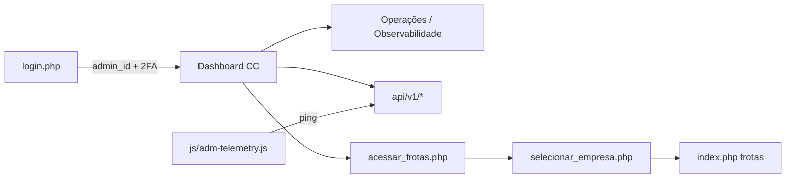

# Control Center ADM (pages_adm)

Painel web interno da **Frotec** — **NOC / Control Center SaaS** para operação multi-cliente: monitoramento em tempo real, KPIs executivos, CRUDs legados (empresas, planos, usuários, financeiro) e configurações de plataforma. Roda no mesmo projeto PHP do sistema de frotas (`/sistema-frotas`), sobre XAMPP (Apache + MySQL).

**URL base (desenvolvimento):** `http://localhost/sistema-frotas/pages_adm/`

---

## Índice

1. [Visão geral](#visão-geral)
2. [Arquitetura](#arquitetura)
3. [Estrutura de pastas](#estrutura-de-pastas)
4. [Menu lateral](#menu-lateral)
5. [Autenticação e sessão](#autenticação-e-sessão)
6. [Layout e UI](#layout-e-ui)
7. [Páginas](#páginas)
8. [APIs JSON](#apis-json)
9. [Bibliotecas (`lib/`)](#bibliotecas-lib)
10. [Modelo de dados](#modelo-de-dados)
11. [Relação empresa_adm × empresa_clientes](#relação-empresa_adm--empresa_clientes)
12. [Telemetria e performance](#telemetria-e-performance)
13. [Modo iframe](#modo-iframe)
14. [Modais e Bootstrap](#modais-e-bootstrap)
15. [Assets (CSS / JS)](#assets-css--js)
16. [Como criar uma nova página](#como-criar-uma-nova-página)
17. [Segurança e boas práticas](#segurança-e-boas-práticas)
18. [Desenvolvimento e validação](#desenvolvimento-e-validação)
19. [Roadmap estratégico (próximos módulos)](#roadmap-estratégico-próximos-módulos)
20. [Documentação relacionada](#documentação-relacionada)

---

## Visão geral

| Aspecto | Detalhe |
|--------|---------|
| **Stack** | PHP 8+ (procedural), MySQL via PDO, HTML/CSS/JS sem build step |
| **Auth ADM** | Tabela `usuarios_adm`, sessão `$_SESSION['admin_id']` |
| **2FA** | TOTP opcional (`two_factor_*` em `usuarios_adm`), login + `conta_adm.php` |
| **Auth frotas** | Sistema principal (`login.php`), sessão `loggedin` + `empresa_id` |
| **Sessão PHP** | Mesmo cookie/nome do frotas via `includes/config.php` (`adm_session.php`) |
| **Isolamento** | ADM gerencia **clientes** (`empresa_adm`); o frotas opera por **empresa_clientes** |
| **Layout** | Sidebar com submenus colapsáveis, header ADM, tema claro/escuro, footer compartilhado |
| **CSS** | `adm-control-center.css` (telas CC) + `adm-pages.css` (legado, modais, shim Bootstrap) |

O painel **não** substitui o login das empresas no `login.php`. É área separada para equipe Frotec / administração da plataforma.

---

## Arquitetura

```
pages_adm/
├── login.php, logout.php, conta_adm.php     → auth (sem layout padrão no login)
├── acessar_frotas.php                       → ponte para selecionar_empresa.php
├── index.php, monitor.php, empresas.php, …  → páginas com layout
├── includes/                                → auth, layout, sidebar, CSRF guard
├── lib/                                     → schema, métricas, eventos, IA, SMTP
├── api/                                     → APIs legadas (CRUD empresas/usuários)
├── api/v1/                                  → APIs JSON do Control Center
├── components/                              → page_header, kpi_card
└── js/                                      → core, charts, telemetry, sidebar flyout

Compartilhado com o projeto:
├── includes/conexao.php, config.php, csrf.php, security.php
├── includes/sf_paths.php, sf_openai_resolve.php
├── css/styles.css, theme.css, adm-pages.css, adm-control-center.css
├── js/sidebar.js, theme.js
└── selecionar_empresa.php
```



---

## Estrutura de pastas

```
pages_adm/
├── README.md
│
├── login.php                    Login ADM (+ etapa 2FA TOTP)
├── logout.php                   Encerra sessão PHP inteira
├── conta_adm.php                2FA da conta admin
├── acessar_frotas.php           Ponte ADM → sistema de frotas
│
├── index.php                    Dashboard executivo (KPIs via API)
├── monitor.php                  Sessões ativas ao vivo
├── saude.php                    Health checks NOC
│
├── empresas.php                 CRUD empresas + modais (financeiro, log, usuários)
├── planos.php                   CRUD planos de cobrança
├── usuarios.php                 Usuários multi-empresa (sistema frotas)
├── licencas.php                 Gestão de licenças / limites
├── suporte.php                  Modo suporte (impersonação auditada)
│
├── financeiro_executivo.php     MRR, ARR, inadimplência (visão SaaS)
├── posicao_financeira.php       Boletos e pagamentos (também em iframe)
│
├── performance.php              Métricas de requisição (adm_request_metrics)
├── logs.php                     Central de logs / eventos
├── alertas.php                  Alertas operacionais
├── erros.php                    Central de erros PHP
│
├── ia_admin.php                 Painel IA administrativa
├── ia_estatisticas.php          Uso e custos de IA
├── auditoria.php                Trilha de auditoria
├── ia_comercial.php             Insights comerciais (IA)
├── analytics.php                Analytics agregados
│
├── comunicacao.php              E-mail / avisos (SMTP real quando configurado)
├── backup.php                   Status de backup
├── sistema.php                  Info do sistema / versão
├── roadmap.php                  CRUD roadmap de produto
├── log_acessos.php              Auditoria log_acessos (iframe em empresas)
├── seguranca_login.php          reCAPTCHA global do login.php
│
├── includes/
│   ├── adm_auth.php             Exige admin_id, boot schema + perf
│   ├── adm_session.php          Sessão unificada com config.php
│   ├── adm_paths.php            SF_PROJECT_ROOT, sf_project_include()
│   ├── adm_post_guard.php       CSRF em formulários POST + status_saas
│   ├── layout_start.php         HTML head, sidebar, adm-page-content
│   ├── layout_end.php           Scripts globais + $adm_extra_scripts
│   ├── sidebar.php              Menu com submenus colapsáveis
│   └── header_adm.php           Header (título, tema, perfil)
│
├── lib/
│   ├── adm_schema.php           Migrações runtime (CREATE IF NOT EXISTS)
│   ├── adm_api.php              Boot JSON APIs v1 (auth, CSRF)
│   ├── adm_metrics.php          KPIs dashboard / financeiro
│   ├── adm_health.php           Health checks
│   ├── adm_intel.php            Inteligência agregada
│   ├── adm_events.php           Log em adm_eventos
│   ├── adm_ia_usage.php         Registro de uso OpenAI
│   ├── adm_comunicacao.php      Envio SMTP / canais
│   └── adm_perf.php             Hook de performance por requisição
│
├── components/
│   ├── page_header.php          Cabeçalho padrão CC (título, subtítulo, ações)
│   └── kpi_card.php             Card KPI reutilizável
│
├── api/                         APIs legadas (empresas / usuários)
│   ├── get_empresa_cliente_id.php
│   ├── get_empresa_nome.php
│   ├── get_usuarios_empresa.php
│   ├── get_usuario.php
│   ├── salvar_usuario.php
│   └── adm_2fa.php              Setup / confirm / disable 2FA
│
├── api/v1/                      APIs Control Center
│   ├── dashboard_metrics.php
│   ├── finance_metrics.php
│   ├── monitor_sessions.php
│   ├── health_status.php
│   ├── performance.php
│   ├── logs_stream.php
│   ├── alerts.php
│   ├── errors.php
│   ├── intel.php
│   ├── ia_stats.php
│   ├── ia_admin_analyze.php
│   ├── system_info.php
│   └── telemetry_ping.php
│
└── js/
    ├── adm-core.js              Fetch API base, helpers CC
    ├── adm-charts.js            Gráficos do dashboard
    ├── adm-telemetry.js         Ping de sessão (painel ADM)
    ├── adm-header.js            Dropdown do perfil
    └── adm-sidebar.js           Flyout de submenu com sidebar recolhida
```

---

## Menu lateral

Definido em `includes/sidebar.php` — seções com dropdown colapsável (`sidebar-dropdown`):

| Seção | Páginas |
|-------|---------|
| **Visão** | Dashboard, Monitor ao vivo, Saúde (NOC) |
| **Operações** | Empresas, Planos, Usuários, Licenças, Modo suporte |
| **Financeiro** | Financeiro SaaS, Posição financeira |
| **Observabilidade** | Performance, Central de logs, Alertas, Central de erros |
| **Inteligência** | IA administrativa, Estatísticas IA, Auditoria, IA comercial, Analytics |
| **Plataforma** | Comunicação, Backup, Sistema, Roadmap, Minha conta / 2FA, Log de acessos, Login / reCAPTCHA |

Links extras no rodapé do sidebar:

- **Sistema de frotas** → `acessar_frotas.php`
- **Sair** removido do sidebar — logout no **menu do perfil** (header) → `logout.php`

Estado dos dropdowns: `localStorage` chave **`sidebarDropdownsAdm`** (separada do menu do frotas em `js/sidebar.js`).

Com sidebar recolhida: `pages_adm/js/adm-sidebar.js` exibe flyout ao passar o mouse na seção.

---

## Autenticação e sessão

### Login (`login.php`)

- Consulta `usuarios_adm` por e-mail; senha com `password_verify()`.
- Se 2FA ativo (`two_factor_enabled` + `two_factor_confirmed_at` + secret): etapa TOTP antes de concluir.
- Sessão criada: `admin_id`, `admin_nome`, `admin_email`, `empresa_id = 1` (legado).
- Evento em `adm_eventos` via `adm_events.php` quando disponível.
- CSS: `css/login-frotec.css`.

### Sessão unificada (`includes/adm_session.php`)

Usa `configure_session()` de `includes/config.php` — **mesmo nome de cookie** do sistema de frotas. Cuidado ao alternar ADM ↔ frotas na mesma sessão PHP.

### Proteção das páginas (`includes/adm_auth.php`)

```php
require_once __DIR__ . '/includes/adm_auth.php';
// Exige $_SESSION['admin_id']; senão redirect → login.php
// Boot: adm_schema_ensure(), csrf_token_get(), adm_perf_bootstrap()
```

`conexao.php` é carregado no escopo global para `$pdo` ficar disponível na página.

### 2FA (`conta_adm.php` + `api/adm_2fa.php`)

- Setup TOTP com `includes/security.php` (`sf_totp_*`).
- Colunas em `usuarios_adm`: `two_factor_enabled`, `two_factor_secret`, `two_factor_confirmed_at`.
- Login exige código quando 2FA confirmado.

### Logout (`logout.php`)

Destrói a sessão PHP inteira (inclui variáveis do frotas se existirem) e redireciona para `login.php`.

### Acesso ao frotas (`acessar_frotas.php`)

1. Valida sessão ADM.
2. Prepara `loggedin`, `acesso_todas_empresas`; tenta vincular `usuarios` pelo e-mail do admin.
3. Redireciona para `selecionar_empresa.php`.

### CSRF (`includes/adm_post_guard.php`)

Formulários POST em **empresas**, **planos**, **usuários** e similares:

- `adm_csrf_field()` no form
- `adm_csrf_valid_post()` no handler
- `adm_status_saas_normalize()` para lifecycle SaaS

---

## Layout e UI

### Casca padrão

```php
$page_title = 'Título';
// Opcionais:
$adm_body_class = 'minha-classe';
$adm_extra_css = [];                    // URLs extras antes de adm-pages.css
$adm_extra_head = '<style>...</style>';
$adm_extra_scripts = '<script>...</script>';  // antes de </body>
$adm_iframe_mode = false;

require_once __DIR__ . '/includes/layout_start.php';
// conteúdo em .adm-page-content
require_once __DIR__ . '/includes/layout_end.php';
```

### Ordem dos CSS (`layout_start.php`)

1. `styles.css`, `theme.css`, `responsive.css`, `fornc-modern-page.css`
2. `$adm_extra_css` (se houver)
3. `adm-pages.css` — legado, sidebar ADM, modais, **shim Bootstrap** (`.btn`, `.badge`, `.table` em `.adm-page-content`)
4. `adm-control-center.css` — KPIs CC, grids, painéis NOC

### Scripts globais (`layout_end.php`)

| Script | Função |
|--------|--------|
| `js/theme.js` | Tema claro/escuro |
| `js/sidebar.js` | Sidebar recolhível + dropdowns ADM |
| `pages_adm/js/adm-header.js` | Perfil no header |
| `pages_adm/js/adm-telemetry.js` | Ping de sessão ativa |
| `pages_adm/js/adm-sidebar.js` | Flyout com sidebar recolhida |
| `$adm_extra_scripts` | Por página (ex.: `adm-charts.js`, Bootstrap JS) |

`layout_start.php` injeta `window.__SF_APP_BASE__`, `window.__ADM_API_BASE__`, `window.__ADM_CSRF__`.

### Classes CSS principais

| Classe | Função |
|--------|--------|
| `body.adm-app` | Escopo do painel ADM |
| `.adm-page-content` | Área de conteúdo principal |
| `.adm-cc-*` | Componentes Control Center (KPI, seção, dashboard) |
| `.adm-kpi-grid` / `.adm-kpi` | Cards legados |
| `.adm-panel` | Painéis com cabeçalho e corpo |
| `.adm-toolbar` | Barra título + ação (empresas, planos) |
| `.action-icons` / `.action-icon` | Ícones de ação na tabela (empresas, planos) |
| `.adm-modal-dialog--form` | Modais largos com grid 2 colunas |
| `.adm-modal-legacy` | Modais sem Bootstrap (usuários, financeiro legado) |
| `.table-container` | Container de tabela legada |

---

## Páginas

### Visão

| Arquivo | Descrição |
|---------|-----------|
| `index.php` | Dashboard executivo — KPIs clientes, financeiro, uso; dados via `api/v1/dashboard_metrics.php` + `adm-charts.js` |
| `monitor.php` | Sessões ativas (`adm_sessoes_ativas`), mapa/lista ao vivo |
| `saude.php` | Health checks (`adm_health_checks`), status de serviços |

### Operações (CRUD legado + CC)

| Arquivo | Descrição |
|---------|-----------|
| `empresas.php` | CRUD `empresa_adm`, plano, `status_saas`, acesso seguro; modais Bootstrap JS (sem CSS CDN); iframes financeiro/log; CRUD usuários via API |
| `planos.php` | CRUD `adm_planos` (pacote/avulso, limites, valores); `action-icons`; eventos em `adm_eventos` |
| `usuarios.php` | Usuários `usuarios` + `empresa_clientes`; modais `.adm-modal-legacy` |
| `licencas.php` | Limites e licenciamento por empresa |
| `suporte.php` | Modo suporte com trilha em `adm_auditoria_suporte` |

### Financeiro

| Arquivo | Descrição |
|---------|-----------|
| `financeiro_executivo.php` | MRR, ARR, receita, inadimplência (`api/v1/finance_metrics.php`) |
| `posicao_financeira.php` | `adm_boletos`, `adm_pagamentos`; KPIs; geração/registro/estorno; iframe com `?empresa_id=` |

### Observabilidade

| Arquivo | Descrição |
|---------|-----------|
| `performance.php` | `adm_request_metrics` — rotas lentas, por módulo |
| `logs.php` | Stream de `adm_eventos` |
| `alertas.php` | `adm_alertas` — regras, prioridade, status |
| `erros.php` | Agregação de erros PHP / aplicação |

### Inteligência

| Arquivo | Descrição |
|---------|-----------|
| `ia_admin.php` | Análises administrativas (`api/v1/ia_admin_analyze.php`) |
| `ia_estatisticas.php` | Uso de tokens / custo (`adm_ia_usage`) |
| `auditoria.php` | Eventos e ações sensíveis |
| `ia_comercial.php` | Insights comerciais |
| `analytics.php` | Métricas de uso agregadas |

### Plataforma

| Arquivo | Descrição |
|---------|-----------|
| `comunicacao.php` | Envio e-mail/aviso via `adm_comunicacao_dispatch()` (SMTP quando configurado) |
| `backup.php` | Status e orientações de backup |
| `sistema.php` | Info servidor / PHP / versão (`api/v1/system_info.php`) |
| `roadmap.php` | CRUD `adm_roadmap` |
| `conta_adm.php` | 2FA TOTP do admin |
| `log_acessos.php` | Filtros em `log_acessos`; iframe em empresas |
| `seguranca_login.php` | reCAPTCHA global do `login.php` (`sf_sistema_login_config_save`) |

### Campo `status_saas` (`empresa_adm`)

Valores: `trial`, `ativa`, `bloqueada`, `cancelada`, `suspensa` — editável em **Empresas**.

---

## APIs JSON

### Legadas (`pages_adm/api/`)

Exigem `$_SESSION['admin_id']`; caso contrário **401**.

| Arquivo | Método | Descrição |
|---------|--------|-----------|
| `get_empresa_cliente_id.php` | GET | `empresa_clientes.id` a partir de `empresa_adm_id`; cria se faltar |
| `get_empresa_nome.php` | GET | Razão social para modais |
| `get_usuarios_empresa.php` | GET | Usuários da empresa cliente |
| `get_usuario.php` | GET | Dados de um usuário |
| `salvar_usuario.php` | POST | Criar/atualizar usuário |
| `adm_2fa.php` | POST | Setup, confirmar, desativar 2FA |

### Control Center (`pages_adm/api/v1/`)

Boot via `lib/adm_api.php` → `adm_api_boot()`:

| Arquivo | Descrição |
|---------|-----------|
| `dashboard_metrics.php` | KPIs do dashboard executivo |
| `finance_metrics.php` | MRR, ARR, inadimplência |
| `monitor_sessions.php` | Sessões ativas |
| `health_status.php` | Últimos health checks |
| `performance.php` | Métricas de requisição |
| `logs_stream.php` | Eventos recentes |
| `alerts.php` | Alertas abertos |
| `errors.php` | Erros agregados |
| `intel.php` | Dados de inteligência |
| `ia_stats.php` | Estatísticas de IA |
| `ia_admin_analyze.php` | Análise IA sob demanda |
| `system_info.php` | Info do sistema |
| `telemetry_ping.php` | Ping de sessão (frotas + ADM) |

**Convenções:** `Content-Type: application/json`, `{ "success": true, "data": ... }`, prepared statements, `error_log()` no servidor.

---

## Bibliotecas (`lib/`)

| Arquivo | Responsabilidade |
|---------|------------------|
| `adm_schema.php` | `adm_schema_ensure()` — tabelas CC, colunas `status_saas`, 2FA em `usuarios_adm` |
| `adm_api.php` | Auth + CSRF para APIs v1 |
| `adm_metrics.php` | Cálculo de KPIs (dashboard, financeiro) |
| `adm_health.php` | Probes de saúde (DB, disco, etc.) |
| `adm_intel.php` | Agregações para telas de inteligência |
| `adm_events.php` | `adm_event_log()` → `adm_eventos` |
| `adm_ia_usage.php` | Registro de chamadas IA; espelhado em `includes/sf_openai_resolve.php` |
| `adm_comunicacao.php` | `adm_comunicacao_dispatch()` — SMTP via `sf_smtp_send` |
| `adm_perf.php` | Medição de duração/memória por request |

---

## Modelo de dados

### Tabelas legadas (pré-CC)

| Tabela | Uso |
|--------|-----|
| `usuarios_adm` | Login ADM + 2FA |
| `empresa_adm` | Empresas contratantes |
| `empresa_clientes` | Tenant no frotas (`empresa_adm_id`) |
| `adm_planos` | Planos de cobrança |
| `adm_boletos` / `adm_pagamentos` | Financeiro por cliente |
| `usuarios` | Usuários do frotas (gestão global) |
| `log_acessos` | Auditoria de login |
| `veiculos`, `motoristas` | Contagens e KPIs |

### Tabelas Control Center (`sql/adm_control_center_foundation.sql`)

| Tabela | Uso |
|--------|-----|
| `adm_eventos` | Log central de eventos |
| `adm_sessoes_ativas` | Telemetria de sessão / monitor |
| `adm_alertas` | Alertas operacionais |
| `adm_health_checks` | Resultados de health check |
| `adm_request_metrics` | Performance por rota |
| `adm_roadmap` | Roadmap de produto |
| `adm_comunicacoes` | Histórico de comunicações |
| `adm_auditoria_suporte` | Modo suporte |
| `adm_ia_usage` | Uso de IA por empresa |

Migração manual:

```bash
mysql -h 127.0.0.1 -P 3307 -u root sistema_frotas < sql/adm_control_center_foundation.sql
```

Runtime também aplica alterações idempotentes via `adm_schema_ensure()`.

---

## Relação empresa_adm × empresa_clientes

```
empresa_adm (contrato Frotec)
    │
    └── empresa_clientes (tenant no sistema de frotas)
            ├── usuarios.empresa_id
            ├── veiculos.empresa_id
            └── … dados operacionais
```

- Modais em `empresas.php` usam `empresa_adm_id` nas APIs legadas.
- Iframes usam `empresa_clientes.id` em `?empresa_id=`.
- `get_empresa_cliente_id.php` pode criar `empresa_clientes` automaticamente.

---

## Telemetria e performance

| Origem | Destino | Intervalo |
|--------|---------|-----------|
| `pages_adm/js/adm-telemetry.js` | `api/v1/telemetry_ping.php` | ~30s (painel ADM) |
| `js/adm-telemetry.js` (frotas, via footer) | `api/v1/telemetry_ping.php` | ~30s (usuários frotas) |
| `lib/adm_perf.php` | `adm_request_metrics` | Cada request (hook em `adm_auth.php` / `config.php`) |

Dados alimentam **Monitor**, **Performance** e KPIs de uso no dashboard.

---

## Modo iframe

Ativado quando:

- `$adm_iframe_mode = true`, ou
- `$_GET['empresa_id']` presente, ou
- Header `Sec-Fetch-Dest: iframe`.

Comportamento: `body.adm-iframe-mode` — sem sidebar/header; conteúdo em `.adm-iframe-content`. Usado nos modais de **Empresas** (financeiro e log).

---

## Modais e Bootstrap

**Importante:** o **CSS do Bootstrap 5 não é carregado globalmente** no ADM (conflitava com o menu lateral — sublinhados, ícones desalinhados).

| Abordagem | Onde |
|-----------|------|
| **Bootstrap JS only** | `empresas.php`, `planos.php` — `bootstrap.bundle.min.js` para modais (`data-bs-toggle`, `bootstrap.Modal`) |
| **Shim CSS** | `css/adm-pages.css` — `.btn`, `.badge`, `.table`, `.alert`, utilitários dentro de `.adm-page-content` |
| **Classes nativas CC** | Telas novas — `.adm-cc-btn`, `.adm-panel`, etc. |
| **Modais legados** | `usuarios.php`, partes de `posicao_financeira.php` — `.adm-modal-legacy` |

Modal financeiro em empresas: `modal-fullscreen`, portal para `document.body` via JS.

Coluna **Ações** nas tabelas legadas: `.action-icons` com `.action-icon` (view, edit, money, log, user, delete).

---

## Assets (CSS / JS)

| Arquivo | Escopo |
|---------|--------|
| `css/adm-control-center.css` | Dashboard CC, KPIs, monitor, NOC |
| `css/adm-pages.css` | Sidebar ADM, modais, shim Bootstrap, action-icons, tabelas legadas |
| `css/login-frotec.css` | `login.php` ADM |
| `pages_adm/js/adm-core.js` | Helpers fetch / API base |
| `pages_adm/js/adm-charts.js` | Gráficos do dashboard |
| `pages_adm/js/adm-telemetry.js` | Ping sessão ADM |
| `pages_adm/js/adm-sidebar.js` | Flyout submenu recolhido |
| `pages_adm/js/adm-header.js` | Dropdown perfil |

Versionamento: `sf_asset_v()` nas URLs.

---

## Como criar uma nova página

1. Criar `pages_adm/minha_pagina.php`.
2. Template mínimo:

```php
<?php
require_once __DIR__ . '/includes/adm_auth.php';

$page_title = 'Minha página';
require_once __DIR__ . '/includes/layout_start.php';

$cc_title = 'Título';
$cc_subtitle = 'Descrição';
include __DIR__ . '/components/page_header.php';
?>

<div class="adm-panel">
    <div class="adm-panel__head"><h2>Conteúdo</h2></div>
    <div class="adm-panel__body"><!-- … --></div>
</div>

<?php require_once __DIR__ . '/includes/layout_end.php'; ?>
```

3. Adicionar em `includes/sidebar.php` no array `$adm_nav`.
4. API nova: `pages_adm/api/v1/minha_api.php` com `require_once '../lib/adm_api.php'; adm_api_boot();`
5. Estilos: preferir `adm-control-center.css` ou escopo em `adm-pages.css` — **não** importar Bootstrap CSS global.

---

## Segurança e boas práticas

- Prepared statements com placeholders nomeados — nunca concatenar SQL.
- ADM tem visão **global** da plataforma; validar IDs antes de alterar dados.
- Não expor `$e->getMessage()` ao usuário; `error_log()` + mensagem genérica.
- Segredos: env `SF_*` ou banco mascarado (`includes/security.php`).
- `logout.php` destrói sessão inteira — cuidado ao alternar ADM ↔ frotas.
- POST mutável: CSRF via `adm_post_guard.php` ou `adm_api_boot(true)`.
- 2FA recomendado para contas `usuarios_adm` em produção.

---

## Desenvolvimento e validação

### Lint PHP

```bash
C:\xampp\php\php.exe -l pages_adm\planos.php
C:\xampp\php\php.exe -l pages_adm\api\v1\dashboard_metrics.php
```

### Acesso local

1. MySQL na porta configurada (ex.: **3307**).
2. Usuário em `usuarios_adm` com senha bcrypt.
3. Aplicar migração CC se necessário: `sql/adm_control_center_foundation.sql`
4. `http://localhost/sistema-frotas/pages_adm/login.php`

### Checklist após alterações

- [ ] Login ADM (+ 2FA se ativo) → `index.php`
- [ ] Tema claro/escuro no sidebar e conteúdo
- [ ] Menu lateral: submenus corretos, sem sublinhado estranho
- [ ] `empresas.php` / `planos.php`: tabela, badges e action-icons alinhados
- [ ] Modais abrem (Bootstrap JS); iframe financeiro em tela cheia
- [ ] Dashboard carrega KPIs (rede → `api/v1/dashboard_metrics.php`)
- [ ] **Sistema de frotas** → `selecionar_empresa.php`
- [ ] Logout pelo menu do perfil
- [ ] Telemetria: ping em `adm_sessoes_ativas` (Monitor)

---

## Roadmap estratégico (próximos módulos)

O painel já opera como **Control Center** (monitoramento, KPIs, CRUDs, telemetria, IA básica). O próximo salto não é só “mais páginas”, mas uma **camada de análise e ação** — aproximando o ADM de plataformas como **Azure Portal**, **Datadog**, **Grafana**, **Stripe**, **Vercel** e **Cloudflare**.

Referências de inspiração:

| Plataforma | O que emprestar |
|------------|-----------------|
| Azure / Vercel | Deploy, ambientes, rollback, histórico de releases |
| Datadog / Grafana | SQL em tempo real, APIs, SLA, heatmaps |
| Stripe | Licenciamento, custos, receita, upgrades |
| Cloudflare | Segurança premium, IPs, bots, firewall |

### Módulos implementados

| Módulo | Status | Arquivos |
|--------|--------|----------|
| Deploy | ✅ | `deploy.php`, `api/v1/deploy.php`, `adm_deploys` |
| Roadmap de produto | ✅ | `roadmap.php`, `adm_roadmap` |
| Banco de dados | ✅ | `banco.php`, `api/v1/db_overview.php` |
| SQL ao vivo | ✅ | `sql_monitor.php`, `api/v1/sql_stream.php` |
| Jobs / Cron | ✅ | `jobs.php`, `api/v1/jobs.php`, `adm_cron_*` |
| APIs externas | ✅ | `apis.php`, `api/v1/integrations_health.php` |
| Licenciamento | ✅ | `licenciamento.php`, `api/v1/licensing.php` |
| Storage | ✅ | `storage.php`, `api/v1/storage_metrics.php` |
| IA desenvolvedor | ✅ | `ia_dev.php`, `api/v1/ia_code_audit.php` |
| Dependências | ✅ | `dependencias.php`, `api/v1/dependencies.php` |
| Segurança NOC | ✅ | `seguranca_premium.php`, `api/v1/security_overview.php` |
| Painel comercial | ✅ | `comercial.php`, `api/v1/commercial_metrics.php` |
| Health Score | ✅ | `health_score.php`, `api/v1/company_health_score.php` |
| Heatmap | ✅ | `heatmap.php`, `api/v1/usage_heatmap.php` |
| Timeline | ✅ | `timeline.php`, `api/v1/timeline.php` |
| Config hub | ✅ | `configuracoes_cc.php`, `api/v1/platform_config.php` |
| Mapa clientes | ✅ | `mapa_clientes.php`, `api/v1/clients_geo.php` |
| Custos plataforma | ✅ | `custos.php`, `api/v1/platform_costs.php` |
| SLA | ✅ | `sla.php`, `api/v1/sla_metrics.php` |
| Benchmark | ✅ | `benchmark.php`, `api/v1/benchmark.php` |
| Marketplace | ✅ | `marketplace.php`, `api/v1/marketplace.php` |
| Licenciamento básico (legado) | ✅ | `licencas.php` → redireciona para `licenciamento.php` |

Legenda: ✅ implementado · 🟡 parcial · 🔴 pendente

> **Atualização jun/2026:** os 20 módulos do backlog P0–P3 foram implementados (páginas + APIs v1 + schema `adm_control_center_phase2.sql`).

> **Fase 3 (completude):** CRUD de custos (`adm_custos_mensais` + UI em `custos.php`), config editável (`adm_platform_config` em `configuracoes_cc.php`), licenciamento com batch storage/API, jobs via `php` CLI, timeline paginada com filtro, marketplace paginado, mapa com fallback por estado, IA dev com scan CSS/JS/orfãos, heatmap configurável (`heatmap_days`). Migração: `sql/adm_control_center_phase3.sql`. Rollback git automático só com `SF_ADM_AUTO_ROLLBACK=1` (dev).

> **Fase 4:** Empresas com cidade/UF e health score na lista; log upgrade/downgrade de plano + sync `adm_licenca_limites`; favoritos no menu (localStorage); banco com painel de índices sugeridos; marketplace com busca; APIs `deploy_history`, `deploy_rollback`, `db_index_suggestions`; Chart.js destroy antes de recriar gráficos.

### Prioridade estratégica (visão do produto)

Investimento recomendado **antes** de expandir CRUDs:

1. 🤖 **IA para auditoria** de código e infraestrutura  
2. 📈 **Score de saúde** por empresa (financeiro, uso, segurança, desempenho)  
3. 🧠 **Sugestões automáticas** de melhoria e upgrade  
4. 🚀 **Central de Deploy** (versão, rollback, commits)  
5. 🗄️ **Observabilidade de banco** (slow queries, índices, locks)  
6. 🔌 **Monitor de APIs externas** (latência, limite, falhas)  
7. 💰 **Custos da plataforma** (IA, SMTP, servidor, maps)  
8. 📊 **SLA** e disponibilidade em tempo real  
9. 🛒 **Marketplace** de módulos por empresa (futuro)

---

### Backlog detalhado — 20 módulos

Cada item inclui **página sugerida**, **menu** e **dependências** para implementação futura.

#### ⭐⭐⭐⭐⭐ 1. Central de Deploy — **P0 · prioridade nº 1**

> Hoje existe **Roadmap** (planejamento de produto), mas não **Deploy** (o que foi para produção).

| Campo | Exemplo |
|-------|---------|
| Ambientes | Produção · Homologação · Desenvolvimento |
| Versão atual | `2.4.8` |
| Último deploy | Ontem · 32s · Victor · 84 arquivos · banco atualizado: SIM |
| Rollback | Disponível / indisponível |
| Commits recentes | Hash · autor · data · mensagem (Git) |

| Implementação | Detalhe |
|---------------|---------|
| Página | `deploy.php` |
| API | `api/v1/deploy_history.php`, `api/v1/deploy_rollback.php` (futuro) |
| Schema | `adm_deploys` (versão, ambiente, autor, duração_ms, git_hash, arquivos, sql_aplicado, meta JSON) |
| Menu | Plataforma → **Deploy** |
| Base atual | `system_info.php` já expõe `git_commit` |

---

#### ⭐⭐⭐⭐⭐ 2. Central de Banco de Dados

Painel dedicado ao MySQL (estilo Azure Database / PlanetScale overview).

| Métricas | Fonte sugerida |
|----------|----------------|
| Tabelas, tamanho total, maior tabela | `information_schema` |
| Consultas lentas | `performance_schema` / slow log |
| Locks, conexões, cache | `SHOW STATUS`, `SHOW PROCESSLIST` |
| Índices faltando, fragmentação | heurísticas + `information_schema.STATISTICS` |
| Auto increment, espaço | por tabela |

| Implementação | Detalhe |
|---------------|---------|
| Página | `banco.php` |
| API | `api/v1/db_overview.php`, `api/v1/db_index_suggestions.php` |
| Lib | `lib/adm_db.php` |
| Menu | Observabilidade → **Banco de dados** |

---

#### ⭐⭐⭐⭐⭐ 3. Monitor SQL em tempo real

Stream de queries (phpMyAdmin + Datadog): `SELECT` / `UPDATE` / `DELETE`, tempo, origem (módulo/rota).

| Implementação | Detalhe |
|---------------|---------|
| Página | `sql_monitor.php` |
| API | `api/v1/sql_stream.php` (polling ou SSE) |
| Schema | `adm_sql_log` (query hash, tipo, duração_ms, rota, empresa_id) |
| Hook | extensão de `adm_perf.php` ou MySQL general log filtrado |
| Menu | Observabilidade → **SQL ao vivo** |

---

#### ⭐⭐⭐⭐⭐ 4. Central de Jobs (Cron)

| Colunas | Ações |
|---------|-------|
| Job · status (executando / fila / pendente / falhou) · duração · última / próxima execução | Reprocessar · Executar agora |

| Implementação | Detalhe |
|---------------|---------|
| Página | `jobs.php` |
| API | `api/v1/jobs.php` |
| Schema | `adm_cron_jobs`, `adm_cron_runs` |
| Base atual | pasta `cron/` e `relatorios_automaticos/` no projeto |
| Menu | Plataforma → **Jobs / Cron** |

---

#### ⭐⭐⭐⭐⭐ 5. Monitor das APIs externas

Integrações: OpenAI, Google, WhatsApp, SMTP, CEP, CNPJ, Google Maps, banco.

| Colunas | API · Status · Tempo · Erro · Limite · Uso hoje |

| Implementação | Detalhe |
|---------------|---------|
| Página | `apis.php` |
| API | `api/v1/integrations_health.php` |
| Schema | `adm_integration_checks` |
| Lib | probes em `lib/adm_health.php` + registro em chamadas existentes |
| Base atual | `saude.php`, `adm_ia_usage`, `adm_comunicacao` (SMTP) |
| Menu | Observabilidade → **APIs externas** |

---

#### ⭐⭐⭐⭐⭐ 6. Centro de Licenciamento (evolução)

Além de veículos: motoristas, usuários, IA, storage, API calls — limite · uso · excedente · valor extra.

| Implementação | Detalhe |
|---------------|---------|
| Página | evoluir `licencas.php` → `licenciamento.php` |
| API | `api/v1/licensing.php` |
| Schema | `adm_licenca_limites` (empresa, recurso, limite, uso, overage_valor) |
| Base atual | `adm_metrics_licencas()`, planos em `adm_planos` |

---

#### ⭐⭐⭐⭐⭐ 7. Storage por empresa

Fotos, documentos, OS, comprovantes, notas — espaço usado / livre por tenant.

| Implementação | Detalhe |
|---------------|---------|
| Página | `storage.php` |
| API | `api/v1/storage_metrics.php` |
| Lib | varrer `uploads/` por `empresa_id` ou tabela de metadados |
| Menu | Operações ou Observabilidade → **Storage** |

---

#### ⭐⭐⭐⭐⭐ 8. IA para programador — “Analisar sistema”

Botão que audita o repositório e responde com:

- Arquivos grandes · funções duplicadas · consultas lentas  
- CSS/JS repetidos · includes iguais · arquivos mortos  
- Possíveis bugs · sugestões

| Implementação | Detalhe |
|---------------|---------|
| Página | `ia_dev.php` ou expandir `ia_admin.php` |
| API | `api/v1/ia_code_audit.php` |
| Lib | scanner estático PHP + prompt OpenAI (`sf_openai_resolve`) |
| Menu | Inteligência → **IA para desenvolvedor** |

---

#### ⭐⭐⭐⭐⭐ 9. Dependências

PHP, Composer, libs (OpenAI SDK, Leaflet, Chart.js, Bootstrap), versão, update disponível, CVEs.

| Implementação | Detalhe |
|---------------|---------|
| Página | `dependencias.php` |
| API | `api/v1/dependencies.php` — `composer.lock`, `package.json` se houver |
| Base atual | `sistema.php` mostra Composer sim/não |
| Menu | Plataforma → **Dependências** |

---

#### ⭐⭐⭐⭐⭐ 10. Segurança Premium

Além do login: ataques hoje, IPs bloqueados, tentativas, bots, crawlers, países, firewall, reCAPTCHA, 2FA.

| Implementação | Detalhe |
|---------------|---------|
| Página | `seguranca_premium.php` |
| API | `api/v1/security_overview.php` |
| Base atual | `login_attempts`, geo-bloqueio, `admin_ip_whitelist` em `includes/security.php` |
| Menu | Plataforma → **Segurança NOC** |

---

#### ⭐⭐⭐⭐⭐ 11. Painel Comercial

Clientes novos/perdidos, upgrade, downgrade, receita nova/perdida, conversão trial.

| Implementação | Detalhe |
|---------------|---------|
| Página | evoluir `ia_comercial.php` + `financeiro_executivo.php` → `comercial.php` |
| API | `api/v1/commercial_metrics.php` |
| Dados | `empresa_adm.status_saas`, histórico de planos, `adm_boletos` |

---

#### ⭐⭐⭐⭐⭐ 12. Score de saúde da empresa

Nota 0–100 por dimensão: segurança, uso, financeiro, performance, treinamento — com explicação IA.

| Implementação | Detalhe |
|---------------|---------|
| Página | `health_score.php` + widget em `empresas.php` |
| API | `api/v1/company_health_score.php` |
| Schema | `adm_empresa_scores` (empresa_adm_id, dimensão, nota, detalhe JSON, calculado_em) |
| Lib | `lib/adm_health_score.php` |

---

#### ⭐⭐⭐⭐⭐ 13. Heatmap de uso

Uso do sistema por dia da semana / hora (gráfico estilo GitHub contributions).

| Implementação | Detalhe |
|---------------|---------|
| Página | widget em `analytics.php` ou `heatmap.php` |
| API | `api/v1/usage_heatmap.php` |
| Dados | `adm_sessoes_ativas`, `log_acessos`, `adm_eventos` |

---

#### ⭐⭐⭐⭐⭐ 14. Timeline unificada

Linha do tempo: empresa criada → login → veículo → OS → pagamento → IA.

| Implementação | Detalhe |
|---------------|---------|
| Página | `timeline.php` (global ou por empresa) |
| API | `api/v1/timeline.php` |
| Base atual | `adm_eventos` + eventos de domínio já logados em CRUDs |
| UI | vertical timeline com filtros por empresa / módulo |

---

#### ⭐⭐⭐⭐⭐ 15. Central de Configuração

Um lugar para: Sistema, Financeiro, SMTP, Google, IA, API, WhatsApp, Login, Backup, Segurança, Mapas, Integrações.

| Implementação | Detalhe |
|---------------|---------|
| Página | `configuracoes_cc.php` |
| API | `api/v1/platform_config.php` (leitura mascarada, escrita com CSRF) |
| Base atual | `seguranca_login.php`, `api/vision_ai_config.php` (frotas), env `SF_*` |
| Menu | Plataforma → **Configurações** (hub com abas) |

---

#### ⭐⭐⭐⭐⭐ 16. Mapa mundial de clientes

Clientes por cidade/estado/país; online/offline; bolinhas no mapa.

| Implementação | Detalhe |
|---------------|---------|
| Página | `mapa_clientes.php` |
| API | `api/v1/clients_geo.php` |
| Lib | Leaflet (já usado no frotas) + `adm_sessoes_ativas` para online |
| Dados | endereço em `empresa_adm` / `empresa_clientes` |

---

#### ⭐⭐⭐⭐⭐ 17. Custos da plataforma

OpenAI, SMTP, servidor, Google Maps → total custo vs receita vs lucro.

| Implementação | Detalhe |
|---------------|---------|
| Página | `custos.php` |
| API | `api/v1/platform_costs.php` |
| Schema | `adm_custos_mensais` (categoria, valor, referencia_mes) |
| Base atual | `adm_ia_usage`, boletos pagos, estimativas manuais |

---

#### ⭐⭐⭐⭐⭐ 18. SLA

Disponibilidade %, tempo parado, tempo de resposta médio, maior pico de usuários.

| Implementação | Detalhe |
|---------------|---------|
| Página | `sla.php` |
| API | `api/v1/sla_metrics.php` |
| Dados | `adm_health_checks`, `adm_request_metrics`, uptime calculado |
| Menu | Observabilidade → **SLA** |

---

#### ⭐⭐⭐⭐⭐ 19. Benchmark entre clientes

Ranking: melhor uso, mais veículos, mais IA, maior faturamento.

| Implementação | Detalhe |
|---------------|---------|
| Página | expandir `analytics.php` → aba Benchmark |
| API | `api/v1/benchmark.php` |
| Lib | agregar `adm_metrics.php` |

---

#### ⭐⭐⭐⭐⭐ 20. Marketplace de módulos (futuro)

Módulos ativáveis por empresa: IA, Financeiro, CT-e, MDF-e, Rastreamento, RH, CRM.

| Implementação | Detalhe |
|---------------|---------|
| Página | `marketplace.php` |
| Schema | `adm_modulos`, `adm_empresa_modulos` (empresa_adm_id, modulo, ativo, desde) |
| Menu | Operações → **Marketplace** |
| Fase | P3 — após licenciamento e score maduros |

---

### Fases sugeridas de implementação

| Fase | Módulos | Objetivo |
|------|---------|----------|
| **P0** | Deploy, DB central, SQL monitor, Jobs | Operação e confiabilidade (estilo Vercel + Datadog) |
| **P1** | APIs externas, Licenciamento+, Storage, SLA | Observabilidade e limites comerciais |
| **P2** | IA dev, Score empresa, Timeline, Heatmap, Custos, Segurança premium | Inteligência e ação |
| **P3** | Config hub, Mapa, Benchmark, Comercial+, Marketplace | Produto completo tipo Stripe / Azure |

### Schema futuro (resumo)

Novas tabelas previstas no backlog (além das já existentes em `adm_control_center_foundation.sql`):

```
adm_deploys
adm_sql_log
adm_cron_jobs / adm_cron_runs
adm_integration_checks
adm_licenca_limites
adm_storage_usage
adm_empresa_scores
adm_custos_mensais
adm_modulos / adm_empresa_modulos
```

Migração sugerida: `sql/adm_control_center_phase2.sql` (quando iniciar P0).

### Menu lateral — visão futura

```
Plataforma
  ├── Deploy          (novo P0)
  ├── Jobs / Cron     (novo P0)
  ├── Dependências    (novo P2)
  ├── Configurações   (hub P2)
  ├── Roadmap         (existente)
  └── …

Observabilidade
  ├── Banco de dados  (novo P0)
  ├── SQL ao vivo     (novo P0)
  ├── APIs externas   (novo P1)
  ├── SLA             (novo P2)
  └── …

Inteligência
  ├── IA desenvolvedor (novo P2)
  ├── Score empresas   (novo P2)
  └── …
```

---

## Documentação relacionada

| Documento | Conteúdo |
|-----------|----------|
| `CLAUDE.md` (raiz) | Arquitetura geral, multi-empresa, segurança frotas |
| `docs/AUDITORIA_CONTROL_CENTER_ADM.md` | Auditoria detalhada do Control Center |
| `sql/adm_control_center_foundation.sql` | Schema CC |
| `includes/security.php` | 2FA, SMTP, reCAPTCHA, políticas |

---

*Última atualização: jun/2026 — Control Center, roadmap estratégico (20 módulos P0–P3), 2FA, telemetria e APIs v1.*
